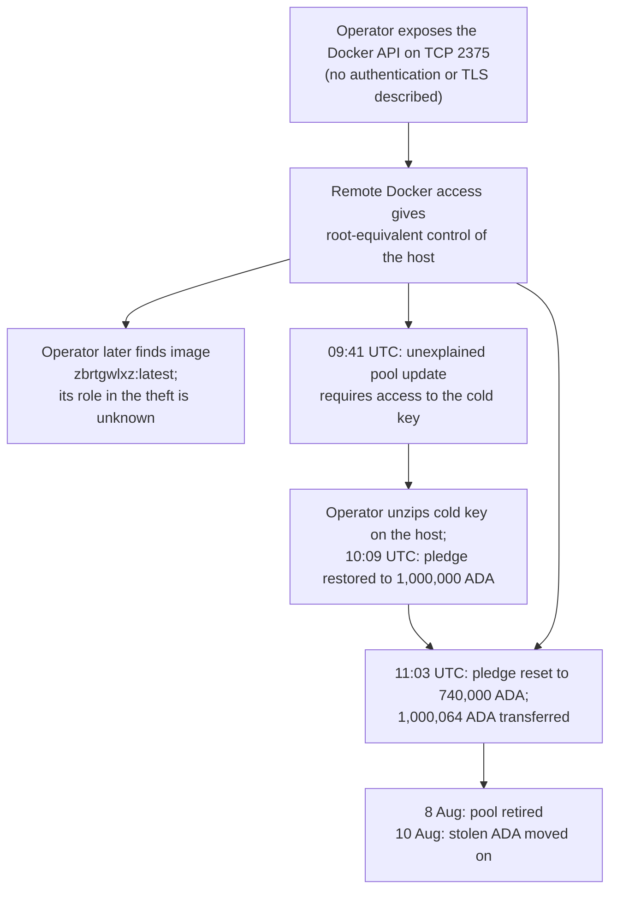
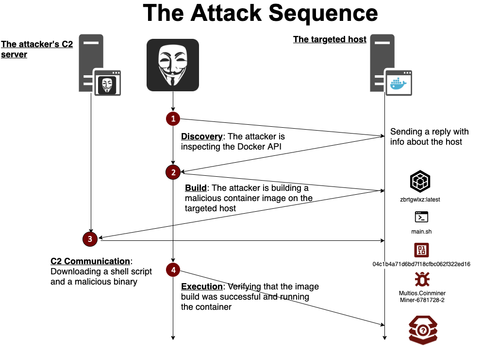

# CID-202001: HAPPY Stake Pool Host Compromise via Exposed Docker Socket

> In August 2020, the operator of the HAPPY stake pool lost 1,000,064 ADA (about USD 142,000 at the time) after exposing the Docker daemon on the block-producing host to the internet. The operator attributed the compromise to that interface after finding the malicious image `zbrtgwlxz:latest`; an attacker-controlled transaction signed with the pool's cold key and the owner's payment and stake keys transferred the funds on 6 August [1][2][3][11][14]. The Cardano protocol was not at fault and delegators' ADA was not exposed, but the pool retired two days later and paid no member rewards [3][4][8]. No recovery has been reported.

## Timeline (UTC)

| Time | Event |
|---|---|
| 2020-07-30 03:10 | Pool `pool1r4rwd64q8xk36m6w2vsq48zfcmfxj0dxypcqdpmy2hnwg9vwv59` is registered with a pledge of 740,000 ADA, five relays under `happycardano.com`, a 2.5% margin and a 400 ADA fixed cost [3][4]. |
| 2020-08-04 15:58 | The owner's funds are consolidated into one output of 1,000,065 ADA at an address under the owner stake key `stake1uxze8p…ye366` [3]. |
| 2020-08-04 16:06 | A pool update certificate raises the pledge to 1,000,000 ADA [3]. The operator later says the 740,000 ADA figure was his pledge "before I add my ITN rewards" [1]. |
| Before 2020-08-06 (date unknown) | While trying to run his node in Docker, the operator opens port 2375 and links it to the Docker socket "so I can access my docker engine from outside easily" [1]. |
| 2020-08-06 09:41 | Transaction `b760eb06…a11864` updates the pool's pledge to 740,000 ADA [3]. The operator sees the pledge "suddenly drop to 740k" but assumes it is a long-lived transaction of his own because he "usually set TTL to 10000" [1]. |
| 2020-08-06, between 09:41 and 10:09 | The operator uploads his password-protected, zipped cold key to the machine and unzips it. He later calls this his "SECOND MISTAKE" [1]. |
| 2020-08-06 10:09 | Transaction `915664ea…590ecb` sets the pledge back to 1,000,000 ADA [1][3]. |
| 2020-08-06 11:03:51 | Transaction `ef8ac1c6…ac2747` (block 4,523,095, epoch 209) again sets the pledge to 740,000 ADA. In the same transaction it sends 1,000,064.188748 ADA to the Byron-era address `Ae2tdPwUPEZ4E2LLYDUrXQ6sRYEP93PjqokepGwCN8TwvXiJKGTJdUpQPNG` [2][3]. The operator identifies this as the transfer "to the hacker's wallet" [1]. |
| 2020-08-06–07 | While investigating, the operator finds the unknown image `zbrtgwlxz:latest` in his Docker image list and links it to Aqua Security's report [1][11]. |
| 2020-08-07 04:37 | The operator publishes "SPOs, Do not repeat my mistakes, Keep your Core Node Safe" on the Cardano Forum [1]. A moderator pins the thread at 06:02 [1]. |
| 2020-08-08 14:59 | A retirement certificate for the pool, effective epoch 210, is recorded on-chain [3][4]. |
| 2020-08-09 08:19 | 500 ADA is withdrawn from the pool's reward account to an address under a different stake key [3]. |

## Impact

The owner address lost 1,000,064.188748 ADA in one transaction [2][3]. At Binance's ADA/USDT price at 11:00 UTC on 6 August 2020 (USD 0.1420 open, USD 0.1429 close), this was about USD 142,000 [14]. Cardanoscan's current USD conversion uses today's price, not the historical price [2]. The operator described the funds as his original 740,000 ADA pledge plus Incentivized Testnet (ITN) rewards [1]; community accounts round the loss to 1,000,000 ADA [6][8].

Delegation does not give a pool control of delegators' ADA, so their principal was not exposed [8]. Koios records 143 delegators and about 70.9 million ADA of active stake in epoch 210, then 72 delegators and about 12.0 million ADA in epoch 211; the pool produced no blocks or member rewards in either epoch [3]. In epoch 209, when the theft occurred, the decentralisation parameter *d* was 1, so federated core nodes made all blocks [3]. The pool retired on 8 August with zero lifetime blocks [4]. Any delegator impact was therefore limited to potential rewards until re-delegation.

No effect on consensus, block production or transaction processing was reported. At least one prospective operator delayed launching a pool, and the incident prompted operators to review their security [1][6][7][10].

Rated SEV-2 (dimension: financial loss of about USD 142,000, within the USD 100,000–999,999 band); potential SEV-2 (dimension: financial loss, because the compromised keys had no authority over delegators' funds or the protocol). Recoverability: not-recoverable, because the stolen ADA moved on and no freeze, return or reimbursement has been reported [1][3].

## Root cause

Figure 1 summarises the compromise path reconstructed from the operator's account and on-chain records.

*Figure 1: Compromise path, reconstructed from the operator's account and on-chain data [1][2][3][4][13]; diagram by the catalogue. When the attacker first obtained the cold key is disputed (see Disputed or open points).*

**Exposed Docker Engine API.** The block producer ran on bare metal at the operator's home; five relays ran on AWS behind UFW. SSH accepted keys only, and the cold key was stored on a USB stick in a password-protected archive [1]. While experimenting with Docker, the operator opened TCP port 2375 to the Docker socket for remote access; his account mentions no TLS or client authentication [1]. Docker warns that anyone able to instruct the daemon has root access to its host and recommends SSH or mutual TLS on TCP 2376 for remote access [13]. The operator later found `zbrtgwlxz:latest` on the host [1]. Aqua Security had documented an image of that name in July 2020: attackers built it from Alpine through exposed Docker APIs, then ran a container that downloaded a shell script and the XMRig miner [11]. Whether that payload stole the HAPPY keys is unknown.

*Figure 2: Attack sequence of the campaign that built `zbrtgwlxz:latest` directly on hosts with an exposed Docker API: discovery through the API, image build on the host, download of a shell script and miner from the attacker's server, and execution. It shows Aqua's July 2020 sample, not the HAPPY host. Source: Aqua Security (Assaf Morag), ["Threat Alert: Attackers Building Malicious Images Directly on Your Host"](https://www.aquasec.com/blog/malicious-container-image-docker-container-host/) [11].*

**Signing keys on the internet-connected host.** The theft transaction had three signatories and carried pool-update and delegation certificates [2][3]. IOHK's 2020 registration flow signed such a transaction with `payment.skey`, `stake.skey` and `cold.skey`, and warned that cold keys should remain offline [12]. The attacker's certificates used the pool's original 740,000 ADA pledge, suggesting that files or scripts from the original registration remained accessible [3]. The operator also said he copied and unzipped the cold key on the compromised host after the first unexplained pledge change [1].

**Incident-response error.** When the pledge first changed, the operator assumed it was a long-lived transaction of his own. Instead of treating the host as compromised, he moved the cold key onto it and re-submitted the higher pledge [1]. The attacker's next transaction reset the pledge and moved all the funds [2][3].

## Detection

The operator detected the incident through the pool's public pledge parameter, not host monitoring [1]. He initially treated the 09:41 change as a stale transaction and realised he was under attack only after the pledge changed again and the funds were gone [1][3]. The intrusion start time is unknown.

## Response and resolution

Within about 18 hours of the theft, the operator disclosed his configuration, mistakes, the theft transaction and the malicious image, and asked peers to check their hosts [1]. Moderators pinned the post, while community members offered donations and delegation if he relaunched [1]. No reimbursement has been reported.

The pool retired instead. A certificate effective in epoch 210 was recorded on 8 August, followed on 9 August by a 500 ADA reward-account withdrawal, matching the pool deposit in epoch 209 [3][4]. The sources do not identify who submitted either transaction.

The stolen ADA moved on 10 August [3]. No exchange, foundation or law-enforcement response, recovery, or incident report from IOHK or the Cardano Foundation is documented in the reviewed sources.

## Remediation and follow-up

- The sources identify host configuration, not Cardano software, as the root cause [1]. Community guidance instead stressed separating the block producer and relays, restricting ports, running neither Docker nor the node as root, keeping only KES and VRF signing keys plus the operational certificate on the server, and signing pool and wallet transactions offline [6][8][9].
- A separate SafeStak scan of 1,080 relays found more than 365 with SSH publicly reachable, 92 of them allowing password authentication; ADABros cited it in incident-prompted guidance [6][7].

## Incident handling assessment

Assessment of the HAPPY pool operator's handling against SOC 2 Trust Services Criteria, based on public sources only (see CLASSIFICATION.md, section 10).

| Criterion | Result | Observation |
|---|---|---|
| CC7.2 Monitoring and detection | Exceptions noted | The operator detected the compromise through the public pledge change rather than host monitoring, after the intrusion had begun [1]. |
| CC7.3 Evaluation of events | Exceptions noted | He attributed the first unexplained pledge change to a stale transaction rather than a key compromise [1][3]. |
| CC7.4 Incident response | Exceptions noted | He copied and unzipped his cold key on the affected host; the funds were transferred about 1 hour 22 minutes after the first signal [1][3]. |
| CC7.5 Recovery | Exceptions noted | The pool retired and the funds were not recovered [3][4]. |
| CC2.3 External communication | No exceptions noted | The operator published a detailed account and warning within about 18 hours [1]. |
| CC8.1 Change management | Exceptions noted | The exposure arose while Docker was being tested on the production block producer, with TCP 2375 opened to the daemon [1]. |

## Lessons for builders

- **Protect the Docker daemon.** Keep it on the Unix socket; for necessary remote access, use an SSH Docker context or mutual TLS on TCP 2376 [13]. Treat daemon access as root access.
- **Keep only operational keys on the block producer.** It needs the KES and VRF signing keys and operational certificate, not cold, payment or stake signing keys [6][12]. Build and sign pool updates and withdrawals offline [9][12].
- **Do not decrypt keys on a suspect host.** The password-protected cold-key archive provided no protection once the operator unzipped it on the compromised machine [1].
- **Treat unexplained pool changes as key compromise.** Isolate the host and move funds using known-clean offline keys; do not re-sign from the affected machine [1][3].
- **Separate experiments from production and monitor on-chain state.** Test new tooling on keyless hosts, and alert on unexpected pool certificates or movements from owner and reward addresses. The operator saw the change but misclassified it [1][3].

## Disputed or open points

- **When was the cold key compromised?** The operator says he uploaded and unzipped it only after the first pledge drop [1], but the 09:41 transaction already carried a pool-update certificate that IOHK's documented flow required the cold key to sign [3][12]. Both unexplained transactions had validity upper bound slot 5,150,400; for the 09:41 transaction this was about 9,800 slots after inclusion, so it was not an old transaction despite the operator's initial assumption [1][2][3]. The sources do not explain how the signer obtained the key before 09:41.
- **How and when was the host breached?** The operator did not say when TCP 2375 was exposed or when `zbrtgwlxz:latest` appeared [1]. Aqua's sample of that image ran a cryptominer [11]; no source establishes whether the same payload, another container, or direct Docker API access was used to obtain the HAPPY keys.
- **Value and composition of the loss:** The chain records 1,000,064.188748 ADA [2][3], while community sources round this to 1,000,000 ADA and press called it "all his reward" [5][6][8]. The operator said the original 740,000 ADA pledge was supplemented with ITN rewards but gave no breakdown [1]. The USD 142,000 estimate uses Binance's 11:00 UTC hourly price; no contemporaneous report supplied a USD value [14].
- **Post-theft transactions:** No source identifies who retired the pool or withdrew its 500 ADA deposit; by then the operator and attacker may both have held the relevant keys [3]. The stolen funds moved on 10 August, but their later destination and any law-enforcement involvement are unknown [3].

## Sources

1. [P] junada ("Jun", HAPPY pool operator), Cardano Forum, "SPOs, Do not repeat my mistakes, Keep your Core Node Safe" (with replies), 2020-08-07. https://forum.cardano.org/t/spos-do-not-repeat-my-mistakes-keep-your-core-node-safe/37766 (archived: https://web.archive.org/web/20210116181304id_/https://forum.cardano.org/t/spos-do-not-repeat-my-mistakes-keep-your-core-node-safe/37766; replies page 2: https://web.archive.org/web/20220310145408id_/https://forum.cardano.org/t/spos-do-not-repeat-my-mistakes-keep-your-core-node-safe/37766?page=2)
2. [P] Cardanoscan, "Transaction ef8ac1c667084018315cd080001a3d62d513afa51f1bcf1847684760afac2747" (on-chain data), 2020-08-06. https://cardanoscan.io/transaction/ef8ac1c667084018315cd080001a3d62d513afa51f1bcf1847684760afac2747
3. [P] Koios (Cardano mainnet chain index), on-chain queries retrieved 2026-10-13: account transactions for `stake1uxze8p5rer004nk9yyyqtqyqky0y3fe3sz75gnrjv7ep80qwye366`; `tx_info` for transactions 8471b7d3…, ec198557…, d92f183d…, b760eb06…, 915664ea…, ef8ac1c6…, 304c2e45…, de0d3213…, 8e0b4259…, f725c52a…; `pool_updates` and `pool_history` for `pool1r4rwd64q8xk36m6w2vsq48zfcmfxj0dxypcqdpmy2hnwg9vwv59`; `address_txs` for `Ae2tdPwUPEZ4E2LLYDUrXQ6sRYEP93PjqokepGwCN8TwvXiJKGTJdUpQPNG`; `epoch_params` for epoch 209, 2020-08-04 to 2020-08-10. https://api.koios.rest/api/v1/account_txs?_stake_address=stake1uxze8p5rer004nk9yyyqtqyqky0y3fe3sz75gnrjv7ep80qwye366 ; https://api.koios.rest/api/v1/pool_history?_pool_bech32=pool1r4rwd64q8xk36m6w2vsq48zfcmfxj0dxypcqdpmy2hnwg9vwv59 ; https://api.koios.rest/api/v1/epoch_params?_epoch_no=209 (other endpoints are POST requests to https://api.koios.rest/api/v1/)
4. [P] Cardanoscan, "Stake Pool pool1r4rwd64q8xk36m6w2vsq48zfcmfxj0dxypcqdpmy2hnwg9vwv59" (registered 2020-07-30, retired 2020-08-08), n.d. https://cardanoscan.io/pool/pool1r4rwd64q8xk36m6w2vsq48zfcmfxj0dxypcqdpmy2hnwg9vwv59
5. [S] CryptoNews.net (republishing NewsLogical), "Korean Cardano Stake Pool Operator Lost all his Reward Transferred to Hacker", 2020-08-10. https://cryptonews.net/news/security/357737/
6. [S] Latheesan (ADABros stake pool), "Back to Basics — Security measures every Cardano Stake Pool Operators should know and implement", 2020-08-10. https://medium.com/@latheesan87/back-to-basics-security-measures-every-cardano-spo-should-know-and-implement-5973a1f80bfe (archived: https://web.archive.org/web/20220205040643id_/https://medium.com/@latheesan87/back-to-basics-security-measures-every-cardano-spo-should-know-and-implement-5973a1f80bfe; forum copy: https://forum.cardano.org/t/back-to-basics-security-measures-every-cardano-stake-pool-operators-should-know-and-implement/38166)
7. [S] {SAFE}STAK (@SafeStak), post on X: "To fellow stake pool operators, please be safe out there! Our simple test across 1080 relay nodes…", 2020-08-09. https://x.com/SafeStak/status/1292580168096272387
8. [S] BEAVR Pool, "Stake Pool Security and What it Means for Stakers", 2020-08-14. https://www.beaver-stake-pool.net/post/stake-pool-security-and-what-it-means-for-stakers
9. [S] Cardano Forum (replies by ADAfrog), "Stake Pool Security", 2020-08-10. https://forum.cardano.org/t/stake-pool-security/38056 (archived: https://web.archive.org/web/20210227005831id_/https://forum.cardano.org/t/stake-pool-security/38056)
10. [S] Cardano Forum, "Postponing our stake pool until hacker issue is solved", 2020-08-08. https://forum.cardano.org/t/postponing-our-stake-pool-until-hacker-issue-is-solved/37937 (archived: https://web.archive.org/web/20210226215143id_/https://forum.cardano.org/t/postponing-our-stake-pool-until-hacker-issue-is-solved/37937)
11. [S] Aqua Security (Assaf Morag, Team Nautilus), "Threat Alert: Attackers Building Malicious Images Directly on Your Host", 2020-07-15. https://www.aquasec.com/blog/malicious-container-image-docker-container-host/
12. [P] IOHK, cardano-node documentation, "Generate your stake pool keys" and "Register a Stake Pool with Metadata" (archived captures of the 2020 documentation), n.d. https://web.archive.org/web/20210126100536id_/https://docs.cardano.org/projects/cardano-node/en/latest/stake-pool-operations/node_keys.html ; https://web.archive.org/web/20210123233306id_/https://docs.cardano.org/projects/cardano-node/en/latest/stake-pool-operations/register_stakepool.html
13. [P] Docker Docs, "Protect the Docker daemon socket", n.d. https://docs.docker.com/engine/security/protect-access/
14. [P] Binance, ADA/USDT hourly klines, 2020-08-06. https://api.binance.com/api/v3/klines?symbol=ADAUSDT&interval=1h&startTime=1596704400000&endTime=1596715200000
