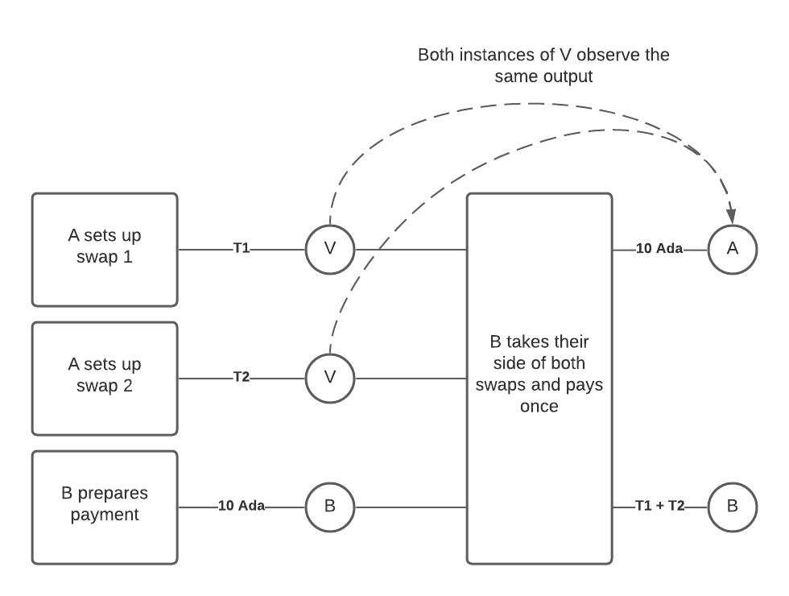
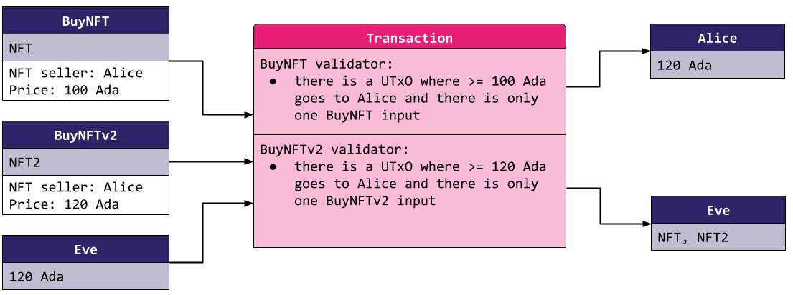
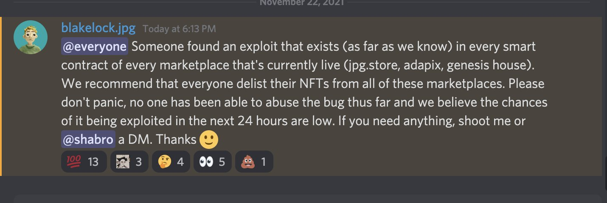

# CID-202101: Marketplace Double-Satisfaction Vulnerability (jpg.store)

> On 22-23 November 2021, about two weeks after launch, the Cardano NFT marketplace jpg.store asked users to delist their NFTs after Vacuumlabs found an exploitable validator flaw [1][12]. The founder's warning named Adapix and Genesis House as also exposed [8]. No exploitation or loss is known [2][13]. jpg.store deployed a replacement contract about 20 hours after its public warning and asked sellers to relist; Genesis House also patched its contract that day [5][9]. The Cardano network was unaffected. jpg.store did not publish the promised post-mortem, so the attribution to double satisfaction rests on related technical accounts rather than a published analysis of its BuySellV1 code [5][11][13][15].

## Timeline (UTC)

| Time | Event |
|---|---|
| 2021-10-18 22:43 | SpaceBudz moves its marketplace to a v2 contract. It says it "found an issue in the current contract" that would "have been fatal in the future" and asks users to delist and relist [7]. It later explains that v1 did not carefully check how many script inputs a transaction may contain [11]. |
| ~2021-11-09 | jpg.store launches on Cardano mainnet. Its 16 Nov 2021 update says it had "officially been one week since we launched" [12]. |
| 2021-11-22 23:29 (no later than) | A community account shares a screenshot of a Discord message from jpg.store founder Blake. The message says an exploit exists "in every smart contract of every marketplace that's currently live (jpg.store, adapix, genesis house)" and recommends delisting [8]. |
| 2021-11-23 00:05 | jpg.store on X: "We recommend that everyone delist their NFTs ... @vacuumlabs found an exploit - it affects @jpgstoreNFT and possibly other Cardano smart contract marketplaces that are currently live, since we're using similar code" [1]. |
| 2021-11-23 00:05 | jpg.store: "no one has been able to abuse the bug thus far and we believe the chances of it being exploited in the next 24 hours are low" [2]. |
| 2021-11-23 01:15 | Replying to users, jpg.store says "Spacebudz also had this issue in the past" and links the SpaceBudz 18 Oct announcement [7]. |
| 2021-11-23 02:04 | jpg.store says it considered adding the ability to delist on users' behalf but did not, because this "could potentially introduce a new exploit and adds some degree of centralization" [3]. |
| 2021-11-23 07:13 | SpaceBudz co-founder Alessandro Konrad says the SpaceBudz marketplace "is secure and does not suffer from the same vulnerability". He quotes a DEADPXLZ post saying neither the SpaceBudz nor the DEADPXLZ explorer is affected [10]. |
| 2021-11-23 12:43 | jpg.store posts a video update from its founder. It asks users to delist if they have not already, because assets must be relisted "on the new contract when it's live" [4]. |
| 2021-11-23 15:41 | Genesis House: "This has been patched on our end! Please relist any smart contract (pink thunderbolt) listings to update contracts" [9]. |
| 2021-11-23 20:14 | jpg.store: "WE SQUASHED THE BUG ... Our new smart contract is live, and it's safe to relist your assets. Stay tuned for a full post-mortem in the coming days" [5]. The team says it "worked tirelessly through the night to get everyone's assets unlisted and audit our new contract" [6]. |
| 2021-12-08 | Canonical LLC (founder Jonathan Fischoff) publishes a PSA. It says that since mid-October every Cardano dApp with public smart contract code "has had a similar exploit in their initial smart contract", names SpaceBudz, jpg.store, Genesis Auction House, Adapix and Martify, and says all have patched [13]. |
| 2021-12-15 | CryptoSlate reports the PSA as an exploit "affecting every Cardano dApp". On 20 Dec it adds that IOHK called it "a known issue that has already been rectified by developers" and changes the headline [14]. |
| 2021-12-17 | Canonical updates the PSA. It rejects the "universal app exploit" framing and links IOG's public "double satisfaction" documentation as the disclosed attack vector [13]. |
| 2022-06-20 | Canonical describes jpg.store's next contract ("V2"). It says the contract was designed specifically to prevent double satisfaction across batched script inputs [16]. |
| 2023-08-09 | jpg.store's contract history says BuySellV1 was abandoned "due to a security vulnerability" and that BuySellV2 carried "a security patch for the vulnerability" [17]. |

## Impact

No loss has been reported. jpg.store said no one had abused the bug [2], and Canonical later wrote that, to its knowledge, none of the affected unspent transaction outputs (UTxOs) had been attacked [13]. No independent on-chain analysis confirming this has been located.

Sellers with open listings on jpg.store's original contract had to delist and relist on the replacement [1][4][5]. jpg.store had no admin path to delist for them [3], so unmigrated assets remained exposed. The founder's message also named Genesis House and Adapix [8], and Genesis House asked users to relist on its patched contract [9]. The number and value of affected listings were not published. The public warning-to-replacement window was 20 hours 45 minutes (about 21 hours), from no later than 2021-11-22 23:29 UTC to 2021-11-23 20:14 UTC [5][8].

Rated SEV-4 (availability: users of a single service had to act and could not safely list for about 21 hours); potential SEV-4 (financial loss: exploitation could underpay sellers, but no source supports a value-at-risk band above SEV-4) [8][15]. Recoverability: extra-resources (a replacement contract had to be deployed and sellers had to migrate their listings) [3][5].

## Root cause

Neither jpg.store nor Vacuumlabs has published the exact defect in the BuySellV1 validator. jpg.store promised "a full post-mortem in the coming days" [5], but we have not found one, and jpg.store's only later public statement calls the flaw "a security vulnerability" [17]. The attribution to double satisfaction rests on three sources:

1. jpg.store said "Spacebudz also had this issue in the past" and linked SpaceBudz's 18 Oct 2021 contract migration [7]. SpaceBudz explained that its v1 issue lay "in not carefully checking, how many script inputs are allowed for the validation". Its validator read only the value of the script input currently being validated and ignored how many script inputs the transaction had, which it called "of course fatal" [11].
2. Canonical's PSA, written by a developer jpg.store called "our teammate Jonathan" [12], lists jpg.store among dApps that had "a similar exploit" [13]. Canonical later pointed to IOG's "double satisfaction" page as the publicly disclosed attack vector [13].
3. Canonical's write-up of jpg.store's next contract treats double satisfaction across multiple script inputs as the central threat that design had to address [16].

**The vulnerability class.** On Cardano's EUTXO ledger, each script-locked input is validated separately, and the transaction is valid only if every validator accepts it [15][18]. A naive listing validator for "sell this NFT for price P to seller S" checks only that the transaction contains *an* output paying at least P to S. IOG's documentation describes the attack: with two such listings by the same seller at the same price, a buyer spends both script outputs but creates only one payment output to the seller. "Both [validators] will see the same output and be satisfied", so the buyer pays 10 ADA against a "true liability" of 20 ADA [15].

*Figure 1: IOG's illustration of double satisfaction. A sets up two swaps (tokens T1 and T2) locked by the same validator V; B takes both and pays A once, and both instances of V observe the same 10 Ada output. The exact BuySellV1 code path was never published, so this shows the vulnerability class, not jpg.store's code. Source: IOG, Plutus documentation, ["Double satisfaction"](https://web.archive.org/web/20221202172159/https://plutus.readthedocs.io/en/latest/reference/writing-scripts/common-weaknesses/double-satisfaction.html) [15].*

Vacuumlabs, which found the jpg.store issue [1], later called double satisfaction "the most commonly found issue during our audits" and documented these variants [18]:

- Banning other inputs with the *same* script hash is not enough. After a contract upgrade, an attacker can combine an old-version input and a new-version input that expect the same payment.
- Minting policies and staking-withdrawal scripts in the same transaction can be satisfied by the same output.
- A single script can be under-paid when the seller is also a fee recipient, unless all obligations to each address are summed before being compared.

*Figure 2: The first variant. Each validator accepts only one input with its own script hash, but an old BuyNFT listing (100 Ada) and a BuyNFTv2 listing (120 Ada) by the same seller can share one transaction, and a single 120 Ada output to the seller satisfies both, so the buyer takes both NFTs. Source: Vacuumlabs Auditing, ["Cardano Vulnerabilities #2 — Double Satisfaction continued"](https://medium.com/@vacuumlabs_auditing/cardano-vulnerabilities-2-double-satisfaction-continued-a66043d025c0) [18].*

IOG summarised the core problem: "validators only *validate*, rather than *doing* things", so whether a payment was meant for a particular validator "is ambiguous" [15].

## Detection

Vacuumlabs found the issue and reported it to jpg.store about two weeks after the marketplace launched [1][12]. How and when it was found is not public. SpaceBudz had already disclosed and fixed a related multiple-input defect on 18 October [7][11].

## Response and resolution

The founder warned users on Discord, followed by jpg.store on X, without describing the flaw [1][8]. With no admin delist path, containment depended on sellers acting; jpg.store rejected adding one during the incident because it could introduce another exploit and greater centralisation [3]. Its later statement that the team worked overnight "to get everyone's assets unlisted" did not explain what that work involved [6].

*Figure 3: The founder's Discord announcement naming jpg.store, Adapix and Genesis House, as shared on X at 23:29 UTC on 22 November 2021. Source: DORI (@DoriDigital), [post on X](https://x.com/DoriDigital/status/1462926303909355526) [8].*

jpg.store's replacement contract went live at 20:14 UTC on 23 November, and users were told to relist [4][5]. Genesis House had patched and issued the same instruction by 15:41 UTC [9]. SpaceBudz and DEADPXLZ said their then-current marketplaces were not affected [10], while Canonical later said every affected dApp it knew of had patched [13].

Canonical privately alerted SundaeSwap, MLabs, Well-Typed and IOHK while vulnerable UTxOs remained [13].

## Remediation and follow-up

- jpg.store moved away from BuySellV1. Its 2023 contract history says BuySellV2 contained a security patch and gives its mainnet address as `addr1w999n67e86jn6xal07pzxtrmqynspgx0fwmcmpua4wc6yzsxpljz3` [17]. The source does not establish that this named version was the replacement deployed on 23 November 2021.
- A later jpg.store contract designed with Canonical supported safe batched purchases by merging the payouts owed across all input datums, making only the first sorted input perform validation, and rejecting transactions containing unknown scripts [16].
- IOG documented double satisfaction as a common Plutus weakness and described unique outputs and banning other scripts as mitigations [15].

## Incident handling assessment

Assessment of the responsible party's handling (jpg.store) against SOC 2 Trust Services Criteria, based on public sources only (see CLASSIFICATION.md, section 10).

| Criterion | Result | Observation |
|---|---|---|
| CC7.2 Monitoring and detection | Exceptions noted | Vacuumlabs, rather than jpg.store's monitoring, found the flaw while the contract was live; sources do not establish whether Vacuumlabs was engaged by jpg.store [1][12]. A related defect had been disclosed by SpaceBudz before jpg.store launched [7][11]. |
| CC7.3 Evaluation of events | No exceptions noted | jpg.store told users to delist, warned that marketplaces using similar code might be affected and gave an estimate of near-term exploitation risk [1][2][8]. |
| CC7.4 Incident response | No exceptions noted | The team warned users and deployed a replacement contract about 20 hours later; containment necessarily relied on sellers because no admin delist path existed [1][3][5]. |
| CC7.5 Recovery | No exceptions noted | Service resumed on a replacement contract on 23 November [5]. jpg.store later described BuySellV2 as containing a security patch, and its 2022 contract was designed against double satisfaction [16][17]. |
| CC2.3 External communication | Exceptions noted | Users were warned on Discord and X [1][8], but jpg.store published no technical account and its promised post-mortem has not been found [5][17]. |
| CC8.1 Change management | Not evidenced | BuySellV1 launched about two weeks before disclosure, but public sources do not describe its pre-launch review, testing or approval [12][17]. |

## Lessons for builders

- **Do not treat one matching output as proof that one obligation was paid.** Sum every obligation per payee across relevant inputs, as Canonical's later jpg.store contract did, or bind each input to a unique output [15][16][18].
- **Restricting inputs by only your current script hash is insufficient.** Old contract versions, other validators, minting policies and staking withdrawals may reuse the same output. A restrictive design must account for all of them, at the cost of composability [15][18].
- **Sum overlapping roles before comparison.** If one address receives both the sale price and a royalty or fee, validate the combined amount owed [18].
- **Ensure every safety check is evaluated.** SpaceBudz reported that Haskell laziness allowed an input-count guard to go unevaluated on some branches until it forced evaluation with bang patterns [11].
- **Plan migrations for UTxOs at obsolete addresses.** A new validator does not protect assets left at the old address, and old and new inputs can be combined in a cross-version attack [18]. With no admin path, jpg.store depended on each seller migrating [3].
- **Test whole adversarial transactions.** Transactions containing multiple script UTxOs for one payee, old and new validator versions, mints or withdrawals should fail unless every combined obligation is paid [15][18].

## Disputed or open points

- **Exact defect.** Neither jpg.store nor Vacuumlabs published the BuySellV1 code path or a proof of concept. The double-satisfaction attribution rests on jpg.store's comparison with SpaceBudz [7][11], Canonical's account [13] and IOG's description of the attack vector [15].
- **SpaceBudz's status.** Canonical lists SpaceBudz among dApps whose initial contract was affected [13], while its co-founder said on 23 November that its marketplace did not have the vulnerability [10]. These accounts may refer respectively to the retired v1 and then-current v2 contracts, but no source explicitly reconciles them.
- **Value at risk.** No source quantifies the affected listings or establishes whether every seller migrated. This prevents a potential-severity rating above SEV-4.
- **Discovery.** Sources do not say whether Vacuumlabs found the issue during an engagement or independently, or when it first notified jpg.store.
- **Delisting work.** jpg.store said it could not delist for users [3] but later said the team worked overnight "to get everyone's assets unlisted" [6]; it did not explain how.

## Sources

1. [P] jpg.store, "We recommend that everyone delist their NFTs ... @vacuumlabs found an exploit" (X post), 2021-11-23. https://x.com/jpgstoreNFT/status/1462935207242260482
2. [P] jpg.store, "Don't panic, no one has been able to abuse the bug thus far" (X post), 2021-11-23. https://x.com/jpgstoreNFT/status/1462935294152429573
3. [P] jpg.store, "We've thought about adding the ability for us to delist on users behalf" (X reply), 2021-11-23. https://x.com/jpgstoreNFT/status/1462965270432010243
4. [P] jpg.store, "Quick update on the smart contract exploit from our founder" (X post), 2021-11-23. https://x.com/jpgstoreNFT/status/1463126042848210947
5. [P] jpg.store, "WE SQUASHED THE BUG ... Our new smart contract is live" (X post), 2021-11-23. https://x.com/jpgstoreNFT/status/1463239667428605961
6. [P] jpg.store, "The past 24 hours has been stressful for the entire team" (X post), 2021-11-23. https://x.com/jpgstoreNFT/status/1463239668997238786
7. [P] jpg.store, "Spacebudz also had this issue in the past" (X reply quoting SpaceBudz, 2021-10-18), 2021-11-23. https://x.com/jpgstoreNFT/status/1462953030807011328
8. [S] DORI (@DoriDigital), screenshot of jpg.store founder's Discord announcement (X post), 2021-11-22. https://x.com/DoriDigital/status/1462926303909355526
9. [P] Genesis House, "This has been patched on our end!" (X reply), 2021-11-23. https://x.com/GenesisHouseIO/status/1463170974703132683
10. [P] Alessandro Konrad (SpaceBudz), "The @spacebudzNFT marketplace is secure and does not suffer from the same vulnerability" (X post, archived), 2021-11-23. https://web.archive.org/web/20211123150552/https://twitter.com/berry_ales/status/1463043105674993664
11. [P] SpaceBudz, "SpaceBudz-Market: A contract based market place on Cardano" (archived), 2021-10-25. https://web.archive.org/web/20211127163934/https://spacebudz.medium.com/spacebudz-market-71e79d1bbf34
12. [P] jpg.store, "Weekly Technical Update #1 — Bug Fixes & Auto-healing" (archived), 2021-11-16. https://web.archive.org/web/20211116043618/https://medium.com/@jpgstorenft/weekly-technical-update-1-bug-fixes-auto-healing-%EF%B8%8F-3d6a4277234
13. [P] Canonical LLC (Jonathan Fischoff), "PSA: Do This and Prevent Your dApp from Getting Hacked" (archived; updated 2021-12-17), 2021-12-08. https://web.archive.org/web/20230203101036/https://www.canonicalllc.com/post/psa-do-this-and-prevent-your-dapp-from-getting-hacked
14. [S] CryptoSlate, "Cardano community responds to previously fixed dApp issue" (updated 2021-12-20), 2021-12-15. https://cryptoslate.com/cardano-community-unfazed-by-the-discovery-of-a-universal-dapp-exploit/
15. [P] IOG, Plutus documentation, "Double satisfaction" (archived snapshot; page undated), 2022-12-02. https://web.archive.org/web/20221202172159/https://plutus.readthedocs.io/en/latest/reference/writing-scripts/common-weaknesses/double-satisfaction.html
16. [P] Canonical LLC (Jonathan Fischoff), "A Deep Dive Into the New V2 jpg.store Smart Contract" (archived), 2022-06-20. https://web.archive.org/web/20231003025239/https://www.canonicalllc.com/post/a-deep-dive-into-the-new-v2-jpg-store-smart-contract
17. [P] jpg.store, "Unveiling the Next-Gen Smart Contract Update for jpg.store", 2023-08-09. https://medium.com/@jpgstorenft/unveiling-the-next-gen-smart-contract-update-for-jpg-store-2f883c913979
18. [S] Vacuumlabs Auditing, "Cardano Vulnerabilities #2 — Double Satisfaction continued", 2023-07-25. https://medium.com/@vacuumlabs_auditing/cardano-vulnerabilities-2-double-satisfaction-continued-a66043d025c0
