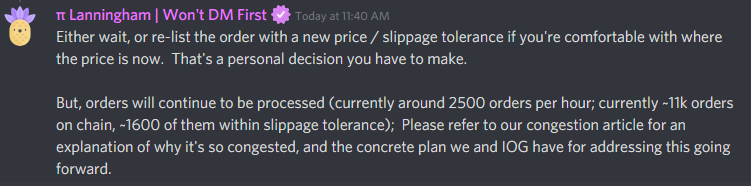
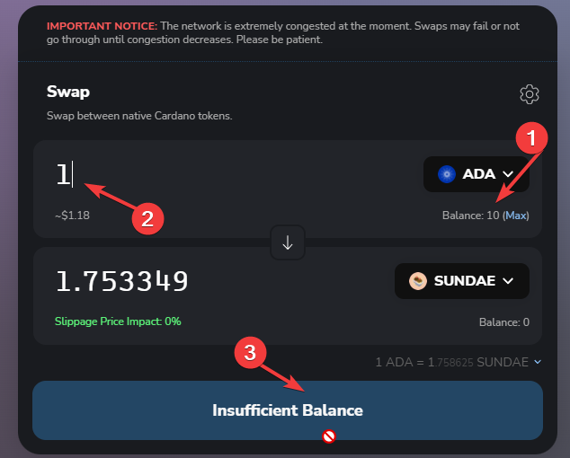
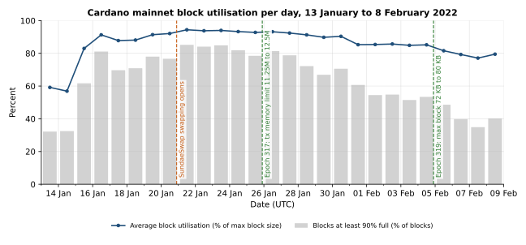
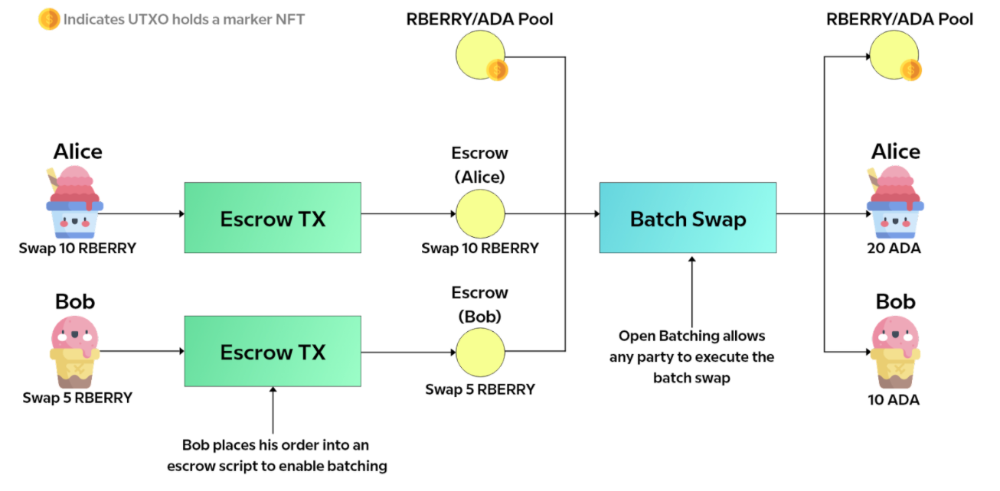
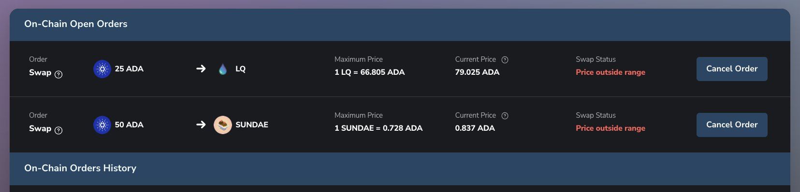

# CID-202201: SundaeSwap Launch Congestion and Failed Orders

*This report was generated with AI (Claude Opus 5.5) from the public sources listed under Sources. To correct or remove content, see [Corrections and removals](../README.md#corrections-and-removals).*

> SundaeSwap opened swapping on Cardano mainnet at 21:45 UTC on 20 January 2022. Demand exceeded the end-to-end capacity of its first-version batching design: about 11,000 orders were queued within five hours, and many trades were still waiting on 30 January [7][15]. Users could cancel pending orders and no source reports loss of principal [10][15]. Cardano continued producing blocks without a consensus or security failure; its conservative capacity settings amplified a dApp-level bottleneck rather than malfunctioning [1][15]. IOG increased protocol limits over the following weeks, and SundaeSwap later launched its redesigned v3 protocol in May 2024 [3][4][13][17][22]. The exact date the 2022 backlog cleared is not published.

## Timeline (UTC)

| Time | Event |
|---|---|
| 2021-11-04 | SundaeSwap publishes its "Scooper Model" design. Users lock funds in an order script. A third party aggregates ("scoops") many orders into one transaction against the pool UTxO. This avoids end-user contention on the single pool UTxO under Cardano's eUTxO model [19]. |
| 2021-12-18 | SundaeSwap runs a 40-minute mainnet load test. A single scooper performs 139 scoops, about 3 per minute, compared with about 7 per minute on testnet. Each mainnet scoop aggregates about 3 user operations on average, compared with 5 to 8 on testnet, because mainnet protocol parameters were lower [1]. |
| 2022-01-07 | SundaeSwap warns that it expects "a large backlog on mainnet as well — even under our most optimistic predictions". It says orders "may take days to process" but will be processed "fairly and in the order they were received and executable", and can be cancelled at any time before processing [1]. |
| 2022-01-14 | IOG publishes its 2022 scaling plan. The block size was recently raised by 8 KB to 72 KB (+12.5%), and IOG anticipates "periods of high demand, network congestion at times" [5]. |
| 2022-01-15 | SundaeSwap confirms the launch for 20 January. It repeats that orders may take "hours to days" at first and that cancellation is not subject to the same queue [2]. |
| 2022-01-16 to 2022-01-20 | Before swapping opens, daily average Cardano block utilisation is already 87.8% to 92.1%, with 70% to 81% of blocks at least 90% full (our analysis of on-chain block sizes) [16]. |
| 2022-01-20 12:29 | IOG starts the update proposal to raise Plutus script memory units per transaction by 1.25M. The change takes effect at the epoch 317 boundary on 2022-01-25 21:44:51 [3]. |
| 2022-01-20 14:48 | SundaeSwap opens pool creation and liquidity deposits and announces that swapping will open at 21:45 UTC [21]. |
| 2022-01-20 21:44:51 | Epoch 316 begins [18]. The SundaeSwap ISO also starts on 20 January [2]. |
| 2022-01-20 21:45 | Trading starts. Within two minutes, users on SundaeSwap's Discord report failed transactions and network congestion [7]. |
| 2022-01-20 21:46 | SundaeSwap tweets "Swapping is now LIVE!" [6]. |
| 2022-01-20 22:07 | CEO Mateen Motavaf posts on Discord: "IF YOUR ORDER IS ON-CHAIN, IT WILL BE PROCESSED ORDERS ARE FAILING DUE TO CONGESTION, PLEASE BE PATIENT." [7] |
| 2022-01-21 ~01:00 | SundaeSwap hosts a Twitter Spaces AMA. CTO Matt Ho says that after the 25 January change the team expects "greater than a 2X throughput increase from strictly the memory bump by itself". He also says the team did not expect someone to hand-build a transaction against the contracts before the website opened [7]. |
| 2022-01-21 ~02:40 | Users report orders pending for more than four hours. Pi Lanningham writes on Discord: "currently around 2500 orders per hour; currently ~11k orders on chain, ~1600 of them within slippage tolerance" [7]. |
| 2022-01-21 | Daily average block utilisation peaks at 94.4% in the analysed window, and 85.2% of blocks are at least 90% full [16]. Community forum users report "Insufficient Balance" errors while their order transactions are still pending [20]. |
| 2022-01-21 17:35 | CoinDesk reports users waiting more than nine hours. The SundaeSwap site shows a banner saying the network is "extremely congested". SundaeSwap states that the network "didn't crash, the security didn't decrease" and is "creating queues at various breakpoints" [8]. |
| 2022-01-22 09:39 | SundaeSwap adds an indicator to the Orders tab showing whether an order is inside or outside its slippage tolerance. It states: "All funds and fees are returned if the order is canceled." [10] |
| 2022-01-22 18:13 | SundaeSwap reports that it found a bug that "prevented a small number of ccVault users from cancelling their orders" and that it has released and confirmed a fix. Cancellations remain "subject to congestion limitations and the capacity of the mempool" [11]. |
| 2022-01-25 17:38 | SundaeSwap reports that most congestion is in the top four pools, with SUNDAE/ADA at "close to 10x" the next pair. It promises queue-depth statistics and says the evening's "12.5% memory bump" should start clearing the backlog [12]. |
| 2022-01-25 21:44:51 | Epoch 317 begins. On-chain `maxTxExecutionUnits.memory` rises from 11,250,000 to 12,500,000 [13][18]. |
| 2022-01-26 22:39 | SundaeSwap releases approximate pool queue depth on its Orders page [9]. |
| 2022-01-27 | Cointelegraph reports average block load of 93.19%, compared with 32.49% on New Year's Eve, and says users still allege that orders submitted days earlier are unprocessed [14]. |
| 2022-01-30 | SundaeSwap's launch recap reports $71.69M TVL, more than 300 pools, "100% uptime" and "No security issues". It acknowledges that "many of your trades are still waiting to get scooped" and says it is working with IOG to "safely accelerate the pace of parameter scaling" [15]. |
| 2022-02-01 20:21 | IOG proposes raising the block size from 72 KB to 80 KB [4]. |
| 2022-02-04 21:44:51 | Epoch 319 begins. On-chain `maxBlockBodySize` rises from 73,728 to 81,920 bytes and `maxTxExecutionUnits.memory` from 12,500,000 to 14,000,000 [13]. |
| 2022-02-07 | Daily average block utilisation (against the new 80 KB limit) falls to 77.1% [16]. |
| 2022-02-14 21:44:51 | Epoch 321 begins with `maxBlockExecutionUnits.memory` raised from 50,000,000 to 56,000,000 [13]. |
| 2024-02-19 | SundaeSwap publishes a performance comparison. It explains that v1 could process at most 8 orders per batch, and typically 2 to 4 because of ledger input ordering, while v3 fits 25 to 35 [17]. |
| 2024-05-09 | SundaeSwap v3 goes live on Cardano mainnet. This is later root-cause remediation, not evidence of when the 2022 order backlog cleared [22]. |

## Impact

For at least nine days, many SundaeSwap swap, deposit and withdrawal orders failed to submit or remained unexecuted for hours to days [7][8][14][15]. About five hours after launch, roughly 11,000 orders were on-chain and about 2,500 were being processed per hour, but only about 1,600 remained within their slippage tolerance [7]. The others could execute only if the price returned to range, or be cancelled. Many trades were still waiting on 30 January [15]; the total number of affected users and orders is unknown.

*Figure 1: Pi Lanningham's Discord reply on the backlog: about 2,500 orders per hour processed, about 11,000 orders on chain, about 1,600 of them within slippage tolerance. Source: Cointelegraph, ["SundaeSwap launches on Cardano, but users report failing transactions"](https://cointelegraph.com/news/sundaeswap-launches-on-cardano-but-users-report-failing-transactions) [7].*

Users also reported "insufficient balance" and zero-balance wallet displays while order transactions were pending [8][20]. A separate SundaeSwap bug briefly prevented some ccVault users from cancelling [11].

*Figure 2: SundaeSwap's swap screen as posted by a forum user on 21 January 2022, with the site's notice that "the network is extremely congested at the moment" and an "Insufficient Balance" error; the red annotations are the user's. Source: Cardano Forum, ["Insufficient Balance on SundaeSwap"](https://forum.cardano.org/t/insufficient-balance-on-sundaeswap/93210) [20].*

Block production continued and no consensus problem was reported [15], but blocks ran near capacity. On-chain data show daily average utilisation of 87.8% to 94.4% from 16 to 30 January, peaking on 21 January [16]. Saturation produced queues and mempool rejection rather than a chain halt [8].

*Figure 3: Daily average block utilisation and share of blocks at least 90% full on Cardano mainnet, 13 January to 8 February 2022, with the swapping launch and the epoch 317 and 319 parameter increases marked. Data: Koios API (`blocks`, `epoch_params`), retrieved 2026-10-13 [16][13]; chart by the catalogue.*

No source reports a loss of user principal. Orders remained in escrow and could be cancelled with funds and fees returned [10], while SundaeSwap reported no security issues [15]. Delayed or unexecuted trades may have had opportunity costs, but none has been quantified. SundaeSwap's reported $71.69M TVL is context for the service's scale, not a loss figure [15].

Rated SEV-3 (dimension: availability): a widely used dApp was not usable for timely trading for more than 24 hours, with orders pending for days [7][14][15]. Potential SEV-2 (dimension: availability): sustained near-full blocks made network-wide transaction delays a credible outcome if demand had risen further or parameter increases had been delayed [13][16]. The actual record does not establish network-wide degradation under the catalogue's definition. Recoverability: escalated (recovery time was not documented or predictable, and clearing pressure on the backlog depended on IOG's parameter changes, although users could cancel pending orders) [3][4][10][13].

## Root cause

Demand at launch exceeded the end-to-end throughput of the SundaeSwap v1 design running on Cardano's January 2022 protocol parameters. The capacity problem was known in advance and disclosed [1][2].

*Figure 4: Escrow-and-batch order flow as drawn in SundaeSwap's design article. Each user's order is locked in an escrow UTxO, and one batch transaction executes several orders against the pool UTxO. The article drew it for the "open batching" variant, in which anyone may build the batch; the scooper model SundaeSwap launched with keeps this flow but limits batching to licensed scoopers. Source: SundaeSwap Labs, ["SundaeSwap Labs Presents: The Scooper Model"](https://sundaeswap-finance.medium.com/sundaeswap-labs-presents-the-scooper-model-678d6054318d) [19].*

1. **Batch size bounded by execution units and transaction size.** In the scooper model, each order is a UTxO locked at an order script. A scoop spends many order UTxOs together with the single pool UTxO in one transaction [19]. The number of orders per scoop is limited by the per-transaction memory budget (11.25M units at launch [3][13]) and by the transaction and block size limits (16,384-byte transactions and 73,728-byte blocks [13]). In the December 2021 mainnet load test this meant about 3 user operations per scoop [1]. SundaeSwap later wrote that v1 could fit at most 8 orders per batch even under later parameters [17].
2. **Ledger input ordering.** The ledger sorts a transaction's inputs before the scripts run. SundaeSwap says this "went unnoticed at the time of our launch". Preserving first-come, first-served order therefore cost extra execution budget, and typical v1 batches held only 2 to 4 orders [17]. UPLC has no array indexing, so re-deriving the order means repeated list traversals, which are expensive in memory units [17].
3. **One pool UTxO serialises each pool.** Each pool's state lives in one UTxO, so scoops for a pool must be chained one after another. Congestion concentrated in the four busiest pools, and SUNDAE/ADA alone carried close to ten times the load of the next pair [12].
4. **Shared, saturated block space.** Scoops competed for block space with everything else on Cardano. The chain was already about 88% to 92% full in the days before swapping opened [16]. SundaeSwap had noted it would "share network bandwidth with other launching protocols" [1]. With blocks full, user order submissions and cancellations were queued or rejected at the mempool [7][11].
5. **Mainnet behaved differently from testnet.** Mainnet parameters were lower than the testnet's, and participation patterns differed, so testnet throughput did not carry over [1][15].

None of these factors was a malfunction. The ledger and the contracts behaved as specified, and the harm came from the throughput ceiling of the v1 design under demand that was expected, if underestimated [1][15]. The separate ccVault cancellation issue was a SundaeSwap software bug with limited reach [11].

## Detection

Congestion was predicted and announced in advance, so there was no detection gap in the usual sense [1][2]. Users began reporting problems on SundaeSwap's Discord within two minutes of trading opening, and SundaeSwap leadership acknowledged order failures there within about 22 minutes and took questions in an AMA about three hours after launch [7]. SundaeSwap found the ccVault cancellation bug itself, "late" on the night of 21 to 22 January [11]. What users lacked at launch was visibility: the app showed neither slippage status nor queue position until SundaeSwap added them on 22 and 26 January [10][9].

## Response and resolution

SundaeSwap told users that on-chain orders would be processed or could be cancelled, displayed a congestion warning, and postponed yield-farming rewards [2][7][8][10]. It added slippage status on 22 January, fixed the ccVault cancellation bug that day, and added approximate pool queue depth on 26 January [9][10][11][12].

*Figure 5: The Orders tab after the 22 January update, showing two open swap orders whose maximum price is below the current price ("Price outside range"), each with a Cancel Order button. Source: SundaeSwap Labs, [thread on X](https://x.com/SundaeSwap/status/1484823075040468992), 22 January 2022 [10].*

IOG raised capacity in stages: per-transaction Plutus memory rose from 11.25M to 12.5M on 25 January; on 4 February, block size rose from 72 KB to 80 KB and per-transaction memory to 14M; on 14 February, per-block memory rose from 50M to 56M [3][4][13]. Daily average block utilisation fell to 77% by 7 February against the new 80 KB limit [16]. These changes reduced capacity pressure, but no source states when SundaeSwap's backlog cleared.

## Remediation and follow-up

Immediate mitigation came from the 2022 Cardano parameter increases described above. Permanent remediation of the dApp-level bottleneck came later: SundaeSwap redesigned transaction-input ordering and adopted Aiken, Plutus V2 reference scripts and inline datums for v3. Its February 2024 analysis projected 25 to 35 orders per batch, compared with a typical 2 to 4 in v1 [17]; v3 went live on mainnet on 9 May 2024 [22]. That later remediation supports `status: resolved`, but does not establish the 2022 impact end date.

## Incident handling assessment

Assessment of SundaeSwap Labs' handling against SOC 2 Trust Services Criteria, based on public sources only (see CLASSIFICATION.md, section 10).

| Criterion | Result | Observation |
|---|---|---|
| CC7.2 Monitoring and detection | Not evidenced | Congestion was predicted, but public sources attribute the first problem reports to users; SundaeSwap acknowledged them within about 22 minutes. The team did detect the separate ccVault cancellation bug itself [1][7][11]. |
| CC7.3 Evaluation of events | No exceptions noted | About five hours after launch, the team quantified backlog size, processing rate and slippage status, and later identified concentration in the four busiest pools [7][12]. |
| CC7.4 Incident response | No exceptions noted | SundaeSwap communicated cancellation options, fixed the ccVault bug, added order and queue visibility, postponed rewards and worked with IOG on capacity increases [2][9][10][11][15]. |
| CC7.5 Recovery | Exceptions noted | No source documents backlog clearance. The input-ordering cost that constrained v1 was publicly analysed only in 2024, before the v3 redesign launched [15][17][22]. |
| CC2.3 External communication | Exceptions noted | Users were warned that orders could take days and received launch updates, but no formal post-mortem or complete impact count was published [1][2][10][12][15]. |
| CC8.1 Change management | Exceptions noted | Mainnet load testing exposed lower throughput, but the effect of ledger input ordering went unnoticed at launch; the deployed contracts also allowed a hand-built order before the website opened [1][7][17]. |

## Lessons for builders

- **Benchmark the complete path under mainnet parameters.** Testnet scoops carried 5 to 8 operations, versus about 3 in SundaeSwap's mainnet test [1]. Measure worst-case batches against the live `maxTxExecutionUnits`, `maxTxSize` and `maxBlockBodySize`, then compare the result with forecast demand.
- **Account for ledger input ordering.** Inputs reach a validator in ledger order, not submission order [17]. If arrival order matters, encode and validate it explicitly, and test output references whose ledger order differs from arrival order.
- **Model the hottest shared state, not the average pool.** A single pool UTxO serialised each pool, and SUNDAE/ADA carried about ten times the load of the next pair [12]. Capacity planning should use the busiest pair while allowing independent pools to progress in parallel.
- **Reduce per-order execution and byte costs.** Reference scripts and inline datums raised a v1-derived design from 8 to 10 orders per batch, while Aiken and input-ordering changes produced larger gains in v3 [17].
- **Ship queue visibility and cancellation together.** SundaeSwap added slippage status and queue depth after launch, and a wallet-specific bug initially blocked some cancellations [9][10][11]. Test cancellation through every supported wallet and show pending funds rather than presenting them as unavailable balances [8][20].
- **Gate a timed launch on-chain.** A user submitted a hand-built transaction before the website opened [7]. If a fair start matters, enforce it in the validator rather than relying on the front end.

## Disputed or open points

- **Success or failure.** SundaeSwap called the launch a success with "100% uptime and zero network failure points", while press and users described failed submissions and multi-day waits [7][8][14][15]. These describe different layers: the chain and contracts stayed available, but timely trading did not.
- **Attribution of network load.** Cointelegraph attributed record block load to SundaeSwap [14], but on-chain data show blocks were already 88% to 92% full on average before swapping opened and daily transaction count peaked on 19 January [16]. Pool creation and liquidity deposits had already begun [2][21], so SundaeSwap's share of the load cannot be isolated.
- **Network-wide degradation.** Blocks were near capacity and users reported multi-hour waits for order transactions [16][20]. This may indicate wider transaction-inclusion delays, but no primary source establishes routine delays for correctly priced transactions unrelated to SundaeSwap; the evidence therefore supports actual SEV-3, not SEV-2.
- **Order fairness.** SundaeSwap promised first-received, executable ordering [1], while CoinDesk reported blockchain data suggesting unequal execution and an order was filled before the website opened [7][8]. The later-disclosed input-sorting constraint adds uncertainty, and no source establishes how closely early batches followed arrival order [17].
- **Impact end and scale.** No source gives the backlog-clearance date, total affected orders or users, or counts of expired and cancelled orders. The May 2024 v3 launch documents later remediation, not when the 2022 impact ended [22].

## Sources

1. [P] SundaeSwap Labs (Medium), "Expectations, Congestion, & Mainnet Launch.", 2022-01-07. https://sundaeswap-finance.medium.com/expectations-congestion-mainnet-launch-e9da5abfd819
2. [P] SundaeSwap Labs (Medium), "WEN SUNDAE? Thursday!", 2022-01-15. https://sundaeswap-finance.medium.com/wen-sundae-thursday-9389e4439530
3. [P] Input Output (X), "PARAMETER UPDATE: Today, we have commenced the update proposal process to increase Plutus script memory units per transaction…" (thread; post 2/9 gives 11.25M → 12.5M), 2022-01-20. https://x.com/InputOutputHK/status/1484141101497958403
4. [P] Input Output (X), "NETWORK UPDATE: Today, we have proposed the next parameter update… increase block size by a further 8KB taking it from 72KB to 80KB", 2022-02-01. https://twitter.com/InputOutputHK/status/1488608404381786113
5. [P] IOHK Blog (Tim Harrison), "How we're scaling Cardano in 2022", 2022-01-14 (archived copy). https://web.archive.org/web/20230105184426/https://iohk.io/en/blog/posts/2022/01/14/how-we-re-scaling-cardano-in-2022/
6. [P] SundaeSwap Labs (X), "Swapping is now LIVE!", 2022-01-20 (posted 21:46 UTC). https://x.com/SundaeSwap/status/1484281160146509828
7. [S] Cointelegraph (Brian Newar), "SundaeSwap launches on Cardano, but users report failing transactions", 2022-01-21. https://cointelegraph.com/news/sundaeswap-launches-on-cardano-but-users-report-failing-transactions
8. [S] CoinDesk (Lyllah Ledesma), "Cardano-Based Decentralized Exchange SundaeSwap Off to Rocky Start", 2022-01-21. https://www.coindesk.com/markets/2022/01/21/cardano-based-decentralized-exchange-sundaeswap-off-to-rocky-start
9. [P] SundaeSwap Labs (X), "We have just released an update to our orders page, you should now be able to see the approximate queue depth of a pool!", 2022-01-26. https://x.com/SundaeSwap/status/1486468986632085504
10. [P] SundaeSwap Labs (X), thread "We've just added a new feature in the 'Orders' tab…" / "All funds and fees are returned if the order is canceled.", 2022-01-22. https://twitter.com/SundaeSwap/status/1484823077649321987
11. [P] SundaeSwap Labs (X), "Late last night we discovered a SundaeSwap bug that prevented a small number of ccVault users from cancelling their orders…", 2022-01-22. https://x.com/SundaeSwap/status/1484952498372845568
12. [P] SundaeSwap Labs (X), thread "Since launch we have gotten a lot of feedback on how we can improve SundaeSwap…" (posts 1/6 to 6/6, incl. top-4-pool congestion and the "12.5% memory bump"), 2022-01-25. https://twitter.com/SundaeSwap/status/1486030728483717128
13. [P] Koios (Cardano on-chain data API), "epoch_params" for epochs 314 to 321 (`max_block_size`, `max_tx_size`, `max_tx_ex_mem`, `max_block_ex_mem`), retrieved 2026-10-13. https://api.koios.rest/api/v1/epoch_params?_epoch_no=317
14. [S] Cointelegraph (Zhiyuan Sun), "Cardano network at record capacity due to SundaeSwap launch, but not all users hail it as a success", 2022-01-27. https://cointelegraph.com/news/cardano-network-at-record-capacity-due-to-sundaeswap-launch-but-not-all-users-hail-it-as-a-success
15. [P] SundaeSwap Labs (Medium), "SundaeSwap Launch & Recap", 2022-01-30. https://sundaeswap-finance.medium.com/sundaeswap-launch-recap-28755c9e3ed5
16. [P] Koios (Cardano on-chain data API), "blocks" (`block_size`, `block_time`, `tx_count` for every block from 2022-01-13 to 2022-02-08, queried in 4-hour windows). Analysis by this report: daily average of `block_size / max_block_size`, with the limit at 73,728 bytes before and 81,920 bytes from epoch 319. Retrieved 2026-10-13. https://api.koios.rest/api/v1/blocks?block_time=gte.1642715091&block_time=lt.1642801491&select=block_size,block_time&limit=1000
17. [P] Sundae Labs (Medium), "Sundae v3 Performance Comparisons", 2024-02-19. https://sundaeswap-finance.medium.com/sundae-v3-performance-comparisons-d048d7507e40
18. [P] Koios (Cardano on-chain data API), "epoch_info" (epoch 316 start 2022-01-20T21:44:51Z; epochs 314 to 320), retrieved 2026-10-13. https://api.koios.rest/api/v1/epoch_info?_epoch_no=316&_include_next_epoch=false
19. [P] SundaeSwap Labs (Medium), "SundaeSwap Labs Presents: The Scooper Model", 2021-11-04. https://sundaeswap-finance.medium.com/sundaeswap-labs-presents-the-scooper-model-678d6054318d
20. [S] Cardano Forum, "Insufficient Balance on SundaeSwap" (thread begun 2022-01-21). https://forum.cardano.org/t/insufficient-balance-on-sundaeswap/93210
21. [P] SundaeSwap Labs (X), "Creating pools and depositing liquidity is now live! Swapping will be enabled at 21:45 UTC today!", 2022-01-20 (posted 14:48 UTC). https://x.com/SundaeSwap/status/1484175915349426176
22. [S] Tap In With TapTools, "SundaeSwap V3 Goes Live on Cardano Mainnet", 2024-05-14. https://medium.com/tap-in-with-taptools/sundaeswap-v3-goes-live-on-cardano-mainnet-2817b687722f
