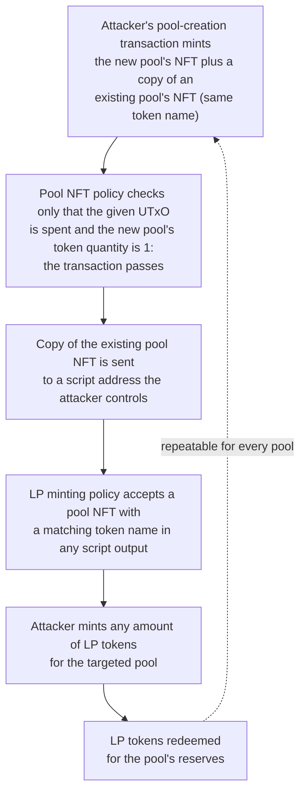

# CID-202202: Minswap LP Token Minting Vulnerability

> Developers from WingRiders found a critical flaw in Minswap, a decentralised exchange (DEX) on Cardano, shortly after its March 2022 mainnet launch. The flaw let anyone duplicate the "pool NFT" that identifies a liquidity pool, mint unlimited liquidity-provider (LP) tokens and withdraw the pool's reserves [1][2][3]. WingRiders disclosed it privately [2]. Minswap stopped processing orders, reported a 50-hour maintenance period and used the flaw to move all liquidity into patched contracts [1][8]. It reported no loss and intact user positions, but replacement LP tokens were still being distributed when it published its technical account [1]. A secondary report the next day said the DEX had left maintenance [9]. The flaw was in Minswap's application contracts, not the Cardano protocol [3].

## Timeline (UTC)

| Time | Event |
|---|---|
| 2022-01 | Tweag audits Minswap's on-chain code at commit `16255227` and reports 13 issues, three of them critical. One of the critical issues is a different path to duplicating LP tokens (finding 2.2.1.2) [4]. The vulnerability described here is not among the findings [3]. |
| 2022-03-09 | Minswap launches on mainnet, according to a community directory [10]. |
| Before 2022-03-21 | Minswap open-sources its smart contracts and audit report [1][2]. |
| 2022-03-21, evening | WingRiders developers review the open-sourced code and find "multiple vulnerabilities where at least one was of critical severity" [2]. |
| 2022-03-21/22 | After "a couple of nerve-wracking hours", WingRiders reaches the Minswap founders through a verified channel, discloses the issue, and advises stopping the platform [2]. Minswap dates the alert to 22 March. It confirms the bug, reproduces it on a private testnet, and its team-operated batcher censors all orders so the bug cannot be exploited [1]. |
| 2022-03-22, morning | Tweag, Minswap's auditor, is notified of the vulnerability [3]. |
| 2022-03-22 13:23 | Minswap tweets that "DEX features will be slow for an hour" while it fixes "some issues" [5]. |
| 2022-03-22 19:57 | Minswap tweets that the DEX is "under maintenance" after detecting "few issues", and that funds are safe [6]. |
| 2022-03-23 07:56 | Minswap tweets that the DEX is still in maintenance mode, that it "detected an issue" with "safeguards in place", and that it is "rewriting, testing and deploying the fixes" [7]. |
| 2022-03-22 to 2022-03-24 | Minswap uses the vulnerability to drain its pools, creates pools on patched contracts and starts airdropping replacement LP tokens from a snapshot [1]. |
| 2022-03-24 23:00 | Minswap says the DEX was in maintenance mode for 50 hours and that "all vulnerabilities discovered have been addressed" [8]. Its linked article says LP tokens are still being airdropped, with over 40% migrated, and directs users to future announcements about the migration and opening of trading [1]. |
| 2022-03-25 07:00 | End of the NFT boost for MIN/ADA liquidity providers, which Minswap extended by two days [1]. |
| 2022-03-25 | BeInCrypto reports that the DEX has exited maintenance mode; WingRiders and Tweag publish their accounts [9][2][3]. |

## Impact

No third-party exploitation has been reported. Minswap said no funds were lost and that users retained their positions, including LP tokens staked in farms and MIN rewards accrued during maintenance [1].

All pool liquidity was at risk. WingRiders said Minswap had reached over USD 195 million in total value locked (TVL) after launch, while a community directory reported over USD 200 million [2][10]. Neither figure is a snapshot from the time of disclosure, but the flaw could have drained every pool [2][3].

Minswap reported 50 hours in maintenance mode [8]. The exact reopening time was not published; a secondary report on 25 March said the DEX had exited maintenance [9]. Minswap moved all liquidity to patched contracts, but its technical account said replacement LP tokens were still being airdropped and that over 40% had been migrated [1]. It did not publish an affected-user count or a completion time for the LP-token reissuance.

Rated SEV-3 (dimension: availability) because a DEX described as well used [10] had most functions unavailable during a reported 50-hour maintenance period [6][8]; zero reported loss does not lower the availability rating [1]. Potential SEV-1 (dimension: financial loss) because all pool liquidity was drainable and reported TVL exceeded USD 195 million [2][3]. Recoverability: extra-resources, because recovery required deploying patched contracts, migrating all liquidity and re-issuing LP tokens from a snapshot [1].

## Root cause

The flaw was in the Plutus minting policy for Minswap's pool NFT, the token that identifies a pool and is locked in it when the pool is created [2][3]. The policy checked two things: the transaction spends a specific UTxO given in the redeemer, and the minted value contains exactly one unit of the expected pool token [2][3]:

```haskell
isUnity :: Value -> AssetClass -> Bool
isUnity v c = assetClassValueOf v c == 1

-- in validateMintNFT:
isUnity mintValue (assetClass ownSymbol poolTokenName)
  && SC.spendsOutput info refHash refIdx
```

`isUnity` only checked the amount of one asset class. It did not check that **no other token under the same policy** was minted in the same transaction [3]. So an attacker could create a legitimate new pool and, in the same transaction, mint a second pool NFT whose token name matched an existing pool. The attacker could then keep that copy at a script address they controlled [2][3]. WingRiders put it this way: "Anything that is not explicitly forbidden is allowed, even if the transaction does not resemble the intended one" [2].

The duplicate pool NFT became a drain because of the LP token minting policy. That policy allowed LP tokens for a pool to be minted if a matching pool NFT appeared in a transaction output at *any* script address. It compared only token names (`nftTokenName == lpTokenName`) [2][3]. The design assumed that each pool NFT was unique and always sat in the real pool script [2]. With a copy held in an attacker-controlled script, the attacker could mint any amount of LP tokens for the targeted pool and redeem them for the pool's reserves. The attack could be repeated for every pool [2][3].



*Figure 1: Attack path enabled by the two minting policies, as described by WingRiders and Tweag [2][3]; diagram by the catalogue. Minswap used the same path itself to move liquidity to the patched contracts [1].*

Tweag's suggested fix checks the whole sub-map of the policy's own currency symbol. Tokens of other policies can still appear in the mint field, because pool creation mints three different tokens [3]:

```haskell
isUnity :: Value -> AssetClass -> Bool
isUnity v c = Map.lookup curr (getValue v) == Just (Map.fromList [(tok, 1)])
  where (curr, tok) = unAssetClass c
```

Tweag explained why its audit missed the bug. During the audit it had already duplicated LP tokens another way (finding 2.2.1.2), and through "a terrible combination of survivorship and confirmation bias" it did not question whether pool NFTs were really unique [3][4]. The same audit had also flagged the LP minting policy as "too loose", because it accepted any script output containing a pool NFT [4].

## Detection

The flaw was found by external review rather than by Minswap's monitoring or its own processes. WingRiders developers, working with Vacuumlabs, read the code soon after Minswap open-sourced it, in what WingRiders calls "a surface-level sweep of the open-source code", and found the critical issue on the evening of 21 March 2022 UTC [2]. Minswap's pre-launch audit had not identified it [3].

Disclosure was then slowed by a contact problem: WingRiders needed "a couple of nerve-wracking hours" to reach the founders through a verified channel [2].

## Response and resolution

Minswap controlled the DEX batcher, which gave it an immediate containment mechanism. After confirming the bug on a private testnet, it censored all orders [1] and placed the DEX in maintenance mode [6][7]. Its first public messages referred only to a one-hour slowdown and then unspecified issues [5][6][7]; it explained the vulnerability on 24 March [1][8].

WingRiders recommended using the flaw to return the liquidity, followed by a full re-audit before release [2]. Minswap instead deployed a targeted patch, used the flaw to move all liquidity into new pools and began airdropping replacement LP tokens from a snapshot [1]. It said the patched contracts no longer allowed the team to move liquidity unilaterally [1].

Minswap extended the NFT boost for MIN/ADA liquidity providers by two days and paid WingRiders an undisclosed bug bounty from the DAO treasury [1].

## Remediation and follow-up

- Minswap deployed new contracts with the pool-NFT minting check fixed and said it addressed three additional lower-severity issues involving batcher and owner powers [1].
- New pool creation was temporarily permissioned. Minswap acknowledged the decentralisation trade-off and said it provided more control over malformed or duplicate pools [1].
- Minswap said it was entering continuous audit and code review with an unnamed Haskell security firm [1].
- Minswap promised a further in-depth article and an AMA [1]; no such article was found.
- Tweag committed to tool-assisted auditing with Pirouette and called for warnings about functions such as `assetClassValueOf` in the Plutus API documentation [3].

## Incident handling assessment

Assessment of the responsible party's handling (Minswap Labs) against SOC 2 Trust Services Criteria, based on public sources only (see CLASSIFICATION.md, section 10).

| Criterion | Result | Observation |
|---|---|---|
| CC7.2 Monitoring and detection | Exceptions noted | The flaw was found by developers of the competing DEX WingRiders in a "surface-level sweep" of the newly open-sourced code, not by Minswap or its pre-launch audit [2][3]. WingRiders needed "a couple of nerve-wracking hours" to reach the founders through a verified channel [2]. |
| CC7.3 Evaluation of events | No exceptions noted | Minswap confirmed the bug, reproduced it on a private testnet and treated it as critical by immediately censoring all orders through its batcher [1]. |
| CC7.4 Incident response | No exceptions noted | Orders were censored and the DEX placed in maintenance mode, and no third-party exploitation has been reported [1][6][7]. The team then moved all liquidity to patched contracts using the vulnerability itself [1]. |
| CC7.5 Recovery | Not evidenced | Sources document the contract patch and liquidity migration, and a secondary report says the DEX left maintenance [1][9]. Minswap's update showed only over 40% of replacement LP tokens migrated; no reviewed source confirms completion or gives the exact reopening time [1]. |
| CC2.3 External communication | Exceptions noted | The first notice described a one-hour slowdown and "some issues"; most DEX functions were then unavailable during a reported 50-hour maintenance period [5][6][8]. A technical account followed on 24 March [1]. |
| CC8.1 Change management | Exceptions noted | The vulnerable minting policies shipped in the launch contracts after a Tweag audit that had already shown LP-token duplication and called the LP minting policy "too loose" (finding 2.2.1.2) [4]. The deployed LP policy still accepted a pool NFT in any script output, and the audit did not question pool-NFT uniqueness [3]. |

## Lessons for builders

- **Constrain the whole mint field for a policy.** A check that the expected token has quantity one does not reject extra tokens minted under the same policy. Compare the complete sub-map for `ownCurrencySymbol` with the allowed `(tokenName, quantity)` set, and test valid transactions with unexpected mints added [2][3].
- **Enforce uniqueness and location as invariants.** Minswap's LP policy assumed each pool NFT was unique and held by the pool validator, but accepted a matching token at any script address [2][3]. Authorisation should also verify the expected validator or continuing output rather than token presence alone [4].
- **Do not treat one exploit path as proof that a vulnerability class is closed.** Tweag had already duplicated LP tokens through another route and then failed to challenge pool-NFT uniqueness [3][4]. Re-examine every route to the same harmful outcome after a finding is fixed.
- **Publish a security contact before launch.** WingRiders needed hours to reach the founders through a verified channel [2]. A pre-published reporting channel shortens the exposure window.
- **Document emergency powers and restoration steps.** Minswap could stop orders because it controlled the batcher and could move liquidity only because the flaw allowed it [1]. Users should know which pause or migration powers exist and how positions will be restored.

## Disputed or open points

- **Discovery date:** WingRiders dates discovery to the UTC evening of 21 March 2022 [2]. Minswap says it was alerted on 22 March [1], when Tweag was also notified [3]. The exact disclosure time was not published, and the dates may reflect different time zones.
- **Reopening and LP-token reissuance:** At 23:00 UTC on 24 March, Minswap said maintenance had lasted 50 hours and all discovered vulnerabilities were addressed [8], but its linked article said trading had yet to reopen and only over 40% of LP tokens had been migrated [1]. BeInCrypto reported on 25 March that the DEX had exited maintenance [9]. No reviewed source gives the exact reopening time, confirms completion of LP-token reissuance or provides migration transaction hashes.
- **Completeness of the fix:** WingRiders said it found additional areas that could expose part of the TVL, withheld details and could not confirm whether the hotfix addressed them [2]. Minswap said all reported vulnerabilities were addressed [1][8]. No later public reconciliation was found.
- **TVL figure:** Sources report over USD 195 million [2] and over USD 200 million [10], but neither is a contemporaneous disclosure snapshot. The value at risk is therefore approximate, though either figure exceeds the SEV-1 threshold.

## Sources

1. [P] Minswap Labs, "Vulnerability Patch: Technical Details and Steps Forward", 2022-03-24. https://minswap-labs.medium.com/vulnerability-patch-technical-details-and-steps-forward-97f6ee35aa91 (archived: https://web.archive.org/web/20221205234433/https://minswap-labs.medium.com/vulnerability-patch-technical-details-and-steps-forward-97f6ee35aa91)
2. [P] WingRiders, "WingRiders hackers put on a white hat and save $195M TVL on Minswap", 2022-03-25. https://medium.com/@wingriderscom/wingriders-hackers-put-on-a-white-hat-and-save-195m-tvl-on-minswap-7a5e9615876c (archived: https://web.archive.org/web/20220325131155/http://medium.com/@wingriderscom/wingriders-hackers-put-on-a-white-hat-and-save-195m-tvl-on-minswap-7a5e9615876c)
3. [P] Tweag (Mathieu Boespflug), "Our first audit of Minswap and the aftermath", 2022-03-25. https://www.tweag.io/blog/2022-03-25-minswap-lp-vulnerability/
4. [P] Tweag Smart Contract Verification Team, "Technical Review of MinSwap" (audit report; file name indicates 31 January 2022), 2022-01-31. https://www.tweag.io/blog/2022-03-25-minswap-lp-vulnerability/MinSwap-Jan31.pdf
5. [P] Minswap Labs (@MinswapDEX), post on X: "Please note that The DEX features will be slow for an hour…", 2022-03-22. https://twitter.com/MinswapDEX/status/1506260223572549633
6. [P] Minswap Labs (@MinswapDEX), post on X: "Please note the Minswap DEX is currently under maintenance…", 2022-03-22. https://x.com/MinswapDEX/status/1506359372812795905
7. [P] Minswap Labs (@MinswapDEX), post on X: "The DEX is still on maintenance mode, we detected an issue…", 2022-03-23. https://twitter.com/MinswapDEX/status/1506540419848540164
8. [P] Minswap Labs (@MinswapDEX), post on X: "The Minswap DEX went into maintenance mode for 50 hours…", 2022-03-24. https://twitter.com/MinswapDEX/status/1507130301830606850
9. [S] BeInCrypto, "Cardano-Based Minswap DEX Exits Maintenance Mode After Patching Critical Vulnerability", 2022-03-25. https://beincrypto.com/cardano-based-minswap-dex-exits-maintenance-mode-patching-critical-vulnerability/
10. [S] Built on Cardano, "Minswap" (project profile, updated after October 2022), n.d. https://builtoncardano.com/minswap
