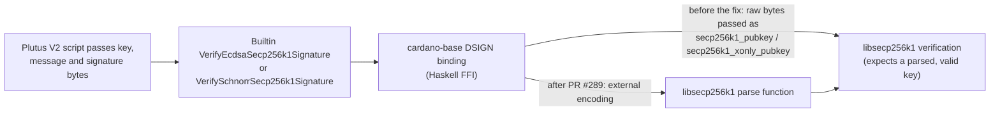

# CID-202203: SECP256k1 Binding Flaw and Legacy Testnet Incompatibility

> In July 2022, tests found that two planned Plutus functions for verifying ECDSA and Schnorr signatures passed unchecked bytes to the libsecp256k1 C library where parsed keys were required [1][2]. The defect was triggered on Cardano's legacy public testnet, and node 1.35.3 later could not replay history accepted by 1.35.2 [1][13]. IOG kept the legacy network on 1.35.2, launched the replacement testnets Preview and Pre-Production on 19 August 2022 and listed the legacy network as deprecated [11][15]. The functions never activated on mainnet: rewritten and audited bindings reached it with the Valentine hard fork on 14 February 2023 [1][19][20]. No mainnet users or funds were affected. The official report assessed that, had the functions been live on mainnet, malformed input could potentially have crashed all nodes [1].

## Timeline (UTC)

| Time | Event |
|---|---|
| 2022-04-25 | SECP256k1 support is backported to the Plutus `release/1.0.0` branch used for the Vasil node releases (PR #4551) [4]. In the Plutus code pinned by node 1.35.2, both SECP256k1 builtins are enabled for Plutus V2 from protocol version 7 (Vasil) [7]. |
| 2022-07-03 20:20 | IOG hard forks the legacy public Cardano testnet to Vasil (protocol version 7) and invites SPOs, developers and exchanges to start final testing [8]. Given the pinned Plutus code, Plutus V2 scripts on the testnet can call the SECP256k1 builtins from this point [7]. |
| 2022-07-14 14:27–14:43 | Plutus PR #4763 "Delay SECP256k1 builtins to Chang" is opened and force-merged. It moves both builtins from protocol version 7 to version 8. The author writes: "This is very urgent so I built it locally and I'm force-merging" [3]. A backport to the release branch is merged at 15:23 [3]. |
| 2022-07-15 | "Date Occurred" in the official report. The issue was found by commissioned end-to-end tests and "(accidentally) triggered on the Cardano Testnet before a fix could be deployed there" [1]. |
| 2022-07-18 09:14 | cardano-base PR #289 is opened. It "addresses several security issues raised by @iquerejeta regarding 'internal' versus 'external' representations of verification keys and signatures" [2]. |
| 2022-07-19/20 | The delay is reverted on the Plutus release branch (commit 8cb94e1) [4]. |
| 2022-07-22 | IOG's weekly development report says the Plutus V2 cost model was "temporarily removed from the Cardano testnet while a potential issue raised by the community was properly investigated". It is to be restored at the next epoch boundary [12]. |
| 2022-07-23 | Node 1.35.2 is tagged [6]. Its pinned Plutus revision still enables both SECP256k1 builtins at protocol version 7, and its pinned cardano-base revision predates the fix [6][7]. |
| 2022-07-23 22:00 | IOG tells SPOs that the Plutus V2 cost model has been reinstated on the testnet and that "the IOG team has temporarily disabled the cryptographic primitives that were related to the issue" [9]. |
| 2022-07-25 10:56 | cardano-base PR #289 is merged [2]. |
| 2022-07-28 | Plutus PR #4795 re-applies the delay of the SECP256k1 builtins to protocol version 8 on the release branch [4]. |
| 2022-08-02 | Node 1.35.3's scope lists "Condition SECP256k1 to the protocol version 8" [14]. Users report that 1.35.3 stops syncing the legacy testnet at block `470b412e…` (slot 64400487) with a `MalformedScriptWitnesses` error, while 1.35.2 syncs fully [13]. Plutus PR #4786 brings the cardano-base fix to the on-chain primitives and is merged on this day [5]. |
| 2022-08-03 09:36 | IOG: "node version 1.35.3 will not work correctly on the current Cardano testnet". The legacy testnet will keep running on 1.35.2 until after the mainnet hard fork and then be respun; new test environments will be created, one of which "will resolve the synchronization issue" reported after upgrading to 1.35.3 [11]. |
| 2022-08-19 | IOG announces node 1.35.3 and two new chains: Pre-Production (Alonzo era, mirroring mainnet) and Preview (Babbage era). The earliest archived copy of the announcement (5 September 2022, page marked as updated) lists the legacy testnet as "Deprecated" [15]. |
| 2022-09-22 | Scheduled date of the Vasil hard fork on mainnet, without the SECP256k1 builtins [16]. |
| 2022-11-16 00:00 | The Preview testnet hard forks to protocol version 8 "to support community testing of SECP256K1 elliptic curves via new Plutus primitives" [18]. |
| 2023-01-19 | IOG proposes the mainnet date for the SECP upgrade [19]. |
| 2023-02-14 21:44 | The Valentine (SECP) intra-era hard fork goes live on mainnet at the start of epoch 394 [19][20]. |
| 2023-08-17 | The "SECP bindings Security Issue Report" is published on the Cardano development updates site [1]. |

## Impact

The functions never activated on mainnet. Plutus V2 first became usable there with the Vasil hard fork, while node 1.35.3 gated the SECP256k1 builtins to protocol version 8 [7][14][16]. Mainnet reached version 8 only with Valentine, after the binding fix and audit [1][19][20].

On the legacy public testnet, where the flaw was triggered [1], Plutus V2 testing paused while IOG removed the V2 cost model, which was restored at the 23 July epoch boundary [9][12]. The lasting effect was a replay incompatibility: node 1.35.3 could not sync past a block that 1.35.2 had accepted [13]. IOG kept the network on 1.35.2 and moved testing to new chains without the legacy history, directing participants to them [11][15]. The sources do not show that block production on the legacy testnet stopped (see Disputed or open points).

The official report lists a Vasil delay, temporary removal of the primitives and an additional hard fork as actual effects [1]. Because the primitives were meant for Vasil but activated with Valentine, they reached mainnet about five months after the 22 September 2022 Vasil upgrade [16][20]; the incident's effect on Vasil's own date is not quantified (see Disputed or open points). No funds were lost; test ada has no market value.

Rated SEV-5 (dimension: no mainnet consensus-safety or availability impact); potential SEV-1 (dimension: availability/CIP-135 recovery), because the official report says malformed input could perhaps let one transaction crash all nodes and require the disaster recovery process [1]. Recoverability: escalated (the legacy environment was replaced, and restoring the feature required a binding rewrite, security audit and additional hard fork) [1][2][15][20].

## Root cause

The two Plutus V2 builtins, `VerifyEcdsaSecp256k1Signature` and `VerifySchnorrSecp256k1Signature`, called libsecp256k1 (Bitcoin Core's C library) through cardano-base's DSIGN interface, the `secp256k1-haskell` wrapper and direct foreign-function-interface (FFI) calls [1][2]. libsecp256k1's verification functions take public keys as opaque structures that must hold a parsed, valid key. The binding instead copied caller-supplied bytes straight into those structures without parsing or checking them, so malformed input could cause unexpected library behaviour [1]. In the fix PR's terms, the binding exposed the library's raw in-memory ("internal") representation of keys and, for ECDSA, signatures, instead of the defined serialised ("external") encodings that the library's parse functions validate [2]. The library itself was not at fault; the bindings had been rated low-risk because the underlying functions were well tested and used on other blockchains [1].

*Figure 1: Call path of the SECP256k1 builtins before and after the fix, based on the official report and cardano-base PR #289 [1][2]; diagram by the catalogue.*

The legacy-testnet replay failure is documented, but its block-level cause is not. Node 1.35.3 rejected block `470b412e…` (slot 64400487) with `MalformedScriptWitnesses` for script hash `f79a9c77…`, while 1.35.2 synced fully [13]. Between those releases the pinned Plutus revision moved both builtins from protocol version 7 to 8 [7], and Adam Dean, correcting his initial account, attributed the incompatibility to "a feature change between 35.2 and 35.3" [22]. It is therefore plausible, but unconfirmed, that the rejected script used one of the moved builtins; no source decodes the script or identifies the triggering transaction.

## Detection

The official report attributes detection to commissioned end-to-end tests [1]. The fix PR credits @iquerejeta (Iñigo Querejeta Azurmendi, the report's author and Cardano Lead Cryptography Engineer) with raising the issues [1][2], while IOG's 22 July update called it "a potential issue raised by the community" [12]. No detection time is published; the earliest visible response is the gating change of 14 July [3] (see Disputed or open points).

## Response and resolution

Containment began in code. On 14 July the Plutus team moved the builtins from protocol version 7 (Vasil) to 8 [3]. On the release branch that change was reverted on 19–20 July and re-applied on 28 July, so node 1.35.2 still enabled the builtins at version 7, while node 1.35.3, the Vasil mainnet release, did not [4][7].

On the legacy testnet, IOG removed the Plutus V2 cost model, restored it on 23 July and said it had "temporarily disabled" the related primitives, without explaining how [9][12] (see Disputed or open points).

The bindings were fixed between 18 July and 2 August. cardano-base PR #289 switched serialisation and deserialisation of ECDSA and Schnorr verification keys, and of ECDSA signatures, to the library's external forms, removed `secp256k1-haskell` and added a wrapper type for hashed messages [2]. The official report summarises the fix as "using the external representation that the deserialization function expects and running the deserialization prior to signature verification" [1]. Plutus PR #4786 brought the fixed cardano-base into the on-chain primitives [5].

IOG did not move the legacy chain to 1.35.3; it launched Pre-Production and Preview instead [11][15]. The bindings were security-audited before re-release [1], tested on Preview from 16 November 2022 [18] and enabled on mainnet with Valentine on 14 February 2023 [19][20].

Contemporaneous notices referred only to "a potential issue" and the related cryptographic primitives; they disclosed neither the root cause nor the possible network-wide crash [9][12]. The technical report followed on 17 August 2023 [1].

## Remediation and follow-up

- The SECP256k1 bindings parse inputs with libsecp256k1's own functions before verification, and `secp256k1-haskell` was removed [1][2].
- The bindings were security-audited before re-release [1]; neither the auditor nor the audit report is public.
- Activation of the builtins was tied to protocol version 8 and a separate hard fork (Valentine) [3][19].
- Testing moved to a new testnet model, with Preview for early features and Pre-Production mirroring mainnet [11][15]. IOG later said that, "learning from the Vasil upgrade", it had refined its release process for the SECP release [17].
- The official report recommends checking all new Plutus bindings for correct use, auditing all new built-in bindings, continuing to build specific end-to-end tests for new Plutus features, and: "Do not assume that any existing library functions are 'safe'. Treat all external calls circumspectly" [1].

## Incident handling assessment

Assessment of the responsible party's handling against SOC 2 Trust Services Criteria, based on public sources only (see CLASSIFICATION.md, section 10). The responsible party is Input Output Global (IOG), whose Plutus and cardano-base teams maintained the affected bindings and builtins; Intersect published the 2023 report.

| Criterion | Result | Observation |
|---|---|---|
| CC7.2 Monitoring and detection | No exceptions noted | Commissioned end-to-end tests found the flaw before mainnet activation [1], and the fix credits IOG's lead cryptography engineer with raising it [2]. The "raised by the community" wording is noted under Disputed or open points [12]. |
| CC7.3 Evaluation of events | Not evidenced | The sources show an urgent move to protocol version 8 on 14 July, its release-branch reversal and its re-application on 28 July, but do not explain the triage or the reversal [3][4][7]. |
| CC7.4 Incident response | No exceptions noted | Protocol-version gating kept the builtins off mainnet, IOG reported disabling the related testnet primitives, and the binding fix merged on 25 July [2][3][7][9]. Communication is assessed under CC2.3. |
| CC7.5 Recovery | No exceptions noted | The bindings were rewritten and audited, tested on Preview and activated with Valentine; replacement testnets superseded the legacy environment [1][2][15][18][19]. |
| CC2.3 External communication | Exceptions noted | Live notices did not name the defect or its possible network-wide effect [9][12]. The technical report appeared 13 months after the event, and its "permanently halted" wording is not supported by contemporaneous notices [1][11][15]. |
| CC8.1 Change management | Exceptions noted | The bindings were rated low-risk and reached the public testnet with the defect; the official report now recommends auditing every new Plutus binding [1][7]. |

## Lessons for builders

- **Audit the FFI contract, not only the library.** libsecp256k1 was mature; the defect lay in passing unparsed bytes into opaque C types [1][2]. Bindings should accept only defined external encodings and call the library's parser before verification.
- **Test hostile inputs end to end.** Malformed key bytes were the dangerous case, and commissioned end-to-end tests caught it [1]. Wrong-length, off-curve and random keys should fail cleanly in the compiled node.
- **Gate new on-chain functions behind a movable protocol version.** Moving these builtins from version 7 to 8 kept them off mainnet [3][7]. Once a public chain has accepted a feature, later node versions must still replay that history; here 1.35.3 could not [13].
- **Separate stable and experimental test networks.** The long-lived testnet carried hard-fork history that the replacement networks lacked [11][22]; Preview became the feature network and Pre-Production the mainnet-like one [15].
- **Issue an interim advisory once contained.** Live notices did not describe the defect or the node-crash risk [9][12], and the technical account came only after 13 months [1].

## Disputed or open points

- **Occurrence and detection:** the official report gives 15 July 2022 and says commissioned end-to-end tests detected the issue [1], but the urgent gating change merged on 14 July [3] and IOG's weekly report called it "a potential issue raised by the community" [12]. The sources give no exact detection or trigger time and do not say whether community reporting and the commissioned tests were separate steps.
- **Legacy-testnet status and cause:** the official report says the testnet was "permanently halted" [1]. Contemporaneous IOG notices instead said it would stay on 1.35.2 until after the mainnet hard fork and then be respun, and later listed it as deprecated [11][15]; the earliest archived copy of that listing dates from 5 September 2022, so when the label was added is not established. Adam Dean called the testnet "catastrophically broken" before correcting his account [22], and Charles Hoskinson rejected that description [23]. No source shows block production stopping or decodes the script whose witnesses 1.35.3 rejected [13].
- **Testnet disable mechanism:** IOG did not explain how it disabled the primitives on 23 July [9]. Node 1.35.2's pinned code still exposed them at protocol version 7 [7], and the release-branch gating change was reversed and later re-applied without a public explanation [4].
- **Separate mainnet issue:** Adam Dean reported that 1.35.2 nodes on mainnet created incompatible forks and reduced chain density [22], and IOG told 1.35.x mainnet operators to return to 1.34.1 [10]. No source links that behaviour to these Plutus V2 builtins, which were not active on mainnet before Vasil [7][16].
- **Vasil schedule:** the official report lists a Vasil delay as an effect [1], but the first postponement preceded this incident [24] and the late-July explanation cited readiness and testnet issues without naming SECP256k1 [21]. The contribution of this defect is not quantified.
- **Remaining disclosure gaps:** the security auditor and audit report are not public; no proof of concept, crash trace, CVE or triggering transaction has been published; and no reason is given for publishing the technical report 13 months after the event and six months after mainnet activation [1][2][20].

## Sources

1. [P] Intersect / Cardano Development Updates (Iñigo Querejeta Azurmendi), "SECP bindings Security Issue Report", 2023-08-17. https://updates.cardano.intersectmbo.org/2023-08-17-secp-issue
2. [P] IntersectMBO/cardano-base, Pull Request #289 "Serialization secp" (opened 2022-07-18, merged 2022-07-25), 2022-07-18. https://github.com/IntersectMBO/cardano-base/pull/289
3. [P] IntersectMBO/plutus, Pull Request #4763 "Delay SECP256k1 builtins to Chang" (merged 2022-07-14), 2022-07-14. https://github.com/IntersectMBO/plutus/pull/4763 (commit: https://github.com/IntersectMBO/plutus/commit/c401d5c37fa66f677a55463e2ac2635bc2003f47; release-branch backport: https://github.com/IntersectMBO/plutus/pull/4764)
4. [P] IntersectMBO/plutus, Pull Request #4795 "Delay SECP256k1 builtins to Chang" on `release/1.0.0` (reverts commit 8cb94e1, itself a revert of the 14 July delay), 2022-07-28. https://github.com/IntersectMBO/plutus/pull/4795 (reverted revert: https://github.com/IntersectMBO/plutus/commit/8cb94e1bd3e1aefd7e07da1dfd0b61073f158393; earlier SECP backport: https://github.com/IntersectMBO/plutus/pull/4551)
5. [P] IntersectMBO/plutus, Pull Request #4786 "Update cardano-base to fix SECP verification primitives" (merged 2022-08-02), 2022-07-25. https://github.com/IntersectMBO/plutus/pull/4786
6. [P] IntersectMBO/cardano-node, `cabal.project` at tag 1.35.2 (tagged 2022-07-23; same cardano-base pin at 1.35.3), 2022-07-23. https://github.com/IntersectMBO/cardano-node/blob/1.35.2/cabal.project (1.35.3: https://github.com/IntersectMBO/cardano-node/blob/1.35.3/cabal.project; tag pages: https://github.com/IntersectMBO/cardano-node/releases/tag/1.35.2 and https://github.com/IntersectMBO/cardano-node/releases/tag/1.35.3)
7. [P] IntersectMBO/plutus, `plutus-ledger-api/src/Plutus/ApiCommon.hs` at the revision pinned by node 1.35.2 (a3fba9f), n.d. https://github.com/IntersectMBO/plutus/blob/a3fba9f4e776c38bc54cb9a1c1cae82d2338b718/plutus-ledger-api/src/Plutus/ApiCommon.hs (revision pinned by 1.35.3: https://github.com/IntersectMBO/plutus/blob/a56c96598b4b25c9e28215214d25189331087244/plutus-ledger-api/src/Plutus/ApiCommon.hs)
8. [P] IOG SPO Announcements (Telegram), post on the Cardano testnet hard fork, 2022-07-03. https://t.me/SPOannouncements/165
9. [P] IOG SPO Announcements (Telegram), post on reinstating the Plutus V2 cost model and disabling the related primitives, 2022-07-23. https://t.me/SPOannouncements/172
10. [P] IOG SPO Announcements (Telegram), "IMPORTANT REMINDER" on rolling back 1.35.x on mainnet (follows posts of 2022-07-26 and 2022-07-27), 2022-07-29. https://t.me/SPOannouncements/175
11. [P] IOG SPO Announcements (Telegram), post on node 1.35.3-rc1 and new test environments, 2022-08-03. https://t.me/SPOannouncements/176
12. [P] Essential Cardano (IOG, Olga Hryniuk), "Weekly development report as of 2022-07-22", 2022-07-22. https://www.essentialcardano.io/development-update/weekly-development-report-as-of-2022-07-22
13. [P] IntersectMBO/cardano-node, Issue #4252 "[BUG] - InvalidBlock on testnet with 1.35.3", 2022-08-02. https://github.com/IntersectMBO/cardano-node/issues/4252
14. [P] IntersectMBO/cardano-node, Issue #4257 "1.35.3 SCOPE", 2022-08-02. https://github.com/IntersectMBO/cardano-node/issues/4257
15. [P] IOHK Support, "Release Announcement cardano-node 1.35.3", 2022-08-19. https://iohk.zendesk.com/hc/en-us/articles/9520047191961-Release-Announcement-cardano-node-1-35-3 (earliest archived copy, 2022-09-05: https://web.archive.org/web/20220905195300/https://iohk.zendesk.com/hc/en-us/articles/9520047191961-Release-Announcement-cardano-node-1-35-3)
16. [P] IOG Blog (Tim Harrison), "Vasil: what to expect", 2022-09-16. https://iohk.io/en/blog/posts/2022/09/16/vasil-what-to-expect/ (archived: https://web.archive.org/web/20240224024134/https://iohk.io/en/blog/posts/2022/09/16/vasil-what-to-expect/)
17. [P] IOG Blog (Olga Hryniuk), "What is SECP and how it drives cross-chain development on Cardano", 2022-11-03. https://iohk.io/en/blog/posts/2022/11/03/what-is-secp-and-how-it-drives-cross-chain-development-on-cardano/ (archived: https://web.archive.org/web/20230202072244/https://iohk.io/en/blog/posts/2022/11/03/what-is-secp-and-how-it-drives-cross-chain-development-on-cardano/)
18. [P] IOHK Support, "Announcement - Cardano Preview testnet forking to protocol version 8", 2022-11-15. https://iohk.zendesk.com/hc/en-us/articles/12527823410969-Announcement-Cardano-Preview-testnet-forking-to-protocol-version-8 (archived: https://web.archive.org/web/20240303123202/https://iohk.zendesk.com/hc/en-us/articles/12527823410969-Announcement-Cardano-Preview-testnet-forking-to-protocol-version-8)
19. [P] IOG Blog (Tim Harrison), "New Cardano cryptographic primitives to bring greater interoperability and secure, cross-chain DApp development", 2023-01-19. https://iohk.io/en/blog/posts/2023/01/19/new-cardano-cryptographic-primitives-to-bring-greater-interoperability-and-secure-cross-chain-dapp-development/ (archived: https://web.archive.org/web/20240301001046/https://iohk.io/en/blog/posts/2023/01/19/new-cardano-cryptographic-primitives-to-bring-greater-interoperability-and-secure-cross-chain-dapp-development/)
20. [S] CryptoPotato, "Cardano Launches Valentine Upgrade for SECP Cryptographic Primitives", 2023-02-15. https://cryptopotato.com/cardano-launches-valentine-upgrade-for-secp-cryptographic-primitives/
21. [S] crypto.news, "Cardano's Vasil Hard Fork Delayed for a Few More Weeks", 2022-07-29. https://crypto.news/cardanos-vasil-hard-fork-delayed-for-a-few-more-weeks/
22. [S] Adam Dean (@adamKDean), thread on X (unrolled by Thread Reader App), 2022-08-18. https://threadreaderapp.com/thread/1560295448333520896.html (original: https://twitter.com/adamKDean/status/1560295448333520896)
23. [S] Cointelegraph, "What's going on with Cardano's testnet and Vasil hard fork?", 2022-08-22. https://cointelegraph.com/news/what-s-going-on-with-cardano-testnet-and-vasil-hard-fork
24. [S] CoinDesk, "Cardano Developers Delay Vasil Upgrade, Citing Bugs", 2022-06-21. https://www.coindesk.com/tech/2022/06/21/cardano-developers-delay-vasil-upgrade-citing-bugs
