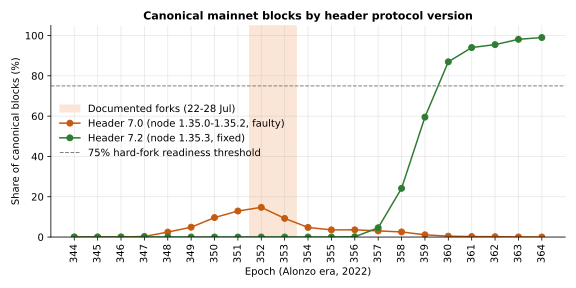
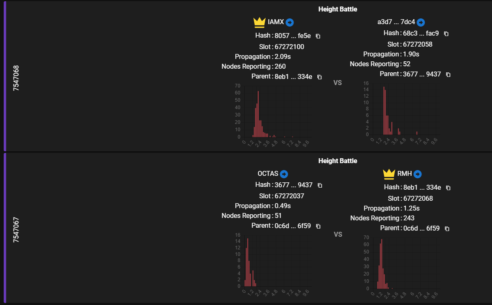
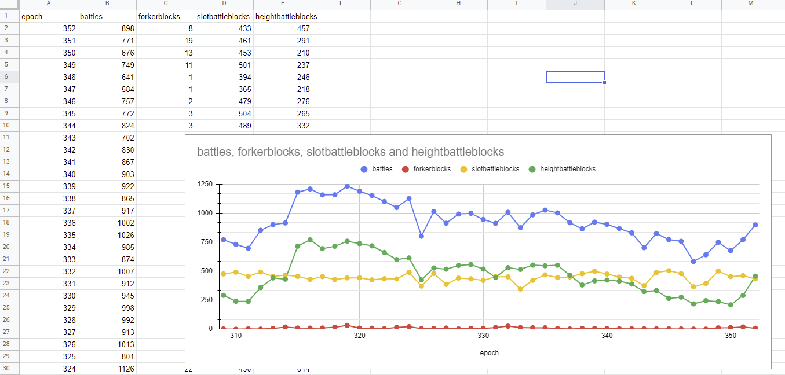
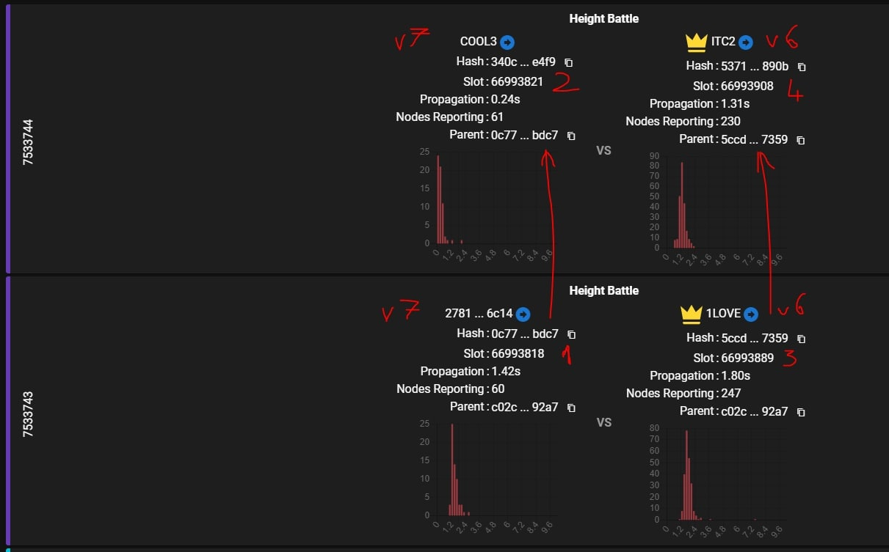
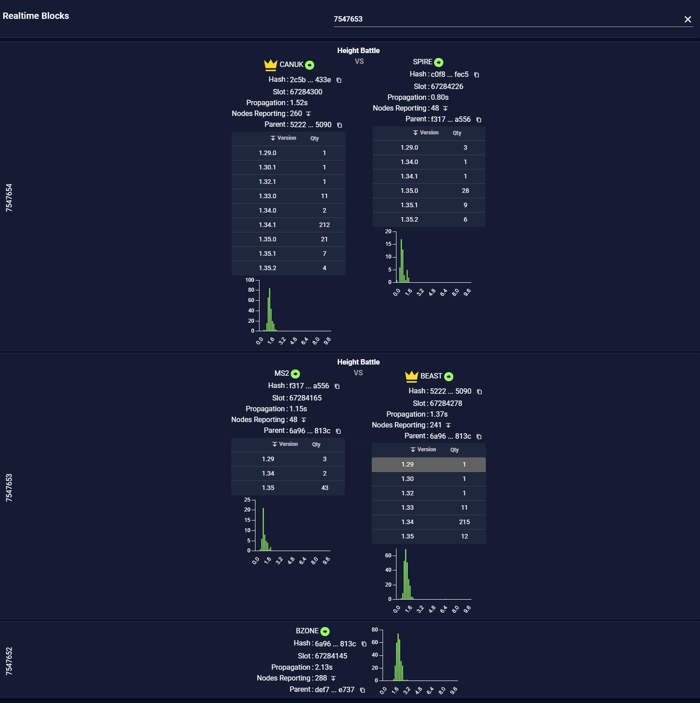

# CID-202204: Node 1.35.x Minimum-Fee Bug, Mainnet Forks and Rollback to 1.34.1

*This report was generated with AI (Claude Opus 5.5) from the public sources listed under Sources. To correct or remove content, see [Corrections and removals](../README.md#corrections-and-removals).*

> In July 2022, ahead of the Vasil upgrade, some Cardano stake pool operators (SPOs) ran the new node versions 1.35.0, 1.35.1 or 1.35.2 on mainnet, which IOG had told them they were free to do [7]. These versions had a fault in the ledger rules of the era then live on mainnet (Alonzo): when checking that a transaction paid enough fee, they ignored the cost of running its smart-contract scripts [1][2][3]. From about 22 July, blocks from these nodes that contained an underpaying script transaction were accepted by other 1.35.x nodes but rejected as invalid by the majority, which ran 1.34.1. The result was a series of short forks in which the affected pools, and other 1.35.x pools that built on their blocks, lost those blocks [1][6]. The stake pool ATADA and the block-monitoring site PoolTool spotted the pattern, and on 26 July an operator's logs led a ledger maintainer to the cause [1][13]. The same day IOG told operators on 1.35.0 or 1.35.1 to roll back to 1.34.1; it added 1.35.2 to that instruction on 29 July [8]. The majority chain always won, so the chain never split for good and no funds were lost. The fix shipped in node 1.35.3 on 11 August [5]; by the Vasil hard fork on 22 September 2022, 99% of blocks came from 1.35.3 [10][12]. Had a faulty version reached the 75% adoption IOG required before triggering the hard fork, mainnet could have split into two chains [9].

## Timeline (UTC)

| Time | Event |
|---|---|
| 2022-02-15 17:22 | cardano-ledger PR #2644 "Refactor UTxO rules for better re-use in future Eras" is merged. One of its commits replaces the Alonzo-specific minimum-fee check in the Alonzo UTXO rule (`minfee @era pp tx`) with the Shelley-era validation function `Shelley.validateFeeTooSmallUTxO` [3]. |
| 2022-06-24 to 07-24 | The share of canonical mainnet blocks whose header announces protocol version 7.0, which in the Alonzo era only nodes 1.35.0 to 1.35.2 did, rises from 0.3% (epoch 347) to 14.7% (epoch 352) [4][12]. |
| 2022-06-25 14:53 | IOG announces node 1.35.0 as "the final candidate for the mainnet Vasil release" [7]. The ledger revisions pinned by nodes 1.35.0, 1.35.1 and 1.35.2 all contain the Shelley-style fee check; node 1.34.1 pins a ledger revision of 2021-12-14 that still uses the Alonzo check [5]. |
| 2022-07-08 19:09 | IOG tags node 1.35.1 and tells SPOs: "If you would like to upgrade to 1.35.1 on mainnet now, please feel free to do so" [7]. |
| 2022-07-22 ~07:30 | Earliest documented impact. An operator who runs relays for six 1.35.2 block producers later reports that his block producer "lost several blocks due to bad/wrong propagation or 1.34.1 nodes rejection" in the 24 hours from this time [1]. |
| 2022-07-23 | Node 1.35.2 is tagged [5]. |
| 2022-07-24 13:24 | Martin Lang (ATADA Stakepool) opens cardano-node issue #4228 with PoolTool screenshots: "This is happening on mainnet right now". 1.35.x nodes ("v7", after the protocol version their block headers announce) keep losing height battles to 1.34.x ("v6") nodes and building on the losing blocks of other 1.35.x nodes. He reports losing 10 height battles within one to two days, "100% of all my height-battles" [1]. |
| 2022-07-24 16:51 | PoolTool's developer (GitHub `papacarp`) posts per-epoch data: 457 blocks in height battles so far in epoch 352, against 210 to 291 in epochs 347 to 351 [1]. |
| 2022-07-24 to 07-26 | Developers on the issue, including IOG engineer Marcin Szamotulski (GitHub `coot`), work on the hypothesis of a network partition between 1.34 and 1.35 nodes and ask operators for logs and relay addresses [1]. |
| 2022-07-26 10:35:33 | A node running 1.34.1 rejects block `4948f483…` (slot 67265442) with `FeeTooSmallUTxO (Coin 1006053) (Coin 1001829)` [6]. |
| 2022-07-26 12:25:28 | A 1.35.2 relay adopts block `3677ae1b…` (slot 67272037); a 1.34.1 relay of the same operator rejects it as invalid with the same fee error [1]. The next 1.35.x block, `68c39e85…`, builds on it [1]. Neither block is on the canonical chain, where blocks announcing protocol version 6.0 fill heights 7547067 (12:25:59) and 7547068 (12:26:31) [1][12]. |
| 2022-07-26 15:33 | The StakeCool operator (GitHub `feqifei`) posts these logs on issue #4228 [1]. |
| 2022-07-26 16:28 | IOG tells SPOs that node 1.35.2 is "for use on testnet ONlY" and that operators using 1.35.0 or 1.35.1 on mainnet ("a small number of you") should roll back to 1.34.1. No reason is given, and mainnet users of 1.35.2 are not addressed [8]. In the same minute, a developer (GitHub `karknu`) posts on the issue the CBOR of a losing block, reconstructed from packet captures [1]. |
| 2022-07-26 17:14 | Ledger maintainer Jared Corduan identifies the cause: the Alonzo UTXO rule uses the Shelley minimum-fee function, which ignores script execution, so "1.34 nodes accept a (strict) subset of blocks that 1.35 deems valid" [1]. At 17:52 he says downgrading to 1.34.1 on mainnet "is indeed the best thing for everyone to do at the moment" [1]. |
| 2022-07-27 13:22 | IOG deprecates 1.35.0 and 1.35.1: "These contain known issues and should not be used". SPOs should keep running 1.34.x on mainnet [8]. |
| 2022-07-27 21:51 | Ledger PR #2936, restoring the Alonzo minimum-fee function and adding a golden test built from the captured mainnet block, is opened. It is merged on 2022-07-28 at 17:56; the cherry-pick to the release branch (PR #2938) is merged at 20:03 [2]. |
| 2022-07-28 02:53 | A 1.34.1 node rejects block `9dece185…` (slot 67410475) with the same two fee errors. This is the last documented occurrence [6]. |
| 2022-07-28 | On Cardano360, IOG's Kevin Hammond announces a further delay to the Vasil hard fork, which CryptoSlate reports he attributed to bugs discovered in testing [15]. |
| 2022-07-29 | IOG's weekly report says the node, ledger and consensus teams "worked on bug fixes found in node v.1.35.2" and are preparing node 1.35.3 [11]. At 14:52, IOG tells operators running 1.35.0, 1.35.1 "or 1.35.2" on mainnet to roll back to 1.34.1 [8]. |
| 2022-08-01 12:25 | cardano-node PR #4242 moves the 1.35 release branch to the fixed ledger; its author writes that this "resolves the minfee bug which we strongly suspect is the root cause of #4228" [4]. In a video the same day, Charles Hoskinson says testing uncovered three separate bugs and that 1.35.3 is likely to be the hard-fork version [15]. |
| 2022-08-02 20:59 | Corduan corrects his earlier description of a soft fork: "This was actually an accidental _hard_ fork" [1]. |
| 2022-08-04 13:27 | cardano-node PR #4260 is merged. In the Alonzo era the fixed node will announce protocol version 7.2 "to distinguish from other versions of the node that are broadcasting major version 7" [4]. |
| 2022-08-11 17:12 | Node 1.35.3 is published on GitHub. Its notes list "Fix the alonzo UTxO rule to use alonzo minfee function (#2938)" [5]. |
| 2022-08-12 19:58 | IOG announces 1.35.3: "any SPOs running versions 1.35.0, 1,35.1, or 1.35.2 on mainnet should immediately upgrade to 1.35.3". The hard fork will be triggered once 75% of mainnet blocks come from the final Vasil node candidate and two other readiness criteria are met [9]. |
| 2022-08-17 20:26 | IOG says 1.35.3 is ready for mainnet deployment and that it has started upgrading its own mainnet nodes [9]. |
| 2022-08-18 | Developer Adam Dean credits ATADA and PoolTool with identifying "1.35.2 v. 1.34.1 as the culprit" for "incompatible forks" and a "decrease to chain density" on mainnet [13]. |
| 2022-08-21 | An SPO reports reproducing the 1.35.2 behaviour on an SPO dev net: a 1.35.2 node keeps an underpaying transaction in its mempool, while 1.34.1 and 1.35.3 nodes reject it [14]. |
| 2022-09-17 to 09-22 | In epoch 364, the last Alonzo epoch, 99.0% of canonical blocks announce version 7.2 (node 1.35.3) and 4 blocks announce 7.0 [12]. |
| 2022-09-22 21:44 | The Vasil hard fork takes mainnet into the Babbage era [10]. |
| 2022-10-21 12:56 | The reporter closes issue #4228: "resolved with 1.35.3" [1]. |

## Impact

**Who ran the faulty nodes.** IOG described mainnet users of 1.35.0 and 1.35.1 as "a small number" [8]. The table counts canonical blocks by the protocol version in their header [4][12]. Blocks lost in forks are not on the canonical chain, so the 7.0 figures are a lower bound.

| Epoch | Dates (2022) | Canonical blocks | Header 7.0 (1.35.0–1.35.2) | Header 7.2 (1.35.3) |
|---|---|---|---|---|
| 347 | 24–29 Jun | 19,345 | 60 (0.3%) | 0 |
| 349 | 4–9 Jul | 20,972 | 1,024 (4.9%) | 0 |
| 351 | 14–19 Jul | 20,893 | 2,698 (12.9%) | 0 |
| 352 | 19–24 Jul | 20,575 | 3,031 (14.7%) | 0 |
| 353 | 24–29 Jul | 20,232 | 1,872 (9.3%) | 0 |
| 354 | 29 Jul–3 Aug | 20,498 | 977 (4.8%) | 0 |
| 358 | 18–23 Aug | 21,169 | 536 (2.5%) | 5,116 (24.2%) |
| 364 | 17–22 Sep | 20,964 | 4 (0.0%) | 20,755 (99.0%) |

*Figure 1: Share of canonical mainnet blocks per Alonzo-era epoch whose header announced protocol version 7.0 (node 1.35.0–1.35.2) or 7.2 (node 1.35.3), against the 75% hard-fork readiness threshold. Data: Koios API, retrieved 2026-10-13 [12]; chart by the catalogue.*

Operators who reported running 1.35.x on mainnet block producers or relays included ATADA, the StakeCool operator and the pools PILOT, NETA1 and Berry [1]. In PoolTool data shown on the issue, orphaned blocks were reported by 50 to 60 nodes, against about 290 for an adopted block; operators read the 50 to 60 as the 1.35.x nodes that report to PoolTool [1].

**Consensus.** The forks spanned one or a few blocks [1]. In the 26 July example, two consecutive 1.35.x blocks were replaced about one minute later by blocks announcing version 6.0 [1][12]. In every documented case the 1.34.x chain won [1].

*Figure 2: PoolTool's view of the 26 July example. At height 7547067, OCTAS's block `3677…9437` (51 nodes reporting) loses to RMH's `8eb1…334e` (243 nodes); at 7547068 the next 1.35.x block, `68c3…fac9`, built on `3677…9437`, loses to IAMX's `8057…fe5e`. Source: StakeCool operator (`feqifei`), [comment on cardano-node issue #4228](https://github.com/IntersectMBO/cardano-node/issues/4228#issuecomment-1195638346) [1].*

**Lost blocks and chain density.** PoolTool counted 457 blocks involved in height battles in epoch 352 (the epoch was about 96% complete when the figure was posted), against 210 to 291 in each of epochs 347 to 351 [1]. A developer (GitHub `karknu`) pointed out that height battles rise with network utilisation and had been more frequent a few months earlier; PoolTool's chart shows about 600 to 770 per epoch around epochs 315 to 324 [1]. On-chain, epochs 352 to 354 had 366, 709 and 443 fewer blocks than the average of epochs 349 to 351 (20,941) [12]. That matches the reports of lower chain density [13] but does not prove the cause: epoch 347, when almost no 1.35.x nodes were producing, had an even larger dip (19,345 blocks) [12].

*Figure 3: Battles per epoch from PoolTool, epochs 309 to 352, posted on 24 July 2022. Height-battle blocks (green) rise to 457 in epoch 352, but were higher around epochs 315 to 324. Source: PoolTool developer (`papacarp`), [comment on cardano-node issue #4228](https://github.com/IntersectMBO/cardano-node/issues/4228#issuecomment-1193355396) [1].*

**Node operations.** 1.34.1 nodes that received an invalid block suspended the peer that sent it. One operator reported that his node "stops syncing" until restarted; a developer suggested it had banned the peer that sent the bad block and had no other peer to fall back on [6]. Operators with a 1.34.1 block producer behind a 1.35.1 relay reported that the two stopped talking until the relay was restarted [1].

**Users and funds.** No funds were lost. As far as the logs and chain data show, every block containing the underpaying transactions was orphaned, so those transactions never reached the canonical chain [1][6][12]; other transactions in orphaned blocks had to wait for a later block. Pools whose blocks were orphaned, and their delegators, lost the rewards for those blocks; the amount is not quantified.

Rated **SEV-2** (consensus safety): honest nodes running official releases disagreed on block validity, but the 1.34.x majority chain always won, so there was no lasting fork [1][6][12]. Potential **SEV-1** (consensus safety): IOG's trigger for the hard fork was 75% of mainnet blocks from the final Vasil candidate [9], and until late July that candidate was the 1.35 line [7]. Had a faulty 1.35.x version reached that share while mainnet was still in the Alonzo era, a single underpaying script transaction could have put the majority on a chain that 1.34.x nodes, and later the fixed 1.35.3, would reject as invalid: a lasting chain split [1][9][14]. Recoverability: extra-resources. Each fork resolved through normal chain selection, but ending them took a coordinated operator rollback to 1.34.1 and an unscheduled fix release, node 1.35.3 [5][8][9].

## Root cause

**The bug.** In the Alonzo era, the minimum fee of a transaction has two parts: a size-based part, `minFeeA × size + minFeeB`, and a charge for the script execution units it declares, priced with the `prices` protocol parameter. Shelley-era transactions have no Plutus scripts, so the Shelley `minfee` function computes only the size part [1][2]. In February 2022, ledger PR #2644 restructured the UTXO rules into small validation functions that could be reused across eras [3]. In the Alonzo `feesOK` check, the line `(minimumFee <= theFee) ?! FeeTooSmallUTxO minimumFee theFee` (with `minimumFee = minfee @era pp tx`) became a call to `Shelley.validateFeeTooSmallUTxO` [3]. As Corduan explained: "We refactored our rules post node 1.34, attempting to reduce code copy, but ended up placing the Shelley calculation in the Alonzo rules" [1]. The Babbage rule, which Vasil would introduce, used the correct function [1].

**Why it forked the network.** A node with the bug accepted any Alonzo-era transaction whose fee covered the size part, even if it did not pay for script execution, so 1.34.x accepted a strict subset of what 1.35.0–1.35.2 accepted [1]. Developers on the issue reconstructed the failure mode as follows [1]:

1. An underpaying Plutus transaction is submitted to the network. A 1.35.x node keeps it in its mempool, while 1.34.x nodes reject it [14].
2. A 1.35.x block producer includes it in a block. Other 1.35.x nodes adopt the block. 1.34.x nodes reject it with `FeeTooSmallUTxO` and suspend the peer that sent it [1][6].
3. If the next slot leader also runs 1.35.x, it builds on the invalid block, which 1.34.x nodes also never adopt [1].
4. The next block from a 1.34.x producer extends the valid chain. Once that chain is longer, the 1.35.x nodes switch to it, because blocks valid under 1.34.x are also valid under 1.35.x [1]. The 1.35.x blocks are orphaned.

*Figure 4: Two consecutive height battles at heights 7533743 and 7533744, annotated by Martin Lang. A v7 (1.35.x) block builds on another v7 block, and both lose to v6 (1.34.x) blocks reported by about four times as many nodes. Source: Martin Lang (ATADA), [opening post of cardano-node issue #4228](https://github.com/IntersectMBO/cardano-node/issues/4228) [1].*

The transaction in the golden-test block was 4,224 lovelace short: it paid 1,001,829 lovelace against a correct minimum of 1,006,053 [2]. Two error pairs, (1,006,053 / 1,001,829) and (1,011,641 / 1,007,417), appear in rejected blocks on both 26 and 28 July [1][6], which suggests that the same few transactions stayed in 1.35.x mempools and were included again whenever a 1.35.x pool forged a block.

**Soft fork or hard fork.** Corduan first called it a soft fork won by the "conservative nodes". On 2 August he corrected this: "This was actually an accidental _hard_ fork. Blocks produced by nodes with the bug would potentially _not_ be valid according to a 1.34 node". Had the bug instead demanded a higher fee, it would have been a soft fork [1].

**Why testing missed it.** Corduan wrote: "In hindsight, we should have had golden tests for the fee calculation in each era (we have them for some eras, but it seems we missed the Alonzo ones)". He did not yet understand why the property tests had not caught it, since their generators used the correct `minfee` [1]. Martin Lang noted that the situation was hard to reproduce on the public testnet, which by then was in the Babbage era with all nodes on 1.35.x, while mainnet ran a mix of versions in the Alonzo era [1].

## Detection

The community found the problem. Martin Lang of ATADA noticed repeated lost height battles on PoolTool's real-time block view and opened issue #4228 about two days after the first documented losses [1]. PoolTool's developer then correlated the versions of the nodes reporting each block and found that orphaned blocks were at first reported only by 1.35.x nodes [1]. The turning point was the StakeCool operator's pair of logs (15:33 UTC, 26 July), in which a 1.35.2 relay adopted a block that a 1.34.1 relay rejected with `FeeTooSmallUTxO` [1]; the same error had appeared at 10:35 UTC in the logs of another 1.34.1 node, whose operator filed a separate issue at 16:27 UTC [6]. Corduan posted the diagnosis at 17:14 UTC, about 100 minutes after the StakeCool logs and about 52 hours after issue #4228 was opened [1]. By then the faulty code had been in the ledger since February 2022 [3] and in node releases presented as mainnet candidates since 25 June [5][7].

*Figure 5: PoolTool's real-time view with the node versions reporting each block, captured during development on 26 July 2022. The losing blocks at heights 7547653 and 7547654 were each reported by 48 nodes, almost all on 1.35.x; the winning blocks were reported by 241 and 260 nodes, most of them on 1.34. Source: PoolTool developer (`papacarp`), [comment on cardano-node issue #4228](https://github.com/IntersectMBO/cardano-node/issues/4228#issuecomment-1195667455) [1].*

## Response and resolution

IOG responded first with operating instructions: the 26 July rollback notice went out about 46 minutes before the root cause was posted, followed by the deprecation of 1.35.0 and 1.35.1 on 27 July and the extension to 1.35.2 on 29 July (see Timeline). None of these notices gave a technical reason [8]. The share of canonical blocks from version-7.0 nodes fell from 14.7% in epoch 352 to 4.8% in epoch 354, but did not reach zero before the hard fork [12].

The fix, ledger PR #2936, put the Alonzo `minfee` back into the Alonzo UTXO rule and added a golden test, `goldenMinFee`, built from the captured mainnet block [2]. It was cherry-picked to the release branch [2], pulled into the node's 1.35 branch on 1 August [4], and shipped in 1.35.3 on 11 August [5]. PR #4260 made the fixed node announce protocol version 7.2 in Alonzo-era block headers, so that its blocks could be told apart from those of the faulty versions [4]; the 7.2 share rose from 24.2% in epoch 358 to 99.0% in epoch 364 [12]. IOG told operators on 1.35.0–1.35.2 to upgrade immediately, declared 1.35.3 ready for mainnet on 17 August [9], and triggered the Vasil hard fork on 22 September [10].

## Remediation and follow-up

- The Alonzo UTXO rule uses the Alonzo minimum-fee function again. The ledger changelog records that it "was previously using the incorrect minfee function (from Shelley)" [2].
- A golden test of the Alonzo fee calculation, based on a real mainnet block that triggered the bug, was added, filling the gap Corduan had named [1][2].
- During review of the fix, another ledger developer checked the rest of the refactor for similar mistakes; Corduan confirmed that the reused value-conservation and maximum-transaction-size checks were correct for Alonzo [2].
- Block headers of the fixed node carry a distinct protocol version, so adoption of the exact hard-fork release could be tracked on-chain [4][12].
- IOG stopped recommending any 1.35 version on mainnet until 1.35.3 was ready [8][9]. Node 1.35.3 was released together with new pre-production and preview test environments [9]; the legacy testnet's problems are covered in CID-202203.

## Incident handling assessment

Assessment of the responsible party's handling (Input Output Global, maintainer of cardano-node and cardano-ledger) against SOC 2 Trust Services Criteria, based on public sources only (see CLASSIFICATION.md, section 10).

| Criterion | Result | Observation |
|---|---|---|
| CC7.2 Monitoring and detection | Exceptions noted | The forks were found by stake pool operators from PoolTool data, about two days after the first documented block losses [1][13]. No source shows IOG's own monitoring detecting the mixed-version forks. |
| CC7.3 Evaluation of events | Exceptions noted | Developers first pursued a network-partition hypothesis; the root cause was posted about 52 hours after the issue was opened, though within about 100 minutes of the decisive operator logs [1]. IOG's first notice did not address operators already running 1.35.2 on mainnet; they were added to the rollback instruction three days later [1][8]. |
| CC7.4 Incident response | No exceptions noted | IOG told mainnet operators to roll back to 1.34.1 on 26 July and deprecated 1.35.0 and 1.35.1 the next day; the ledger fix was merged on 28 July [2][8]. The ledger maintainer endorsed the downgrade on the public issue [1]. |
| CC7.5 Recovery | No exceptions noted | The root cause was fixed in node 1.35.3, with a golden test built from the captured mainnet block, a review of the rest of the refactor and a distinct header version for the fixed node [2][4][5]. No public analysis of why the property tests missed the bug was found [1]. |
| CC2.3 External communication | Exceptions noted | The technical record on GitHub is detailed [1][2], but IOG's operator notices gave no reason for the rollback and its weekly report mentioned only "bug fixes found in node v.1.35.2" [8][11]. No IOG post-mortem with timeline or impact figures was found. |
| CC8.1 Change management | Exceptions noted | The defect was introduced by a ledger refactor (PR #2644) without golden tests for the Alonzo fee calculation, a gap the maintainer acknowledged [1][3]. Releases containing it were presented as mainnet candidates and SPOs were invited to run them on mainnet, while the testnet could no longer exercise a mixed-version Alonzo network [1][7]. |

## Lessons for builders

- **Any change in what a node accepts is a fork.** A new version that accepts more than the old one creates a hard fork against nodes that have not upgraded, even if no protocol change was intended [1]. Before release, compare old and new nodes on the same inputs, for example by replaying recent mainnet blocks and mempool transactions and generating transactions whose fee is exactly at or just below the minimum.
- **Pin every era's consensus calculations with golden tests.** The bug came from a refactor that shared code across eras [1][3]. Test fees and other era-specific rules against known values from real chain data; a single captured block was enough to reproduce this bug [2].
- **Test the transition period, not just the target era.** The public testnet had already moved to Babbage with all nodes upgraded, so it could not show what happens on a mixed-version Alonzo network [1]. Before a hard fork, run old and new nodes together in the pre-fork era with real script transactions.
- **SPOs: treat pre-hard-fork releases as untested on mainnet.** An invitation to run them early [7] does not make them safe. Watch for unusual height battles, keep ChainDB tracing on so that `InvalidBlock` errors are logged, and keep several upstream peers: a node that bans its only peer looks stuck [1][6].
- **Wallet and dApp builders: do not treat mempool acceptance as validity.** For script transactions, include the execution-unit charge (`prices × ExUnits`) in the fee. The underpaying transactions here were held by some nodes but never confirmed [1][14]; track inclusion on chain and rebuild a transaction that does not confirm within its validity interval.
- **Make readiness metrics specific to the release.** Counting blocks by major protocol version could not tell the faulty and fixed nodes apart; a distinct header version did [4][12].

## Disputed or open points

- **Start of impact.** Nodes with the defect produced mainnet blocks from epoch 347, in late June [12], but the first documented losses date from 22 July [1]. Whether underpaying script transactions caused forks earlier is unknown. The operator report of block losses from 07:30 UTC on 22 July has no logs [1], and another operator's lost height battle at block 7530726 that day has not been linked to the fee error [1][12].
- **Scale.** No source counts the blocks lost or the pools affected. The PoolTool and on-chain figures are consistent with the reports [1][12][13], but epoch 347 shows that other factors move block counts by similar amounts [12].
- **Networking symptoms.** Before the fee bug was found, operators reported 1.34.1 block producers losing contact with 1.35.x relays [1]. Suspension of peers that send invalid blocks would probably explain this [6]. However, the separate networking issue #4226 was closed only as "should be fixed in 1.35.3", without a stated cause [1], and PR #4242 calls the fee bug the "strongly suspect[ed]" root cause of #4228 without confirming it [4].
- **Origin of the underpaying transactions.** Their hashes, senders and intent are not published. Whether they came from faulty fee estimation in a wallet or dApp, or were sent deliberately, is unknown.
- **Mainnet forks and the testnet breakage.** Adam Dean's thread links the mainnet forks with the August breakage of the legacy testnet. He first blamed "a bug in Cardano Node v 1.35.2", then corrected this to "a feature change between 35.2 and 35.3" [13]. An SPO likewise described the fee bug as the one "that caused issues for testnet" [14]. But the fee bug affected only the Alonzo rule, and the testnet was already in the Babbage era [1]. The sync failures of 1.35.3 on the legacy testnet, documented in CID-202203, showed a different error (`MalformedScriptWitnesses`). No primary source shows whether the fee bug left invalid Alonzo-era blocks on the legacy testnet.
- **Contribution to the Vasil delay.** The fee fix was part of the 1.35.3 scope [4][5]. IOG's public explanations of the late-July postponement referred to bugs found in testing, three bug-fix releases and the SECP256k1 primitives (see CID-202203) without naming this bug [11][15]. How much of the delay it caused is not known.

## Sources

1. [P] IntersectMBO/cardano-node, Issue #4228 "[BUG] - 1.35.* v7 nodes on Mainnet are picking up the wrong parent-block - Vasil HF Blocker?" (opened by gitmachtl / Martin Lang, ATADA; closed 2022-10-21), 2022-07-24. https://github.com/IntersectMBO/cardano-node/issues/4228 (reporter profile: https://github.com/gitmachtl; related networking issue #4226, closed 2022-10-24: https://github.com/IntersectMBO/cardano-node/issues/4226)
2. [P] IntersectMBO/cardano-ledger, Pull Request #2936 "the alonzo UTxO rule to use alonzo minfee function" (merged 2022-07-28), 2022-07-27. https://github.com/IntersectMBO/cardano-ledger/pull/2936 (release-branch cherry-pick, PR #2938: https://github.com/IntersectMBO/cardano-ledger/pull/2938)
3. [P] IntersectMBO/cardano-ledger, Pull Request #2644 "Refactor UTxO rules for better re-use in future Eras" (merged 2022-02-15), 2022-02-04. https://github.com/IntersectMBO/cardano-ledger/pull/2644 (commit switching the Alonzo fee check: https://github.com/IntersectMBO/cardano-ledger/commit/08021e0241da05caac6e625de8fb2d26b583b3be)
4. [P] IntersectMBO/cardano-node, Pull Request #4242 "update ledger to the tip of release/1.0.0" (merged 2022-08-01), 2022-07-28. https://github.com/IntersectMBO/cardano-node/pull/4242 (header version: PR #4260 "Bump block header protocol version", merged 2022-08-04: https://github.com/IntersectMBO/cardano-node/pull/4260; 1.35.3 scope: https://github.com/IntersectMBO/cardano-node/issues/4257)
5. [P] IntersectMBO/cardano-node, "Cardano Node 1.35.3" release, 2022-08-11. https://github.com/IntersectMBO/cardano-node/releases/tag/1.35.3 (ledger pins: https://github.com/IntersectMBO/cardano-node/blob/1.34.1/cabal.project, https://github.com/IntersectMBO/cardano-node/blob/1.35.0/cabal.project, https://github.com/IntersectMBO/cardano-node/blob/1.35.1/cabal.project, https://github.com/IntersectMBO/cardano-node/blob/1.35.2/cabal.project, https://github.com/IntersectMBO/cardano-node/blob/1.35.3/cabal.project; 1.35.2 tag: https://github.com/IntersectMBO/cardano-node/releases/tag/1.35.2)
6. [P] IntersectMBO/cardano-node, Issue #4236 "[BUG] - Mainnet Node stops syncing altogether after encountering an invalid block" (marked duplicate of #4228), 2022-07-26. https://github.com/IntersectMBO/cardano-node/issues/4236
7. [P] IOG SPO Announcements (Telegram), post on node 1.35.1 and mainnet use, 2022-07-08. https://t.me/SPOannouncements/170 (node 1.35.0 as final Vasil candidate, 2022-06-25: https://t.me/SPOannouncements/162)
8. [P] IOG SPO Announcements (Telegram), instruction to roll back 1.35.0/1.35.1 on mainnet to 1.34.1, 2022-07-26. https://t.me/SPOannouncements/173 (deprecation of 1.35.0/1.35.1, 2022-07-27: https://t.me/SPOannouncements/174; reminder extending the rollback to 1.35.2, 2022-07-29: https://t.me/SPOannouncements/175)
9. [P] IOG SPO Announcements (Telegram), "VASIL UPDATE! ... node version 1.35.3 has been released", 2022-08-12. https://t.me/SPOannouncements/181 (ready for mainnet deployment, 2022-08-17: https://t.me/SPOannouncements/186)
10. [P] IOG SPO Announcements (Telegram), posts on the Vasil mainnet hard fork, 2022-09-22. https://t.me/SPOannouncements/214 (schedule and "the Vasil node (1.35.3)", 2022-09-13: https://t.me/SPOannouncements/212; confirmation, 2022-09-23: https://t.me/SPOannouncements/216)
11. [P] Essential Cardano (IOG, Olga Hryniuk), "Weekly development report as of 2022-07-29", 2022-07-29. https://www.essentialcardano.io/development-update/weekly-development-report-as-of-2022-07-29
12. [P] Koios (on-chain data), "Cardano mainnet epoch_info for epochs 344–365, block header protocol versions per epoch, and blocks at heights 7547064–7547070", retrieved 2026-10-13. https://api.koios.rest/api/v1/epoch_info?epoch_no=gte.344&epoch_no=lte.365&select=epoch_no,start_time,end_time,blk_count&order=epoch_no.asc (version counts per epoch, with header `Prefer: count=exact` and the epoch and minor version substituted: https://api.koios.rest/api/v1/blocks?epoch_no=eq.352&proto_major=eq.7&proto_minor=eq.0&select=hash&limit=1; blocks: https://api.koios.rest/api/v1/blocks?block_height=gte.7547064&block_height=lte.7547070&select=hash,block_height,abs_slot,block_time,pool,proto_major,proto_minor)
13. [S] Adam Dean (@adamKDean), thread on X (unrolled by Thread Reader App), 2022-08-18. https://threadreaderapp.com/thread/1560295448333520896.html (original: https://twitter.com/adamKDean/status/1560295448333520896)
14. [S] Watcher Guru, "Cardano Developer Confirms That the Testnet Has Stabilized and the Bug Is Fixed" (quotes SPO @AncientKraken), 2022-08-21. https://watcher.guru/news/cardano-developer-confirms-testnet-has-stabilized-bug-is-fixed
15. [S] CryptoSlate, "Cardano founder addresses Vasil hard fork delay; says rollout 'shouldn't be much longer'", 2022-08-02. https://cryptoslate.com/cardano-founder-addresses-vasil-hard-fork-delay-says-rollout-shouldnt-be-much-longer/
