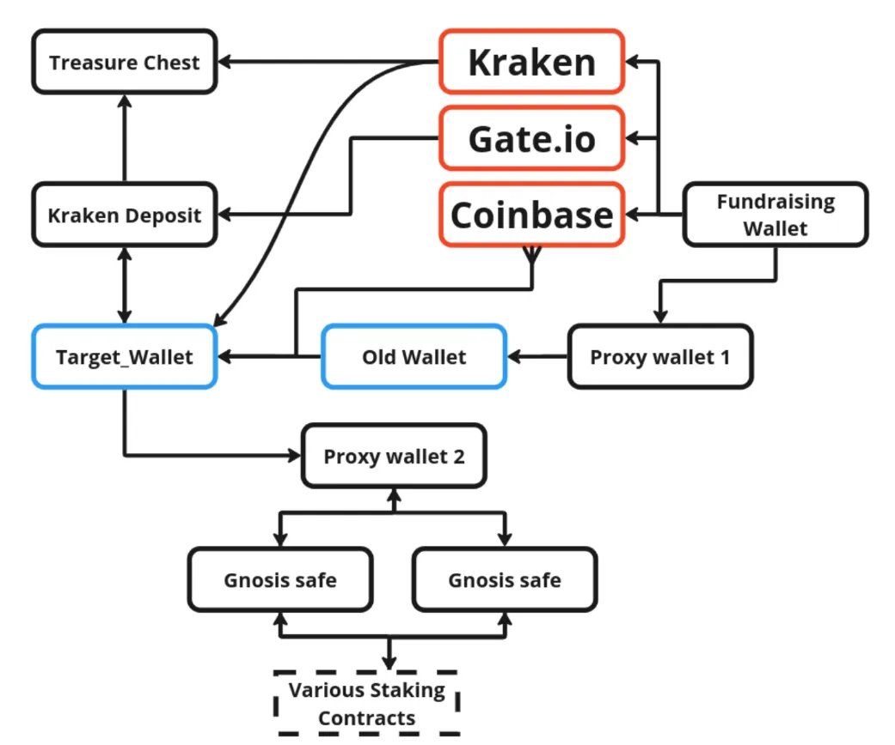
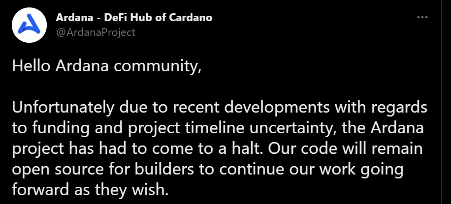

# CID-202205: Ardana Stablecoin Project Halts Development

*This report was generated with AI (Claude Opus 5.5) from the public sources listed under Sources. To correct or remove content, see [Corrections and removals](../README.md#corrections-and-removals).*

> Ardana was building a US-dollar stablecoin (dUSD) and a stable-asset exchange (Danaswap) on Cardano. It announced USD 10 million of investment in October 2021, sold its DANA token to the public, and from July 2022 ran an Initial Stake Pool Offering (ISPO), paying DANA to delegators of partner stake pools [3][4][16]. In January 2022 it said almost all development was finished [2]; on 24 November 2022 it halted the project, citing "funding and project timeline uncertainty" [1][12]. No product launched, so no user deposits were at risk; the losses fell on investors and token holders, and DANA lost 42–83% of its price within a day [12][13][15]. Ardana said Ardana Labs would hold the remaining funds pending a successor team [16]; no handover, refund or financial statement has followed. In September 2023 the risk-analytics firm Xerberus alleged that up to USD 4 million of the raised money had been lost in speculative trading [19][20]; the allegations are unverified and unanswered by Ardana [20]. The Cardano L1 was not at fault.

## Timeline (UTC)

| Time | Event |
|---|---|
| 2021-09-02 | First transaction into the Ethereum wallet that Xerberus identifies as Ardana's fundraising wallet. USDC transfers totalling millions of dollars follow from 15 September 2021 [20]. |
| 2021-10-30 | Ardana announces that, after the first round of its public sale on Tokensoft, it has raised USD 10 million "including previous strategic funding rounds", in a round led by Three Arrows Capital, cFund and Ascensive Assets [3]. |
| 2021-11 | Public IDOs reportedly raise USD 1.5 million [16]. DANA launches on 22 November 2021 [12]. CryptoSlate reports an all-time high of USD 11.27 three days later [12]; CoinDesk, citing CoinMarketCap, puts the November 2021 peak at USD 9.2916 [13]. |
| 2022-01-01 14:20 | Ardana's New Year thread states: "Almost all of the product/smart contract development is finished; therefore, our efforts are now focused on supporting tools like CIP-33, and related tasks" [2]. According to Cointelegraph, the thread also said the products could launch "within a few weeks" and blamed the delay on Cardano "liquidation issues" and "risk to users' funds" [14]. |
| 2022-03 | According to Xerberus, the team's wallets start selling assets on DEXs, and keep doing so until November 2022 [20]. |
| 2022-07-04 | The Ardana ISPO starts. It is to run until 2022-12-31 and officially end on 2023-01-05 21:45 UTC, with DANA rewards claimable each epoch through Drip Dropz [4]. |
| 2022-09-17 10:47 | The Cardano address that Ardana's documentation lists as its treasury [6] is funded with 4,786,199.8 DANA and about 21.27 ADA [8][16]. |
| 2022-11-07 | Founder Ryan Matovu publicly denies claims that he founded earlier failed token projects [16]. |
| 2022-11-10 | Ardana's last development diary reports Danaswap work and says the team "captured old dUSD issues to put together a dependency graph showing what has been done vs. what still must be done" and is "writing and reviewing test descriptions for the dUSD spec" [5]. |
| 2022-11-24 01:44 | Ardana posts the halt announcement on X [1] (time derived from the post ID). Some outlets date it 23 November, which matches US local time [13][16]. Orbis, a project with the same founder, announces its own halt the same day [12][16]. |
| 2022-11-24 08:03 | John O'Connor, director of African operations at IOHK, posts that both he and cFund invested in Ardana, and that "last I heard DeX was meant to be out this month" [11][15]. |
| 2022-11-24 12:15 | CryptoSlate reports that DANA has fallen 77.8% to an all-time low of USD 0.01158 [12]. |
| 2022-11-24 13:51 | Charles Hoskinson posts: "Looks like I might have just lost 500k on it. I was an investor through the cfund. Waiting for a readout from them" [10]. |
| 2022-11-24 to 2022-11-25 | CoinDesk reports DANA down 82.54% in 24 hours, at USD 0.01046 [13]. Forkast reports USD 0.008284, down 42.2% in 24 hours at its time of publication [15]. |
| 2022-11 (after the halt) | In a Twitter Space, Matovu reportedly says that USD 7 million was spent on team salaries and some on infrastructure and marketing, and that Ardana and Orbis will try to continue [16]. |
| 2022-12-29 | A Cardano Forum thread notes that nothing has been heard about rescue attempts or about finishing the ISPO [17]. |
| 2023-02-04 09:55 | All 4,786,199.8 DANA in the published treasury address are transferred to a different address (transaction `aff2d159…5315a`); the remaining ADA follows at 09:56 (transaction `9c57dbba…41b53`). The address has held a zero balance since [7][8]. |
| 2023-02-09 17:08 | Ardana's X account states that "the remaining tokens for the seed and private sale tokens have been distributed completing the vesting of all presale tokens", and calls this "the first phase of transitioning the Ardana project forward" [18]. |
| 2023-09-06 | Xerberus publishes "The Life and Death of Ardana" on X [20]. |
| 2023-10-03 | Cointelegraph publishes a detailed account of the Xerberus findings. Matovu does not reply to its request for comment within two weeks [20]. |
| 2026-10-13 | The treasury address shows a zero balance [8]. The Ardana Labs GitHub organisation remains public with 23 repositories [9]. |

## Impact

Neither dUSD nor Danaswap launched [20]. No Ardana smart contract ever held user deposits, so none were exposed to loss or freezing.

The losses fell on investors and token holders. Ardana announced USD 10 million of investment [3], and AdaPulse put the combined loss of investors and public-sale buyers at potentially more than USD 11 million [16] (see Disputed or open points); that is capital invested in a failed venture, not funds drained or stolen. Charles Hoskinson said he "might have just lost 500k" through cFund, a lead investor [10], and IOHK's John O'Connor said he had also invested [11]. DANA's one-day fall was reported at between 42.2% and 82.54% [12][13][15], and about 99.85% over the preceding year [14]; these are market losses.

Delegators to Ardana Stake Pool Alliance (ASPA) pools were promised DANA rewards up to 2022-12-31, from a programme of 2.5 million DANA [4], later reported as 4 million [16]. Delegated ADA stays in the delegator's wallet, so no principal was at risk. Ardana's ISPO announcement does not say how the pools' ADA rewards were shared with the project [4]; Cointelegraph describes ISPOs as funding developers with delegators' staking rewards [14]. Ardana promised "more updates surrounding the ongoing ISPO" [16], but no update or final distribution has been found [17].

Ardana's documentation listed a single Cardano treasury address [6]. From September 2022 it held about 21.27 ADA and 4,786,199.8 DANA, and no stablecoins [8][16]; its balance was transferred out on 2023-02-04 [7][8]. According to Xerberus, at least USD 9.07 million of the raise was held in stablecoins on Ethereum [19], in wallets Ardana never published [20]. The only account of spending is the founder's reported oral breakdown in a Twitter Space [16]; no financial statement or audited accounting has been published. What happened to the Ethereum funds is contested (see Root cause).

Rated SEV-3 (dimension: trust and integrity): what Ardana told its community differed materially from the project's actual state, to the detriment of DANA holders and ISPO delegators. It described development as almost finished and a launch as weeks away in January 2022, while dUSD was still being specified ten months later (see Root cause) [2][5][14]; and the ISPO was still running when the project halted, after which the ISPO update it promised did not appear [16][17]. No verified funds were drained, so the financial dimension does not apply. Potential SEV-1 (dimension: financial loss): if substantiated, the Xerberus allegation that up to USD 4 million of the raised funds was lost in speculative trading [19][20] would be a gross loss above USD 1 million. Recoverability: not-recoverable, the CLASSIFICATION.md case of a product abandoned with raised funds unaccounted for; the code is public [9] and Ardana invited another team to take over [16], but almost four years later no handover, refund or financial statement has appeared.

## Root cause

The root cause is organisational, but the sources support several readings and do not all agree.

Ardana's own explanation was "funding and project timeline uncertainty" [1][12]. It added: "Development on Cardano has been difficult with a lot of funding going into tooling, infrastructure and security. This alongside the uncertainty around development completion has led to the best course of action being halting development of dUSD" [13][16]. The public repositories bear out part of this: the team built general-purpose infrastructure, including a dApp template, CI machines and YubiHSM signing bindings [9]. In January 2022 Ardana had blamed the delay on the network being unsuited to protocols with liquidations [14]; that was the team's assessment, which community members rejected as "blaming Cardano" [14][15], not an established protocol fault.

Ardana's claimed readiness also outran its work. In January 2022 it said that "almost all of the product/smart contract development is finished" [2]; its last development diary, in November 2022, describes listing "what has been done vs. what still must be done" for dUSD and writing test descriptions for its specification [5]. dUSD appears to have been still at the specification and testing stage ten months later.

The funding environment had turned against the project. Three Arrows Capital, a lead investor, had gone bankrupt [13][15]; AdaPulse wrote that, according to reports, 3AC withdrew its investment and was no longer listed on Ardana's website [16]. The halt also came shortly after the FTX collapse, which Cointelegraph says made fundraising hard for many projects [20].

Xerberus offers a different account, centred on treasury management. It alleges that about USD 7.2 million of the raised stablecoins reached a "Target Wallet" through proxy wallets and centralised exchanges, that up to USD 4 million was then lost trading volatile assets on PancakeSwap, Uniswap, SushiSwap, GMX and staking protocols, shortening the project's runway, and that about USD 1.4 million in USDC remained in a related wallet [19][20]. It also alleges that up to USD 6 million was extracted from the Cardano ecosystem through DANA sales by treasury and potential founder wallets [19], and it identified about USD 1.82 million in payments to the project's main development contractor [20]. These figures are unverified, and Ardana has not responded to them in any source reviewed [20].

*Figure 1: Xerberus's diagram of how, it alleges, the raised funds moved from a "Fundraising Wallet" through proxy wallets and the exchanges Kraken, Gate.io and Coinbase to a "Target_Wallet", and from there to Gnosis safes and staking contracts. Unverified third-party allegations (see Disputed or open points). Source: Xerberus, "The Life and Death of Ardana" [19].*

Finally, the project had no treasury governance or wind-down terms. DANA was described as a governance token [3][12], yet the halt left the remaining funds under the sole control of Ardana Labs, with no criteria, timeline or community oversight for a handover [16]. Only the Cardano treasury address was published [6]; Xerberus identified the Ethereum fundraising wallets through Tokensoft sale pages and transaction analysis [20].

## Detection

There was no detection event in the technical sense. The community learned of the halt from Ardana's own announcement [1], which surprised most observers, including investors connected to IOHK and cFund [10][11][16]. Warning signs had been raised in public before: in November 2021 a pseudonymous account accused the founder of earlier failed projects, which he denied [16], and commentators listed the absence of an MVP or published audits as red flags [16]. Xerberus later said its risk model would have flagged Ardana's on-chain behaviour from 2 September 2021, with five further alerts before the announcement [19]; that hindsight claim has not been independently assessed.

## Response and resolution

Ardana announced the halt in a thread on X, with no post-mortem, financial statement or treasury report [1][12][16]. The code was to "remain open source for builders" [16], and the GitHub organisation is still public [9]. On the treasury, the thread said: "Remaining funds and treasury balances etc will be held by Ardana Labs until another competent dev team in the community comes forward to continue our work" [16]. No such team or handover is documented, and the ISPO update the thread promised has not been found [16][17].

*Figure 2: The opening post of Ardana's halt announcement on X, 24 November 2022 [1], as reproduced by AdaPulse. The original post can no longer be retrieved from X. Source: AdaPulse (LiberLion), "What We Can Learn from the Current Failure of Ardana and Orbis" [16].*

In a Twitter Space after the halt, Matovu reportedly gave a spending breakdown dominated by salaries and said both projects would try to continue [16]. Orbis, the founder's other project, announced a full refund of its recent NFT sale [16]; no equivalent refund for Ardana investors or DANA holders is documented.

On 2023-02-04 the DANA and ADA in the published treasury address were transferred to another address [7][8], and on 2023-02-09 Ardana announced that vesting of all seed and private-sale tokens was complete, "the first phase of transitioning the Ardana project forward" [18]. No later phase is documented, and no legal action or official response to the Xerberus findings appears in the sources reviewed.

## Remediation and follow-up

No remediation by Ardana is documented: no refund, audited accounting of the raise, completed handover or ISPO settlement; only the open-source repositories remain [9][16][17]. AdaPulse drew a red-flag checklist from the case (no MVP, no proven audits, a founder running several unfinished projects, a treasury holding little besides the project's own token) [16], and Xerberus used it to calibrate its on-chain risk-rating model [19][20].

## Incident handling assessment

Assessment of the responsible party's handling (Ardana Labs; for this discontinuation, the handling of the wind-down) against SOC 2 Trust Services Criteria, based on public sources only (see CLASSIFICATION.md, section 10).

| Criterion | Result | Observation |
|---|---|---|
| CC7.2 Monitoring and detection | Not evidenced | Ardana announced the halt itself [1]. No source describes how the team tracked its runway or treasury; its development diary two weeks earlier gave no warning [5], and investors said they were surprised [10][11]. |
| CC7.3 Evaluation of events | Exceptions noted | The halt announcement did not set out the consequences for ISPO delegators, DANA holders or investors [1][16], and the ISPO update it promised was not found [17]. |
| CC7.4 Incident response | Exceptions noted | Remaining funds were left with Ardana Labs pending an unnamed successor team, with no criteria, deadline or oversight [16]. No handover or refund was documented, unlike the refund announced by the founder's other project, Orbis [16]. |
| CC7.5 Recovery | Exceptions noted | No refund, audited accounting of the raise or ISPO settlement was published; the only spending breakdown was given orally [16][17]. The treasury address balance was transferred out in February 2023 [7][8], and no phase after the announced vesting completion was documented [18]. |
| CC2.3 External communication | Exceptions noted | Disclosure was limited to a thread on X with no post-mortem, financial statement or treasury report [1][12][16]. Ten months earlier the team had described development as almost finished [2], and it has not responded publicly to the Xerberus allegations [20]. |
| CC8.1 Change management | Not applicable | The halt resulted from an organisational decision about funding, not from a code, configuration or deployment change [1][16]. |

## Lessons for builders

- **Publish every custody address, on every chain, and report against it.** Ardana published one Cardano address holding only its own token and about 21 ADA [6][16], while the stablecoin proceeds sat in Ethereum wallets that only outside analysts identified [19][20]. List all custody addresses (EVM wallets, exchange accounts, multisigs) and publish periodic balance and spending reports that can be checked on-chain.
- **Put raised capital under multi-party control with a written mandate.** A multisig with independent signers and a policy on permitted assets (no speculative trading or leverage) makes the alleged conversion of stablecoins into volatile assets [19][20] much harder to carry out.
- **Back readiness claims with verifiable artefacts.** "Almost all … finished" in January 2022 [2] was followed by dUSD test-description work in November 2022 [5]. Report progress with deployed testnet scripts, audit reports or public test results.
- **Write the wind-down terms before raising or launching an ISPO.** Specify what happens to accrued rewards, unvested insider tokens and remaining funds if development stops, with a deadline, a governance vote and a final accounting. Ardana's ISPO had no published wind-down rule [4][17], its custody of remaining funds pending a successor team had no criteria or deadline [16], and presale vesting ran to completion after development had stopped [18].
- **Count tooling and audits in the runway from day one.** Ardana said tooling, infrastructure and security consumed much of its funding [13][16], and its repositories show substantial in-house infrastructure [9]. Check whether maintained ecosystem tooling covers a need before building it.

## Disputed or open points

- **Cause of failure:** Ardana cites funding, timeline uncertainty and the cost of building on Cardano [1][13][16]; Xerberus cites speculative trading of raised funds and token sales by team-linked wallets [19][20]. Community members alleged a "rug pull" from the first day [12], while AdaPulse found it "too early to qualify this situation as 'rug pull'" and named poor financial planning or a deliberate scam as the two possibilities [16]. No court, regulator or audit has decided between these accounts, and this report makes no finding of wrongdoing.
- **Strength of the Xerberus evidence:** The exchange-routed portion of the alleged trail (about USD 4 million) relies on matching timing and amounts across Kraken, Coinbase and Gate.io, and Xerberus says this "does not prove with certainty" that the team made the transactions [20]. The allegations name "CEO Ryan Motovu or some other C-level team member" [20]; other sources spell the surname Matovu [3][16]. The full report is hosted on DocSend [19] and was not independently re-verified for this entry.
- **Use of funds:** Matovu reportedly said that USD 7 million went on team salaries [16]. Xerberus identified about USD 1.82 million paid to the main contractor and said most funds went to the trading wallet cluster [20]. The two accounts cannot both be fully correct, and no audited figures exist.
- **Amount raised:** Ardana's USD 10 million already includes the first round of its public sale [3]; AdaPulse counts USD 1.5 million from public IDOs on top of it [16], so the two may overlap. Xerberus finds "at least 9.07 million USD" in stablecoins on Ethereum [19]. The total raised lies between about USD 10 million and USD 11.5 million.
- **Where the treasury DANA went:** The 4,786,199.8 DANA transferred on 2023-02-04 went to an address under a different stake key [7], whose on-chain history begins on 2021-11-22, DANA's launch day [12]. The timing fits the vesting completion announced on 2023-02-09 [18], but the onward transfers have not been traced, so whether presale investors received the tokens is not established.
- **ISPO settlement:** Whether accrued ISPO rewards up to the scheduled end were distributed, and how ADA rewards were shared between ASPA pools and Ardana, is not established [4][14][17].

## Sources

1. [P] Ardana (@ArdanaProject), post on X: "Hello Ardana community, Unfortunately due to recent developments with regards to funding and project timeline uncertainty, the Ardana project has had to come to a halt…" (thread), 2022-11-24. https://twitter.com/ArdanaProject/status/1595594077260709888 (no longer retrievable; text reproduced in [12], [13] and [16])
2. [P] Ardana (@ArdanaProject), post on X: "2/ Almost all of the product/smart contract development is finished; therefore, our efforts are now focused on supporting tools like CIP-33, and related tasks.", 2022-01-01. https://web.archive.org/web/20220101142552/https://twitter.com/ArdanaProject/status/1477283668460662784
3. [P] Ardana, "Ardana completes $10m fundraising rounds led by Three Arrows Capital, CFund & Ascensive Assets.", 2021-10-30. https://medium.com/ardana-hub/ardana-completes-10m-fundraising-rounds-led-by-three-arrows-capital-ascensive-assets-ffd5e8eb6acf
4. [P] Ardana, "Announcement: The Ardana ISPO is here!", 2022-07-04. https://medium.com/ardana-hub/announcement-the-ardana-ispo-is-here-1668f7655689 (archived: https://web.archive.org/web/20220704140826/https://medium.com/ardana-hub/announcement-the-ardana-ispo-is-here-1668f7655689)
5. [P] Ardana, "Development Diary: 24th October — 4th November", 2022-11-10. https://medium.com/ardana-hub/development-diary-24th-october-4th-november-18a14c11512d (archived: https://web.archive.org/web/20221110060247/https://medium.com/ardana-hub/development-diary-24th-october-4th-november-18a14c11512d)
6. [P] Ardana, "Treasury Address" (Ardana documentation, archived on the day of the halt), 2022-11-24. https://web.archive.org/web/20221124215839/https://docs.ardana.org/faq/financials-1
7. [P] Cardanoscan, on-chain record of transaction aff2d1595ea2241cdd20417d63041979f1b1266e4c94962056061111c6f5315a (4,786,199.8 DANA moved out of the treasury address), 2023-02-04. https://cardanoscan.io/transaction/aff2d1595ea2241cdd20417d63041979f1b1266e4c94962056061111c6f5315a
8. [P] Cardanoscan, address page for Ardana's published treasury address (funding and last-sent transactions; current balance), accessed 2026-10-13. https://cardanoscan.io/address/addr1qyvv8cr08xpurkv0quf2fvdr2n8scsk90ev9cqeyaxhv8pzxcajsmrcv0u2qzzrljlm0cjy3sfpzhqdge0k7m9cmqgas5jhjdx
9. [P] Ardana Labs, GitHub organisation "ArdanaLabs" (23 public repositories), accessed 2026-10-13. https://github.com/ArdanaLabs
10. [P] Charles Hoskinson (@IOHK_Charles), post on X: "Looks like I might have just lost 500k on it. I was an investor through the cfund. Waiting for a readout from them", 2022-11-24. https://x.com/IOHK_Charles/status/1595777251240341505
11. [P] John O'Connor (@jjtoconnor), post on X: "Not thrilled to hear the Ardana news today, both myself and Cfund invested into the project…", 2022-11-24. https://x.com/jjtoconnor/status/1595689624298573824
12. [S] CryptoSlate (Samuel Wan), "Cardano projects Ardana and Orbis call it quits, community cries foul play", 2022-11-24. https://cryptoslate.com/cardano-projects-ardana-and-orbis-call-it-quits-community-cries-foul-play/
13. [S] CoinDesk (Frederick Munawa), "Cardano DeFi Project Ardana Halts Development, Citing Funding, Timeline Concerns", 2022-11-24. https://www.coindesk.com/business/2022/11/24/cardano-defi-project-ardana-halts-development-citing-funding-timeline-concerns
14. [S] Cointelegraph, "Leading Cardano stablecoin project shuts down after excruciating launch delays", 2022-11-24. https://cointelegraph.com/news/leading-cardano-stablecoin-project-shuts-down-after-excruciating-launch-delays (syndicated: https://www.tradingview.com/news/cointelegraph:a3b5ac61a:0-leading-cardano-stablecoin-project-shuts-down-after-excruciating-launch-delays/)
15. [S] Forkast (Megha Chaddah), "Stablecoin project Ardana on Cardano halts operation", 2022-11-25. https://forkast.news/stablecoin-ardana-cardano-halts-operation/
16. [S] AdaPulse (LiberLion), "What We Can Learn from the Current Failure of Ardana and Orbis", 2022-11-29. https://adapulse.io/what-we-can-learn-from-the-current-failure-of-ardana-and-orbis/
17. [S] Cardano Forum, "What's the status of Ardana and Orbis now?" (community thread), 2022-12-29. https://forum.cardano.org/t/whats-the-status-of-ardana-and-orbis-now/112145
18. [S] Learn Cardano (Peter Bui), "Resurrecting Ardana?" (embeds Ardana's post on X of 2023-02-09), 2023-02-13. https://learncardano.io/podcasts/resurrecting-ardana/
19. [S] Xerberus, "The Life and Death of Ardana" (report summary; first published on X on 2023-09-06, web page dated 2024-06-07; full report on DocSend), 2023-09-06. https://web.archive.org/web/20241008180527/https://www.xerberus.io/research/the-life-and-death-of-ardana (full report: https://docsend.com/view/anpnvfkufguryx2c)
20. [S] Cointelegraph, "Cardano stablecoin project gambled away investors' money before rug: Report", 2023-10-03. https://cointelegraph.com/news/cardano-stabledcoin-project-gambled-away-investors-money-before-rug (mirror: https://cryptonews.net/news/altcoins/27647408/)
