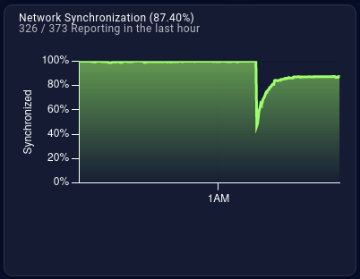
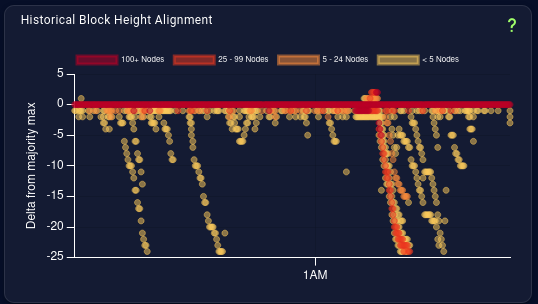
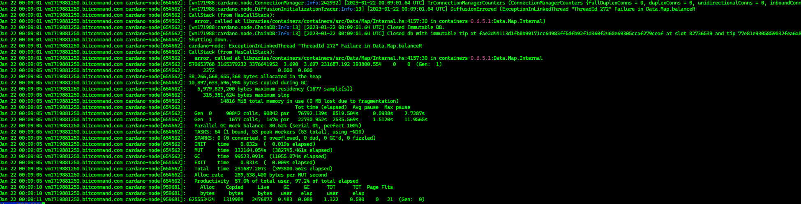

# CID-202301: Mass Node Disconnection and Restart

> At about 00:09 UTC on Sunday 22 January 2023, roughly half of Cardano mainnet's relay and block-producing nodes crashed at the same moment and restarted automatically [2][9]. Block production slowed but did not stop: for about five minutes, blocks arrived 92 to 123 seconds apart instead of about every 20 seconds [3]. No network-wide restart was needed, the chain did not split, and no source reports any loss of funds [2][9][10]. The cause was a bug in the node's own ledger code, so the L1 was at fault: a data structure holding native-token (multi-asset) balances could become internally unbalanced, making the node abort [8][9]. IOG first called the event a "transient anomaly" [2], later classified it as critical [9], and shipped a fix in cardano-node 1.35.5 on 2023-01-27, keeping details private until enough stake pool operators (SPOs) had upgraded [4][9][10].

## Timeline (UTC)

| Time | Event |
|---|---|
| 2023-01-22 00:08:20 | One operator's relay starts logging connection timeouts and refusals to several outbound peers [1]. |
| 2023-01-22 00:08:48 | Nodes with incoming connections log `Failure in Data.Map.balanceR` on several inbound peer connections and drop those peers, without crashing [1]. |
| 2023-01-22 00:08:53 | Block 8300568 (slot 82779842) is adopted normally [1][3]. |
| 2023-01-22 00:09:01 | Block 8300569 (`77e81e93…f667`, slot 82779850) is adopted. Immediately afterwards, nodes running 1.35.3 and 1.35.4 log `DiffusionErrored (ExceptionInLinkedThread … Failure in Data.Map.balanceR)`, close their databases and shut down; supervised nodes restart, one within seven seconds [1][3]. |
| 2023-01-22 00:10:33 | Block 8300570 is produced, 92 s after block 8300569 [3]. |
| 2023-01-22 00:12:36 | Block 8300571 is produced, 123 s after the previous block [3]. |
| 2023-01-22 00:14:11 | Block 8300572 is produced, 95 s after the previous block. The following blocks arrive at normal intervals (00:14:32, 00:14:47, 00:15:15) [3]. |
| 2023-01-22 00:36:49 | Stake pool operator SmaugPool opens cardano-node GitHub issue #4826: all of their public nodes shut down, while nodes with only outgoing connections were not affected [1]. |
| 2023-01-22 00:41 | Operators report the same crash on 1.35.3 and 1.35.4 in the SPO workgroup chat; "only nodes that were not publicly available to connect … survived" [1]. |
| 2023-01-22 02:27 | Ledger maintainer Jared Corduan joins the investigation on the GitHub issue [1]. |
| 2023-01-22 07:23 | An IOG-side assessment on the issue concludes that block 8300569 "is not the culprit and it's another block that didn't make it into the chain", of which no copy is available [1]. |
| 2023-01-22 13:12 | IOG's SPO announcements Telegram channel reports that a "transient anomaly" caused about 50% of nodes to disconnect and restart, and announces a root-cause investigation and extra logging [2]. |
| 2023-01-23 | Press coverage reports the outage as self-healed with no root cause yet [13][14][15][16]. |
| 2023-01-24 01:16–01:32 | Tim Sheard commits "replaced balanceR and balancedL with link" and opens cardano-ledger PR #3271, which is closed unmerged 12 minutes later [5]. |
| 2023-01-26 17:52 | `cardano-data` 0.1.0.1, built from a version-bump commit on top of the fix, is published to the Cardano Haskell package repository [6][7]. |
| 2023-01-27 13:01 | cardano-node 1.35.5 is published as "a maintenance release addressing a fix in ledger internal data structures" [4][9]. |
| 2023-01-28 | A Cardano developer (`erikd`) states on the issue that about 21% of the network runs the fixed version (per Pooltool) and asks to keep public detail "as vague as possible" until more nodes upgrade [1]. |
| 2023-03-20 to 2023-03-22 | Ledger PR #3343 brings the fix, new property tests and a short explanation to the main ledger branch [8]. |
| 2023-04-17 | IOG publishes its incident report [9]. |
| 2023-04-18 | Pi Lanningham (SundaeSwap, a member of the triage task force) publishes a community post-mortem. GitHub issue #4826 is closed [1][10]. |

## Impact

IOG puts the share of block producers and relays that restarted at about 50% [2][9], Lanningham at about 60% [10][13], and a community write-up at 50 to 60% [15]; no exact census was published. Pooltool network-health data showed the share of reporting nodes in sync falling from 100% to just above 40% (Figure 1) [1][14]. The nodes that crashed were those accepting incoming connections, and so receiving transactions from the public network; nodes with only outgoing connections, and edge nodes, generally survived [1][2]. Affected machines included cloud and bare-metal hosts in several regions [1].

*Figure 1: Pooltool network synchronisation chart (pooltool.io/networkhealth), shared by SmaugPool on cardano-node issue #4826 at 00:47 UTC: the share of reporting nodes in sync drops from 100% to just above 40% and recovers to 87.40% (326 of 373 nodes reporting in the last hour) [1].*

Block production slowed rather than stopped. After block 8300569 at 00:09:01, the next three blocks came 92 s, 123 s and 95 s apart; from block 8300572 at 00:14:11 onwards, blocks again arrived at normal intervals [3]. IOG's report describes a pause of "approximately two minutes, similar to the usual pause at an epoch boundary" [9], which matches the longest single gap. A community analysis describes about 7 minutes of degraded service in which some users' transactions were delayed [15].

*Figure 2: Pooltool historical block height alignment (pooltool.io/networkhealth), shared by SmaugPool on cardano-node issue #4826: at the time of the crash, 25 to 99 nodes at a time fell up to about 25 blocks behind the majority tip; the sparse trails elsewhere are fewer than 5 nodes [1].*

Nodes with automatic restart came back without manual work; IOG noted that recovery depended "on the SPO deployment choice" [2]. No network-wide restart or coordinated action was needed, and the chain did not fork lastingly [2][9][10]. No source reports any loss of funds.

Rated **SEV-3** on availability: block production slowed network-wide for roughly five minutes and recovered on its own, well under one hour, and with no lasting fork the consensus-safety dimension was not reached. Potential **SEV-2** on availability: IOG flagged the incident as critical with "potential to affect network integrity" [9], details were withheld specifically so that malicious actors could not cause "repeated crashes" [10], and only about 21% of the network had upgraded six days after the incident [1]. Had the trigger been deliberately repeated before the fix was widely deployed, network-wide degradation of block production lasting more than an hour was credible; no public source shows that a crash of all nodes, and hence a full halt (SEV-1), could be engineered reliably (see *Disputed or open points*). Recoverability: routine. Nodes restarted automatically and block production returned to normal within minutes without coordinated action [2][3][9]; the later 1.35.5 hotfix closed the defect rather than restoring service.

## Root cause

The ledger stores multi-asset (native token) values in a "CanonicalMap": a sorted map from policy ID to asset name to quantity, in which zero quantities are never stored [8][10]. Its insert function, `canonicalInsert` in `libs/cardano-data/src/Data/CanonicalMaps.hs`, was "mostly copied" from the standard `Data.Map` insert and calls the internal rebalancing functions `balanceL` and `balanceR` from the Haskell `containers` library [1][8][11]. Those functions are built for insertion. As PR #3343 puts it, they "expect the size difference between their two arguments to be 0 or 1", which lets them rebalance in constant time [8].

But `canonicalInsert` can also delete. When adding a quantity makes an entry zero, which happens when token amounts cancel out during value subtraction, the entry is removed (`link2 l r`), the subtree shrinks, and the insertion-only rebalancing leaves the tree out of balance [1][8]. A later operation on the corrupted map then hits the invariant check inside `containers` and throws `error "Failure in Data.Map.balanceR"` [1][11]. In the node, this exception escaped from a networking thread (`ExceptionInLinkedThread`) and shut the node down [1].

*Figure 3: Log of an affected mainnet node: at 00:09:01 UTC, `DiffusionErrored (ExceptionInLinkedThread "ThreadId 272" Failure in Data.Map.balanceR` (raised in `containers-0.6.5.1:Data.Map.Internal`) is followed by the databases closing and "Shutting down.."; a new node process starts logging at 00:09:10. Source: operator `chimaeraa` on cardano-node issue #4826 [1].*

IOG says the bug depended on "the precise order of insertion/deletion of multi-asset tokens into the internal ledger record" [9]: a map's internal shape depends on how it was built, not only on its contents. The trigger sequence below is the task force's account as published by Lanningham [10]; with no copy of the offending block (see *Detection*), it has not been independently confirmed:

1. Earlier transactions left the UTxO in an internal state that primed the bug.
2. A node restarted, which rebuilt its UTxO with a different internal structure.
3. A transaction spending UTxOs that held several policy IDs or native tokens reached that node's mempool. It did not crash the node it was submitted to, and it spread to other nodes' mempools without crashing them immediately.
4. A node produced a block containing the transaction. Nodes whose maps had the "dangerous" shape crashed while trying to adopt that block, so it never became part of the chain.

This fits the logs: about 13 seconds before the mass shutdown, nodes with incoming connections threw the same error on inbound peer connections and dropped those peers without crashing, which an IOG-side assessment attributed to the transaction propagating; nodes that later replayed the final chain did not crash [1].

The fix replaced `balanceL`/`balanceR` with `link`, which "makes no assumptions about the relative balance, at the cost of spending log time re-balancing". The ledger team judged that the performance cost would not be noticeable [8]. A Cardano developer (`erikd`) attributed the original choice to using a `containers` function incorrectly "for performance reasons" [1]. A `containers` maintainer noted that the error is the library's invariant check firing after its internals were misused, not a bug in `containers` [11].

## Detection

Stake pool operators detected the incident: their nodes restarted and Pooltool network-health charts showed the drop in sync [1]. The first public report was GitHub issue #4826, filed about 28 minutes after the crash; other operators confirmed the error within minutes, and IOG ledger staff were engaged by 02:27 UTC [1]. IOG's first public statement came at 13:12 UTC [2].

Diagnosis was hard because the nodes that processed the offending block crashed before storing it: no copy was kept, and the triggering block and transaction were never publicly identified [1][10]. Early suspicion of block 8300569 and of transaction `5d21b0eb…89c1` was ruled out on the issue: nodes that received and replayed that block did not crash, and the transaction's collateral had not in fact been consumed [1].

## Response and resolution

IOG engineers and SPOs first analysed logs and block data together on GitHub and in chat [1][14]. IOG then formed a task force that included community members, among them Lanningham [10]; its report also mentions collaboration with the Cardano Foundation [9]. According to the ledger team, Tim Sheard found the problem and Alexey Kuleshevich helped narrow it down [1][8]. The task force reproduced the crash in QuickCheck property tests, but could not reproduce it on a full private testnet [10]. The fix was committed two days after the incident and shipped in the 1.35.5 hotfix three days later (see *Timeline*). IOG describes 1.35.5 as "implemented, tested, benchmarked, and deployed as a hotfix" [9]; its release notes list only "Fixes internal data structure representation" under Ledger [4].

IOG deliberately held back the exact cause until enough SPOs had upgraded [9][10]. On the issue, some community members criticised this as concealment, while others defended it as standard responsible-disclosure practice [1]. Public explanations followed in PR #3343 in March and in IOG's and Lanningham's reports in April [8][9][10].

## Remediation and follow-up

- **Code fix.** cardano-node 1.35.5 shipped the corrected `canonicalInsert` [4][7][9], and PR #3343 applied the same change to the main ledger branch. The `cardano-data` changelog names the unbalanced tree in `canonicalInsert` as "the root cause of" node issue #4826 [8].
- **Regression tests.** PR #3343 added the property test "multi-asset subtraction is total" (100,000 cases), which builds multi-assets in shuffled orders and subtracts others, and a deterministic reproduction it found, `node4826Reproducible`: twelve single-token policies combined in one order, minus two of them. The existing test "Canonical construction agrees" was raised to 100,000 cases [8].
- **Monitoring.** IOG announced further logging measures alongside regular monitoring [2] and reports no further instances of the issue after the fix was deployed [9].
- **Capturing evidence.** Lanningham started `cardano-slurp`, which connects to the network like a node and archives blocks and transactions without processing them, so that data that crashes nodes can be captured for analysis [1][10].
- **Upstream.** A `containers` maintainer opened a QuickCheck issue proposing generators that produce many internal shapes for the same `Map`/`Set` contents; its tentative conclusion was a separate helper package for code that uses `containers` internals [12]. A `containers` issue discussed documenting the internal rebalancing functions [11].

## Incident handling assessment

Assessment of the responsible party's handling (Input Output Global, maintainer of cardano-node and cardano-ledger) against SOC 2 Trust Services Criteria, based on public sources only (see CLASSIFICATION.md, section 10).

| Criterion | Result | Observation |
|---|---|---|
| CC7.2 Monitoring and detection | Exceptions noted | Operators detected the incident through their own node restarts and Pooltool charts; the first public report was an SPO's GitHub issue about 28 minutes after the crash. No source shows IOG's own monitoring raising the alert [1]. |
| CC7.3 Evaluation of events | No exceptions noted | IOG classified the incident as critical, formed a task force with community members and committed a fix within about two days, although no copy of the triggering block was available [1][5][9][10]. |
| CC7.4 Incident response | No exceptions noted | Crashed nodes restarted automatically and block production was back to normal within about five minutes [2][3]. IOG shipped the 1.35.5 hotfix five days later and withheld details until enough operators had upgraded, a choice some community members questioned [1][4][9]. |
| CC7.5 Recovery | No exceptions noted | The root cause was named in the `cardano-data` changelog, the fix reached the main ledger branch with new property tests and a deterministic reproduction, and IOG reports no recurrence [8][9]. |
| CC2.3 External communication | Exceptions noted | IOG's first statement came about 13 hours after the event and called it a "transient anomaly" in which the systems "behaved exactly as expected"; its later report calls it a critical ledger bug [2][9]. The "full retrospective" promised in PR #3343 appeared only as what a ledger maintainer called "a brief incident report", and the trigger sequence was published by a community member of the task force [1][8][9][10]. |
| CC8.1 Change management | Not evidenced | The issue is labelled a regression, and the defect sat in ledger code that called `containers` internals for performance reasons [1][8]. No public source identifies the change that introduced it or how it was reviewed and tested. |

## Lessons for builders

- **Honour the preconditions of library internals.** `Data.Map.Internal.balanceL`/`balanceR` are only correct when one side of the tree has changed by at most one element, but `canonicalInsert` can also delete [8][11]. Use the general function (`link` here) unless the precondition provably holds, and record any speed-for-safety trade-off in the code [1][8].
- **Test internal shape, not just contents.** Standard generators do not explore unusual internal tree shapes [11][12]. For custom map or set operations, build the same logical value through different orders of insertion and deletion, include operations that cancel to zero (burning, value subtraction, collateral return), and check the balance invariant after every operation, as suggested on the issue [1]. The PR #3343 regression test is a template: shuffle the build order, subtract, then force full evaluation [8].
- **Make restart paths behave like steady state.** The bug needed nodes whose in-memory state had been rebuilt after a restart, so identical inputs behaved differently on different nodes [10]. Differential tests can feed the same transactions to a node built incrementally and to one restored from a snapshot.
- **Keep partial functions such as `error` out of consensus-critical paths.** One failed invariant in a ledger computation took down the whole process through a linked thread [1]. Where crashing is the safest outcome, automatic restart by a process supervisor is what limited this incident to minutes [2].
- **Record the input that caused a crash.** No node kept a copy of the offending block, which slowed diagnosis [1][10]. Services that consume chain or mempool data should be able to archive the raw data they receive for later replay, as `cardano-slurp` now does [10].
- **For dApp, wallet and exchange back-ends, plan for node crashes.** Some transactions were delayed during this window [15], and nodes that did not accept public inbound connections survived [1][2]. Track confirmations rather than assuming inclusion, resubmit within the validity interval, and connect to more than one node.

## Disputed or open points

- **Time of the incident.** Node logs, IOG's statement and on-chain data agree on about 00:09 UTC on 22 January 2023 [1][2][3]. One press outlet reported "09:01 UTC" [16], apparently a misreading of the logged `00:09:01`. Lanningham gives "January 23rd at 7:09:01 PM EST" [10]: the time matches, but 00:09:01 UTC on 22 January is 19:09:01 EST on 21 January. Issue #4826 opens with a year typo ("2022 January 22"); its log timestamps show 2023 [1].
- **Could it be exploited deliberately?** Lanningham describes the bug as a "vulnerability" and says disclosure was delayed to stop malicious reproduction [10]. The deterministic unit test shows that particular build orders crash [8]. Public sources do not establish whether an attacker could have crashed all nodes at once, given that the outcome depended on each node's internal state [10].
- **Affected versions and when the defect was introduced.** Crashes were reported on 1.35.3 and 1.35.4 [1]. The issue is labelled `type: regression` [1], but no source documents which change introduced the defect or whether earlier versions were vulnerable.
- **The fix was public early.** The fix commit was visible in public PR #3271 for 12 minutes on 2023-01-24 [5]; on 2023-01-28 a `containers` maintainer linked it on the public issue and explained the flaw while IOG was still keeping details vague [1]. No source records whether this affected the risk.

## Sources

1. [P] GitHub (input-output-hk/cardano-node), "[BUG] Mainnet nodes with incoming connections unexpected shutdown with Failure in Data.Map.balanceR … · Issue #4826", 2023-01-22. https://github.com/input-output-hk/cardano-node/issues/4826
2. [P] IOG SPO Announcements (Telegram), "Some of you will be aware of an incident last night at approximately 00:09:00 UTC (between block 8300569 and 8300570)…", 2023-01-22. https://t.me/SPOannouncements/255
3. [P] Koios (on-chain data), "Cardano mainnet blocks 8300565–8300575 (hash, slot, block_time, pool)", 2023-01-22. https://api.koios.rest/api/v1/blocks?block_height=gte.8300565&block_height=lte.8300575&select=hash,block_height,abs_slot,block_time,epoch_no,pool
4. [P] GitHub (IntersectMBO/cardano-node), "Release Cardano Node 1.35.5", 2023-01-27. https://github.com/IntersectMBO/cardano-node/releases/tag/1.35.5
5. [P] GitHub (input-output-hk/cardano-ledger), "replaced balanceR and balancedL with link · Pull Request #3271", 2023-01-24. https://github.com/input-output-hk/cardano-ledger/pull/3271
6. [P] GitHub (IntersectMBO/cardano-ledger), "Bump up the version of `cardano-data-0.1.0.1` (commit 6e97d315)", 2023-01-26. https://github.com/IntersectMBO/cardano-ledger/commit/6e97d31540ee5918e1149c0385e629fcb70ccc03
7. [P] GitHub (IntersectMBO/cardano-haskell-packages), "cardano-data 0.1.0.1 meta.toml", 2023-01-26. https://raw.githubusercontent.com/IntersectMBO/cardano-haskell-packages/main/_sources/cardano-data/0.1.0.1/meta.toml
8. [P] GitHub (input-output-hk/cardano-ledger), "Ts fix cannonical · Pull Request #3343", 2023-03-20. https://github.com/input-output-hk/cardano-ledger/pull/3343
9. [P] Cardano Development Updates (Kevin Hammond, IOG), "Cardano Block Production Temporary Outage", 2023-04-17. https://updates.cardano.intersectmbo.org/2023-04-17-ledger/
10. [P] Pi Lanningham (314pool, member of the triage task force), "Cardano January Post-Mortem", 2023-04-18. https://www.314pool.com/post/cardano-post-mortem-1
11. [S] GitHub (haskell/containers), "error is used in balanceR, maybe elsewhere · Issue #913", 2023-01-27. https://github.com/haskell/containers/issues/913
12. [S] GitHub (nick8325/quickcheck), "Need better containers instances · Issue #354", 2023-04-01. https://github.com/nick8325/quickcheck/issues/354
13. [S] CoinDesk, "Cardano Network Quickly Recovers After Brief Node Outage", 2023-01-23. https://www.coindesk.com/tech/2023/01/23/cardano-network-quickly-recovers-after-brief-node-outrage
14. [S] Cointelegraph, "Cardano recovers from an outage on 50% relay and block-producing nodes", 2023-01-23. https://cointelegraph.com/news/cardano-recovers-from-an-outage-on-50-relay-and-block-producing-nodes
15. [S] CardanoSpot (CryptoCounsel), "Cardano Node Outage: What we know", 2023-01-23. https://web.archive.org/web/20240225063256/https://cardanospot.io/news/cardano-node-outage-what-we-know-0
16. [S] DailyCoin, "Cardano (ADA) Network Bounces Back After Node Outage", 2023-01-23. https://dailycoin.com/cardano-ada-network-bounces-back-after-node-outage/
