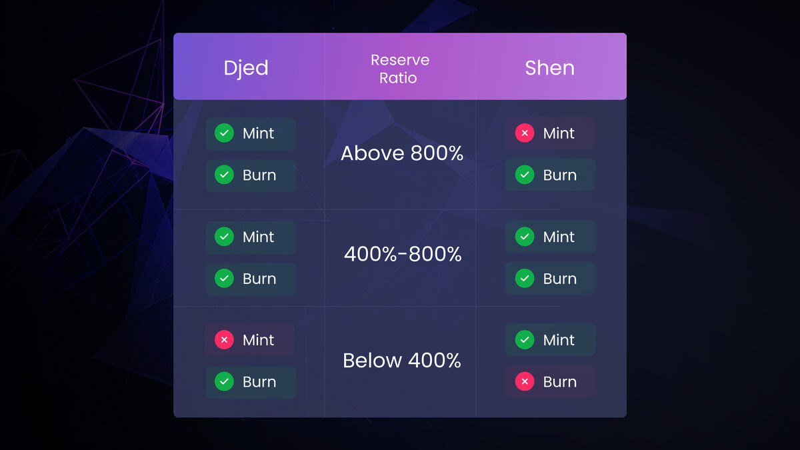
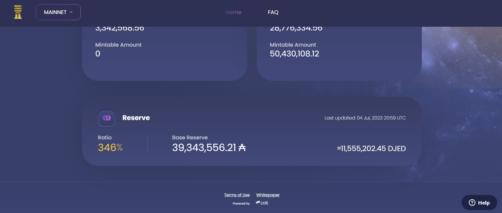
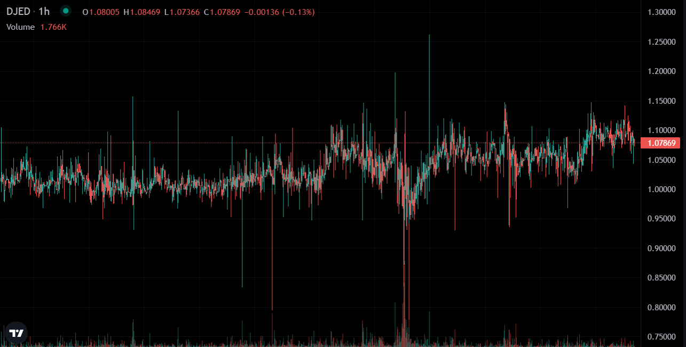
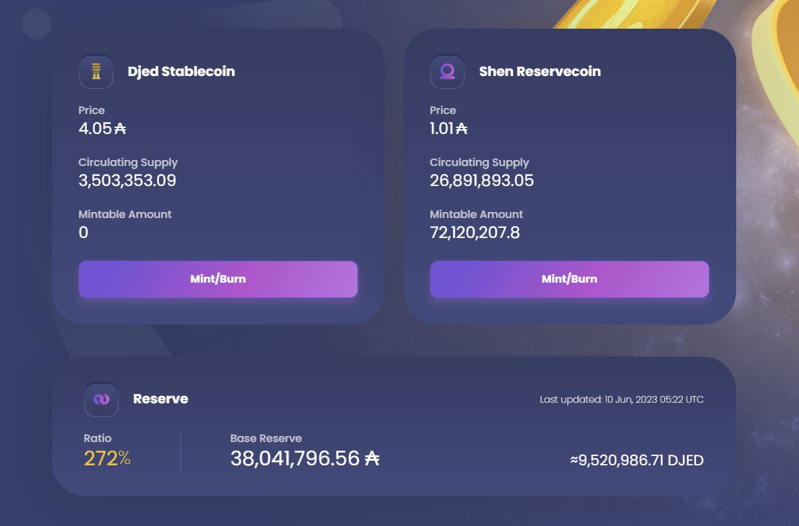
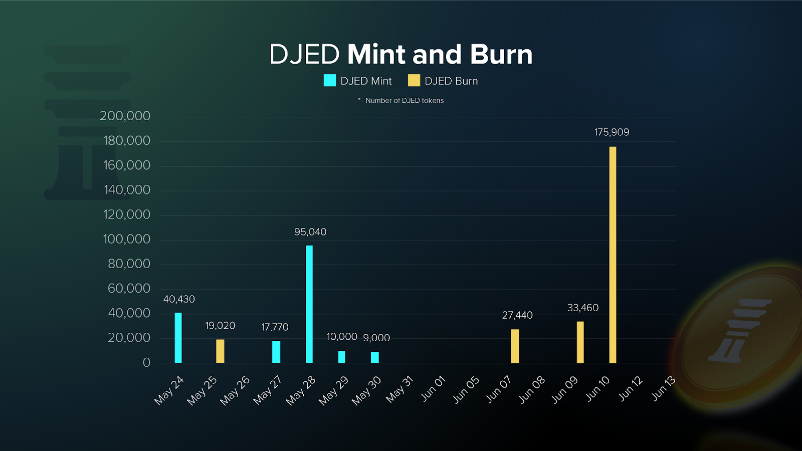
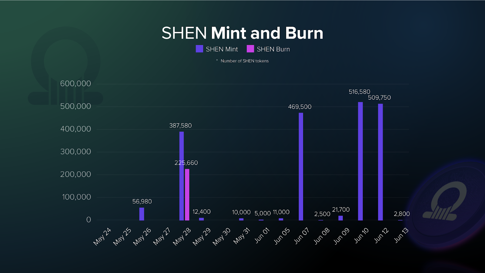
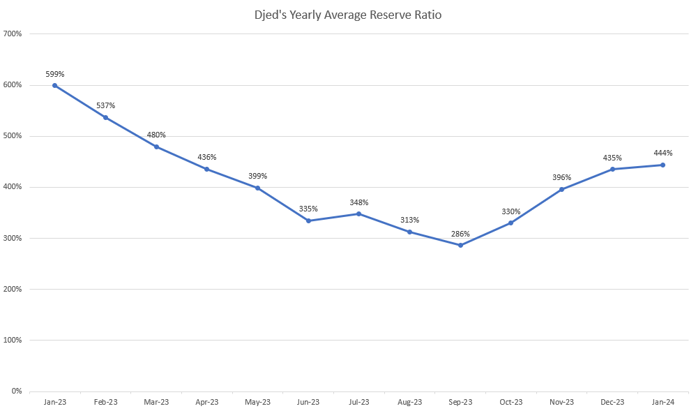

# CID-202302: Djed Reserve Ratio Breach and Depeg

*This report was generated with AI (Claude Opus 5.5) from the public sources listed under Sources. To correct or remove content, see [Corrections and removals](../README.md#corrections-and-removals).*

> DJED is a US-dollar stablecoin on Cardano, issued by COTI and backed by a reserve of ADA that its rules require to be worth at least 400% of the DJED in circulation (target range 400% to 800%) [2]. In June 2023 ADA fell after US SEC lawsuits described it as a security, and the reserve ratio dropped below 400%: 272% on 10 June, about 300% on 11 June and 346% on 4 July [9][10][14][17]. Below 400% the contract, as designed, stops anyone minting new DJED and stops holders of the reservecoin SHEN redeeming it; DJED itself stayed redeemable at the protocol for 1 USD worth of ADA [1][2]. With minting switched off, DJED traded **above** USD 1 on Cardano DEXes, at about USD 1.02 to 1.08. COTI said the protocol worked as designed and DJED kept its peg; critics called the premium a depeg [1][9][10]. No funds were drained or stolen, and the Cardano L1 was not at fault. COTI's monthly figures show the ratio below 400% until November 2023 and above it from December; COTI did not announce the recovery [3]. The design is unchanged, and on 13 October 2026 the ratio was again at the 400% floor [4].

## Timeline (UTC)

| Time | Event |
|---|---|
| 2023-01-31 | COTI launches DJED on Cardano mainnet. COTI says the reserve ratio was about 600% at launch and passed 800% within three days [3]. |
| 2023-03 | DL News reports critics' concern that SHEN redemptions lock below 400%, and notes that the Djed whitepaper describes a bank-run-like dynamic near the minimum ratio [13]. |
| 2023-06 (week of 5 June) | SEC lawsuits describe ADA as a security. ADA, SOL and MATIC take "a hit" that week, and Cardano's developer rejects the claim [14]. |
| 2023-06-09 | Robinhood announces it will end support for ADA on 27 June 2023 [14]. |
| 2023-06-10 05:29 | A community post on X reports the Djed reserve ratio "at 272% with ada in freefall" (embedded in [9]; time decoded from the post ID). The attached dashboard screenshot, "Last updated: 10 Jun, 2023 05:22 UTC", shows a ratio of 272% and a mintable DJED amount of 0 [17]. |
| 2023-06-11 | crypto.news reports a ratio of about 300%, based on djed.xyz: base reserve 38,108,555.96 ADA, DJED supply 3,340,007, DJED trading at about USD 1.02 [9]. |
| 2023-06-15 04:40 | COTI publishes "DJED & SHEN: Weathering the Storms of Market Volatility". It says the ratio "moved below 400%, temporarily preventing further minting of DJED, as designed", that SHEN burning is paused, and that DJED "kept its peg" [1]. |
| 2023-07-04 20:59 | The dashboard shows a ratio of 346% and a base reserve of 39,343,556 ADA, valued at 11,555,202 DJED (about USD 11.56 million) [10][11][18]. |
| 2023-07-05 04:36 | The Cardano Times posts on X that DJED "has failed to maintain a reserve ratio between 400-800% making it un-mintable", causing "consistent de-pegging on all #Cardano DEXs" at USD 1.078 [10][11][18]. A second post says buying DJED at exactly USD 1 had been "extremely difficult" through June and early July [12][19]. Times are decoded from the post IDs. |
| 2023-07-05 05:56 | A community account summarises the protocol state: mint DJED "not possible", burn DJED "possible", mint SHEN "possible", burn SHEN "not possible" [11]. |
| 2023-07-05 11:36 | COTI community manager Prince Pratap Singh posts that "the protocol is functioning as intended" and that DJED can be redeemed at any time whatever the ratio [10]. CoinMarketCap shows DJED at USD 1.0688 [10]. |
| 2023-07-07 05:26 | The Crypto Basic updates its article to state that DJED "did not in fact lose its peg against the dollar" at the protocol [10]. |
| 2023-09-04 | COTI announces a protocol upgrade that lowers the minimum mint/burn amounts to 200 DJED and 200 SHEN and the operator fee to 5 ADA [15]. |
| 2023-12 | COTI's monthly chart puts the December average at 435%, the first month above 400% since April; November averaged 396%. The date the ratio crossed back above 400% was not published [3]. |
| 2024-01-31 | COTI reports a ratio of 505% "today", "allowing the mint and burn of both SHEN and DJED" [3]. |

## Impact

While the ratio was below 400%, two of the four protocol operations were blocked: nobody could mint (buy) DJED from the reserve, and SHEN holders could not burn (sell) SHEN for ADA (Figure 1) [1][2][11]. The block is directly observed from 10 June [17] to 5 July 2023 [10][11], at least 25 days; COTI's monthly averages stay below 400% from May to November 2023 [3], which points to about six months. The end date was not published.

*Figure 1: Operations allowed in each reserve-ratio band. Below 400%, DJED can be burned but not minted, and SHEN can be minted but not burned. Source: COTI, ["DJED & SHEN: Weathering the Storms of Market Volatility While Creating New Opportunities"](https://web.archive.org/web/20240326105902/https://medium.com/cotinetwork/djed-shen-weathering-the-storms-of-market-volatility-while-creating-new-opportunities-a5b320241e3b) [1].*

DJED holders kept their exit at the protocol, and those who sold on a DEX could get more, by one community member's estimate "~10% more" [10]. Anyone who needed DJED had to buy it on the secondary market at a premium: about USD 1.02 on 11 June [9], and USD 1.078 (The Cardano Times) and USD 1.0688 (CoinMarketCap) on 5 July [10][11]; The Cardano Times said buying at exactly USD 1 had been "extremely difficult" through June and early July (Figure 3) [12]. DJED was then in use elsewhere in Cardano DeFi, for example as a lending asset on Liqwid [3][10], but no source we reviewed documents any effect of the premium on those integrations.

*Figure 2: The djed.xyz dashboard at 20:59 UTC on 4 July 2023: ratio 346%, base reserve 39,343,556.21 ADA (≈11,555,202.45 DJED), mintable DJED 0. Source: The Cardano Times, [X post of 5 July 2023](https://x.com/TheCardanoTimes/status/1676450060756992003) [18], reproduced in [10].*

*Figure 3: Hourly DJED price chart that The Cardano Times posted to show DJED's trading history "through all of June and the beginning of July"; the last candle closes at 1.07869. Source: The Cardano Times, [X post of 5 July 2023](https://x.com/TheCardanoTimes/status/1676450068243845120) [19], embedded in [12] and reproduced in [10].*

SHEN holders had no protocol exit while the ratio was below 400%, so the secondary market was their only way out [1][2].

On 4 July 2023 the reserve held 39,343,556 ADA, worth 11,555,202 DJED or about USD 11.56 million [10][11]. The 11,555,202 figure is the reserve's value in DJED terms, not the DJED supply: divided by the 346% ratio it gives about 3.34 million DJED outstanding, consistent with the 3,340,007 reported on 11 June [9]. No funds were drained, stolen or lost at the protocol level.

Rated SEV-3 (availability): two core operations of a widely used Cardano stablecoin, minting DJED and redeeming SHEN, were unavailable for more than 24 hours (at least 25 days directly observed), with no funds lost. Potential SEV-3 (availability): neither the protocol nor COTI had a way to reopen the operations, so the worst credible outcome was a lock lasting months while ADA fell further and the DEX premium persisted; COTI's monthly averages, below 400% until November with a low of 286% in September [3], show that this largely happened. A higher rating would need a financial loss, which requires DJED to redeem for less than USD 1, that is a ratio below 100%. From 346% that means a further ~71% fall in ADA (1 − 100/346), more than the ~66% largest monthly drop COTI used to size the floor [2], so under the "prefer the lower level" rule it was not rated credible. Recoverability: escalated (extended), because restoring the blocked operations depended on the ADA price and on outside participants minting SHEN, with no protocol lever and no predictable date [2][3].

## Root cause

The Djed protocol is an autonomous "bank". It holds a reserve of a base coin (ADA), issues a stablecoin (DJED) and a reservecoin (SHEN), and gates operations by the reserve ratio [5][7]. In the Minimal Djed version used by COTI's deployment [8]:

- Anyone can buy stablecoins for 1 USD worth of the base coin, but only while the reserve ratio is above the minimum: "When the reserve ratio is below threshold, the purchase of SCs from the protocol is disallowed, because it would reduce the reserve ratio further" [7].
- Stablecoin holders can always sell to the protocol. They receive 1 USD worth of base coin per stablecoin if the ratio is above 100%, otherwise reserve/supply [7].
- Reservecoin holders may sell only while the ratio stays above the minimum [7].

COTI set the minimum at 400% and the maximum at 800%. Its stated basis was a maximum monthly ADA drop of about 66%, which implied a 300% floor would suffice; 400% was chosen for extra safety [2]. The reserve is held only in ADA [2][13], so unless people mint or burn, the ratio moves roughly in proportion to the ADA/USD price. In June 2023 ADA fell after the SEC lawsuits [14], and the ratio fell below 400% [1][9].

The incident followed from that rule set:

1. **Loss of the upper arbitrage bound.** Normally, if DJED trades above USD 1 on a DEX, an arbitrageur can mint DJED at the protocol for about USD 1 plus fees (1.5% base fee [8]) and sell it, which caps the market price. IOG's description of Djed's proven properties says the peg bounds hold "in the normal reserve ratio range", where "purchases and sales are not restricted" [6]. Below 400% only redemption remains, which keeps a floor (sell at the protocol for USD 1) but no ceiling, so DJED traded at a premium [9][10][11].
2. **Recapitalisation relies on new SHEN minters who then face the same lock.** Raising the ratio requires new ADA via SHEN minting, or DJED burns, and new SHEN minters cannot redeem until the ratio is back above 400% [2]. Community members questioned what incentive there was to mint SHEN or burn DJED while ADA was falling [9][11].
3. **No protocol-level stabilisation lever.** Djed is designed to run without a stability fund or governance intervention [5][6], so recovery depended on market behaviour and the ADA price. Stability Nexus says COTI controls contract upgrades in its deployment [8], but no source we reviewed reports any intervention by COTI to restore the ratio.

## Detection

The breach was visible on COTI's public dashboard (djed.xyz) and was first raised by a community post on 10 June 2023 (Figure 4) and a crypto.news article on 11 June [9][17], not announced by COTI. COTI's first statement followed on 15 June [1], and wider attention came on 5 July after posts by The Cardano Times [10][11]. No source we reviewed describes COTI alerting on or monitoring threshold crossings.

*Figure 4: The djed.xyz dashboard at 05:22 UTC on 10 June 2023: ratio 272%, base reserve 38,041,796.56 ADA, mintable DJED 0, SHEN still mintable. Source: Dubbleu_43, [X post of 10 June 2023](https://x.com/Dubbleu_43/status/1667403492384710659) [17], embedded in [9].*

## Response and resolution

COTI presented the event as expected behaviour: its June post said that "throughout the entire event, DJED's protocol worked exactly as designed" [1], and on 5 July its community manager distinguished the protocol peg (redemption value) from the DEX market price and put price swings down to the stablecoin's early stage [10].

COTI's main lever was persuasion. The June post promoted SHEN minting ("Low Cost Minting", at 1.015 ADA per SHEN including fees) and pointed to fees and delegation rewards shared among fewer SHEN holders [1]. It reported 2M SHEN minted and 225K burned, and 172K DJED minted and 255K burned, "during recent market events", generating about 54K ADA in fees [1]. Its charts break this down by day from 24 May to 13 June 2023 (Figures 5 and 6) but do not mark when the ratio fell below 400%.

*Figure 5: Daily DJED mints and burns, 24 May to 13 June 2023. The last mint shown is on 30 May; burns rise from 7 June and peak at 175,909 DJED on 10 June. Source: COTI, ["DJED & SHEN: Weathering the Storms of Market Volatility While Creating New Opportunities"](https://web.archive.org/web/20240326105902/https://medium.com/cotinetwork/djed-shen-weathering-the-storms-of-market-volatility-while-creating-new-opportunities-a5b320241e3b) [1].*

*Figure 6: Daily SHEN mints and burns over the same period. The only burn shown (225,660 SHEN) is on 28 May; most minting came on 7, 10 and 12 June. Source: COTI, ["DJED & SHEN: Weathering the Storms of Market Volatility While Creating New Opportunities"](https://web.archive.org/web/20240326105902/https://medium.com/cotinetwork/djed-shen-weathering-the-storms-of-market-volatility-while-creating-new-opportunities-a5b320241e3b) [1].*

On 4 September 2023 COTI upgraded the protocol infrastructure (Chain Index and Pub User), lowered the minimum mint/burn amounts to 200 DJED and 200 SHEN and cut the operator fee to 5 ADA, with the aim of getting more users to take part [15].

The ratio recovered above 400% at an unpublished date, no later than December 2023 (Figure 7). COTI first mentioned the recovery in its anniversary post of 31 January 2024, which gave the ratio that day as 505% [3]. No source we reviewed attributes the recovery to a specific action rather than to ADA price movement and protocol activity.

*Figure 7: Djed reserve ratio by month, January 2023 to January 2024, from COTI's chart titled "Djed's Yearly Average Reserve Ratio". The plotted values sit below 400% from May (399%) to November 2023 (396%), with a low of 286% in September, and return above 400% in December (435%). The points are monthly averages, so the January 2024 value (444%) differs from the 505% COTI gave as the ratio on 31 January 2024. Source: COTI, ["Djed's First Anniversary — A Walk Through Djed's Journey so Far"](https://web.archive.org/web/20240409031445/https://medium.com/cotinetwork/djeds-first-anniversary-a-walk-through-djed-s-journey-so-far-a56d00d8bef1) [3].*

## Remediation and follow-up

- **No design change.** The 400% minimum and 800% maximum remain [8]. We found no post-mortem, parameter review or change to the mint/redeem gating. The ratio sits at the floor again: on 13 October 2026 the djed.xyz dashboard showed 399% with zero mintable DJED at 10:18 UTC, and 403% with about 14,600 DJED mintable at 21:05 UTC, against a base reserve of about 24.6 million ADA and a DJED supply of about 1.45 million [4]. We did not establish how often the ratio was below 400% between February 2024 and October 2026.
- **Infrastructure and fee changes** (September 2023), described under *Response and resolution* [15].
- **Later Djed versions not adopted.** Stability Nexus, which maintains the Djed protocol documentation [7], says COTI's deployment uses the older Minimal version [8]. Later versions exist, such as Osiris, which allows selling reservecoins and stablecoins together as long as this does not lower the ratio, "thus giving RC holders more flexibility when the reserve ratio is below the minimum threshold" [16]. No source we reviewed shows COTI announcing a migration.

## Incident handling assessment

Assessment of the responsible party's handling against SOC 2 Trust Services Criteria, based on public sources only (see CLASSIFICATION.md, section 10). The responsible party is COTI, which operates the Djed deployment on Cardano. The protocol behaved as designed, so the assessment covers how COTI monitored, evaluated and communicated the reserve-ratio breach.

| Criterion | Result | Observation |
|---|---|---|
| CC7.2 Monitoring and detection | Not evidenced | The dashboard showed the ratio, but the breach was first publicised by community members and press on 10 and 11 June 2023 [9][17]. No source shows when COTI identified the crossing or whether it alerts on threshold crossings. |
| CC7.3 Evaluation of events | No exceptions noted | COTI's 15 June post correctly described the protocol state: DJED minting blocked and SHEN burning paused as designed, with DJED still redeemable at the protocol [1]. Its community manager later distinguished the protocol peg from the DEX market price [10]. |
| CC7.4 Incident response | No exceptions noted | The ratio gating protected the reserve automatically, as documented [1][2]. COTI explained the state and encouraged SHEN minting to raise the ratio [1]; the autonomous design does not foresee operator intervention [5][6]. |
| CC7.5 Recovery | Exceptions noted | The ratio recovered at an unpublished date with no attributed action [3]. There was no post-mortem or parameter review, and the ratio was at the floor again in October 2026 [4]. |
| CC2.3 External communication | Exceptions noted | COTI's first statement came about five days after community and press reports of the breach [1][9][17], and the return above 400% was not announced; it surfaced only in the January 2024 anniversary post [3]. The June post said DJED "kept its peg" without addressing the secondary-market premium users reported [1][9]. |
| CC8.1 Change management | Not applicable | The breach followed from the launch design and an external ADA price shock, not from a change to code, configuration or parameters [1][2][14]. |

## Lessons for builders

- **Publish "distance to threshold" in price terms.** For a single-collateral reserve, the collateral price at which the floor is hit is roughly `P_breach = P_now × r_min / r_now`, ignoring flows. At 505% a ~21% ADA drop reaches 400%; at 346% a ~71% drop reaches 100%. Show these numbers on the dashboard and in risk disclosures, not only the current ratio.
- **Document a floor-only peg as a design choice.** Disabling minting below `r_min` protects the reserve but removes the arbitrage that caps the market price [6][7]. Tell users and integrators in advance that the stablecoin can trade at a sustained premium in this state, and publish which operations are enabled in each ratio band [2][7].
- **Integrators should value a gated stablecoin at redemption value.** Lending markets, DEX routers and liquidators can read the protocol state on-chain (ratio, enabled operations, redemption price) and value DJED-like assets at redemption value, or apply a haircut, instead of using a premium DEX price as collateral value.
- **Plan for long gated periods, not only for solvency.** COTI sized the floor so that DJED stays fully backed after a ~66% monthly ADA drop [2], and DJED stayed fully redeemable. But the gate closed about four months after launch and stayed closed for months [3], partly because new reservecoin buyers inherit the redemption lock that recapitalisation depends on [13]. Model how long gated states last, and consider designs that allow ratio-neutral exits, such as combined RC+SC sales (Osiris) [16] or dynamic fees (Extended Djed) [6].
- **Announce threshold crossings.** Both the breach and the recovery were left for users to discover [3][9]. An automatic public status message when the ratio crosses `r_min` or `r_max` removes ambiguity and speculation.

## Disputed or open points

- **"Depeg" or "working as designed".** The Cardano Times and several outlets called the DEX premium a depeg [10][11][12]. COTI said DJED kept its peg because it stayed redeemable for 1 USD worth of ADA [1][10], and The Crypto Basic later revised its article to agree [10]. Both are factually consistent: DJED held its redemption value at the protocol but not its market price.
- **What was blocked.** crypto.news wrote that the protocol "no longer allows token holders to unmint their tokens" [12]. COTI, the COTI FAQ and a community summary all state that burning (redeeming) DJED stayed possible and that what was blocked was minting DJED and burning SHEN [1][2][11].
- **Attribution of the "failed to maintain" quote.** crypto.news attributed the sentence "DJED, the stablecoin issued by Coti, has failed to maintain a reserve ratio between 400-800%…" to COTI [12]. It comes from The Cardano Times, an independent account [10][11][18]; we found no COTI statement with this wording.
- **Start and end dates.** COTI published neither crossing time. The earliest point observation below 400% is 272% on 10 June [17], but COTI's own charts suggest an earlier start: a May monthly average of 399% [3] and no DJED minted after 30 May [1]. The last direct observation of the breach is 5 July 2023 [10]; monthly averages place the return above 400% no later than December 2023 [3] but cannot date it.
- **Decentralisation claims.** COTI's FAQ calls Djed "fully decentralized" and open source [2]. Stability Nexus says COTI controls the oracle, the transaction batcher and contract upgrades, and that the source code is not available for inspection [8]. Stability Nexus is an interested party, since it promotes other Djed deployments. We found no COTI response to these claims.
- **SHEN minimum price.** COTI's FAQ states "SHEN's minimal price is 1 ADA" [2], yet on 13 October 2026 the dashboard showed a SHEN buy price of about 0.60 ADA [4]. We found no explanation, such as a parameter change or a different meaning of "minimal price".

## Sources

1. [P] COTI, "DJED & SHEN: Weathering the Storms of Market Volatility While Creating New Opportunities", 2023-06-15 (page displays 14 June 2023). https://medium.com/cotinetwork/djed-shen-weathering-the-storms-of-market-volatility-while-creating-new-opportunities-a5b320241e3b (archived: https://web.archive.org/web/20240326105902/https://medium.com/cotinetwork/djed-shen-weathering-the-storms-of-market-volatility-while-creating-new-opportunities-a5b320241e3b)
2. [P] COTI, "Djed: Frequently Asked Questions", 2023-04-13 (Medium metadata). https://cotinetwork.medium.com/djed-frequently-asked-questions-f636735be76 (archived: https://web.archive.org/web/20231211051442/https://cotinetwork.medium.com/djed-frequently-asked-questions-f636735be76)
3. [P] COTI, "Djed's First Anniversary — A Walk Through Djed's Journey so Far", 2024-01-31. https://medium.com/cotinetwork/djeds-first-anniversary-a-walk-through-djed-s-journey-so-far-a56d00d8bef1 (archived: https://web.archive.org/web/20240409031445/https://medium.com/cotinetwork/djeds-first-anniversary-a-walk-through-djed-s-journey-so-far-a56d00d8bef1)
4. [P] COTI, djed.xyz Djed dashboard (snapshots "Last updated: 13 Oct, 2026 10:18 UTC" and "13 Oct, 2026 21:05 UTC"), retrieved 2026-10-13. https://djed.xyz/
5. [P] Zahnentferner, J., Kaidalov, D., Etienne, J.-F., Díaz, J., "Djed: A Formally Verified Crypto-Backed Pegged Algorithmic Stablecoin", IACR ePrint 2021/1069 (peer-reviewed version at IEEE ICBC 2023), 2021. https://eprint.iacr.org/2021/1069
6. [P] Input Output Global (Olga Hryniuk), "Djed: implementing algorithmic stablecoins for proven price stability", 2021-08-18. https://www.iog.io/news/djed-implementing-algorithmic-stablecoins-for-proven-price-stability
7. [P] Stability Nexus, "How the Protocol Works" (Djed protocol documentation), n.d. https://docs.stability.nexus/stablecoins/djed-overview/how-the-protocol-works
8. [S] Stability Nexus, "Djed powered by COTI" (deployment review, Catalyst-funded documentation), n.d. https://docs.stability.nexus/stablecoins/djed-overview/deployments/djed-powered-by-coti
9. [S] crypto.news (Dalmas Ngetich), "Djed reserve ratio drops to 300% amid dumping ADA prices", 2023-06-11. https://crypto.news/djed-reserve-ratio-drops-to-300-amid-dumping-ada-prices/
10. [S] The Crypto Basic (Albert Brown), "Cardano Stablecoin DJED Allegedly Depegs; COTI CM Provides Clarification", 2023-07-05 (updated 2023-07-07). https://thecryptobasic.com/2023/07/05/cardano-stablecoin-djed-depegs-as-its-reserve-ratio-falls-causing-unminting-issues/
11. [S] Invezz (Newton Gitonga), "Cardano stablecoin DJED de-pegs after failure to maintain reserve ratio", 2023-07-05. https://invezz.com/news/2023/07/05/cardano-stablecoin-djed-de-pegs-after-failure-to-maintain-reserve-ratio/
12. [S] crypto.news (Brenda Mary), "Cardano's DJED stablecoin faces unminting and depegging challenges amid reserve ratio decline", 2023-07-05. https://crypto.news/cardanos-djed-stablecoin-faces-unminting-and-depegging-challenges-amid-reserve-ratio-decline/
13. [S] DL News, "Cardano's new stablecoin DJED is defying sceptics – for now", 2023-03 (exact day not shown in the retrieved copy). https://www.dlnews.com/articles/defi/cardanos-new-stablecoin-djed-is-defying-sceptics-for-now/
14. [S] CoinDesk (Aoyon Ashraf, Helene Braun), "Robinhood Ends Support for All Tokens Named in SEC Lawsuit as Securities", 2023-06-09. https://www.coindesk.com/markets/2023/06/09/robinhood-ends-support-for-some-tokens-named-in-sec-lawsuit-as-securities
15. [S] U.Today (Tomiwabold Olajide), "Cardano Djed Stablecoin Receives Big Code Upgrade: Details", 2023-09-04. https://u.today/cardano-djed-stablecoin-receives-big-code-upgrade-details
16. [P] Stability Nexus, "Versions" (Djed protocol documentation), n.d. https://docs.stability.nexus/stablecoins/djed-overview/versions
17. [S] Dubbleu_43 (X), "Ratio at 272% with ada in freefall what is the incentive to burn any Djed at this time?…" (with djed.xyz dashboard screenshot), 2023-06-10. https://x.com/Dubbleu_43/status/1667403492384710659
18. [S] The Cardano Times (X), "REPORT: $DJED, the stablecoin issued by Coti; has failed to maintain a reserve ratio between 400-800%…" (with djed.xyz dashboard screenshot), 2023-07-05. https://x.com/TheCardanoTimes/status/1676450060756992003
19. [S] The Cardano Times (X), "View $DJED's trading history through all of June and the beginning of July…" (with DJED price chart), 2023-07-05. https://x.com/TheCardanoTimes/status/1676450068243845120
