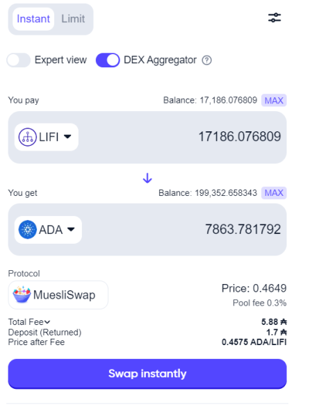
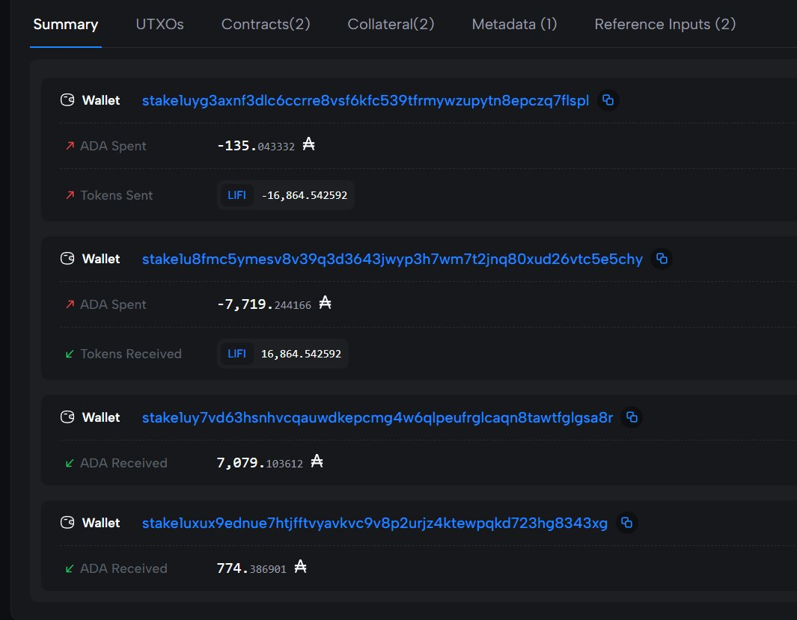

# CID-202303: MuesliSwap Matchmaker Slippage Retention and Refunds

> MuesliSwap is a decentralised exchange (DEX) on Cardano whose trades are filled by third-party "matchmakers" (batchers). Users who set a high value in a front-end setting labelled "slippage" could have their orders filled at that limit rather than at the market price, with the matchmaker keeping the difference, as MuesliSwap's contracts allow [1][3][4][5][9][11]; MuesliSwap said this had been the case "since the beginning" [5][7]. After users complained publicly in early August 2023 [9], MuesliSwap admitted it had "fell short in providing adequate clarity", said it had fixed the order book, and promised to refund affected users for the previous 12 months from project funds [1][3][4]. The amounts retained and refunded were never published; three months later refunds were still handled through Discord support tickets instead of the promised self-claim site [15][16], and no later source confirms completion. No unauthorised contract exploit is established: matchmakers acted within the documented contract rules. The Cardano protocol was not at fault.

## Timeline (UTC)

| Time | Event |
|---|---|
| 2021-11-26 | MuesliSwap launches its order-book DEX on Cardano mainnet [12]. Under its design, a matchmaker may keep any surplus left after every party receives the amount they ordered [11]. |
| 2023-08-06 17:39 | A community member, "Bobcorn", reports in a thread on X that a token sale on MuesliSwap returned less ADA than the user interface showed [9][18][19]. Other users, including "Cardano Paul", report that their orders were always filled at their maximum slippage [9]. |
| 2023-08-07 ~20:54 | MuesliSwap posts an "Important Announcement" on X. It acknowledges that matchmakers could "fill the limit order and choose whether to return the additional slippage amount or retain the difference at their discretion", announces refunds for the last 12 months from project funds, and says it has taken "immediate action" on the order book [1][3][4]. The time is derived from the post ID; press reports date the post to 7 or 8 August depending on time zone [3][6]. |
| 2023-08-07 21:31 | Sundae Labs publicly offers MuesliSwap its token distribution platform for the refunds [13][15]. |
| 2023-08-08 ~12:12 | MuesliSwap posts a follow-up, "Clarifying Slippage on MuesliSwap", saying the issue "impacts only a handful of users" and warning readers to "be careful about what others state on Twitter" [2][5]. It says a "comprehensive analysis of all trades" will take about 3 to 4 weeks [5][7]. |
| 2023-08-08 to 09 | Trade press covers the refund pledge [3][4][5][6][7][8]. |
| 2023-08-10 | MuesliSwap gives a more detailed explanation, describing the "matchmaker premium feature, initially mislabeled as advanced slippage (with a warning)" [9]. |
| 2023-10-21 14:32 | A user asks publicly whether MuesliSwap has launched its self-claim refund website, wanting to claim "batcher excess" without handing over wallet addresses [14][16]. |
| 2023-11-04 | The same community member posts "Wen promised refund? 3 months later, still no self claim refund website" [15]. |
| 2023-11-09 09:14 | CoinDesk reports that MuesliSwap says its claims window will open "soon". Refunds had been processed through Discord support tickets, which required users to give their wallet details to the team [16]. |
| 2023-11-10 | Coinlive reports that some ticket-based refunds paid incorrect amounts [15]. |

## Impact

Affected users received less than the market price at execution allowed, by up to the full slippage tolerance they had set [3][9]. A community analysis says the retained difference was "sometimes amounting to hundreds of ADA" per trade [9]. In Bobcorn's trade, placed with a 10% tolerance [18], 774.39 ADA of about 7,853 ADA paid out went to a stake key whose owner he asked might be a batcher, about 10% (Figure 2) [19]. MuesliSwap said only "a handful of users" were affected [5] and reportedly estimated less than 1% of all trades [10]. Neither the number of affected users or trades nor the total retained or refunded has been published [8][9]. For scale only, MuesliSwap had over USD 10 million in total value locked (TVL) and had traded over USD 500 million in the preceding year [4]; neither figure measures the loss.

The surplus rule was part of the contracts from launch on 2021-11-26 [11][12], and MuesliSwap said the matchmaker incentive existed "since the beginning" [5][7], so retention may have been possible for up to about 20 months. Cointelegraph paraphrases the team as saying users had paid high slippage "for at least a year" [3]. When the first affected trade occurred is not established; the 12-month refund window is MuesliSwap's choice, not a measured duration [1][3]. The DEX kept operating throughout, and the Cardano ledger behaved as specified.

Rated SEV-3 (dimension: trust and integrity, a service operating materially differently from what users were told, to their detriment); potential SEV-3 (dimension: financial, a bounded estimate of roughly USD 50,000 to 500,000 a year that straddles the SEV-2 threshold, lower level kept as explained in the classification notes). Recoverability: extra-resources (supplemented: MuesliSwap committed project funds to refunds, but completion is unconfirmed [3][16]).

## Root cause

MuesliSwap's order-book contracts lock each order in a script output that records the asset and amount the user wants to receive. A matchmaker fills the order with a transaction that the validator accepts if "each party gets credited the amount that was ordered in the initially placed order", and the contract README adds: "That way the matchmaker can decide to claim any remaining difference as reward" [11]. The validator checks only that each user receives at least what they ordered; any value above that minimum belongs to whoever builds the matching transaction.

The front end turned a user's "slippage" setting into a lower ordered amount. MuesliSwap called this setting "advanced matchmaker slippage" [10] and later a "matchmaker premium" that "allowed matchmakers to prioritize specific orders by offering a premium" [9], meant as a "supplementary matchmaker incentive" to get orders prioritised in volatile markets [5]. Slippage tolerance is conventionally a worst-case bound, not a payment. Matchmakers, however, could fill at the bound and keep the gap between the market price and the user's minimum [1][3][9], and users reported that their orders were always filled at their maximum slippage whatever the available liquidity [9].

The protocol worked as designed. The harm came from a validator that hands the whole surplus to the matchmaker, combined with a user interface and documentation that presented a matchmaker payment as slippage tolerance. MuesliSwap's documentation also lists a separate 0.6 ADA per order that rewards matchmakers and covers network fees [17], so users had reason to believe the matchmaker was already paid.

## Detection

Users found the issue by comparing on-chain fills with the prices shown in the interface, publicly on X on 6 and 7 August 2023 [9]. Bobcorn posted the swap screen as it looked before execution (Figure 1) and then the fill transaction (Figure 2) [18][19]; other community members found that batchers kept the difference between actual and permitted slippage [9]. MuesliSwap acknowledged the issue about 27 hours after Bobcorn's thread, "after some back and forth" with users [9].

*Figure 1: The MuesliSwap swap screen Bobcorn posted "before execution": 17,186.08 LIFI for a quoted 7,863.78 ADA at a price of 0.4649 (0.4575 ADA/LIFI after fees), routed to MuesliSwap. Source: bobcorn (@bobcorn_ada), [X post of 6 August 2023](https://x.com/bobcorn_ada/status/1688243330428362752) [18].*

*Figure 2: Cardanoscan summary of the fill transaction `a36c8ed2…` from the same thread, showing net changes per stake key: one key sends 16,864.54 LIFI and 135.04 ADA; the key Bobcorn identifies as the liquidity pool receives the LIFI and sends 7,719.24 ADA; one key receives 7,079.10 ADA and another, which Bobcorn traced to the PILOT stake pool, 774.39 ADA. The two receipts are not parts of the 7,719.24 ADA payout: ADA in (7,719.24 + 135.04 = 7,854.29) matches ADA out (7,079.10 + 774.39 = 7,853.49) to within 0.80 ADA, consistent with a transaction fee the summary does not show. The sources identify neither receiving key, and the thread does not explain why the LIFI amount differs from the 17,186.08 quoted in Figure 1. Source: bobcorn (@bobcorn_ada), [X post of 6 August 2023](https://x.com/bobcorn_ada/status/1688243336480718848) [19].*

## Response and resolution

On 7 August 2023 MuesliSwap admitted it "fell short in providing adequate clarity", said that "immediate action has been taken to remedy the slippage issue in the MuesliSwap order book", and promised "clear and accurate information on slippage" in future [1][3][5].

It also promised to refund "affected users who encountered high slippage on the MuesliSwap pools in the last 12 months from our project funds" after a "thorough analysis of all trades" taking about 3 to 4 weeks [3][5][7]. Refunds were to be calculated from users' on-chain trading history and distributed automatically [4][6].

No source reports such a distribution; three months later users were still waiting for a self-claim site [14][15][16]. MuesliSwap told CoinDesk that refunds had been available through Discord support tickets, which required users to give their wallet details to the team, and that a self-claim site would open "soon" [16]; Coinlive reported that some ticket-based refunds paid incorrect amounts [15]. Sundae Labs had offered its distribution tooling on 7 August [13], but no source shows MuesliSwap using it [15].

When retrieved on 2026-10-13, both of MuesliSwap's X statements of 7 and 8 August 2023 showed "This Post was deleted by the Post author" [1][2]; their text survives in press quotations and embeds [3][4][5].

## Remediation and follow-up

- MuesliSwap said it had changed how its order book handles slippage and would show accurate slippage information in its interface [1][3][5]. No code change, audit or release note has been published.
- Refunds from project funds were committed [1][3]. No source after November 2023 confirms that the self-claim site launched, that refunds were completed, or how much was refunded.
- No methodology, list of affected trades or matchmaker addresses, or post-mortem has been published.

## Incident handling assessment

Assessment of the responsible party's handling against SOC 2 Trust Services Criteria, based on public sources only (see CLASSIFICATION.md, section 10). The responsible party is the MuesliSwap team, which designed the order-book contracts and front end.

| Criterion | Result | Observation |
|---|---|---|
| CC7.2 Monitoring and detection | Exceptions noted | Users, not MuesliSwap, detected the issue by comparing on-chain fills with the prices shown in the interface [9], although the mechanism had been in place since launch [5][7][11]. |
| CC7.3 Evaluation of events | Exceptions noted | MuesliSwap acknowledged the issue only "after some back and forth" with users, and a team representative's earlier responses drew criticism [6][9]. It described the impact as limited to "a handful of users" [5] but never published the promised analysis of all trades or any count or total [8][9]. |
| CC7.4 Incident response | Not evidenced | MuesliSwap said "immediate action has been taken" on the order book within about a day of the public complaints, but published no technical details, so the containment cannot be confirmed from public sources [1][3][5]. |
| CC7.5 Recovery | Exceptions noted | Refunds promised within about 3 to 4 weeks were still handled manually through Discord tickets three months later, some reportedly with incorrect amounts [5][15][16]. No source confirms that refunds were completed. |
| CC2.3 External communication | Exceptions noted | Disclosure is partial: no methodology, affected trades, refund totals or post-mortem were published [8][9]. The 8 August post warned readers about what others said on X [2][5], and both primary X statements were later deleted [1][2]. |
| CC8.1 Change management | Not applicable | The surplus rule and slippage setting were part of the design from launch, not introduced by a later change [5][7][11]. |

## Lessons for builders

1. **Decide who owns surplus, on-chain.** If a validator only checks `paid_to_user >= min_receive`, whoever builds the transaction keeps everything above `min_receive` [11]. Enforce the intended split in the validator, for example by requiring the user's output to equal the amount computed from the pool state at execution minus a fee stated in the datum.
2. **Keep tolerance and payment separate.** Slippage tolerance should never fund a matchmaker incentive. Put fees and priority premiums in their own datum fields, show them in ADA in the UI, and validate them against a maximum the user signed. MuesliSwap already had an explicit matchmaker payment [17]; using the slippage gap as a second, hidden one created this incident.
3. **Test and monitor fills against tolerance.** With the same market state, raising a user's slippage tolerance must not lower what they receive; test this property for batcher and validator, and alert when live fills cluster at users' limits. Users found this pattern by hand [9].
4. **Label economic choices honestly.** Do not put fees behind an "advanced" toggle named after a different concept; a warning text does not fix a misleading label [9].
5. **Make remediation verifiable.** Publish the refund formula, affected transactions and totals, and distribute refunds through a self-claim mechanism tied to on-chain addresses. Discord ticket refunds were slow, reportedly paid inconsistent amounts [15] and required users to disclose wallet details [14][16]. Keep incident statements public rather than deleting them [1][2].

## Disputed or open points

- **How the issue is framed.** MuesliSwap describes it as a "misunderstanding" and a "supplementary matchmaker incentive" that was unclearly labelled [1][4][5]. Community members call it batchers retaining users' funds ("batcher excess", "ADA you took off them in batcher tips") [9][15].
- **Scale.** MuesliSwap's "only a handful of users" [5] and reported estimate of under 1% of trades [10] contrast with users' reports that the effect was systematic for orders with high slippage settings [9]. The <1% figure comes from a secondary report that could not be checked against the deleted primary post.
- **Who received the surplus.** A community analysis says the surplus went to "a wallet belonging to the matchmaker" and notes that MuesliSwap did not disclose who ran the batcher [9]. The sources do not say whether that matchmaker was operated by or affiliated with the MuesliSwap team.
- **Affected contracts and start.** MuesliSwap's 7 August statement refers to the "MuesliSwap Pool DEX protocol", "MuesliSwap pools" and the "order book" [1][3][4]; which contracts, versions and order types were affected, and when the first affected trade occurred, are not established.
- **Date of first report.** The community analysis dates Bobcorn's post to "Monday, 6 August" [9], but 6 August 2023 was a Sunday. Bobcorn's thread itself is timestamped 6 August 2023, 17:39 UTC [18][19].

## Sources

1. [P] MuesliSwap Team (X), "Important Announcement! ... We recognize that we fell short in providing adequate clarity on the slippage feature within the MuesliSwap Pool DEX protocol", 2023-08-07. https://twitter.com/MuesliSwapTeam/status/1688654897938395137 (post deleted by author when retrieved on 2026-10-13; text preserved in [3][4][5])
2. [P] MuesliSwap Team (X), "Clarifying Slippage on MuesliSwap: We want to address confusion about advanced matchmaker slippage on our platform", 2023-08-08. https://twitter.com/MuesliSwapTeam/status/1688886013471387648 (post deleted by author when retrieved on 2026-10-13; text preserved in [5])
3. [S] Cointelegraph, "Cardano DEX MuesliSwap to refund users after slippage confusion", 2023-08-09. https://cointelegraph.com/news/cardano-dex-muesliswap-refund-users-high-slippage
4. [S] CoinDesk, "Cardano-Based MuesliSwap to Refund 'High Slippage' Losses for Users", 2023-08-09. https://www.coindesk.com/tech/2023/08/09/cardano-based-muesliswap-to-refund-high-slippage-losses-for-users
5. [S] NewsBTC, "Cardano-Native MuesliSwap To Refund Users After 'Slippage' Misunderstanding", 2023-08-09. https://www.newsbtc.com/news/defi/cardano-native-muesliswap-to-refund-users-after-slippage-misunderstanding/
6. [S] U.Today, "Cardano DEX MuesliSwap Addresses Slippage Concerns, Announces Refunds", 2023-08-08. https://u.today/cardano-dex-muesliswap-addresses-slippage-concerns-announces-refunds
7. [S] CryptoPotato, "Users Will be Reimbursed for Losses Due to Significant Slippage on Cardano-Based MuesliSwap", 2023-08-09. https://cryptopotato.com/users-will-be-reimbursed-for-losses-due-to-significant-slippage-on-cardano-based-muesliswap/
8. [S] DailyCoin, "Cardano's MuesliSwap Issues Refunds over Slippage Outrage", 2023-08-09. https://dailycoin.com/cardanos-muesliswap-issues-refunds-over-slippage-outrage/
9. [S] Cardano Forum, "Slippage, Trust, and MuesliSwap: Analyzing Cardano's DEX Controversy", 2023-08 (exact date not retrievable; page access-restricted at retrieval, content taken from indexed excerpts). https://forum.cardano.org/t/slippage-trust-and-muesliswap-analyzing-cardanos-dex-controversy/120854
10. [S] Binance Square, "$ADA: Cardano-Based MuesliSwap Addresses Slippage Concerns and Commits to User Compensation", 2023-08 (exact date not retrievable; page access-restricted at retrieval, content taken from indexed excerpts). https://www.binance.com/en/feed/post/936009
11. [P] MuesliSwapTeam (GitHub), "muesliswap-cardano-contracts: README, Matching orders", n.d. https://github.com/MuesliSwapTeam/muesliswap-cardano-contracts
12. [S] AdaPulse, "MuesliSwap: The Cardano DEX with a Decentralized Order Book — Part 1", 2022-02-06. https://adapulse.io/muesliswap-the-cardano-dex-with-a-decentralized-order-book-part-1/
13. [P] Sundae Labs (X), "Hi MuesliSwap team, We've built a token distribution platform ...", 2023-08-07. https://twitter.com/SundaeSwap/status/1688664176749654018
14. [S] @beaumont_dvd (X), "Has Muesli implemented their self claim refund website yet ...", 2023-10-21. https://twitter.com/beaumont_dvd/status/1715737872412684552
15. [S] Coinlive, "Cardano DEX MuesliSwap Delays Refund Claim Site Amidst User Frustrations", 2023-11-10. https://www.coinlive.com/news/cardano-dex-muesliswap-delays-refund-claim-site-amidst-user-frustrations
16. [S] CoinDesk, "Cardano-Based DEX MuesliSwap to Open Refund Site 'Soon' as Some Users Voice Concerns", 2023-11-09. https://www.coindesk.com/tech/2023/11/09/cardano-based-dex-muesliswap-to-open-refund-site-soon-as-some-users-voice-concerns
17. [P] MuesliSwap Docs, "Orderbook" (FAQ: "What fees are being paid to use the service?"), n.d. https://docs.muesliswap.com/cardano/orderbook
18. [S] bobcorn (@bobcorn_ada, X), "After many issues with instant swap liquidity orders becoming orderbook orders. I increased my liquidity pool slippage tolerance to 10%…" (thread post with swap screenshot), 2023-08-06 17:39 UTC. https://x.com/bobcorn_ada/status/1688243330428362752
19. [S] bobcorn (@bobcorn_ada, X), "I investigated further on the transaction…" (thread post with transaction screenshot), 2023-08-06 17:39 UTC. https://x.com/bobcorn_ada/status/1688243336480718848
