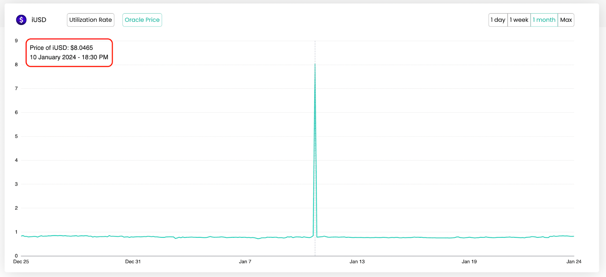
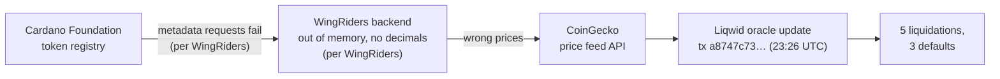
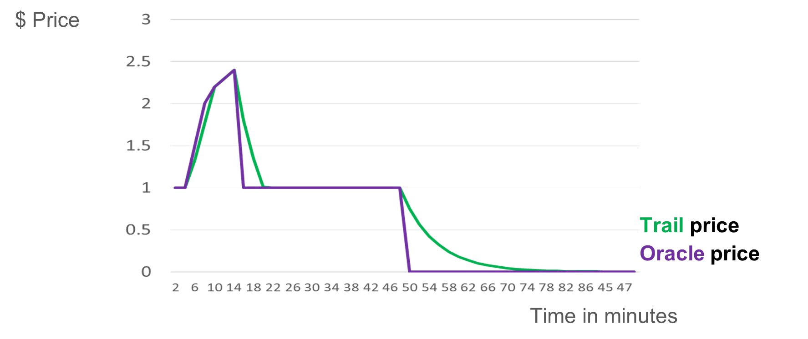

# CID-202401: Liqwid Faulty Oracle Transaction

> At 23:26 UTC on 10 January 2024, Liqwid, a lending protocol on Cardano, wrote wrong prices for the stablecoins DJED and iUSD into its on-chain price oracle [1][8]. The prices came from a CoinGecko feed that was relaying bad data from the WingRiders exchange, whose backend, by WingRiders' account, had run out of memory and lost track of token decimals [1][4]. Before Liqwid paused the protocol about 15 minutes later, five positions were liquidated, with about 110,000 ADA (about USD 63k) of collateral seized, and three went into default [5][12]. Almost all of the seized ADA was returned voluntarily, and Liqwid compensated the remaining losses in its LQ token from its Safety Pool after a governance vote, reporting no bad debt [1][5]. The Cardano L1 was not at fault. Liqwid moved the affected feeds to Charli3 oracles on 19 January 2024 and later adopted price limits and a single-person "kill switch" [1][7].

## Timeline (UTC)

| Time | Event |
|---|---|
| 2024-01-10 21:44:51 | Cardano epoch 460 begins [9]. WingRiders later says token-registry metadata requests fail "whenever there's an epoch shift" and failed worse than usual in the hours before the incident [4]. |
| 2024-01-10 23:10 | Transaction `bd5d98b2…` is confirmed (slot 113,361,919) [9]; Liqwid's first X post wrongly named it as the faulty update [2][3]. |
| 2024-01-10 23:26 | Faulty oracle update `a8747c73…44fec9b` is confirmed in block 9,788,275 (slot 113,362,873) [1][8][9]. Liquidations and defaults follow [5]. |
| ~2024-01-10 23:41 | After a Liqwid developer notices the incident, the core team pauses batching; shortly afterwards the Liqwid Admin Multisig pauses the affected markets [1][2][5]. |
| 2024-01-10/11 | Liqwid asks CoinGecko to remove WingRiders as a source for Cardano native assets supported on Liqwid [1]. |
| 2024-01-11 01:16 | First public disclosure on X, attributing the price spike to WingRiders data in Liqwid's CoinGecko feed [2]. |
| 2024-01-11 02:10 | Liqwid corrects the transaction link and expects to resume "tomorrow morning" [3]. |
| 2024-01-11 07:43 | WingRiders publishes its explanation and says the problem was fixed within a couple of hours [4]. |
| 2024-01-11 13:24 | Liqwid publishes initial impact data, says it is still "working on resuming the markets" and keeps SHEN withdrawals paused [5]. |
| 2024-01-11 19:24 | Liqwid posts its compensation proposal on the governance forum, estimating about USD 27,100 owed [6]. |
| 2024-01-19 | Charli3 price feeds for ADA, DJED and iUSD go live on Liqwid [1]. |
| 2024-01-25 | Postmortem: Proposal 37 has passed, all affected users are reimbursed and there is no bad debt [1]. |
| 2024-02-22 | Governance discussion of price controls (cap/floor, trailing price, kill switch) opens [7]. |
| 2024-03-26 | A core team member states that the vote on these controls has passed [7]. |

## Impact

On Liqwid's oracle, DJED, a USD-pegged stablecoin, went from USD 1 to 0.001 and then to USD 8 [7]; the iUSD chart in the postmortem shows a spike to USD 8.0465 (Figure 1) [1].

*Figure 1: iUSD oracle price on Liqwid, 25 December 2023 to 24 January 2024, with the spike to USD 8.0465 marked. The chart's time label (18:30) is not UTC; the faulty update was confirmed at 23:26 UTC. Source: Liqwid Labs, ["Faulty Oracle Transaction Incident Postmortem"](https://liqwidfinance.substack.com/p/faulty-oracle-transaction-incident) [1].*

Before the pause, five positions were liquidated with about 110,000 ADA of collateral seized, and three positions went into default with about USD 21k of collateral against about USD 140k of debt [5]. One large position had its qSHEN collateral "changed for a lower amount of qDJED" and fell below a health factor of 1.0 [5]. At about USD 0.57 per ADA [12], the seized collateral was worth roughly USD 63k. One liquidator returned 108,066.1 ADA to the ADA market [5], and two liquidators had returned assets by the evening of 11 January [6].

Liqwid estimated the compensation owed to liquidated users and to liquidators who returned collateral at about USD 27,100 (about 8,470 LQ at about USD 3.20) on 11 January [6] and at about USD 7,000 on 25 January, when it reported all affected users reimbursed [1]. The difference is not explained (see *Disputed or open points*).

Liqwid took the app offline and paused the affected markets [2][5]. They were still paused at 13:24 UTC on 11 January, more than 12 hours later, with SHEN to stay excluded after resumption pending an investigation [5]; the resumption time was not published. The incident hit Liqwid v1; Liqwid V2 launched on mainnet on 24 April 2024 [10].

Rated SEV-3 on the financial dimension: the gross value of collateral seized was about USD 63k [5][12], counted before returns, and Liqwid's own compensation estimates were lower [1][6]; all are within USD 10,000–99,999. On availability, the pause of more than 12 hours is SEV-4, or SEV-3 if it exceeded 24 hours, so it does not raise the rating. Potential SEV-1, financial: about USD 5.8M of DJED and USD 5.7M of iUSD was borrowed on Liqwid on 10 January 2024, within a TVL of about USD 41M [11]. A DJED price of USD 8 makes every DJED loan look eight times larger, pushing positions below a health factor of 1.0 as it did within 15 minutes here [5][7]; left unpaused, wrong-price liquidations across these loans could credibly have exceeded USD 1M. Recoverability: extra-resources (supplemented), because users were reimbursed in LQ from the Safety Pool under governance Proposal 37 and the markets were moved to new Charli3 feeds after oracle contract updates [1].

## Root cause

The bad data passed through three layers of price infrastructure before it reached Liqwid's on-chain oracle. The first two steps are WingRiders' own account [4]:

1. **WingRiders backend (upstream data).** According to WingRiders, metadata requests to the Cardano Foundation token registry routinely failed around epoch boundaries and failed more often and for longer before the incident, while the registry had grown sharply (for example, Minswap added 1,156 tokens in one change) [4]. Together these caused an out-of-memory failure in its backend. Without token metadata, in particular "the number of decimals for some tokens", its app showed token prices "a million times lower" than actual and "prices [were] reported incorrectly by APIs used by services such as CoinGecko" [4]. WingRiders said its on-chain contracts were unaffected because they validate prices on-chain [4].
2. **CoinGecko (aggregator).** CoinGecko's price feed API took in the incorrect WingRiders data [1][2].
3. **Liqwid (consumer).** Liqwid used that single feed for the affected assets, and its oracle update wrote the faulty prices on-chain [1][8]; liquidations were executed against them [5]. Neither the oracle contract nor its off-chain updater rejected the outlier. Liqwid's remediation, a "price floor and cap model" filtering data "based on price deviation percent from previous price" as "an ultimate line of defense" [1], shows what was missing; a later governance post said the protocol "cannot fully rely on any price feed providers, whether centralized or decentralized" [7].

No source attributes the faulty update to malicious activity [1][2][4].

## Detection

A Liqwid developer noticed the incident [1], and the core team started "urgent safety steps" about 15 minutes after the faulty update [5]. No source describes automated alerting on oracle price deviations at the time. Liqwid later set the bar for a similar event: a halt decision "must be made within 5 to 15 minutes to minimize risk exposure" [7].

## Response and resolution

The core team paused batching, and the Admin Multisig then paused the DJED and iUSD markets [1]; the first X post also lists the ADA market [2]. Liqwid asked CoinGecko to remove WingRiders as a source for all Cardano native assets supported on Liqwid until WingRiders confirmed its API was fixed and tested [1], and kept SHEN withdrawals paused while it investigated a wallet holding a 225k ADA loan [5]. Liqwid communicated on X and Discord [1][2][3].

The governance proposal invoked the Safety Pool framework from Liqwid's whitepaper [6]: liquidated users would be repaid 100% of their USD losses in LQ plus a 5% slippage bonus, and liquidators who had returned seized assets would be repaid 100% of their liquidation profit plus 10%. Liqwid publicly thanked the liquidator who returned 108,066.1 ADA [5]. On-chain Proposal 37 passed, and Liqwid reported all affected users fully reimbursed with no bad debt [1].

## Remediation and follow-up

- **Oracle provider change.** After further testing and oracle contract updates, ADA, DJED and iUSD moved to Charli3 feeds on 19 January 2024; with SHEN, 4 of Liqwid's 10 markets then used Charli3 [1]. Liqwid also named Orcfax as a provider whose data the new filters would cover [1].
- **Price floor and cap.** Hardcoded floor and cap values, mainly for stablecoins, clamp any price outside them, and updates are filtered by percentage deviation from the previous price [1][7].
- **Trailing price.** Limits how far a price may move within one or two minutes, against flash crashes and manipulation of native-token collateral values [1][7]. A cross-check against a second oracle is the first line of defence, cap/floor the second [7].
- **Kill switch.** One core team member can halt batching, with an audit trail and team alerts on every activation or resume, alongside the existing four-signatory "Pause Guardian" multisig [7]. Community members asked for at least two signatories and a roadmap to remove it [7]. The core team said the vote had passed and the controls would sit "on the Liqwid oracle contract's offchain" as a second layer of defence, not a replacement for third-party oracles [7].
- **Compensation mechanism.** A core team member later said the Safety Pool, "as described in the Whitepaper and utilized recently", should remain the protocol's primary insurance [14].

*Figure 2: The options Liqwid put to governance for handling a sudden price movement: accept it, modify it with a trailing price or a hardcoded cap/floor, or block it and halt trading. Source: Florian Volery, Liqwid Governance Forum, ["Liqwid price control mechanisms"](https://gov.liqwid.finance/t/liqwid-price-control-mechanisms/1507) [7].*

*Figure 3: Illustration from the same proposal of how a trailing price (green) lags a jumping oracle price (purple), so that a short spike or a sudden drop to zero reaches the protocol only gradually. Source: Florian Volery, Liqwid Governance Forum, ["Liqwid price control mechanisms"](https://gov.liqwid.finance/t/liqwid-price-control-mechanisms/1507) [7].*

## Incident handling assessment

Assessment of the responsible party's handling against SOC 2 Trust Services Criteria, based on public sources only (see CLASSIFICATION.md, section 10). The responsible party is Liqwid Labs, which operated the oracle pipeline; WingRiders and CoinGecko are upstream third parties.

| Criterion | Result | Observation |
|---|---|---|
| CC7.2 Monitoring and detection | Exceptions noted | Detection relied on a developer noticing, about 15 minutes after the faulty update, by which time five liquidations and three defaults had occurred [1][5]. No automated deviation alerting is described; team alerts came later with the kill switch [7]. |
| CC7.3 Evaluation of events | No exceptions noted | Within about two hours Liqwid traced the prices to WingRiders data in its CoinGecko feed [2], and within about 14 hours it published impact figures [5]. |
| CC7.4 Incident response | No exceptions noted | Batching and the affected markets were paused within about 15 minutes [1]; Liqwid had WingRiders removed as a CoinGecko source and kept SHEN withdrawals paused during an investigation [1][5]. |
| CC7.5 Recovery | No exceptions noted | The postmortem states a root cause, users were reimbursed under Proposal 37 with no bad debt reported, feeds moved to Charli3 and governance approved new price controls [1][7]. |
| CC2.3 External communication | Exceptions noted | Liqwid posted about two hours after the faulty update and published a postmortem 15 days later [1][2], but the first post linked the wrong transaction (corrected 54 minutes later) [2][3], and the postmortem's USD 7,000 figure and "no bad debt" statement are not reconciled with the USD 27,100 estimate and the three reported defaults [1][5][6]. |
| CC8.1 Change management | Not applicable | The faulty update came from an upstream data failure acting on Liqwid's existing oracle design, not from a change to Liqwid's code or configuration [1][4]. |

## Lessons for builders

- **Know what is behind an aggregated price feed.** Liqwid consumed CoinGecko, which aggregated a DEX API that Liqwid did not control [1][4]. Find out which venues an aggregator includes, or use feeds with documented aggregation.
- **Bound every price update against the previous on-chain price.** A one-step stablecoin move from USD 1 to 0.001 should fail validation or be clamped [1][7]. Put the check where the price is consumed (oracle or protocol validator), not only in off-chain code, and test it with updates at ×10⁻⁶, ×10⁻³ and ×8 of the previous price.
- **Treat missing token metadata as an error, not a default.** A lost decimals value shifted prices by about six orders of magnitude [4]. Pin decimals per listed asset in your own configuration, and test that a failing metadata service results in no price being published.
- **Require agreement between independent sources.** Liqwid's later design checks prices against a second oracle before applying cap/floor [7].
- **Delay liquidations after extreme moves.** With a trailing price, a single bad update cannot trigger liquidations at once [7]; here five liquidations and three defaults happened before anyone reacted [5].
- **Automate detection and make the pause fast.** Detection depended on a person and containment needed a multisig [1][5]. Alert automatically on deviation and keep a rehearsed single-signer circuit breaker with an audit trail, with a plan to narrow that power later, as community members asked [7].
- **Define the shortfall process in advance.** A pre-defined Safety Pool let Liqwid propose compensation within about 20 hours, and its bonus for liquidators who returned funds gave third parties a reason to return wrongly seized collateral [6].
- **Check on-chain references before publishing.** The first post linked the wrong transaction [2][3].

## Disputed or open points

- **Amount of loss.** Liqwid estimated about USD 27,100 owed on 11 January [6] and about USD 7,000 on 25 January [1] without explaining the difference, for example whether it reflects further returns of collateral (the amount returned by the second liquidator was not published [6]) or a recalculation.
- **Defaulted positions.** On 11 January Liqwid reported 3 positions in default with about USD 21k of collateral against about USD 140k of debt [5]; on 25 January it reported no bad debt [1]. How this apparent shortfall of over USD 100k was resolved is not explained.
- **SHEN wallet investigation.** Liqwid paused SHEN withdrawals to investigate a wallet holding a 225k ADA loan [5]. No outcome was published, so it is not established whether anyone deliberately acted on the faulty prices.
- **Which markets were paused.** The postmortem names DJED and iUSD [1]; the 01:16 UTC post names ADA, DJED and iUSD [2].
- **Size and direction of the price error.** WingRiders described prices "a million times lower" [4], but Liqwid's oracle also recorded upward moves to about USD 8 for DJED and iUSD [1][7]. No source explains the upward moves.
- **Prior oracle setup for ADA.** Charli3 announced in April 2023 that ADA/USD would be among its first feeds for Liqwid [13], yet the postmortem lists ADA among the assets moved to Charli3 after the incident [1]. Which source the ADA market used on 10 January 2024 is not documented.
- **Initially cited transaction.** Liqwid replaced `bd5d98b2…` with `a8747c73…` [2][3] without saying what the first transaction was.
- **Not found in the sources reviewed:** the market resumption time and the Proposal 37 vote date and turnout.

## Sources

1. [P] Liqwid Labs, "Faulty Oracle Transaction Incident Postmortem", 2024-01-25. https://liqwidfinance.substack.com/p/faulty-oracle-transaction-incident
2. [P] Liqwid (@liqwidfinance), "Dear Liqwid community, at approximately 23:26 PM UTC yesterday, the prices for DJED and iUSD spiked…" (X post), 2024-01-11. https://x.com/liqwidfinance/status/1745253381352919173
3. [P] Liqwid (@liqwidfinance), "Correction: the faulty oracle update transaction can be found here…" (X post), 2024-01-11. https://x.com/liqwidfinance/status/1745266960672211397
4. [P] WingRiders (@wingriderscom), "What happened on our side…" (X reply to Liqwid), 2024-01-11. https://x.com/wingriderscom/status/1745350774878613794
5. [P] Liqwid (@liqwidfinance), "Following our investigation into the faulty oracle price feed update transactions we have gathered this initial data…" (X post), 2024-01-11. https://x.com/liqwidfinance/status/1745436398373478778
6. [P] Liqwid Governance Forum (DC, Liqwid core team), "Faulty Oracle Transaction Update Resolution Proposal", 2024-01-11. https://gov.liqwid.finance/t/faulty-oracle-transaction-update-resolution-proposal/1464
7. [P] Liqwid Governance Forum (Florian Volery; replies incl. DC), "Liqwid price control mechanisms", 2024-02-22. https://gov.liqwid.finance/t/liqwid-price-control-mechanisms/1507
8. [P] Cexplorer, "Transaction a8747c7356613d2f70f1a6f511362b813811e0426fa70d4ddef8cf07844fec9b", 2024-01-10. https://cexplorer.io/tx/a8747c7356613d2f70f1a6f511362b813811e0426fa70d4ddef8cf07844fec9b
9. [P] Koios (Cardano chain index API), "epoch_info for epoch 460" and "tx_info" for transactions a8747c73… and bd5d98b2… (slot, block, epoch), retrieved 2026-10-13. https://api.koios.rest/api/v1/epoch_info?_epoch_no=460
10. [P] Liqwid Labs, "Liqwid Blog archive" (lists "Liqwid V2 Mainnet Launch", 2024-04-24), retrieved 2026-10-13. https://liqwidfinance.substack.com/archive?sort=new
11. [S] DefiLlama, "Liqwid protocol TVL and borrowed-token history" (API; Cardano and Cardano-borrowed series for 2024-01-10), retrieved 2026-10-13. https://api.llama.fi/protocol/liqwid
12. [S] Binance, "ADAUSDT 1h klines, 2024-01-10 22:00 to 2024-01-11 01:00 UTC" (API), retrieved 2026-10-13. https://api.binance.com/api/v3/klines?symbol=ADAUSDT&interval=1h&startTime=1704924000000&endTime=1704934800000
13. [S] CryptoPotato, "Cardano Gets Its First Oracle Integrator But ADA Falls Back", 2023-04-07. https://cryptopotato.com/cardano-gets-its-first-oracle-integrator-but-ada-falls-back/
14. [P] Liqwid Governance Forum (DC, Liqwid core team), "Proposal to improve Liqwid protocol" (reply on use of the Safety Pool), 2024-02-13. https://gov.liqwid.finance/t/proposal-to-improve-liqwid-protocol/1482/11
