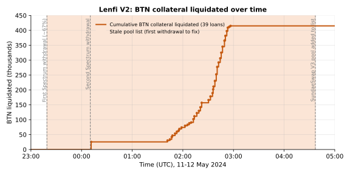
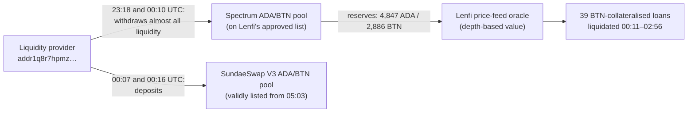
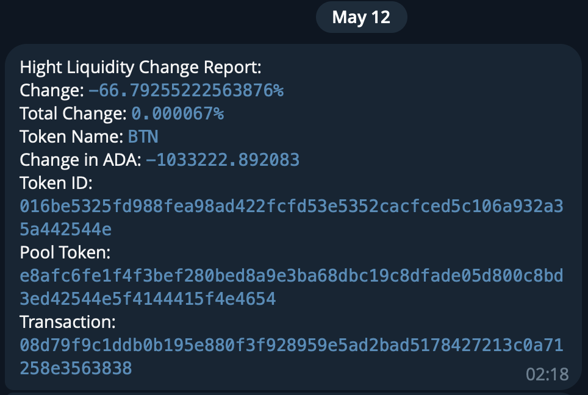

# CID-202402: Lenfi BTN Liquidations Incident

> Lenfi, a lending protocol on Cardano, values collateral in its V2 pools by how much ADA it would fetch if sold into a hand-maintained list of approved DEX (decentralised exchange) pools, not by a quoted market price. Late on 11 May 2024 (UTC), a liquidity provider moved almost all liquidity for BTN, the token of the Butane protocol, out of Spectrum, the only BTN pool on Lenfi's list, into a new SundaeSwap V3 pool that Lenfi did not track. The BTN market price did not change, but Lenfi's valuation of BTN collateral collapsed, and within three hours 39 loans were liquidated: 415,016 BTN seized against 132,810 ADA of debt. Lenfi put the borrowers' loss at 310,043 BTN, about USD 181,000 by our estimate. A valid list entry for the new pool was in place about 5 hours 45 minutes after the first withdrawal, and Lenfi published a post-mortem the next day. On 13 June 2024 Butane, the Lenfi team and the Lenfi DAO compensated each liquidated loan, about 18% of the value in Lenfi's LENFI token rather than BTN. The Cardano L1 was not at fault.

## Timeline (UTC)

| Time | Event |
|---|---|
| 2024-02-23 13:22 | Butane's founder proposes on the Lenfi governance forum to add BTN, "the core token of Butane", as a collateral and borrowable asset on Lenfi V1 and V2, while BTN's public sale is launching [3]. |
| 2024-04-26 11:14 | Last revision of Lenfi's approved-pool list before the incident. Its only BTN entry is the Spectrum ADA/BTN pool (pool NFT `e8afc6fe…BTN_ADA_NFT`) [6][7]. |
| 2024-05-09 | SundaeSwap V3 goes live on mainnet with a tool for migrating liquidity [13]. |
| 2024-05-11 23:18:58 | Address `addr1q8r7hpmz…` removes 1,033,223 ADA and 630,020 BTN, about 67% of the reserves, from the Spectrum ADA/BTN pool (transaction `08d79f9c…`), leaving 513,690 ADA and 313,229 BTN [1][7]. |
| 2024-05-11 23:23 – 2024-05-12 00:07 | The same address creates a SundaeSwap V3 ADA/BTN pool, withdraws from it, and at 00:07:28 creates the V3 pool that Lenfi later lists (pool NFT `…000de1408e76c60d…`), seeded with 504,307 ADA and 306,907 BTN [8]. |
| 2024-05-12 00:10:23 | The same address removes another 514,967 ADA and 306,657 BTN from Spectrum (transaction `daede61b…`), leaving the tracked pool with 4,847 ADA and 2,886 BTN [8]. |
| 2024-05-12 00:11:23 | First liquidation of a BTN-collateralised loan: 25,508 BTN of collateral against about 8,287 ADA of debt (transaction `43879561…`) [1][9]. |
| 2024-05-12 00:16:43 | The liquidity provider adds 1,033,834 ADA and 629,739 BTN to the SundaeSwap V3 pool, which then holds 1,537,910 ADA and 936,788 BTN [8]. |
| 2024-05-12 01:41 – 02:56 | 38 more BTN-collateralised loans are liquidated, the last in transaction `17febdaa…` at 02:56:29 [1][9]. |
| 2024-05-12 04:37 | Lenfi adds the SundaeSwap V3 ADA/BTN pool to its approved-pool list, but the entry's BTN token ID is one hex digit short [6]. Lenfi's post-mortem gives 04:40 for "issue resolved" [1]. |
| 2024-05-12 05:03 | The token ID is corrected; the list now holds a valid entry for the new pool [6]. |
| 2024-05-12 16:02 – 16:19 | An edit maps BTN to a different SundaeSwap V3 pool (the SUNDAE pair) and is reverted 18 minutes later [6]. |
| 2024-05-13 11:35 | Lenfi publishes "Postmortem Report: BTN liquidations incident" [1]. |
| 2024-05-17 15:16 | A Lenfi team member posts a DAO proposal to compensate borrowers [2]. |
| 2024-06-13 10:22 – 10:23 | A distribution wallet (`addr1vy4ghf4a…`) receives 25,515 BTN and 75,000 BTN from two addresses [11]. |
| 2024-06-13 10:24:30 | The Lenfi treasury sends 28,327 LENFI to the distribution wallet with the transaction metadata "BTN incident compensation" [10][12]. |
| 2024-06-13 11:23:24 | Transaction `88c61e59…` (metadata "BTN compensation") adds 200,000 BTN from a third address and pays 255,925 BTN plus 28,326 LENFI in 39 outputs to 24 addresses; 44,575 BTN goes back to the third address as change [11]. |

## Impact

Lenfi reports that 415,016 BTN of collateral was liquidated, 10,108 BTN returned to borrowers and 132,810 ADA of debt repaid [1]; our tally of the 39 liquidations at the Lenfi V2 collateral script (00:11:23 to 02:56:29) matches [9]. Five liquidator payment credentials took part, one performing 24 of the liquidations, and borrowers repaid at least 13 other BTN-collateralised loans in the same window [9].



*Figure 1: Cumulative BTN collateral liquidated at the Lenfi V2 collateral script, with the two Spectrum withdrawals and the first pool-list edit (04:37) marked. Data: Koios API, retrieved 2026-10-13 [9]; event times from [6][7][8]; chart by the catalogue.*

Net of the BTN returned, liquidators paid about 0.33 ADA per BTN (132,810 ADA for 404,908 BTN), against about 1.64 ADA per BTN in the Spectrum pool before the withdrawals [7][9].

Lenfi put the borrowers' total loss at 310,043 BTN [2]. This equals, loan by loan, the BTN seized minus the BTN returned and minus the cancelled debt converted at 1.40 ADA per BTN [9]. At the proposal's 1.337 ADA per BTN [2] and Binance's ADA/USDT daily close of 0.4377 on 2024-05-12 [14], it is about 414,500 ADA, or USD 181,000; Lenfi published no USD figure.

Depositors in the Lenfi V2 ADA pool were repaid through the liquidations ("loans were liquidated to protect deposits"), and no pause or outage of the platform is reported [1][9].

Rated SEV-2 (financial): the borrowers' loss before compensation, 310,043 BTN or about USD 181,000, falls within USD 100,000–999,999; compensation does not change the rating. Potential SEV-2 (financial): only BTN collateral was mispriced, and BTN collateral liquidated or repaid at the collateral script between 11 and 19 May totals at least about 1.07 million BTN [9], about USD 0.65–0.77 million at 1.40–1.64 ADA per BTN; no source supports a figure above USD 1 million. Recoverability: extra-resources (supplemented), because borrowers were compensated about a month later from the Lenfi DAO treasury and from BTN committed by Butane and the Lenfi team [2][10][11].

## Root cause

**How Lenfi V2 values collateral.** Collateral is valued at the ADA the whole amount would return if sold into the constant-product reserves of approved DEX pools, after a 0.3% fee [4][5]:

```
collateral_value = sell_amount * 997 * ada_reserve / (token_reserve * 1000 + 997 * sell_amount)
```

A loan can be liquidated when `collateral_value / debt / liquidation_threshold` falls below 1 [5]. An off-chain oracle signs the price data a client submits only for pools on Lenfi's approved list [4], a JSON file in a GitHub Gist that the team edits by hand [6]. The documentation says the design "allows Lenfi to efficiently operate in low liquidity markets" [5] and warns that "liquidity movements on DEX will impact positions, even if the asset price seems unchanged" [4].

**What went wrong.** Spectrum was the only BTN pool on the list [6]. When its liquidity moved to SundaeSwap V3, the tracked reserves shrank while the market price stayed the same. In Lenfi's words, "the unfair liquidations happened since the SundaeSwap pool was not being tracked at the time when a large share of ADA/BTN liquidity was moved" [1]. The DAO proposal attributes the incident to "mechanics in Lenfi's design" while "all operations of the Lenfi protocol remained intact" [2]. Three design properties made this possible: liquidity depth was the only price signal, one pool was enough to list an asset, and nothing compared the depth-based value with the spot price, a check Lenfi's own action items call for [1].



**Effect of the two withdrawals.** On the on-chain reserves [7][8], Lenfi's formula [5] values the first liquidated loan's 25,508 BTN [9] at about 40,600 ADA before the first withdrawal, 38,600 ADA after it, and 4,350 ADA after the second at 00:10:23; the loan was liquidated 60 seconds later [8][9]. The second withdrawal, not the first 67% on its own, therefore explains the liquidations. This assumes the oracle used only the Spectrum reserves, as the list indicates [6].

**Related incidents.** CID-202401 (Liqwid, January 2024) is the closest precedent: wrong prices from a single source, with no check against an independent reference, caused erroneous liquidations on another Cardano lending protocol. CID-202406 is a separate validator vulnerability, found in December 2024, in the same Lenfi V2 pool contract (script credential `32e8c0ae…`) that received the liquidation proceeds here [9].

## Detection

Lenfi's alerting system flagged the first withdrawal in the team's Telegram channel (Figure 2), but "because of its timing the team could not act on it immediately": it was 2 am local time [1]. The first recorded action is the pool-list edit at 04:37 [6], after all 39 liquidations [9].



*Figure 2: Lenfi's automated alert for the first Spectrum withdrawal: a −66.79% change in the tracked BTN pool, −1,033,222.89 ADA, transaction `08d79f9c…`. The 02:18 timestamp is in the team's local time; on-chain, the withdrawal was confirmed at 23:18:58 UTC [7]. Source: Lenfi, ["Postmortem Report: BTN liquidations incident"](https://web.archive.org/web/20240524041842/https://medium.com/@lenfi/postmortem-report-btn-liquidations-incident-32fb0114529e) [1].*

## Response and resolution

Containment consisted of the pool-list edits in the timeline, the first valid one at 05:03; no pause of BTN liquidations is reported [1][6]. Our tally found no BTN liquidations after 02:56 up to 20 May [9].

The 17 May DAO proposal put the borrowers' total loss at 310,043 BTN. Butane committed 155,021 BTN and the Lenfi team 105,000 BTN "acquired through the Butane private sale and from on-chain liquidations"; the DAO treasury was asked for "the remaining 55,021 BTN" to "make borrowers whole", either in LENFI at fixed prices (BTN 1.337 ADA, LENFI 2.597 ADA), in ADA from an over-the-counter sale of 73,563 ADA worth of LENFI, or not at all. The proposal adds that future losses from liquidity movements should not be the DAO's responsibility [2].

On 13 June the treasury address [12] sent 28,327 LENFI, the 55,021 BTN at the proposal's prices (option 1), with the memo "BTN incident compensation" [2][10]. The distribution transaction paid 255,925 BTN and 28,326 LENFI in 39 outputs to 24 addresses [11]. Each output equals the loss of one liquidated loan, computed as in *Impact*, plus about 0.03% (one is about 810 BTN, or 5%, higher), always in the same mix of about 82% BTN and 18% LENFI by value at proposal prices [9][11]. The total, about 310,946 BTN, slightly exceeds Lenfi's figure. By amount, the BTN came from an address contributing a net 155,425 BTN (Butane committed 155,021) and about 100,500 BTN from the distribution wallet (the Lenfi team committed 105,000) [2][11]; neither address is publicly linked to either party.

## Remediation and follow-up

- **Done:** the SundaeSwap V3 pool was added to the BTN price configuration [1][6].
- **Announced, not verified:** price-feed code that would "dynamically include new DEX liquidity pools", an oracle that would "reject requests when spot token price differentiates a lot compared to liquidity depths", participation in "uniform oracle solutions", and inclusion of every new DEX [1]. The list was still edited by hand in 2025 [6]; we found no evidence that dynamic pool discovery or the spot-versus-depth check was deployed.
- **Governance:** Lenfi wrote that the "DAO should be more critical on collateral asset acceptance" and should communicate more with projects whose tokens are used as collateral [1]. Butane's founder had proposed BTN as collateral while its public sale was running [3].
- **User guidance:** the price-feed documentation asks anyone controlling a large share of an asset's liquidity to "move liquidity in chunks or even notify the team before the movement" [4].
- **Later context:** Lenfi V2 was taken out of service after CID-202406 (December 2024); a July 2025 community FAQ said there was "no timeline for the relaunch of V2" [12].

## Incident handling assessment

Assessment of the responsible party's handling against SOC 2 Trust Services Criteria, based on public sources only (see CLASSIFICATION.md, section 10). The responsible party is the Lenfi team, which operated the price-feed oracle and maintained the approved-pool list.

| Criterion | Result | Observation |
|---|---|---|
| CC7.2 Monitoring and detection | No exceptions noted | Lenfi's own alerting flagged the first withdrawal in the team's Telegram channel as it happened [1][7]. |
| CC7.3 Evaluation of events | Exceptions noted | The alert was not acted on because it arrived at 2 am local time [1]; the first recorded action came at 04:37, after all 39 liquidations [6][9]. |
| CC7.4 Incident response | Exceptions noted | No pause of BTN liquidations is reported. The first pool-list entry had a malformed token ID; a valid entry came at 05:03, about 5 hours 45 minutes after the first withdrawal, and a later edit briefly mapped BTN to the wrong pool [6]. |
| CC7.5 Recovery | Exceptions noted | The configuration was corrected and borrowers were compensated on-chain [6][10][11], but the announced preventive changes are not evidenced as deployed and the list was still edited by hand in 2025 [1][6]. |
| CC2.3 External communication | No exceptions noted | A post-mortem with timeline, root cause, impact figures and action items appeared about 36 hours after the first withdrawal [1], followed by a compensation proposal [2] and a payout with traceable on-chain memos [10][11]. Minor date and scope errors are listed under Disputed or open points. |
| CC8.1 Change management | Not applicable | The incident was triggered by a third party moving liquidity while Lenfi's pool list stayed unchanged, not by a change Lenfi made [1][6]. Errors in the remediation edits are covered under CC7.4. |

## Lessons for builders

- **A depth-only price is only as good as the pool list behind it.** With a hand-edited list, any liquidity migration looks like a crash. Discover pools automatically, for example by policy ID across DEXes, or at least alert on new pools for listed assets.
- **Cross-check before liquidating.** Refuse to sign a price, or pause liquidations for the asset, when the depth-implied value and the spot price diverge sharply, as Lenfi's own action item proposes [1].
- **Limit liquidity concentration.** One address held two thirds and then almost all of the tracked liquidity [7][8]. Require several pools, cap any one pool's or provider's share, and agree notice periods with issuers [1][4].
- **Alerts need a responder.** The alert fired at 2 am local time and nobody acted [1]. Provide on-call cover or an automatic per-asset circuit breaker.
- **Validate configuration changes.** The fix shipped with a malformed token ID, and a later edit pointed BTN at the wrong pool [6]. Check that IDs parse, that the pool holds the asset and that reserves are plausible.
- **Publish the compensation calculation.** The per-loan figures and the 1.40 ADA per BTN rate behind them had to be reconstructed from chain data [9][11].

## Disputed or open points

- **End time.** Lenfi gives 04:40 for "issue resolved" [1], but the entry added at 04:37 had a BTN token ID one hex digit short, which cannot match BTN; the list held a valid entry only from 05:03 [6]. Whether the oracle reads the Gist directly is not documented.
- **Start time.** The post-mortem summary dates the event to "May 12, 2024, at approximately 23:00 UTC"; its own timeline and the chain give 2024-05-11 23:18:58 UTC [1][7].
- **Size of the withdrawal.** Lenfi's "approximately 67%" [1] matches the first withdrawal only; the post-mortem omits the second, which left the tracked pool with about 0.3% of its original ADA reserve [7][8].
- **Who moved the liquidity.** The address is not publicly identified [8]. Butane committed half the calculated loss [2]; we found no Butane statement explaining why.
- **Loss figure.** Lenfi did not publish its method. Its 310,043 BTN is reproduced exactly by converting each loan's cancelled debt at 1.40 ADA per BTN [9], a rate no source mentions; at the pre-event Spectrum ratio of about 1.64 the total would be about 324,000 BTN [7][9]. The proposal's three commitments add up to 315,042 BTN, 4,999 more than its stated loss [2].
- **Compensation.** The match of the 39 payments to individual loans is our own analysis [9][11]. Borrowers carried LENFI price risk on the 18% paid in LENFI. We found no complaints from affected borrowers but did not search Discord or Telegram.
- **DAO vote.** The proposal was to go to a forum poll and possibly an on-chain vote [2]. No result was found; the payout matches option 1 [10].
- **Timing of liquidations.** Only one liquidation came in the 90 minutes after the second withdrawal; the other 38 came between 01:41 and 02:56 [9] (Figure 1). The sources do not explain the gap.

## Sources

1. [P] Lenfi (Medium), "Postmortem Report: BTN liquidations incident", 2024-05-13. https://medium.com/@lenfi/postmortem-report-btn-liquidations-incident-32fb0114529e (archived: https://web.archive.org/web/20240524041842/https://medium.com/@lenfi/postmortem-report-btn-liquidations-incident-32fb0114529e)
2. [P] Lenfi governance forum (Mantas), "Proposal: Compensate Users Affected in the BTN Liquidity Incident Using DAO Funds", 2024-05-17. https://governance.aada.finance/t/proposal-compensate-users-affected-in-the-btn-liquidity-incident-using-dao-funds/3362 (archived: https://web.archive.org/web/20240614112712/https://governance.aada.finance/t/proposal-compensate-users-affected-in-the-btn-liquidity-incident-using-dao-funds/3362)
3. [P] Lenfi governance forum (Micah, Butane founder), "Proposal: Add BTN as collateral and borrowable asset to LenFi V1&V2", 2024-02-23. https://governance.aada.finance/t/proposal-add-btn-as-collateral-and-borrowable-asset-to-lenfi-v1-v2/2490 (archived: https://web.archive.org/web/20240713044723/https://governance.aada.finance/t/proposal-add-btn-as-collateral-and-borrowable-asset-to-lenfi-v1-v2/2490)
4. [P] Lenfi documentation, "Price feeds", retrieved 2026-10-13; earliest archived copy 2024-05-23. https://lenfi.gitbook.io/docs/price-feeds (archived: https://web.archive.org/web/20240523223702/https://lenfi.gitbook.io/docs/price-feeds)
5. [P] Lenfi documentation, "Collateral" (value calculation and health factor), retrieved 2026-10-13. https://lenfi.gitbook.io/docs/liquidity-pools/collateral
6. [P] aada-finance (GitHub Gist), `lenfi_tokens.json` approved DEX pool list, revision history including revisions 38fef6c (2024-04-26), d2c08d0 (2024-05-12 04:37), 6c9ca6b (05:03), 635fd54 (16:02), e06356f (16:19), retrieved 2026-10-13. https://gist.github.com/aada-finance/0baf007fb47d15b64a63ad54b3768eb7/revisions
7. [P] Cardano mainnet, transaction 08d79f9c… (withdrawal from the Spectrum ADA/BTN pool), 2024-05-11; data retrieved via the Koios API on 2026-10-13. https://cexplorer.io/tx/08d79f9c1ddb0b195e880f3f928959e5ad2bad5178427213c0a71258e3563838
8. [P] Cardano mainnet, address addr1q8r7hpmz…eug9mf (liquidity provider) and its transactions from 2024-05-11 23:18 to 2024-05-12 00:16, including daede61b… (second Spectrum withdrawal), eb449486… (SundaeSwap V3 pool creation) and de418917… (V3 deposit); data retrieved via the Koios API on 2026-10-13. https://cexplorer.io/address/addr1q8r7hpmzh9cck6t4u0sxwmf70as7jf393a9c4qc80h022pq6mg9srfedm2c3ca3p8l6d52gc9zg45lwthaq5dwphfrcqeug9mf
9. [P] Cardano mainnet, Lenfi V2 collateral script address addr1xxqzrqc2…s6xr3y, transactions from 2024-05-11 23:30 to 2024-05-20 (liquidations tagged "Lenfi: Liquidated the loan", repayments tagged "Lenfi: REPAID to pool"); catalogue maintainers' tally via the Koios API on 2026-10-13. https://cexplorer.io/address/addr1xxqzrqc2lmwctldpy57690n4kekquewysg2gawx2dyys8jl2cs5fmtsqsqe32szd3y37p92a4nj6ym52ccutvswwv2rqs6xr3y
10. [P] Cardano mainnet, transaction cfb6aac5… (Lenfi treasury to distribution wallet, metadata "BTN incident compensation"), 2024-06-13; data retrieved via the Koios API on 2026-10-13. https://cexplorer.io/tx/cfb6aac583fd9a10094b791642f8614c24de7b2f554f91cdd8395d9f257d63b1
11. [P] Cardano mainnet, transaction 88c61e59… (compensation distribution, metadata "BTN compensation") and the funding transactions 8dd8a429… and 2a07b500… into addr1vy4ghf4a…, 2024-06-13; data retrieved via the Koios API on 2026-10-13. https://cexplorer.io/tx/88c61e59230fd89fff1c1b3ba1a4d0a1c0531025bdc1cbce5b95204e1bb9969d
12. [S] Lenfi governance forum (CMOS, community FAQ, "in no way is official communication"), "LENFI FAQ | July 2025" (identifies the treasury address addr1qyxgh8xp…; V2 status), 2025-07-21. https://web.archive.org/web/20250805135244/https://governance.aada.finance/t/lenfi-faq-july-2025/5023
13. [S] TapTools (Tap In With TapTools, Medium), "SundaeSwap V3 Goes Live on Cardano Mainnet", 2024-05-14. https://medium.com/tap-in-with-taptools/sundaeswap-v3-goes-live-on-cardano-mainnet-2817b687722f (archived: https://web.archive.org/web/20250104102319/https://medium.com/tap-in-with-taptools/sundaeswap-v3-goes-live-on-cardano-mainnet-2817b687722f)
14. [S] Binance, ADA/USDT daily klines 2024-05-11 to 2024-05-18, retrieved 2026-10-13. https://api.binance.com/api/v3/klines?symbol=ADAUSDT&interval=1d&startTime=1715385600000&endTime=1715990400000
