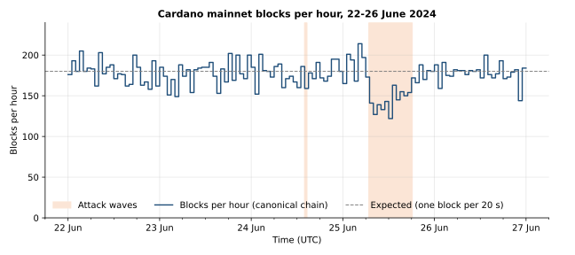
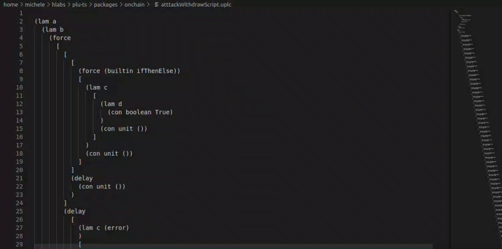
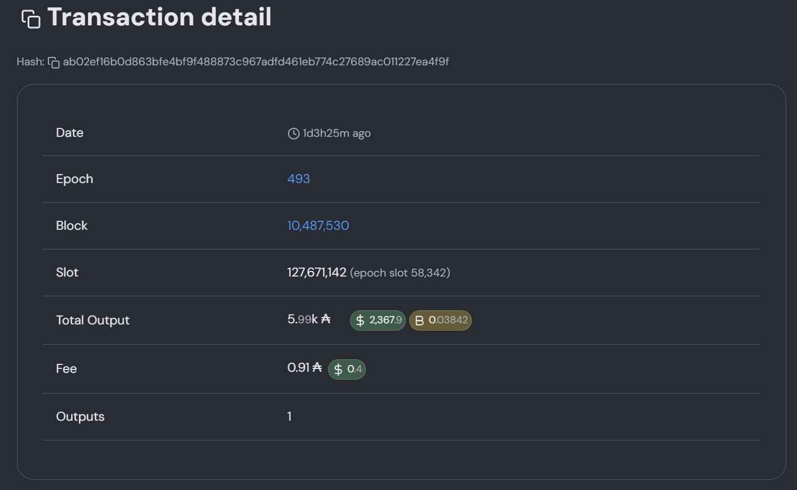
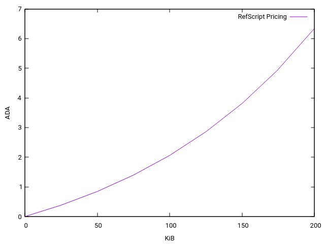

# CID-202403: Reference Script Spam (DDoS) Attack on Mainnet

> On 24 and 25 June 2024 an unidentified attacker sent 4,422 spam transactions to Cardano mainnet from three wallets [1][19]. Each paid an ordinary fee of about 0.91 ADA but made every validating node load and decode about 3 MB of Plutus scripts stored elsewhere on the chain ("reference scripts"), work the fee rules of the time did not charge for [2][19]. The chain never stopped, but during the 11.4-hour main wave on 25 June blocks were produced at about 79% of the expected rate, block producers ran under higher load and transactions confirmed more slowly [1][3][19]. No user funds were lost [1][3][22]. The weakness lay in the Cardano ledger's fee rules, so the L1 was at fault [1][2]. The attack stopped that evening, shortly after a community developer pointed out publicly that anyone could deregister the attacker's own stake credentials and keep their deposits, which would also invalidate its pending attack transactions [4][5][19]. Emergency node releases 8.9.4 and 8.12.1 followed on 27 June, and the Chang hard fork on 1 September 2024 made escalating reference-script fees and hard size caps part of the ledger rules [1][2][8][9][14].

## Timeline (UTC)

| Time | Event |
|---|---|
| 2024-06-24 13:23 | Attacker wallet 2 registers 194 script-based stake credentials (2 ADA deposit each) in two transactions [19]. |
| 2024-06-24 13:53 | Attacker wallet 1 registers its own set of 194 script-based stake credentials in two transactions (block 10,487,511) [19]. |
| 2024-06-24 13:57 | First attack transaction (wallet 2, block 10,487,529); wallet 1's first attack transactions follow 12 seconds later in block 10,487,530 [15][16]. |
| 2024-06-24 14:37 | First wave ends after 283 attack transactions in about 40 minutes [19]. |
| 2024-06-24 15:16 | Attacker wallet 3 registers a third set of 194 script-based stake credentials [19]. |
| 2024-06-25 06:48 | Second, main wave begins with wallet 3; wallets 1 and 2 rejoin at 07:07 and 08:18 [19]. |
| 2024-06-25 15:27 | Harmonic Labs developer Michele posts that "the attack script is just junk", "not doing any real validation" [7]. |
| 2024-06-25 17:24 | Anastasia Labs founder Philip DiSarro explains the mechanism and invites anyone to deregister the attacker's 194 "always succeeds" stake credentials to claim the deposits and stop the attack [4]. |
| 2024-06-25 17:30 | FluidTokens CTO Raul Antonio posts that the attack began at block 10,487,530, with each transaction executing 194 scripts of type REWARD for 0.9 ADA [6]. |
| 2024-06-25 17:36 | Wallet 1 submits its last attack transaction; wallet 2 follows at 17:43 [19]. |
| 2024-06-25 17:42 | Wallet 1 begins spending its 194 reference-script outputs (about 69.5 ADA each) back to itself; done by 17:44 [19]. |
| 2024-06-25 18:12 | Last attack transaction (wallet 3, block 10,492,231) [17][19]. |
| 2024-06-25 18:21 | First deregistration of an attacker credential by a third party (transaction linked by DiSarro) [5][18]. |
| 2024-06-25 18:40 | DiSarro posts that the attacker "halted his attack after reading my tweet" and that "the pillaging of their funds is already in progress" [5]. |
| 2024-06-25 21:09 | Intersect confirms a "spam attack" on mainnet and announces a task force with the Cardano Foundation, Input Output, SPOs and developers [3]. |
| 2024-06-26 06:17 | CoinDesk reports the event as a "Failed DDoS Attack Targeting Staked ADA" [20]. |
| 2024-06-26 08:50 | SPO "Dave" replies to CoinDesk that "there wasn't any attempt to steal staked tokens here" and "No funds were at risk" [22]. |
| 2024-06-26 | ouroboros-consensus-cardano 0.17.1.0: "Enforce Conway minfees for ref scripts in the mempool, even in Babbage" [11]. |
| 2024-06-26 23:53 | Last third-party deregistration; 449 of 582 attacker credentials deregistered in total [19]. |
| 2024-06-27 | cardano-node 8.12.1 and 8.9.4 released, fixing "an issue that could lead to high system load when specific transactions were submitted to Cardano" [8][9]. |
| 2024-06-29 | cardano-node 8.12.2 released (bootstrap-peers fix, otherwise identical to 8.12.1) [10]. |
| 2024-07-09 | Intersect SRE report: all IOG-operated release environments upgraded through 8.9.4 and 8.12.1 to 8.12.2 by the end of June [13]. |
| 2024-08-14 | cardano-ledger ADR-9 accepted: tiered reference-script fees and per-transaction/per-block size caps for Conway [2]. |
| 2024-08-26 | ouroboros-consensus mempool switched to the 1 MiB per-block reference-script limit decided for Conway [12]. |
| 2024-09-01 | Chang hard fork activates the Conway era at epoch 507 [14]. |
| 2024-09-11 | Intersect publishes its incident note "Issue Caused by Large Reference Scripts on Cardano Mainnet" [1]. |

## Impact

Intersect reported on the day that "the network has experienced a higher load than normal and some SPOs have been negatively affected due to an intensification in block height battles", while "the chain as a whole is functioning as expected, with only a small impact on overall transaction timings and some reduction in chain density" [3]. Its later note describes "network disruption to block producer nodes, an increase in network load, and some slowdown in transaction throughput" [1].

On-chain data [19] gives the scale:

- 4,422 attack transactions from three wallets: 283 on 2024-06-24 (13:57 to 14:37) and 4,139 on 2024-06-25 (06:48 to 18:12).
- 4,356 of them were 16,296 bytes long (99.5% of the 16,384-byte limit), each with 194 zero-ADA reward withdrawals and 194 reference inputs, and each paid 0.906368 ADA in fees [15][16][17][19]. The rest were 64 smaller transactions from wallet 2 (8,342 bytes) and two of 16,368 bytes [19].
- The reference inputs pointed at PlutusV2 scripts of about 15.8 to 16.0 KB each, about 3.08 MB of script bytes per transaction, roughly 189 times the transaction's own size [19]. Execution was trivial: 446.4K memory units and 113.8M steps per transaction, 2.71% and 1.14% of the per-transaction budget [15].
- The main wave lasted 11.4 hours (06:48 to 18:12 UTC). Its 1,629 blocks, 1,474 (90%) of which contained at least one attack transaction, came at about 143 per hour: about 79% of the expected 180 per hour (one block per 20 seconds) and about 19% below the preceding seven-day average of about 176 per hour [19]. Intersect puts the direct effect at "about 12 hours" [1]; this report uses the on-chain 11.4 hours.

*Figure 1: Blocks per hour on the canonical chain, 22 to 26 June 2024 (UTC), against the expected 180 per hour. The shaded bands are the two attack waves from the Timeline. Data: Koios API, retrieved 2026-10-13 [25]; chart by the catalogue.*

No user or protocol funds were lost or exposed: SPO Dave stated that "No funds were at risk" [22], and Intersect's reports mention no losses [1][3]. The attacker paid 3,984.48 ADA in fees for the attack transactions alone, about USD 1,500 at the ADA price of about USD 0.38 reported at the time [19][23]; Intersect puts its total cost at 4,603 ADA [1]. Of the 1,164 ADA the attacker deposited to register 582 stake credentials, other addresses claimed 898 ADA and 266 ADA stayed in 133 credentials that were never deregistered [19]; this was the attacker's money and is not counted as a loss. Stake pool operators had to upgrade outside the normal schedule, to 8.9.4, 8.12.1 or 8.12.2 [1][8][9][13].

Rated SEV-2 (dimension: availability): chain density over the 11.4-hour main wave was about 79% of expected, below the threshold CLASSIFICATION.md section 1 sets for network-wide degradation ("chain density below 90% of expected over the affected window"), for more than one hour [19]. SEV-1 does not apply: block production never stopped, and there was no chain split, chain restart or bad block requiring CIP-135 disaster recovery [1][3]. No funds were lost. Potential SEV-2 (dimension: availability): unmitigated, the attacker could have prolonged the degradation for as long as it paid about 0.9 ADA per transaction, but it was already near the size limits (about 2.8 of a possible 5 maximum-size attack transactions per block), and no primary source describes a credible path to a halt or chain split [1][4][19]. Recoverability: escalated. Block production returned to normal only when the attacker stopped (Figure 1), which followed a community developer's public counter-measure rather than any action of the core teams, so time to recovery was not predictable; the permanent fix then needed a cross-organisation task force, emergency node releases and the Chang hard-fork rules [1][2][3][4][8][9].

## Root cause

**Unpriced reference scripts.** Since the Babbage era, a transaction can use a Plutus script stored in an existing UTxO by listing that UTxO as a reference input, instead of carrying the script bytes itself [2]. The Babbage minimum fee depended only on the transaction's own serialised size and its declared execution units; the bytes of referenced scripts, which every validating node must look up and deserialise, added nothing [2][4]. With the epoch 493 parameters (44 lovelace per byte plus 155,381 lovelace [19]), 16,296 bytes cost 872,405 lovelace; about 34,000 lovelace for execution units brings this to the 906,368 lovelace the attack transactions paid (our calculation) [15][19]. ADR-9 states the problem: "it would be possible to create a very large script that was fairly expensive to deserialize, but very cheap to execute", and "there was no real limit on the total size of reference scripts that could be used in a transaction, thus being limited only by the size of the transaction itself"; this "[o]verhead of using reference scripts was not properly accounted for when this feature was introduced in the Babbage era" [2]. Intersect gives the same cause: "High deserialisation costs for these reference scripts impacted the node" [1].

**How the attacker forced 194 scripts per transaction.** Each attack transaction withdrew 0 ADA from 194 different script-locked reward accounts. That made the ledger run each account's script (redeemer purpose "reward") and required each script to be supplied, which the attacker did by reference [6][19]. The ledger accepts a withdrawal only from a registered reward account, so the attacker first registered 194 script credentials per wallet at 2 ADA each [4][19]. Developers who inspected the scripts described them as junk that does no real validation and as "always succeeds" scripts [4][7].

*Figure 2: Opening frame of a screen recording of the decompiled attack withdrawal script, posted with the comment that "the attack script is just junk". Source: Michele (Harmonic Labs) on X [7].*

**The issue was known before the attack.** Intersect states that "the general issue had already been identified, and a mitigation (costing for reference scripts) had been prepared as part of the Chang hard fork, but not yet deployed to mainnet" [1]. ADR-9 explains that a linear per-byte fee (`minFeeRefScriptCostPerByte`) had been planned for Conway at a "fairly moderate value", because a deterrent value would have made reference scripts "almost as expensive to use as regular scripts", with the intention of tuning it once "we would be able to reveal to a wider audience the true nature of this issue" [2].

## Detection

Community developers analysing chain data found the attack; there is no account of automated monitoring catching it. The earliest public analysis found is Michele's post at 15:27 UTC on 25 June, about 8.6 hours into the main wave [7][19]. DiSarro (17:24 UTC) and Raul Antonio (17:30 UTC) published fuller descriptions shortly afterwards [4][6]. Intersect thanked "the community for quickly mobilizing to help support us in identifying the source" [3]. No public source mentions the 40-minute first wave on 24 June while it was happening [19].

*Figure 3: Explorer view of attack transaction `ab02ef16…4f9f` in block 10,487,530 (epoch 493), fee 0.91 ADA, attached to the post that described the attack. Source: Raul Antonio (FluidTokens) on X [6].*

## Response and resolution

**Containment (25 June): the attacker's own weakness.** Any transaction that satisfies a script-based stake credential's script in the certifying role can deregister that credential, and the 2 ADA deposit refund goes to whoever builds the transaction [4][18]. Because the attacker's scripts accepted everything, anyone could deregister its credentials and keep the deposits, and each deregistration invalidated every pre-built attack transaction that withdrew from that account [4]. DiSarro published this at 17:24 UTC [4]. All three wallets stopped between 17:36 and 18:12 UTC, after that post but before the first deregistration landed on-chain at 18:21 UTC [5][18][19]; DiSarro attributed the halt to the attacker reading his post "in an effort to protect his funds" [5]. That first deregistration netted 1.124 ADA after a 0.876 ADA fee; it embedded the 15.6 KB script inline, and the script ran at 2.3K memory units and 586.7K steps [18].

Between 2024-06-25 18:21 and 2024-06-26 23:53 UTC, three addresses other than the attacker's funding wallets deregistered 449 of the 582 credentials and received 898 ADA in refunds [19]:

- The address used in the transaction DiSarro linked made 330 deregistrations (660 ADA refunded, 288.05 ADA in fees).
- A second address made 114, all of them wallet-3 credentials, citing wallet 3's own reference-script outputs instead of including the scripts inline (228 ADA refunded, 21.85 ADA in fees).
- A third address made 5.

DiSarro said the proceeds would fund "the open-source smart contract development work we do at @AnastasiaLabs & funding Midgard" [5].

**Remediation by the core teams.** Intersect set up a technical task force with the Cardano Foundation, Input Output, and knowledgeable SPOs and developers to "identify and test a solution that will blunt this kind of spam attack", and coordinated with SPOs via Discord [3]. Two days after the attack it shipped as cardano-node 8.12.1 and, for operators not ready to move to the 8.12 line, as 8.9.4, which fixes the issue "in exactly the same way" (see *Remediation and follow-up*) [8][9]. Node 8.12.2 followed on 29 June to fix an unrelated bootstrap-peers issue in 8.12.1 [10], and IOG-operated environments were on 8.12.2 by the end of June [13].

## Remediation and follow-up

- **Interim mempool rule in the Babbage era (8.9.4 and 8.12.1).** Both releases carry the consensus change "Enforce Conway minfees for ref scripts in the mempool, even in Babbage" and the ledger functions that compute the new fee, "Add `tierRefScriptFee`" and "Make reference scripts fee grow exponentially with size" [8][9][11]. An upgraded node admits a transaction to its mempool, and so relays it or puts it in a block it forges, only if the fee also covers the Conway-style tiered reference-script fee described below. This was node policy, not a ledger rule: the Babbage ledger still accepted transactions without that fee, so blocks containing them remained valid [2][11]. ouroboros-consensus also began tracking each transaction's reference-script size in the mempool [12]. Intersect summarises the mitigations as "restricting large reference scripts, and changing the cost model" [1].
- **Ledger fix for Conway.** ADR-9 replaced the planned flat rate with tiered pricing. The total reference-script size is split into 25 KiB (25,600-byte) chunks; the first chunk costs `minFeeRefScriptCostPerByte` (15 lovelace per byte), and each later chunk costs 1.2 times the previous one [2]. Hard caps of 200 KiB (204,800 bytes) of reference scripts per transaction and 1 MiB (1,048,576 bytes) per block were added [2]. The size counts all scripts in all spent and referenced inputs (an input in both sets once), counts duplicate scripts each time, and includes native scripts and scripts the transaction does not execute [2]. The mempool was aligned to the 1 MiB per-block cap and enforces the reference-script size limit in Conway from 2024-08-26 [11][12]. Intersect states these mitigations were "incorporated into node version 9.0.0 or later for the Chang hard fork" [1], which activated Conway on 2024-09-01 [14].

  

  *Figure 4: Reference-script fee in ADA per transaction against total reference-script size (KiB), under the tiered pricing with the parameters set for Conway. Source: Alexey Kuleshevich, cardano-ledger ADR-9 [2].*

- **Effect on the attack pattern.** A transaction like the attack ones, with about 3.08 MB of reference scripts, is invalid in Conway because it exceeds the 200 KiB cap about 15 times over [2][19]. The flat 15 lovelace/byte rate first planned would have added only about 46 ADA per transaction (our calculation from [2][19]).
- **Still pending.** ADR-9 records that the tier size, multiplier and caps were hard-coded because new protocol parameters could not be added that late in the Conway release cycle, and that they "will be turned into proper protocol parameters in the next era" [2]. A draft specification for the Dijkstra era describes doing exactly that, with guardrails [24].

## Incident handling assessment

Assessment of the responsible party's handling against SOC 2 Trust Services Criteria, based on public sources only (see CLASSIFICATION.md, section 10). The responsible party is the Cardano core development organisation: Intersect, which coordinated the response, and Input Output, which maintains cardano-node, cardano-ledger and ouroboros-consensus.

| Criterion | Result | Observation |
|---|---|---|
| CC7.2 Monitoring and detection | Exceptions noted | No source describes detection by the core teams' monitoring. The earliest public analysis came from a community developer about 8.6 hours into the main wave, and the 24 June wave went unremarked (see *Detection*) [3][7][19]. |
| CC7.3 Evaluation of events | No exceptions noted | Intersect's same-day statement described higher load, block height battles and reduced chain density without user-fund impact, which matches the on-chain data [3][19]; it later tied the attack to the already-identified issue [1]. |
| CC7.4 Incident response | Exceptions noted | A task force was formed and a mempool fix shipped in cardano-node 8.12.1 and 8.9.4 within two days [3][8][9][11]. During the 11.4-hour main wave, however, the sources show no containment or public statement by the core teams; the attack stopped after a community member published a counter-measure, and Intersect's first statement came about three hours later [1][3][4][19]. |
| CC7.5 Recovery | No exceptions noted | The root cause was identified and addressed in two steps: a mempool rule enforcing Conway-style reference-script fees in Babbage, then tiered fees and hard size caps in the Conway ledger from the Chang hard fork; the tier values remain hard-coded (see *Remediation and follow-up*) [2][11][14]. |
| CC2.3 External communication | Exceptions noted | The release notes described the fix only as addressing "high system load when specific transactions were submitted" [8][9]. The incident note followed 11 weeks later as a short summary that misdates the event and gives no timeline or impact figures [1], and ADR-9 states that wider disclosure of the known issue had been deferred [2]. |
| CC8.1 Change management | Exceptions noted | The Babbage-era reference-script feature shipped with a fee rule that did not price referenced script bytes; the gap was known before the attack, but its mitigation was set at a "fairly moderate value" and deferred to the Chang hard fork (see *Root cause*) [1][2]. |

## Lessons for builders

- **Price every resource a validator spends, including data the transaction only references.** The attack's cost to nodes came from bytes resolved out of the UTxO set, not bytes sent in the transaction [2]. Protocol and alternative-node teams (for example Amaru or Dingo) should benchmark validation time per lovelace of fee for adversarial shapes such as this one: maximum-size transactions, many reference inputs, large scripts that are cheap to run, and many zero-value withdrawals.
- **Fee estimators must implement ADR-9 exactly.** Since Conway, reference scripts are not free, and the counting rules (all spent and referenced inputs, duplicates and unused scripts included) and 25,600-byte / ×1.2 tiers are easy to get wrong [2]. Test estimators against a node's minimum fee at tier boundaries (25,600 and 51,200 bytes) and with duplicated reference inputs, and keep batchers and aggregators well under the 200 KiB per-transaction and 1 MiB per-block caps, since a block's reference-script budget is shared by all its transactions [2].
- **Never use an "always succeeds" script for a credential that holds a deposit or that your transactions depend on.** A dApp using the "withdraw zero" pattern to run a staking script as a transaction-wide validator must make that script reject the certifying (deregistration) purpose unless an authorised key signs. Otherwise anyone can deregister the credential, take the deposit, and make every transaction that withdraws from it fail, which is exactly what disabled the attacker here [4][18][19]. Test it by trying to deregister your protocol's script credentials from an unrelated wallet in an emulator.
- **Mempool policy is a fast but partial fix.** The two-day hotfix was a mempool admission rule, not a ledger rule [8][11]. It protected the network only as far as relays and block producers upgraded, and a block containing such a transaction stayed valid until the Conway rules took effect [2][11][14]. Alternative node implementations need to reproduce such policies, not only the ledger rules.
- **Alert on chain-level anomalies.** The attack's on-chain signature (see *Impact*) was visible for hours before the first public analysis [7][19]. Indexer and SPO tooling can alert on the ratio of resolved reference-script bytes to transaction size and on bursts of new script stake-credential registrations.

## Disputed or open points

- **Date.** Intersect's incident note dates the event "25th June 2025" [1]; the chain data, contemporaneous posts and ADR-9 ("June 25th 2024") show the year was 2024 [2][3][4][19]. The press, Intersect and ADR-9 all describe a 25 June attack [1][2][20][21], but on-chain the first wave ran on 24 June from 13:57 to 14:37 UTC [19].
- **Starting block.** Raul Antonio cites block 10,487,530 as the start [6], and the press repeated it [20][21][23]. The earliest attack transaction found is in block 10,487,529, 12 seconds earlier, from a different attacker wallet [15][19].
- **"Stealing staked ADA".** CoinDesk described an attack "targeting staked ADA" [20], CryptoSlate an attack "aimed at stealing staked tokens" [23], and Cointelegraph wrote that "if successful, the attacker could steal staked Cardano (ADA) tokens" and that developers reclaimed "the stolen ADA tokens" [21]. A Cardano SPO replied that "there wasn't any attempt to steal staked tokens here" [22], and Intersect calls it a "spam attack" [3]. The on-chain data shows no attempt on third-party stake; the only ADA that changed hands through deregistrations was the attacker's own deposits [18][19].
- **Who stopped the attack.** Intersect says it "was stopped by a community member" [1], and Cointelegraph that developers "outsmarted the attacker" [21]. On-chain, the halt followed the publication of the counter-measure but preceded its use (see *Response and resolution*) [4][18][19].
- **Network impact.** DiSarro wrote during the attack that "Liveliness is unaffected" and that validators were "totally fine" [4]; Intersect reported block-producer disruption, block height battles, reduced chain density and slower throughput [1][3]. The on-chain data fits a network that did not halt but was measurably degraded [19]. The number of SPOs affected and of blocks lost to height battles has not been published.
- **Attacker cost and funding.** Intersect gives a cost of 4,603 ADA and says the transactions were "funded from 3 wallets containing around 20K ada each" [1]. The on-chain analysis confirms three funding wallets but measures 3,984.48 ADA in attack-transaction fees, 898 ADA of deposits claimed by others and 266 ADA still locked [19], and cannot reconcile these with Intersect's total, which may include setup transactions not analysed.
- **Identities.** The attacker is unidentified and published no statement. The address that made 330 deregistrations is the one used in the transaction DiSarro posted [5][18]; the two other deregistering addresses are not publicly attributed [19].
- **Pre-incident disclosure.** No public discussion by the responsible parties was found of whether the known vector (see *Root cause*) should have been disclosed or mitigated sooner in Babbage [2].

## Sources

1. [P] Intersect (Kevin Hammond), "Large Reference Scripts: Issue Caused by Large Reference Scripts on Cardano Mainnet", 2024-09-11. https://updates.cardano.intersectmbo.org/2024-09-11-incident
2. [P] IntersectMBO / cardano-ledger (Alexey Kuleshevich), "ADR 9: Changes to the fee calculation due to Reference Scripts", 2024-08-14. https://github.com/IntersectMBO/cardano-ledger/blob/master/docs/adr/2024-08-14_009-refscripts-fee-change.md
3. [P] Intersect (@IntersectMBO) on X, "Update on the spam attack attempted today", 2024-06-25. https://x.com/IntersectMBO/status/1805709955493752880
4. [P] Philip DiSarro (@phil_uplc) on X, "Hey, if anyone wants to claim 400 Ada from the attacker just deregister the stake credentials they are using", 2024-06-25. https://x.com/phil_uplc/status/1805653337976504428
5. [P] Philip DiSarro (@phil_uplc) on X, "Update: DDOSer halted his attack after reading my tweet", 2024-06-25. https://x.com/phil_uplc/status/1805672403822870776
6. [S] Raul Antonio (@ElRaulito_cnft, CTO FluidTokens) on X, "On Block 10,487,530, an attack on the Cardano network began", 2024-06-25. https://x.com/ElRaulito_cnft/status/1805654707378983353
7. [S] Michele (@MicheleHarmonic, Harmonic Labs) on X, "the attack script is just junk, not doing any real validation", 2024-06-25. https://x.com/MicheleHarmonic/status/1805623904414708044
8. [P] IntersectMBO / cardano-node, "Release Cardano Node 8.12.1", 2024-06-27. https://github.com/IntersectMBO/cardano-node/releases/tag/8.12.1
9. [P] IntersectMBO / cardano-node, "Release Cardano Node 8.9.4", 2024-06-27. https://github.com/IntersectMBO/cardano-node/releases/tag/8.9.4
10. [P] IntersectMBO / cardano-node, "Release Cardano Node 8.12.2", 2024-06-29. https://github.com/IntersectMBO/cardano-node/releases/tag/8.12.2
11. [P] IntersectMBO / ouroboros-consensus, "ouroboros-consensus-cardano CHANGELOG (0.17.1.0, 2024-06-26; 0.18.0.0, 2024-08-26)", 2024-08-26. https://raw.githubusercontent.com/IntersectMBO/ouroboros-consensus/main/ouroboros-consensus-cardano/CHANGELOG.md
12. [P] IntersectMBO / ouroboros-consensus, "ouroboros-consensus CHANGELOG (0.19.1.0, 2024-06-26; 0.20.1.0, 2024-08-26)", 2024-08-26. https://raw.githubusercontent.com/IntersectMBO/ouroboros-consensus/main/ouroboros-consensus/CHANGELOG.md
13. [P] Intersect Cardano Development Updates (John Lotoski), "SRE Q2 2024 Update", 2024-07-09. https://updates.cardano.intersectmbo.org/quarterly/2024-Q2-sre/
14. [P] Intersect, "Chang upgrade #1 hard fork achieved!", 2024-09-02. https://www.intersectmbo.org/news/chang-upgrade-1-hard-fork-achieved
15. [P] Cardanoscan, "Transaction 220ac36bf5946478db0183c24e80172f2b0a27750110ba0894495e878456669b" (earliest attack transaction, block 10,487,529), 2024-06-24. https://cardanoscan.io/transaction/220ac36bf5946478db0183c24e80172f2b0a27750110ba0894495e878456669b
16. [P] Cardanoscan, "Transaction ab02ef16b0d863bfe4bf9f488873c967adfd461eb774c27689ac011227ea4f9f" (attack transaction in block 10,487,530), 2024-06-24. https://cardanoscan.io/transaction/ab02ef16b0d863bfe4bf9f488873c967adfd461eb774c27689ac011227ea4f9f
17. [P] Cardanoscan, "Transaction 77ebace1a5e4b39b41b745bfd72563adbd49e3b1f2cd25ffec58cae70ac2f6cc" (last attack transaction, block 10,492,231), 2024-06-25. https://cardanoscan.io/transaction/77ebace1a5e4b39b41b745bfd72563adbd49e3b1f2cd25ffec58cae70ac2f6cc
18. [P] Cardanoscan, "Transaction 184e90cd26532db938e793c0d802f304173c128cc1f13b2a7fe1421dbabd3edf" (first third-party stake deregistration, linked by DiSarro), 2024-06-25. https://cardanoscan.io/transaction/184e90cd26532db938e793c0d802f304173c128cc1f13b2a7fe1421dbabd3edf
19. [P] Koios mainnet API, "On-chain data for blocks 10,487,511 to 10,497,513: blocks, block_txs, tx_info, account_updates, account_info, address_txs and epoch_params (epoch 493), analysed by this catalogue", 2026-10-13. https://api.koios.rest/api/v1/blocks?block_height=eq.10487530
20. [S] CoinDesk (Shaurya Malwa), "Cardano Unfazed by Failed DDoS Attack Targeting Staked ADA", 2024-06-26. https://www.coindesk.com/tech/2024/06/26/cardano-unfazed-by-failed-ddos-attack-targeting-staked-ada
21. [S] Cointelegraph (Arijit Sarkar), "Cardano node upgrade underway following mainnet DDoS attack", 2024-06-26. https://cointelegraph.com/news/cardano-developers-thwart-ddos-attack-upgrade-security
22. [S] Dave (@ItsDave_ADA, Cardano SPO) on X, reply to CoinDesk: "there wasn't any attempt to steal staked tokens here", 2024-06-26. https://x.com/ItsDave_ADA/status/1805886439869079554
23. [S] CryptoSlate (Oluwapelumi Adejumo), "Cardano outsmarts DDoS attacker who ends up funding network improvements", 2024-06-26. https://cryptoslate.com/cardano-outsmarts-ddos-attacker-who-ends-up-funding-network-improvements/
24. [S] Carlos Lopez de Lara (IOG) and Aleksandr Vershilov (Tweag), "Dijkstra protocol parameters: specification for the constitution update, guardrails and initial settings" (draft v1.3), 2026-10-07. https://github.com/CarlosLopezDeLara/dijkstra-constitution-update
25. [P] Koios mainnet API, "Blocks at heights 10,476,000 to 10,498,499 (block_height, block_time, tx_count, block_size), bucketed into blocks per UTC hour by this catalogue", 2026-10-13. https://api.koios.rest/api/v1/blocks?block_height=gte.10476000&block_height=lt.10477000&select=block_height,block_time,tx_count,block_size&order=block_height.asc
