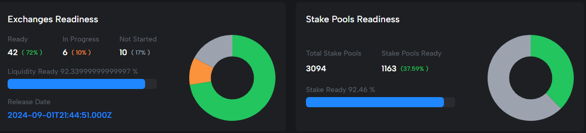
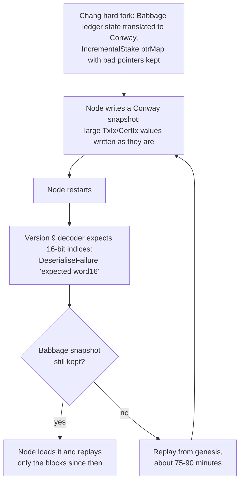

# CID-202404: Conway Ledger State Replay Bug after Chang Hard Fork

*This report was generated with AI (Claude Opus 5.5) from the public sources listed under Sources. To correct or remove content, see [Corrections and removals](../README.md#corrections-and-removals).*

> When Cardano mainnet entered the Conway ledger era with the Chang hard fork at 21:44 UTC on 1 September 2024, the node versions operators ran for the fork, cardano-node 9.0.0 and 9.1.0, began saving ledger state snapshots that they could not read back [1][7]. Running nodes kept working, but a node restarted more than about 14 hours after the fork had to rebuild its ledger by replaying the whole chain from the first (genesis) block, staying offline for about 75-90 minutes, and did so again on every later restart [5][7]. The cardano-db-sync indexer could not read its own snapshots either [13]. The core teams had found the bug and merged a fix about 16 hours before the fork [2][3], but the fixed node, 9.1.1, was published about 19 hours after it [4], and a working db-sync release followed on 4 September [14]. Until they upgraded, operators were told not to restart any node [1][5][6]. The chain ran without interruption [10], there was no chain split and no funds were at risk. The root cause was in Cardano's own node software, so the L1 was at fault.

## Timeline (UTC)

| Time | Event |
|---|---|
| 2024-08-28 | The hard fork working group votes unanimously to go ahead, schedules the Chang hard fork for 2024-09-01 21:44:51 UTC and reports 92% of SPO stake ready [9]. Preprod and Preview are already in the Conway era [8]. |
| 2024-08-31 18:16-19:38 | Alexey Kuleshevich (`lehins`) commits "Implement a fix for inability to deserialize pointers in Conway" and opens cardano-ledger PR #4589 ("Fix deserialization of bad `Ptr`s in `IncrementalStake`"), with backport PRs for the cardano-node 9.1 and 9.2 branches [2][3]. |
| 2024-09-01 02:27-06:00 | A last commit disables pointer-map generation in tests ("Tomorrow we are going into Conway…"), a reviewer approves citing testing by `amesgen` "earlier today", and PR #4589 is merged with its 9.1, 9.2 and Cardano Haskell package repository (CHaP) backports [2][19]. |
| 2024-09-01 18:14 to 2024-09-02 05:30 | On `release/9.1.x`, cardano-node PR #5966 bumps `cardano-ledger-shelley` to 1.12.3.0 and PR #5967 ("cardano-node 9.1.1", commit `efd5600`) is merged [19][4]. |
| 2024-09-01 21:44:51 | The Chang hard fork takes effect. Slot 133660800 is the first Conway slot and the start of epoch 507 [7][9][13]. A secondary source gives block 10764778 as the fork block [20]. |
| 2024-09-02 00:37 | Intersect posts a "Notice for node users" on X: nodes restarted within 14 hours of the hard fork (until about 11:45 UTC) should be fine, later restarts will need a replay from genesis, and a hotfix, 9.1.1, is "in preparation" [5]. |
| 2024-09-02 17:08 | The cardano-node 9.1.1 release is published on GitHub [4]. |
| 2024-09-02 17:53-17:58 | Intersect announces 9.1.1 on X, repeats that operators should avoid restarts, including automated ones, until they upgrade, and links a mitigation document [6][7]. |
| 2024-09-02 18:50-18:53 | A db-sync 13.5.0 operator reports that every Conway ledger snapshot fails to parse with "expected word16"; db-sync falls back to the last Babbage snapshot at slot 133660799 [13]. |
| 2024-09-02 19:03 | cardano-db-sync 13.5.0.1 is released with a fix "similar to node version 9.1.1" [14]. |
| 2024-09-03 12:44-12:50 | The same operator reports that db-sync 13.5.0.1 still writes Conway snapshots it cannot read [13]. |
| 2024-09-03 15:26 to 2024-09-04 20:06 | An SPO's self-built "9.1.1" relay replays from genesis with the same error (issue #5971); maintainers trace it to a stale cabal package index that still linked `cardano-ledger-shelley-1.12.2.0` [12]. |
| 2024-09-04 22:42 | cardano-db-sync 13.5.0.2 is released. It recommends deleting all ledger snapshots before upgrading; upgrades from 13.4/13.5 require a ledger replay from genesis [14]. |
| 2024-09-05 | The db-sync reporter confirms that 13.5.0.2 works [13]. |
| 2024-09-09 | Intersect's development update reports that the chain ran "uninterrupted" and some restarts took "up to two hours longer" [10]. |
| 2024-09-12 | Intersect publishes the incident note "Unexpected Ledger State Replay in the Conway era" [1]. |
| 2024-09-27 to 2024-11-04 | Pointers are dropped from the Conway ledger state at the Babbage-to-Conway translation (commit `4b0b918`) and from the Conway `UMap` decoder (PR #4647) [2][18]; ouroboros-consensus PR #1297 then reverts an older translation workaround [15]. |

## Impact

Every kind of cardano-node 9.0.0/9.1.0 instance was affected: relays, block producers, full-node wallets and nodes serving db-sync [1][7]. So were cardano-db-sync 13.5.0.0 and 13.5.0.1 [13][14]. These were the versions operators ran for the fork; three days before it, Cardanoscan counted 92.46% of stake as ready (Figure 1) [8].

*Figure 1: Exchange and stake pool readiness for the Chang hard fork on Cardanoscan as at 29 August 2024, three days before the fork: 92.46% of stake and 72% of tracked exchanges were reported ready. Source: Intersect, "Chang upgrade #1 - Readiness" [8].*

A node restarted after the 14-hour window replayed from genesis for "about 75-90 minutes, during which the node is essentially offline", on every restart until upgraded [7]. Intersect also gave "around 90 minutes" [6][8] and "up to two hours longer" than a normal restart [10]; one SPO expected a self-built node to take "several hours" [12]. db-sync instead fell back to its last Babbage-era snapshot and re-applied every block since the fork [13], and the release that fixed it required a full ledger replay from genesis [14].

Intersect reported that "the chain continued to run uninterrupted" and that no emergency calls were needed [10]. No source reports missed blocks, reduced chain density or exchange suspensions. The bug concerned only reading back local snapshots: all nodes kept validating the same chain, so consensus safety was not affected and no funds were at risk [1][7]. The burden fell on operators: an unscheduled upgrade, no restarts until then, and for db-sync two upgrades within three days [6][7][14].

Rated SEV-4 (dimension: availability, emergency-upgrade rule): operators had to make an unscheduled, mandatory upgrade and follow a "do not restart your node" instruction, and downtime stayed limited to individual nodes and indexers [1][5][10]. Potential SEV-2 (dimension: availability): unpatched, every restart of an affected node would have cost 75-90 minutes offline while about 92% of stake ran those versions [7][8], so restarts covering about a tenth of stake at once would have pushed chain density below 90% for more than an hour; this is a catalogue judgement (see `classification_notes`). Recoverability: extra-resources (an emergency node release, a coordinated operator upgrade and, for db-sync, two follow-up releases and a ledger replay from genesis, within about three days [4][6][14]).

## Root cause

Intersect summarised the cause as "a slight inconsistency between the ledger state snapshots that were written and those that could be read back; a side effect of the removal of pointer addresses in the Conway era" [1].

A pointer address names its stake credential indirectly, through a `Ptr` made of a slot number, a transaction index (`TxIx`) and a certificate index (`CertIx`) [11]. The ledger's `IncrementalStake` structure keeps stake attributed to pointers in a separate map, `ptrMap` [3]. A 2022 cardano-ledger design decision (ADR 5) retired pointer addresses from protocol version 9 (Conway) onwards [17], and the decoders became stricter accordingly: from version 9, `TxIx` and `CertIx` are decoded as 16-bit values instead of 64-bit values, and any `Ptr` whose fields do not fit in 32/16/16 bits is invalid [11]. Mainnet's historical ledger state held such out-of-range ("bad") pointers: the fix's regression test builds a `Ptr` with `TxIx maxBound` and `CertIx maxBound` [2][3], and the mitigation tool reports "Bad pointer addresses present" on mainnet Conway snapshots [7].

At the hard fork, the Babbage ledger state was translated into Conway without blanking `ptrMap`, which the consensus team later identified as "what caused the serialization bug" [15]. The node wrote the bad pointers unchanged into its periodic snapshots. On restart it decoded Conway snapshots with the version 9 decoder and failed with `DeserialiseFailure … "expected word16"` [12][13], then tried the next snapshot. By default a node keeps only two snapshots, so once both were Conway snapshots (slot ≥ 133660800) nothing readable was left and it replayed from genesis, after which it wrote defective snapshots again [7]. db-sync keeps its own ledger snapshots and failed in the same way, but because it also kept older ones it fell back to the last Babbage snapshot rather than to genesis [13].

*Figure 2: Why every restart of an affected node ended in a replay from genesis, based on the ledger fix, operator reports and the working group's mitigation document [3][7][12][13][15]; diagram by the catalogue.*

Intersect did not explain how it derived the 14-hour window [5]. A plausible explanation, which is the catalogue's inference, is that a node snapshots the ledger state at its immutable tip, about k = 2,160 blocks (around 12 hours) behind the chain tip, so both retained snapshots stayed pre-Conway, and readable with the version 8 decoder, until roughly half a day after the fork.

The testnets did not catch the bug. Preprod and Preview had entered Conway before mainnet [8], but "certain esoteric parts of the ledger state (like pointer addresses) might not exist on any testnet" [15].

The fix (cardano-ledger-shelley 1.12.3.0, shipped in node 9.1.1) makes the `IncrementalStake` decoder version-aware: from version 9 it skips the serialised pointer map (`dropCBOR`) and returns an empty map [3]. Node 9.1.1 therefore discards "the problematic part of the ledger state on deserialization" and writes snapshots without it [7]. Those snapshots can also be loaded by 9.0.0/9.1.0, but those versions still cannot read the snapshots they write themselves, so only the upgrade ends the cycle [7]. Dropping the map does not change ledger rules, because Conway no longer resolves pointer addresses when computing the stake distribution [15].

While investigating #4589, the consensus team found a second, harmless effect of the undropped map: together with an earlier translation workaround, it kept pointer-address delegations ("exactly 100 ADA") out of the first Conway stake distribution. All nodes ran the same code, so there was no divergence [15].

## Detection

The core teams found the bug before the fork, not through monitoring. Intersect says it "was identified shortly before the Chang hard fork" [1]; the first fix commit is dated about 27.5 hours before the fork [3], and the reviewer cited "@amesgen testing earlier today" [2]. The sources do not say who first saw the failure or how, and a later Intersect account differs (see Disputed or open points).

On mainnet, the failure shows up as `ChainDB` errors of the form `Invalid snapshot DiskSnapshot {…} InitFailureRead (ReadFailed (DeserialiseFailure … "expected word16"))`, followed by a replay [12]. db-sync logs `Failed to parse ledger state file … "expected word16"` [13].

## Response and resolution

The ledger fix and its backports were merged about 16 hours before the fork [2][19], but node 9.1.1 was published about 19 hours after it [4][19] (see Disputed or open points). About three hours after the fork, Intersect warned operators about restarts and pointed them to a dedicated Discord channel (`chang-hf-issues`) and the GitHub releases page [5][8]. With the release, it recommended avoiding restarts, including automated ones, until operators had upgraded, and advised tool providers to "stagger node restarts" [6][8]. The hard fork working group's mitigation document ranked five options [7]:

1. Upgrade to 9.1.1 (no replay needed from 9.0.0/9.1.0; one replay from genesis may be needed from earlier versions).
2. Do not restart, which is "not sustainable indefinitely".
3. For tool providers, run redundant nodes.
4. Suffix a Babbage snapshot (for example `mv 133653464 133653464_keep`) so that garbage collection keeps it and replay starts from there.
5. As a last resort, strip the bad pointers from a Conway snapshot with an unreviewed tool (`amesgen/snap-util`).

db-sync took longer. 13.5.0.1 followed node 9.1.1 by about two hours [14], but the reporter's instance still wrote unreadable Conway snapshots. The maintainer first suspected the build method, then found that a ledger replay from genesis was needed before the fix took effect: "It's unclear why this happens, but seems to be a solution" [13]. db-sync 13.5.0.2 shipped this on 4 September, and the reporter confirmed it worked the next day [13][14].

Source builds caused one more complication: an SPO who built "9.1.1" without refreshing the cabal package index still linked the unfixed ledger package, which maintainers diagnosed through `dist-newstyle/cache/plan.json` [12].

## Remediation and follow-up

- **Hotfix:** `cardano-ledger-shelley` 1.12.3.0 added the version-aware decoder, a Conway regression test that round-trips a translated Babbage ledger state containing a bad `Ptr`, and a test-generator change [2][3], shipped in cardano-node 9.1.1 [4][19] and cardano-db-sync 13.5.0.1/13.5.0.2 [14].
- **Clean-up at the source:** pointers are dropped from `IncrementalStake` at the Babbage-to-Conway translation (commit `4b0b918`) [2] and from the Conway `UMap` decoder (PR #4647) [18]. The consensus team says this "landed in Node 10.0" and let it remove an older translation workaround (ouroboros-consensus PR #1297) [15].
- **Process proposals:** a tool that round-trips and era-translates the latest mainnet ledger snapshot in integration testing, "to avoid bugs like the one that was fixed in #4589" (cardano-ledger #4618, still open as of 2026-10-13), and a specification of cross-era ticking and forecasting (#4635) [16]. The consensus team concluded that Cardano "*really* need[s] proper specification and testing of what exactly should happen at era boundaries" [15].
- **Disclosure:** Intersect added the incident to its public incident log [1] and credited its "newly established incident response team" with the fix [10]; IOG's weekly development report covered the 9.1.1 release [21].

## Incident handling assessment

Assessment of the responsible party's handling against SOC 2 Trust Services Criteria, based on public sources only (see CLASSIFICATION.md, section 10). The responsible party is the Cardano core development organisation: Input Output's ledger, consensus, node and db-sync teams, with Intersect's hard fork working group and incident response team coordinating the response.

| Criterion | Result | Observation |
|---|---|---|
| CC7.2 Monitoring and detection | No exceptions noted | The core teams identified the issue themselves before the fork; the first fix commit predates it by about 27.5 hours [1][3]. A later Intersect account differs [10]. |
| CC7.3 Evaluation of events | No exceptions noted | Within about three hours of the fork, Intersect told operators which restarts would be affected [5]; the mitigation document correctly described the effect and ranked five options [7]. |
| CC7.4 Incident response | Exceptions noted | Guidance, a support channel and the node hotfix followed within about 19 hours of the fork [4][5][6][8]. However, a fix merged before the fork was released after it without public explanation [2][4][19], and the first db-sync fix did not work for every instance, delaying a working release to 4 September [13][14]. |
| CC7.5 Recovery | No exceptions noted | The root cause was determined, fixed with a regression test and later removed at the source [2][3][15][18]. The proposed mainnet ledger-state test tool is still open [16]. |
| CC2.3 External communication | Exceptions noted | Operators were informed promptly [5][6][7][8], but the incident note has no detailed timeline or impact figures, Intersect's accounts of the detection differ, and its "would break ledger replay" headline overstates the documented behaviour [1][6][7][10]. |
| CC8.1 Change management | Exceptions noted | The hard fork release's Babbage-to-Conway translation left the pointer map in place for the stricter Conway decoder [3][15]. Release testing did not use real mainnet ledger state, which "might not exist on any testnet"; such a test was proposed only afterwards [15][16]. |

## Lessons for builders

- **Round-trip real production state through every serialiser and era translation before a hard fork.** Synthetic generators and testnets missed this because the triggering data existed only in mainnet history [15][16]. Indexers, oracles, batchers and chain followers that persist chain-derived state can test `decode(encode(x)) == x` on a copy of real mainnet state after every schema or protocol-version change.
- **When you tighten a decoder by version, check everything already stored.** The stricter 16-bit `TxIx`/`CertIx` decoding was meant for new data [11][17] but also hit a persisted snapshot carrying old 64-bit values [3][13]. List every structure that embeds the type (on-chain data, snapshots, caches, messages) and decide whether old values must still be accepted.
- **Normalise deprecated data at the migration boundary, not in readers.** The permanent fix dropped pointer data during the Babbage-to-Conway translation [2][15][18].
- **Alert on recovery fallbacks.** The node fell back automatically from a failed snapshot to a full replay from genesis [7][12]; operators should alert on `Invalid snapshot`/`ReadFailed` events and unexpected replays.
- **Keep a recovery path across hard forks.** A suffixed pre-fork snapshot (`<slot>_keep`) survives garbage collection, and services with several nodes can stagger restarts, which a single node or db-sync instance cannot [6][7].
- **Pin dependencies in source builds.** A self-built "9.1.1" stayed vulnerable because of a stale package index [12]. Use cabal `index-state` or freeze files and check resolved versions (for example in `plan.json`), or use the official binaries.

## Disputed or open points

- **When was it detected?** Intersect's incident note says "shortly before the Chang hard fork" [1], and GitHub shows the fix written on 31 August [3]; its 9 September update says "as we crossed the epoch boundary, an issue surfaced" [10], possibly meaning when operators saw the effects. The sources do not reconcile the two.
- **Why the fix shipped after the fork:** No source explains why node 9.1.1 was not released before the fork, or whether a postponement was considered [2][4].
- **Actual footprint:** No source gives the number of nodes or db-sync instances that replayed, or whether any block producer missed slots. We found no exchange or bridge suspension tied to this bug.
- **Severity wording:** Intersect's headline says snapshots "would break ledger replay" [1][6]; the same working group documents a fallback to a slower replay from genesis, not a node that cannot start [7].
- **db-sync 13.5.0.1:** Why it still failed for the reporter, and why a full ledger replay was needed before the fix worked, was never explained [13].
- **Fork block number:** Block 10764778 comes from a secondary source only [20]; the slot (133660800) and epoch (507) are supported by primary sources [7][9][13].
- **Discord channel:** The `chang-hf-issues` channel [5][8] requires Intersect membership and has not been reviewed.

## Sources

1. [P] Intersect (Kevin Hammond, Head of Software Engineering, Cardano Core), "Unexpected Ledger State Replay in the Conway era", 2024-09-12. https://updates.cardano.intersectmbo.org/2024-09-12-incident
2. [P] IntersectMBO/cardano-ledger, PR #4589 "Fix deserialization of bad `Ptr`s in `IncrementalStake`" (opened 2024-08-31, merged 2024-09-01; includes backports #4590/#4591, commit `ac0d1d1`, and references to commit `4b0b918`), 2024-09-01. https://github.com/IntersectMBO/cardano-ledger/pull/4589
3. [P] IntersectMBO/cardano-ledger, commits `4d6e7e8` "Implement a fix for inability to deserialize pointers in Conway" and `7cb30c2` "Implement a Conway regression test for IncrementalStake deserializaiton", 2024-08-31. https://github.com/IntersectMBO/cardano-ledger/commit/4d6e7e8ca9def9279da3121ce25da1f661533cfd ; https://github.com/IntersectMBO/cardano-ledger/commit/7cb30c27feaa0ef884750640e3b5774df09fd152
4. [P] IntersectMBO/cardano-node, "Release 9.1.1", 2024-09-02. https://github.com/IntersectMBO/cardano-node/releases/tag/9.1.1
5. [P] Intersect (@IntersectMBO), post on X: "Notice for node users. The hard fork working group has identified an issue with ledger state snapshots…", 2024-09-02. https://x.com/IntersectMBO/status/1830404531840266446
6. [P] Intersect (@IntersectMBO), X article "Cardano node v.9.1.1 released!" and accompanying post "New Cardano node v.9.1.1 released!", 2024-09-02. https://x.com/IntersectMBO/status/1830665428651159686 ; https://x.com/IntersectMBO/status/1830666675211079988
7. [P] Intersect hard fork working group, "Mitigating Conway ledger state deserialization issue" (Google Doc linked from [6] as bit.ly/MCLSD), 2024-09-02. https://docs.google.com/document/d/1d4j1vXr197hRU94Sqmgq8Ynigyp11JtrR3u8Xm7dV4A/edit
8. [P] Intersect, "Chang upgrade #1 - Readiness" (knowledge base page with the node-user notice), 2024-09-02. https://docs.intersectmbo.org/cardano/cardano-hardforks-and-upgrades/chang-upgrade/chang-upgrade-1-readiness
9. [P] Intersect, "The Chang Upgrade #1 - Date Confirmed!", 2024-08-29. https://www.intersectmbo.org/news/the-chang-upgrade-1-date-confirmed
10. [P] Intersect, "Intersect Development Update #30 - September 6", 2024-09-09. https://www.intersectmbo.org/news/intersect-development-update-30-september-6
11. [P] IntersectMBO/cardano-ledger source at commit `c55f7ca` (merge of #4589): `BaseTypes.hs` (version-gated `DecCBOR TxIx`/`DecCBOR CertIx`) and `Credential.hs` (`Ptr`, `normalizePtr`), 2024-09-01. https://github.com/IntersectMBO/cardano-ledger/blob/c55f7ca2848d78c029bf182777854af5b71e9562/libs/cardano-ledger-core/src/Cardano/Ledger/BaseTypes.hs ; https://github.com/IntersectMBO/cardano-ledger/blob/c55f7ca2848d78c029bf182777854af5b71e9562/libs/cardano-ledger-core/src/Cardano/Ledger/Credential.hs
12. [P] IntersectMBO/cardano-node, issue #5971 "[BUG] - Version 9.1.1 required full replay on mainnet restart from version 9.1.0", 2024-09-03. https://github.com/IntersectMBO/cardano-node/issues/5971
13. [P] IntersectMBO/cardano-db-sync, issue #1841 "Failed to parse ledger state file from Conway era", 2024-09-02. https://github.com/IntersectMBO/cardano-db-sync/issues/1841
14. [P] IntersectMBO/cardano-db-sync, releases 13.5.0.1 (2024-09-02) and 13.5.0.2 (2024-09-04), 2024-09-04. https://github.com/IntersectMBO/cardano-db-sync/releases/tag/13.5.0.1 ; https://github.com/IntersectMBO/cardano-db-sync/releases/tag/13.5.0.2
15. [P] IntersectMBO/ouroboros-consensus, PR #1297 "Revert hack regarding Babbage→Conway ledger state translation" (amesgen), 2024-10-31. https://github.com/IntersectMBO/ouroboros-consensus/pull/1297
16. [P] IntersectMBO/cardano-ledger, issues #4618 "Create Ledger State test tool" (2024-09-10) and #4635 "Specify cross-era ticking/forecasting for Cardano" (2024-09-17), 2024-09-17. https://github.com/IntersectMBO/cardano-ledger/issues/4618 ; https://github.com/IntersectMBO/cardano-ledger/issues/4635
17. [P] IntersectMBO/cardano-ledger, "5. Remove support for pointer addresses" (ADR, file dated 2022-12-05), 2022-12-05. https://github.com/IntersectMBO/cardano-ledger/blob/master/docs/adr/2022-12-05_005-remove-ptr-addresses.md
18. [P] IntersectMBO/cardano-ledger, PR #4647 "Drop pointers from UMap in Conway", 2024-09-27. https://github.com/IntersectMBO/cardano-ledger/pull/4647
19. [P] IntersectMBO release pipeline: cardano-node PR #5966 "update cardano-ledger-shelley -> 1.12.3.0" (merged 2024-09-02 02:06), PR #5967 "cardano-node 9.1.1" (merged 2024-09-02 05:30), and cardano-haskell-packages PR #885 "Backport ledger state deserialization fix" (merged 2024-09-01 06:00), 2024-09-02. https://github.com/IntersectMBO/cardano-node/pull/5966 ; https://github.com/IntersectMBO/cardano-node/pull/5967 ; https://github.com/IntersectMBO/cardano-haskell-packages/pull/885
20. [S] Bitcoinist (Jake Simmons), "Cardano Chang Hard Fork Rolls Out With A Minor Glitch", 2024-09-02. https://bitcoinist.com/cardano-chang-hard-fork-rolls-out-minor-glitch/
21. [P] Input Output Global via cardano.org, "Weekly Development Report" ("Cardano's core teams released node v.9.1.1 to fix replay issues in the Conway era"), 2024-09-06. https://cardano.org/news/2024-09-06-weekly-development-report/
