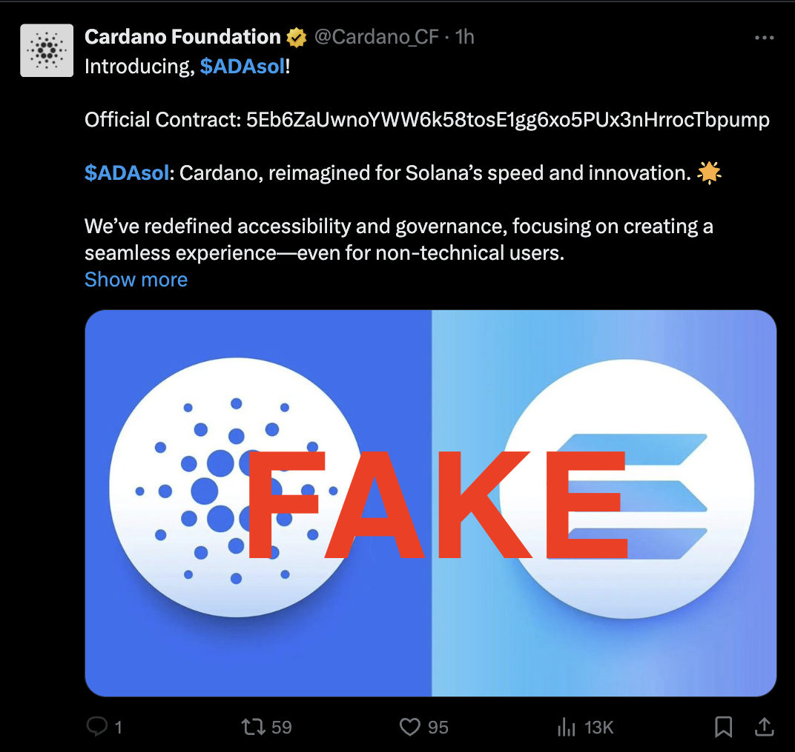
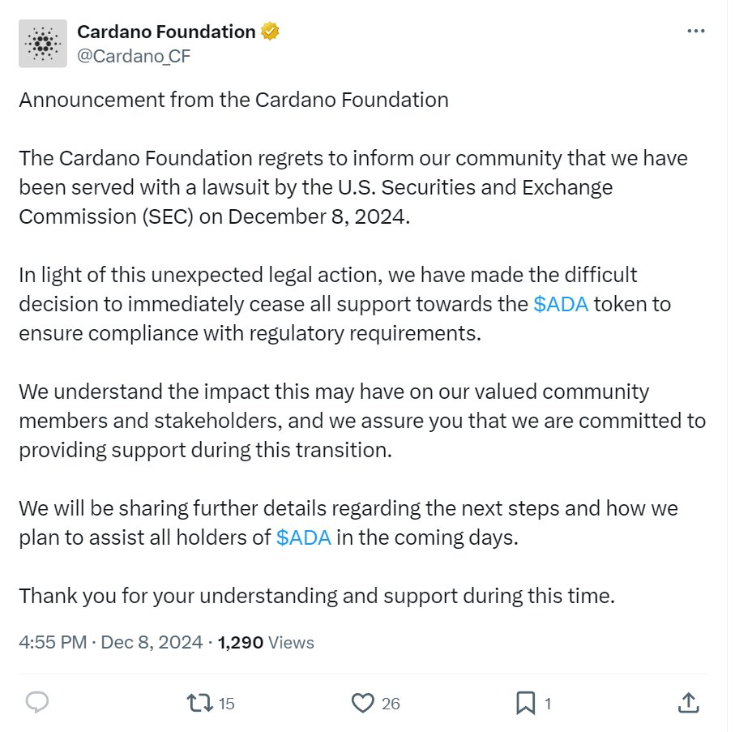

# CID-202405: Cardano Foundation X Account Compromise (ADAsol scam)

> On 8 December 2024 an unknown attacker took over the Cardano Foundation's official X account, @Cardano_CF, and, by the Foundation's account, kept access for about four days [2]. On the first day the attacker used it to promote "ADAsol", a fake Cardano-branded token on Solana, and then to post a false notice that the US SEC had sued the Foundation and that it would stop supporting ADA [3]. The token traded about USD 500,000 in volume before collapsing; that is volume, not losses, and no loss figure has been published [3][14]. The Cardano blockchain was not affected. The Foundation warned users through its website the same day [1], says the unauthorised access ended on 12 December, and announced the recovery on 13 December with a cryptographically signed message [2]. It has not published how the account was compromised or what its investigation found, and no compensation for token buyers has been announced.

## Timeline (UTC)

| Time | Event |
|---|---|
| 2024-12-08 12:00 | Start of unauthorised access to @Cardano_CF, per the Foundation's later statement ("8 December at 13:00 CET") [2]. |
| 2024-12-08 13:21:44 | A new Solana wallet, `FdH5QPe2…of9xe`, with no earlier transactions, receives 5 SOL from wallet `DmQd7kr4…zfG` [13]. |
| 2024-12-08 13:35:40 | That wallet creates the token "Cardano on Solana" (ticker ADAsol, mint `5Eb6ZaUw…Tbpump`) on pump.fun and, in the same transaction, buys 34,612,903 ADAsol for about 1.01 SOL [10][11]. |
| 2024-12-08 13:37:07 | 87 seconds after creation, the pump.fun bonding curve is complete; 85.0 SOL is withdrawn for migration to Raydium [13]. |
| 2024-12-08 13:38:32 | A Raydium ADAsol/SOL pool is created [12]. |
| 2024-12-08 (time not published) | @Cardano_CF posts a 13-post thread announcing "$ADASOL" ("Cardano, reimagined for Solana's speed and innovation"), linking to genuine Foundation resources such as its website and a recent podcast episode [3]. |
| 2024-12-08 (within an hour of the thread) | The thread is removed. The account then posts a fake notice that the Foundation was served with an SEC lawsuit "on December 8, 2024" and will "immediately cease all support towards the $ADA token", with replies disabled [3][14]. |
| 2024-12-08 14:03:09 | The token-creator wallet sells all 34,612,903 ADAsol for about 1.25 SOL [13]. |
| 2024-12-08 14:07:02 | The creator wallet sends 5.71 SOL back to the wallet that funded it [13]. |
| 2024-12-08 14:58:53 | A community member posts a screenshot of the SEC notice and asks whether the account was hacked [4]. |
| 2024-12-08 15:00:55 | The Foundation's Global Head of Technical Integrations replies: "Confirmed, we're on it. Please create awareness" [5]. |
| 2024-12-08 15:17:48 | ZachXBT posts a Telegram alert: "Do not click any links posted" [16]. |
| 2024-12-08 15:22:32 | The @Cardano community account posts that @Cardano_CF "has been compromised" and asks users to ignore its posts [6]. |
| 2024-12-08 15:29 | The Block publishes its first report; the SEC notice has over 256,000 views [3]. |
| 2024-12-08 15:38–15:54 | Charles Hoskinson (Input Output) posts that the account "got hacked", renews his "verified tweets" proposal to X and says investigations will follow [7][8][9]. |
| 2024-12-08 (by 16:54) | The Foundation's website statement says its X account "has experienced unauthorized access" and asks users to disregard its posts until restoration is confirmed on LinkedIn [1][3]. |
| 2024-12-12 16:00 | End of unauthorised access, per the Foundation ("12 December at 17:00 CET") [2]. |
| 2024-12-13 08:53:45 | @Cardano_CF announces that control has been re-established, says no other Foundation systems were affected and that an investigation is under way; the post carries a signed message [2]. |

## Impact

The attacker held one social-media account of a major Cardano ecosystem organisation for about 100 hours (12:00 UTC on 8 December to 16:00 UTC on 12 December 2024) [2]; no source reports scam posts after 8 December. The Foundation says no other Foundation systems were affected [2]. Cardano mainnet, wallets, dApps and governance were not affected.

The direct harm fell on people who bought ADAsol on Solana. According to DexScreener the token reached over USD 500,000 in trading volume before its price fell by about 99% [3][14]. Its pump.fun bonding curve filled within 87 seconds of creation [13], and liquidity moved to a Raydium pool seeded with 79.0 SOL, whose SOL reserve had risen to at least 237.3 SOL (about USD 56,000 at about USD 236 per SOL) by 13:46 UTC [13][17]. A partial catalogue analysis of roughly 1,440 transactions found at least ~700 trading wallets [13]. It covers all pump.fun-phase trades but only part of the Raydium swaps, so it cannot establish gross buyer losses or how much of them reached the attacker, and no source publishes either figure.

*Figure 1: The hijacked account's "Introducing, $ADAsol!" post, giving the pump.fun mint `5Eb6ZaUw…Tbpump` as "Official Contract". The "FAKE" overlay was added by The Block. Source: The Block, ["Hacked Cardano Foundation X account posts fake token, false SEC lawsuit notice"](https://www.theblock.co/post/329879/hacked-cardano-foundation-x-account-posts-fake-token-false-sec-lawsuit-notice) [3].*

The fake SEC notice had over 256,000 views by the time of The Block's report [3]. Press reported a drop of about 4% in ADA around the incident [14][15], but The Cryptonomist described the decline as "somewhat general for all cryptos" [20], and no source separates it from the wider market.

Rated SEV-3 (trust and integrity: compromise of an official communication channel used to defraud users; buyer losses are unquantified, so the financial dimension cannot raise the rating). Potential SEV-2 (financial loss, catalogue judgement: the attacker kept posting rights for about four days [2], and a wallet-drainer link, which ZachXBT warned against [16], could credibly have caused losses of USD 100,000–999,999; The Cryptonomist notes that the 2023 hijack of Vitalik Buterin's X account led to about USD 700,000 in thefts through scam links [20]. Not potential SEV-1, as the Foundation says no other systems were affected [2]). Recoverability: not-recoverable (the account was recovered after about four days with no restoration date given in the meantime [1][2], but ADAsol buyers' losses have not been recovered and no recovery has been announced).

## Root cause

The Cardano Foundation has not said how the attacker got into @Cardano_CF. Its 13 December statement speaks only of "unauthorized access" and says an investigation would "identify the attacker(s), determine the root cause, and implement measures to prevent future occurrences" [2]. As of 2026-10-13 no result has been published, and contemporary press reports give no attack vector [3][14][19]. Phishing, credential reuse, session hijacking, a compromised third-party tool, insider action and platform-side failures all remain possible.

The sources establish only the extent of control: the attacker could post threads and change reply settings (the SEC notice had replies disabled) [3], and until the access ended the Foundation told users to disregard the account [1][2]. Before the recovery the Foundation said "this breach of our X account does not indicate any other platforms or systems are compromised" [3].

The scam combined two techniques: a token promotion made credible by links to genuine Foundation material, and a fake regulatory notice that could push holders to sell ADA or look for the "new" token [3][14].

## Detection

Community members, not an internal control, raised the alarm. The first public question about the SEC notice came at 14:58 UTC, with a screenshot of the post (Figure 2) [4]: 2 h 59 min after the stated start of access [2] and 1 h 23 min after the ADAsol token was created [11]. A Foundation team lead confirmed the compromise two minutes later [5], and warnings from ZachXBT, the @Cardano account and Charles Hoskinson followed within 40 minutes [16][6][7]. The Foundation later thanked "all of those who acted quickly to alert us" [2].

*Figure 2: The fake "Announcement from the Cardano Foundation" claiming an SEC lawsuit and the end of support for ADA, as shared by a community member asking whether the account had been hacked. Source: Sssebi (@Sssebi), ["Is this true or was the Cardano Foundation account hacked?"](https://x.com/Sssebi/status/1865773048416162022) [4].*

## Response and resolution

Within about two hours of the confirmation, the Foundation published a statement on its website asking users to disregard posts from the X account until restoration was confirmed on LinkedIn [1][3]. CryptoSlate reported on 9 December that the Foundation had deleted the malicious posts [18]; the sources do not say who removed the ADAsol thread on 8 December.

According to the Foundation, the unauthorised access ended at 16:00 UTC on 12 December; it announced the recovery at 08:53 UTC on 13 December [2]. It has not said what recovery steps it took or what role X played. The recovery post included a message signed with one of the Foundation's hot keys for Cardano's Interim Constitutional Committee (iCC), verifiable with a Foundation-hosted tool. This showed that the announcement came from the key holder, not merely from whoever controlled the X session [2].

Charles Hoskinson renewed his proposal that X support cryptographically signed ("verified") posts and offered to build it for free [8][18]. He also wrote that "the swarm of investigations" would begin and that the new head of the FBI was "interested in this stuff" [9]. No law-enforcement action has been reported.

## Remediation and follow-up

The Foundation said it would "implement measures to prevent future occurrences" [2] but has not published those measures, a root cause, a takeover timeline or an impact assessment. No compensation for ADAsol buyers has been announced. The only visible process change is the signed recovery announcement, which moves trust in the message from the platform to a key the Foundation controls [2].

## Incident handling assessment

Assessment of the responsible party's handling (the Cardano Foundation, which owns the @Cardano_CF account) against SOC 2 Trust Services Criteria, based on public sources only (see CLASSIFICATION.md, section 10).

| Criterion | Result | Observation |
|---|---|---|
| CC7.2 Monitoring and detection | Exceptions noted | Community members, not an internal control, raised the first public alarm, about three hours after the stated start of unauthorised access [2][4]. |
| CC7.3 Evaluation of events | No exceptions noted | A Foundation team lead confirmed the compromise two minutes after the first public question [4][5]. The same day the Foundation scoped the breach to the X account [1][3]. |
| CC7.4 Incident response | Exceptions noted | Users were warned through the website and staff accounts within hours [1][5], but the attacker kept access for about four days and the Foundation has not described the steps taken to regain control [2]. |
| CC7.5 Recovery | Exceptions noted | Access ended on 12 December and recovery was announced on 13 December [2], but the announced investigation into root cause and preventive measures has produced no published result [2]. |
| CC2.3 External communication | Exceptions noted | Warnings were timely and the recovery post was authenticated with a signed message [1][2], but no attack vector, takeover timeline or impact assessment was published (disclosure: statement-only) [2]. |
| CC8.1 Change management | Not applicable | No source links the compromise to a change made by the Foundation; the attack vector is undisclosed [2]. |

## Lessons for builders

- **Name a fallback channel in advance.** The Foundation had to direct users to its website and LinkedIn during the incident [1]. Publish beforehand where users should look if the main channel is compromised, so they do not have to guess.
- **Sign high-stakes announcements.** Token launches, migrations, airdrops and "legal" notices should be verifiable against a key the organisation controls, as the Foundation did for its recovery post [2]. On Cardano that can be a CIP-8 / CIP-30 `signData` message. Users and integrators can then reject unsigned claims.
- **State publicly what you will never do.** The ADAsol scam relied on users believing the Foundation would launch a token on another chain [3]. A standing statement that the organisation does not launch tokens on other chains or announce migrations only on social media makes such posts an obvious anomaly.
- **Do not take contract addresses from social posts.** The hijacked post gave the scam mint as "Official Contract" (Figure 1) [3]. Wallets and dApps should source token metadata and contract addresses from on-chain registries or signed lists, not from posts, even by verified organisation accounts.

## Disputed or open points

- **Who created ADAsol and who profited.** The Block linked the fake token to mint `5Eb6ZaUw…Tbpump` through DexScreener, and its screenshot shows that address given as "Official Contract" (Figure 1) [3]. The Cryptonomist wrote the next day that "no malicious link has been published and no scam token contract address" [20], which the screenshot contradicts. No source links the creator wallet `FdH5QPe2…of9xe` to the hijacker, and on-chain that wallet made only about 0.2 SOL from its own trades [13]. The attacker's proceeds, and which wallets they used, are unknown.
- **Timing of the scam posts.** No source gives the posting time of the ADAsol thread. The token was created at 13:35:40 UTC [11], and trading was concentrated between 13:35 and 15:00 UTC [13].
- **Whether the Foundation commented on 8 December.** CryptoSlate reported on 9 December that the Foundation "has not issued any official statement addressing the incident" [18], but the Foundation's website carries a statement dated 8 December [1], and The Block quoted it the same day [3].

## Sources

1. [P] Cardano Foundation, "Cardano Foundation X Account Subject to Unauthorized Access", 2024-12-08. https://cardanofoundation.org/blog/unauthorized-x-account-access
2. [P] Cardano Foundation (@Cardano_CF), "Following the unauthorized access on our official X channel, the Cardano Foundation is pleased to confirm that we have now re-established control…", 2024-12-13. https://x.com/Cardano_CF/status/1867493099166986674
3. [S] The Block (Zack Abrams), "Hacked Cardano Foundation X account posts fake token, false SEC lawsuit notice", 2024-12-08. https://www.theblock.co/post/329879/hacked-cardano-foundation-x-account-posts-fake-token-false-sec-lawsuit-notice
4. [S] Sssebi (@Sssebi), "Is this true or was the Cardano Foundation account hacked?", 2024-12-08. https://x.com/Sssebi/status/1865773048416162022
5. [P] michael.ada (@michaeldotada, Cardano Foundation), "Confirmed, we're on it. Please create awareness", 2024-12-08. https://x.com/michaeldotada/status/1865773558171095378
6. [P] Cardano (@Cardano), "The Cardano Foundation X account @Cardano_CF has been compromised…", 2024-12-08. https://x.com/Cardano/status/1865778999365947698
7. [P] Charles Hoskinson (@IOHK_Charles), "Looks like the CF account got hacked. Try harder hackers", 2024-12-08. https://x.com/IOHK_Charles/status/1865782995728404518
8. [P] Charles Hoskinson (@IOHK_Charles), "Given that the CF account was hacked, it's a good opportunity to re-visit a change X could make…", 2024-12-08. https://x.com/IOHK_Charles/status/1865784520995393871
9. [P] Charles Hoskinson (@IOHK_Charles), "Now the fun part comes for us… Let the swarm of investigations begin", 2024-12-08. https://x.com/IOHK_Charles/status/1865786977800396871
10. [P] Solscan, "Token 5Eb6ZaUwnoYWW6k58tosE1gg6xo5PUx3nHrrocTbpump (Cardano on Solana, ADAsol)", 2024-12-08. https://solscan.io/token/5Eb6ZaUwnoYWW6k58tosE1gg6xo5PUx3nHrrocTbpump
11. [P] Solscan, "Transaction xjtsJvXd…bui76 (pump.fun CreateToken and Buy)", 2024-12-08. https://solscan.io/tx/xjtsJvXd9eQ5ynYUyqAwsJDoBvDLsPx3M6s5Rq5uQfzFbWZHwpfdL6eVFiJjSiXriQuyp2G2ugkjdMLKNxbui76
12. [P] GeckoTerminal API, "Pools for token 5Eb6…Tbpump" (Raydium ADAsol/SOL pool 3ajWEQH1…kKc1, pool_created_at 2024-12-08T13:38:32Z), 2024-12-08. https://api.geckoterminal.com/api/v2/networks/solana/tokens/5Eb6ZaUwnoYWW6k58tosE1gg6xo5PUx3nHrrocTbpump/pools
13. [P] Solana mainnet-beta JSON-RPC (`getSignaturesForAddress` / `getTransaction`), catalogue analysis (partial) of ~1,440 successful transactions referencing mint 5Eb6…Tbpump or Raydium pool 3ajWEQH1t7FN6E2EUXgEvaPeksxeek8KoMz4ni2SkKc1, and of creator wallet FdH5QPe2GpsKkTkrFrjJE1NERizfmk9R9fTZhu2of9xe, 2026-10-13. https://api.mainnet-beta.solana.com
14. [S] Cryptonews (Sujha Sundararajan), "Cardano X account Hacked, Spreading False SEC Lawsuit Claims", 2024-12-09. https://cryptonews.com/news/cardano-x-account-hacked-spreading-false-sec-lawsuit-claims/
15. [S] Crypto Briefing (Vivian Nguyen), "Cardano Foundation X account under attack, hackers spread misinformation about SEC lawsuit", 2024-12-08. https://cryptobriefing.com/cardano-foundation-hacked-false-sec-claims/
16. [S] ZachXBT, "Community alert: A threat actor compromised the Cardano X/Twitter account. Do not click any links posted." (Telegram, Investigations by ZachXBT), 2024-12-08 15:17 UTC. https://t.me/investigations/189
17. [S] Binance API, "SOLUSDT 1h klines, 2024-12-08 13:00–17:00 UTC" (SOL ≈ USD 234–238), 2024-12-08. https://api.binance.com/api/v3/klines?symbol=SOLUSDT&interval=1h&startTime=1733662800000&limit=4
18. [S] CryptoSlate (Oluwapelumi Adejumo), "Cardano founder renews call for 'verified tweets' after social media hack", 2024-12-09. https://cryptoslate.com/cardano-founder-renews-call-for-verified-tweets-after-social-media-hack/
19. [S] CryptoSlate (Oluwapelumi Adejumo), "Cardano Foundation regains social media control amid governance turmoil", 2024-12-13. https://cryptoslate.com/cardano-foundation-regains-social-media-control-amid-governance-turmoil/
20. [S] The Cryptonomist (Stefania Stimolo), "Cardano Foundation: the X account hacked has promoted a crypto scam", 2024-12-09. https://en.cryptonomist.ch/2024/12/09/cardano-foundation-the-x-account-hacked-has-promoted-a-crypto-scam/
