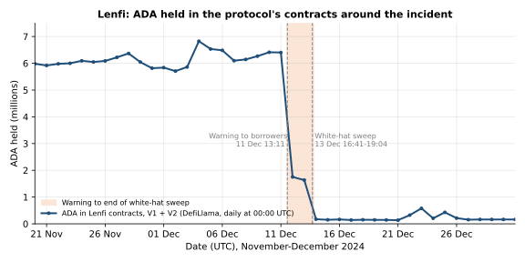

# CID-202406: Lenfi V2 Smart Contract Vulnerability

> In December 2024 Lenfi's lead developer found a critical flaw in the pool contract of Lenfi V2, a lending protocol on Cardano: anyone holding a few of a pool's liquidity-provider (LP) tokens could withdraw far more than their share, up to all of the pool's funds not currently lent out [5][7]. Without naming a vulnerability, Lenfi urged borrowers to repay and depositors to withdraw [1][19]. About two days later it used the flaw itself to move what remained, about 1.19 million ADA plus native tokens (roughly USD 1.34 million in ADA alone), into a team wallet, and four days after that it paid those funds out to LP token holders [2][3][16][23]. No third-party exploitation has been reported, but Lenfi V2 was not reopened. The Cardano L1 was not at fault: the bug was a reversed inequality in Lenfi's own validator that two audits and a six-month bug bounty had missed [5][10][11][13]. Lenfi V1 (peer-to-peer lending) uses different contracts and was not affected [19].

## Timeline (UTC)

| Time | Event |
|---|---|
| 2023-08-10 – 2023-09-15 | Anastasia Labs audits the Lenfi pooled-loans contracts (report dated 2023-11-30) on a commit in a private repository [10]. |
| 2023-11-13 – 2024-01-22 | TxPipe audits Lenfi V2. `validators/pool.ak` is in scope. The final audited state is commit `c3899a6` in a private repository. Nine critical findings are reported as resolved [11]. |
| 2024-02-08 | First public commit of the V2 contracts (`b78927a`). It already contains the vulnerable `check_delta_amount` comparison [6][7]. Lenfi launches a bug bounty of USD 20,000 for critical findings, with `pool.ak` in scope [12]. |
| 2024-02-22 | Lenfi V2 launches on mainnet and cites both audits and the open-source code [9]. |
| 2024-04-03 | Lenfi reports V2 TVL of 16 million ADA [14]. |
| 2024-10-11 | Lenfi announces the end of the six-month bug bounty with "no critical bugs or breaches" found [13]. |
| 2024-12-11 | Lead developer Mantas identifies the bug in the V2 contracts [19]. |
| 2024-12-11 13:11 | Lenfi asks V2 borrowers to repay "as soon as possible" because it "may need to take measures that could affect outstanding loan positions". The post does not mention a vulnerability [1]. |
| 2024-12-11 15:25 | Minswap Labs repeats the warning and advises V2 borrowers to repay and withdraw [20]. |
| 2024-12-12 | 262 V2 loans are still open, according to TapTools [19]. |
| 2024-12-12 19:07 | A community member (Snek co-founder) reports that 87% of active V2 loans have been repaid and that the rest are "susceptible to a hack" [21]. |
| 2024-12-13 16:41 – 19:04 | 44 transactions spend UTxOs from a single Plutus script payment credential (`32e8c0ae…`), burn small amounts of LP tokens, and send a combined ~1,190,795 ADA plus native tokens to the Lenfi-controlled address behind the ada handle `$lenfi-wh` [15][16][17]. |
| 2024-12-13 19:15 | Lenfi confirms "a vulnerability that could affect users deposits" and says the remaining funds were "whitehacked" into `$lenfi-wh` and a claim contract is being prepared [2]. |
| 2024-12-13 | Mantas explains on Discord that repayments were given priority for about 60 hours before the funds were secured [19]. |
| 2024-12-16 | Lenfi announces that a snapshot of affected LP token holders is complete and that distribution will start the next day [19]. |
| 2024-12-17 09:33 – 10:00 | Three distribution transactions from `$lenfi-wh` pay a combined ~1,187,996 ADA plus native tokens to 310 recipient addresses [4][16][18]. |
| 2024-12-17 10:06 | Lenfi: "Whitehack deposits were distributed to LP token holders" [3]. |
| 2024-12-20 09:43 | Fix committed (`f0148f9`, "Resolving withdrawal vulnerability"). PR #5 opened at 10:08 [5][6]. |
| 2025-01-02 08:38 | PR #5 merged into `main` [5]. |
| 2025-05-17 | A community commentator criticises Lenfi for not communicating "for several months" after the incident [24]. |

## Impact

No theft by a third party has been reported [2][3][19]; the only on-chain use of the flaw found is Lenfi's own rescue sweep [16][17].

Most depositors left before the sweep. ADA held in Lenfi's contracts (V1 and V2 combined, as counted by DefiLlama) fell from about 6.4 million on 11 December to about 1.6 million on 13 December (daily values at 00:00 UTC), and DefiLlama's combined TVL from about USD 63.9 million to USD 40.7 million [22]. The sweep then moved the remaining ~1,190,795 ADA plus native tokens out of the pool script [16]; at Binance's ADA/USDT daily close of 1.1213 on 2024-12-13 [23], the ADA alone was worth about USD 1.34 million. This is the catalogue's estimate; Lenfi published no figure. Earlier in the year Lenfi had reported 16 million ADA of V2 TVL [14].



*Figure 1: ADA held in Lenfi's contracts (V1 and V2 combined, as counted by DefiLlama's Lenfi adapter), daily data points timestamped 00:00 UTC. The shaded band runs from Lenfi's warning to borrowers (11 December, 13:11 UTC) to the last white-hat sweep transaction (13 December, 19:04 UTC). Data: DefiLlama, "Lenfi" protocol TVL API, retrieved 2026-10-13 [22]; event times [1][16]; chart by the catalogue.*

Borrowers were asked to repay as soon as possible [1] and depositors to withdraw [19][20]; depositors who did not act were paid through the 2024-12-17 distribution [3][4]. According to TapTools, the news caused sell-offs in several Cardano native tokens as users unwound positions, and most recovered within days [19]. The response emptied the V2 pools, and no announcement that V2 was reopened has been found (see Disputed or open points).

Rated SEV-3 (availability: Lenfi V2, a widely used lending service with 262 loans still open on 2024-12-12 and 310 LP-holder addresses paid in the distribution, was unusable from the 2024-12-11 warning and was not reopened [1][16][19]; the near-miss rule alone would give SEV-4, as users had to repay and withdraw); potential SEV-1 (financial: more than USD 1 million was withdrawable through the flaw, about USD 1.34 million in ADA alone at the time of the sweep). Recoverability: extra-resources (an emergency sweep and snapshot-based redistribution run outside normal operations [2][3][4]).

## Root cause

Each Lenfi V2 pool holds one loanable asset, and depositors receive LP tokens for their share. Deposits and withdrawals use the pool validator's `Continuing(LpAdjust { value_delta, … })` action, where `value_delta` is the signed change in the pool balance: positive for a deposit, negative for a withdrawal. The validator values the LP tokens minted or burned as [7]:

```
owned_proportion = lp_token_delta * (balance + lent_out) / total_lp_tokens
```

For a withdrawal, both `lp_token_delta` and `value_delta` are negative. The amount withdrawn must not exceed the value of the LP tokens burned, so the check should be `|value_delta| <= |owned_proportion|`, or `value_delta >= owned_proportion` in signed terms. The deployed code checked the opposite direction [5][7]:

```
let check_delta_amount =
  if value_delta < 0 {
    rational.truncate(owned_proportion) >= value_delta   // vulnerable
  } else {
    rational.truncate(owned_proportion) <= value_delta
  }
```

The comparison was written as if both values were positive magnitudes. Burning a few LP tokens gives an `owned_proportion` close to zero, and any larger withdrawal (a more negative `value_delta`) passed; Lenfi's fix PR states the bug "allowed to withdraw any amount of assets from the pool with few LP tokens burned" [5]. The only remaining bound was that the pool's balance could not go negative (`output_is_positive`), so a withdrawal could take everything not lent out [7]. The other withdrawal checks did not relate the amount to the LP tokens burned: `sign_check` required a minimum size and the clause `lp_token_delta < total_lp_tokens`, which bounds the LP tokens burned rather than the value withdrawn and was always true for a negative `lp_token_delta` [7]. The fix (commit `f0148f9`) reversed the withdrawal comparison to `value_delta * -1 <= rational.truncate(owned_proportion) * -1`, changed that clause to `lp_token_delta * -1 < total_lp_tokens`, left the deposit branch semantically unchanged and corrected the tests [6].

The tests treated the vulnerable behaviour as correct. "Should withdraw: depositing more than needed" built a withdrawal that took 500 base units *more* than the LP tokens' value and expected it to succeed [6][8]. The matching negative test wrapped the submission in `try { … } catch (e) { expect(e).toContain("check_delta_amount ? False") }`, so it passed whenever no exception was thrown [8]. The fix renamed both tests and flipped their deltas [6].

Lenfi's rescue transactions have the shape this flaw allows. Transaction `0bd797c0…`, for example, spends a UTxO at script credential `32e8c0ae…`, burns 95 units of an LP token and pays 90,140.89 ADA to `$lenfi-wh` [17]; all 44 rescue transactions spent from that credential [16]. The catalogue has not matched the credential to a published V2 pool script hash.

## Detection

Mantas found the bug internally on 2024-12-11 [19]; the sources do not say how. The flawed comparison is present from the first public commit of the V2 contracts (2024-02-08) [6][7], so it was live on mainnet for about ten months [9]. Neither audit had reported it [10][11], nor had the bug bounty, which closed in October 2024 without critical findings [13].

## Response and resolution

Lenfi's first notice, on the day of discovery, asked borrowers to repay without naming a vulnerability [1]. Mantas later said: "We purposely said that loans are in danger as to encourage borrowers to repay the loans" [19]. Ecosystem accounts amplified the warning [20][21], and the team held a Twitter Space of more than an hour and a half [19].

The team let repayments run before securing the funds: "We could white hack funds immediately, but then any repaid loan would be in danger to be stolen. Therefore we focused on the repayments for last 60hrs." [19] Repayments flow back into the pool UTxO [7], so a repayment made after an early rescue would again have sat in a vulnerable pool.

On 2024-12-13 Lenfi moved the remaining pool liquidity into `$lenfi-wh` [2][15][16]. It first planned a claim contract [2], but instead took a snapshot of LP token holders, published a spreadsheet for users to check their entries [19], distributed the funds directly on 2024-12-17 and published the three transaction hashes [3][4][18]. The code fix followed on GitHub on 2024-12-20 and was merged on 2025-01-02 [5][6].

## Remediation and follow-up

- The validator fix and corrected tests are public in `lenfiLabs/lenfi-smart-contracts` PR #5 [5][6].
- No post-mortem, audit of the fix or announcement of a patched V2 deployment has been found. Before the incident Lenfi had said it would commission "more external audits for our future upgrades" [13]. In April 2025 Lenfi promoted its P2P (V1) product [25], and in May 2025 a community commentator criticised the team for not communicating for months [24].

## Incident handling assessment

Assessment of the responsible party's handling (Lenfi) against SOC 2 Trust Services Criteria, based on public sources only (see CLASSIFICATION.md, section 10).

| Criterion | Result | Observation |
|---|---|---|
| CC7.2 Monitoring and detection | Exceptions noted | Lenfi found the flaw itself before any reported exploitation, but only after it had been live on mainnet for about ten months, and no source describes the review or monitoring that found it [6][9][19]. |
| CC7.3 Evaluation of events | No exceptions noted | Lenfi triaged the flaw on the day of discovery, established that only V2 was affected, and identified that an immediate rescue would expose later loan repayments [1][19][21]. |
| CC7.4 Incident response | Exceptions noted | The remaining liquidity was secured in a published wallet and no third-party exploitation was reported [2][16]. Containment was deliberately deferred: the first sweep transaction came about 51.5 hours after a public warning that signalled a problem (13:11 on 11 December to 16:41 on 13 December), and the pools stayed exploitable throughout [1][16][19]. |
| CC7.5 Recovery | No exceptions noted | LP token holders were paid through three published distribution transactions, and the root cause was fixed with corrected tests in a public pull request [3][4][5][6]. Whether the fix was audited and whether V2 was redeployed or discontinued is not documented. |
| CC2.3 External communication | Exceptions noted | The first notice deliberately did not mention a vulnerability; Lenfi acknowledged the flaw in writing two days later [1][2][19]. No post-mortem was published, and Lenfi was later criticised for months of silence [24]. |
| CC8.1 Change management | Exceptions noted | The reversed comparison shipped in the first public V2 commit after two audits and during a bug bounty [6][10][11][12]. The tests encoded the vulnerable behaviour as correct, and the negative test could not fail [8]. Whether the flaw existed at the audited commits cannot be confirmed (see Disputed or open points). |

## Lessons for builders

- **Avoid signed comparisons for amount bounds.** One redeemer carried a signed `value_delta` for deposits and withdrawals, and reversing a single operator on a negative number exposed the whole pool. Separate `Deposit { amount }` and `Withdraw { amount }` redeemers with non-negative amounts, or normalising to absolute values, let the inequality be stated directly ("paid out ≤ value of LP burned").
- **Test the invariant, and make negative tests fail on success.** The LP invariant (value removed ≤ `lp_burned * (balance + lent_out) / total_lp_tokens`, rounded against the user) suits property-based tests (Aiken property tests or off-chain fuzzing over pool states and over-withdrawal deltas). A `try { submit } catch (e) { expect(e)… }` block passes silently when the submit succeeds [8]; use `await expect(promise).rejects…` or an explicit `fail()` after the submit.
- **Link audits to deployed code.** Two audits [10][11] and a bounty with `pool.ak` in scope [12][13] missed a one-line reversed comparison, and the audited commits are private. Publishing the mapping from audited commit to deployed script hash, and re-auditing post-audit changes, makes that gap visible.
- **Plan the emergency path in advance.** The sources describe no pause or migration mechanism; the rescue relied on the flaw itself and on public warnings that also alerted potential attackers [1][19]. Decide beforehand whether to have an admin-gated emergency withdrawal (a trust trade-off), how a snapshot and redistribution would work, and how outstanding loans are handled once pool liquidity is gone.
- **Make rescues verifiable.** Publishing the rescue wallet and distribution hashes [2][4] let third parties trace the funds; a per-holder reconciliation of swept against distributed value would have closed the remaining questions.

## Disputed or open points

- **What exactly was swept.** Lenfi's update says "Funds from loans that were not repaid were whitehacked" [2]; TapTools says "any funds that had not been withdrawn by users" were [19], and Lenfi later calls the redistributed funds "whitehack deposits" [3]. On-chain, the sweep spent pool-script UTxOs and burned LP tokens, which fits pool deposits [16][17]. Lenfi's wording implies some loans were never repaid [2], while TapTools says "within a few days, all loans were repaid" [19]; what happened to the collateral of any open loans is not documented.
- **Completeness of redistribution.** About 1,190,795 ADA was swept in and about 1,187,996 ADA paid out in the three published transactions, plus native tokens in both; smaller amounts moved through `$lenfi-wh` from 2024-12-16 to 2024-12-22 [16][18]. Without a per-holder reconciliation, whether every LP token holder received their full share rests on Lenfi's statement [3].
- **Audit coverage.** TxPipe audited `pool.ak` at private commit `c3899a6` [11] and Anastasia Labs at private commit `ea2d516` [10]. Neither commit is public, so it cannot be confirmed whether the vulnerable comparison existed at the audited commits or was introduced before the first public commit on 2024-02-08 [6].
- **Current V2 status.** No public source confirms whether a patched V2 was redeployed or V2 formally discontinued.

## Sources

1. [P] Lenfi (X), "Announcement: Important Note to Borrowers on Lenfi V2", 2024-12-11. https://x.com/LenfiOfficial/status/1866833102191939848
2. [P] Lenfi (X), "We want to provide a clear update on the recent events", 2024-12-13. https://x.com/LenfiOfficial/status/1867649495246229529
3. [P] Lenfi (X), "Whitehack deposits were distributed to LP token holders.", 2024-12-17. https://x.com/LenfiOfficial/status/1868960834501877950
4. [P] Lenfi (X), "Distribution transactions" (three transaction hashes), 2024-12-17. https://x.com/LenfiOfficial/status/1868961281270857928
5. [P] lenfiLabs (GitHub), "Resolving withdrawal vulnerability;" pull request #5, opened 2024-12-20, merged 2025-01-02. https://github.com/lenfiLabs/lenfi-smart-contracts/pull/5
6. [P] lenfiLabs (GitHub), commit f0148f9 "Resolving withdrawal vulnerability; Improving tests and syntax;" and repository history, 2024-12-20. https://github.com/lenfiLabs/lenfi-smart-contracts/commit/f0148f9ce72e866b61ac00bfee3d127cf3101e8f
7. [P] lenfiLabs (GitHub), `validators/pool.ak` at pre-fix commit eb7dc68, 2024-02-21. https://raw.githubusercontent.com/lenfiLabs/lenfi-smart-contracts/eb7dc685f3888c940d0da027c46b5f1c3d9578f1/validators/pool.ak
8. [P] lenfiLabs (GitHub), `tests/pool/pool_test.ts` at pre-fix commit eb7dc68, 2024-02-21. https://raw.githubusercontent.com/lenfiLabs/lenfi-smart-contracts/eb7dc685f3888c940d0da027c46b5f1c3d9578f1/tests/pool/pool_test.ts
9. [P] Lenfi (Medium), "Lenfi V2: A New Chapter in Cardano's DeFi Ecosystem", 2024-02-22. https://medium.com/@lenfi/lenfi-v2-a-new-chapter-in-cardanos-defi-ecosystem-26c460135ed2
10. [P] Anastasia Labs, "Lenfi Pooled Loans" security assessment, 2023-11-30. https://github.com/lenfiLabs/materials/blob/main/anastasiaLabs-audit-final.pdf
11. [P] TxPipe, "Lenfi - V2" audit report, 2024-01-22. https://github.com/lenfiLabs/materials/blob/main/txpipe-audit.pdf
12. [P] Lenfi (Medium), "Lenfi V2 to Begin Community-Driven Bug Bounty Program Now", 2024-02-08. https://medium.com/@lenfi/lenfi-v2-to-begin-community-driven-bug-bounty-program-now-c2d312203df2
13. [P] Lenfi (Medium), "Lenfi Successfully Concludes Its Bug Bounty Program", 2024-10-11. https://medium.com/@lenfi/lenfi-successfully-concludes-its-bug-bounty-program-e317df3967b2
14. [P] Lenfi (Medium), "Lenfi V2 Borrowing Use Cases", 2024-04-03. https://medium.com/@lenfi/lenfi-v2-borrowing-use-cases-2dd8774b75f4
15. [P] Handle.me API, resolution of ada handle `$lenfi-wh`, retrieved 2026-10-13. https://api.handle.me/handles/lenfi-wh
16. [P] Cexplorer, address `$lenfi-wh` (addr1qxhw5hcv…zvw5wu) with full transaction history, retrieved 2026-10-13. https://cexplorer.io/address/addr1qxhw5hcvvkdrlzmn3fs77gc5r5wa0206dj9r927vv8lky4q6mtkllp5zdum7yk6tdkhv0nqjudx5ysnhpp8zl67rdfnszvw5wu
17. [P] Cexplorer, rescue transaction 0bd797c0…fd4116, 2024-12-13. https://cexplorer.io/tx/0bd797c0d1bd38929dca1fa693caf801927bcdcb978608b783c5ab7128fd4116
18. [P] Cexplorer, distribution transaction 85ef27d4…792706, 2024-12-17. https://cexplorer.io/tx/85ef27d41f494340e5549e04c345737f04e713366758e7e19bf814bd7e792706
19. [S] TapTools (Tap In With TapTools, Medium), "Cardano Developer Prevents Potential Multi-Million Dollar Hacks", 2024-12-19. https://medium.com/tap-in-with-taptools/cardano-developer-prevents-potential-multi-million-dollar-hacks-e458a13e6431
20. [S] Minswap Labs (X), "Attention Borrowers on Lenfi V2", 2024-12-11. https://x.com/MinswapDEX/status/1866866882550305111
21. [S] Rami (@CardanoRami, X), "87% of all active loans in Lenfi v2 have now been repaid", 2024-12-12. https://twitter.com/CardanoRami/status/1867285063249088759
22. [S] DefiLlama, "Lenfi" protocol TVL history (V1+V2 combined), retrieved 2026-10-13. https://api.llama.fi/protocol/lenfi
23. [S] Binance, ADA/USDT daily klines 2024-12-11 to 2024-12-18, retrieved 2026-10-13. https://api.binance.com/api/v3/klines?symbol=ADAUSDT&interval=1d&startTime=1733875200000&endTime=1734480000000
24. [S] S₳PIEN (@Cardano_Sapien, X), "The current @LenfiOfficial situation...", 2025-05-17. https://x.com/Cardano_Sapien/status/1923801012734931381
25. [P] Lenfi (X), "Consistency beats hype, always.", 2025-04-28. https://x.com/LenfiOfficial/status/1916780929978339649
