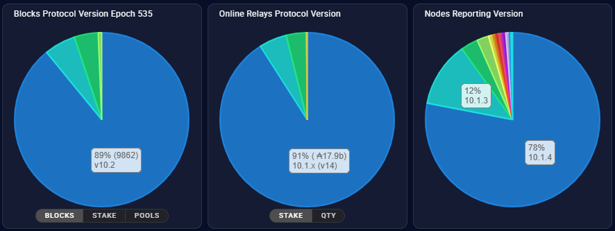
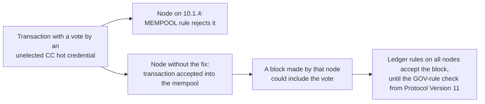

# CID-202407: Plomin Hard Fork DoS Vector and Mandatory Hotfix 10.1.4

> In late December 2024 a community member testing on Cardano's pre-production testnet (preprod) reported that certain transactions could make nodes unstable once Protocol Version 10, the "Plomin" hard fork, took effect [1]. Plomin was to be Cardano's first hard fork enacted through on-chain governance, and the mainnet vote on it was under way [10][14]. Developers traced the issue to votes cast by constitutional committee (CC) credentials without a seat on the currently elected committee, and changed the ledger so that nodes reject such votes before they enter the mempool, the queue of transactions waiting for a block [4][6]. The fix shipped as cardano-node 10.1.4 on 7 January 2025. Its release notes required every stake pool and relay to upgrade and warned that nodes left behind risked a denial-of-service (DoS) attack after the fork [2]. By 22 January, 89% of blocks in the current epoch were made with 10.1.4 [14], and Plomin took effect on mainnet at 21:44:51 UTC on 29 January 2025 [15] with no reported exploitation, outage or loss of funds. The defect was in Cardano's ledger software, so the L1 was at fault; the cost was an unscheduled, mandatory node upgrade in the middle of the hard fork vote.

## Timeline (UTC)

| Time | Event |
|---|---|
| 2024-11-22 00:00 | Preprod enters Protocol Version 10 at the start of epoch 181 (on-chain data) [15]. |
| 2024-11-30 13:53 | cardano-node 10.1.3, a Plomin-capable release, is published [2][3]. |
| 2024-12-20 | The mainnet governance action to hard fork to Protocol Version 10 is submitted on-chain [10][17]. |
| Late 2024-12 ("holiday period") | A community member testing on preprod reports "a potential issue that could affect node stability under certain conditions once the Plomin hard fork (HF) has been enacted"; the development team confirms the root cause [1]. |
| 2024-12-30 04:27 | Alexey Kuleshevich (cardano-ledger) opens PR #4813, "Add a check to `MEMPOOL` rule that prevents unelected CC from voting" [4]. |
| 2025-01-02 17:16 | PR #4813 is merged into cardano-ledger master [4]. |
| 2025-01-02 21:45 | Backport PR #4815 is merged, releasing `cardano-ledger-conway-1.17.4.0` "for `cardano-node-10.1.4`" [5][6]. |
| 2025-01-03 00:23 | cardano-node release PR #6063 is opened: "The only change from `10.1.3` is that it uses `cardano-ledger-conway-1.17.4` instead of `1.17.3`" [3]. |
| 2025-01-06 15:51 | PR #6063 is merged. A follow-up commit raises the node's protocol minor version, which "enables tracking of peers that have upgraded" [3][2]. |
| 2025-01-07 21:32 | cardano-node 10.1.4 is published; the release notes require all stake pools and relays to upgrade "to mitigate a potential DoS attack following a hard fork to Protocol Version 10" [2]. |
| 2025-01-08 | Intersect's Hard Fork Working Group publishes "Hotfix 10.1.4 - notice for SPOs" [1]. The PR #4813 author tells an SPO the change is "necessary for upgrading to Protocol Version 10" [4]. |
| 2025-01-10 | Intersect Development Update #44 repeats the call to upgrade. SPO "yes" votes on the hard fork stand at 29.25% of stake against a 51% threshold [10]. |
| 2025-01-15 | The Ledger team update says testing ahead of Plomin "nailed a couple of serious bugs", with fixes in 10.1.4, so "an upgrade for all SPOs ... is highly advisable" [7]. |
| 2025-01-17 | Intersect Development Update #45: block-producing nodes on the required version stand at 73% (guardrail threshold 85%), SPO votes at 52% (threshold 51%) [11]. IOG's weekly report names v10.1.4 as the node version that counts towards the 85% threshold [12]. |
| 2025-01-20 | The Cardano Foundation community digest reports 85% of blocks "already using" 10.1.4 [13]. |
| 2025-01-22 | Intersect's readiness page reports 89% of blocks in the current epoch made with 10.1.4, "which reports as 10.2" [14]. EMURGO cites 78% of network nodes upgraded as of the same date [16]. |
| 2025-01-24 | The hard fork is approved for enactment after the node-readiness, SPO and interim constitutional committee thresholds are met [17]. |
| 2025-01-29 21:44:51 | Epoch 537 begins. Mainnet protocol parameters move from major version 9 to 10, and Plomin is enacted [15][14]. |
| 2025-05-05 | cardano-ledger issue #5022 plans to move the mempool-only check, which "we didn't get ... in time for the previous hardfork", into the GOV ledger rule from Protocol Version 11 [8]. |
| 2025-06-17 10:14 | cardano-ledger PR #5091 is merged, adding the `UnelectedCommitteeVoters` failure to the GOV rule from protocol major version 11 [9]. |
| 2026-07-18 21:44:51 | Mainnet protocol parameters show major version 11 from epoch 644 (on-chain data) [15]. |

## Impact

No source reports a DoS attack, node instability, a chain split or degraded block production linked to this issue, before or after the fork [1][2][14][17]; Intersect's readiness page records the enactment without mentioning any incident [14]. No funds were at risk, since the issue concerned node stability, not custody of assets [1][2].

The cost fell on operators. The release notes made 10.1.4 mandatory for stake pools and relays [2], and Intersect asked operators to check that CPU and memory could handle "both typical and peak activity levels" [1]. The hotfix arrived while operators were already upgrading for, and voting on, the hard fork [10][11]. Intersect said it "does not affect the governance schedule for the Plomin HF itself" [1], and Plomin was enacted on the last of the published enactment dates [10][15].

Adoption before the fork was high but not complete: 73% of block-producing nodes on 17 January [11], 85% of blocks on 20 January [13], and on 22 January 89% of blocks in the current epoch [14] and 78% of nodes reporting a version [14][16]. The figures measure different things and are not directly comparable; none shows full adoption, and no figure for the moment of the fork was published. Nodes that had not upgraded remained exposed after the fork [2].



*Figure 1: Node versions on mainnet as published on Intersect's Plomin readiness page with its figures for 22 January 2025. Left: 89% of blocks in epoch 535 came from nodes reporting v10.2, the hotfixed 10.1.4. Centre: 91% of online-relay stake ran 10.1.x. Right: 78% of nodes reporting a version ran 10.1.4. Source: Intersect Hard Fork Working Group, "Plomin upgrade readiness" [14].*

Rated SEV-4 (availability: an unscheduled, mandatory node upgrade with no user-visible impact, under the emergency-upgrade rule); potential SEV-2 (availability: unmitigated, every node would have been exposed once Plomin was enacted, and the responders tied the vector to node stability and block production [1][2], so an attack sustained until a fix shipped could credibly have caused network-wide degradation for more than an hour; the mechanism was never published and nothing supports SEV-1). Recoverability: extra-resources (an emergency node release and a coordinated operator upgrade closed the vector before the fork, on a predictable timescale and without changing the governance schedule [1][2][14]).

## Root cause

The only functional change between cardano-node 10.1.3 and 10.1.4 is the move from `cardano-ledger-conway-1.17.3` to `1.17.4` [3], whose changelog has a single entry: "Add a check to `MEMPOOL` rule that prevents unelected CC from voting" [6]. PR #4813 adds `authorizedElectedHotCommitteeCredentials`, which returns the hot credentials (the keys committee members vote with) authorised by members of the *currently elected* committee, leaving out resigned members. The Conway `MEMPOOL` rule then rejects any transaction containing a `CommitteeVoter` whose hot credential is not in that set, with "Unelected committee members are not allowed to cast votes" [4]:

```haskell
collectUnelectedCommitteeVotes !unelectedHotCreds voter _ =
  case voter of
    CommitteeVoter hotCred
      | hotCred `Set.notMember` authorizedElectedHotCreds ->
          Set.insert hotCred unelectedHotCreds
    _ -> unelectedHotCreds
```

The regression test added in PR #4813 shows how an unelected credential could vote [4]:

1. Submit an `UpdateCommittee` proposal that adds a fresh cold credential.
2. Register a hot key for that cold credential, even though the proposal has not been ratified.
3. Submit a transaction in which that hot key votes on a governance action.

The test requires mempool validation (`applyTx`) to reject this transaction, while the same transaction still passes the block-level ledger rules when submitted directly (`withNoFixup $ submitTx_ tx`). Only the mempool filter blocks such votes [4].

The change mattered only under Plomin: the PR author told an SPO it had "no implications for the Protocol Version 9, which is the current protocol version on mainnet", but "is necessary for upgrading to Protocol Version 10" [4]. No primary source explains how such votes would degrade nodes under Protocol Version 10 (see Disputed or open points). A commenter on the PR described the effect as "invalid votes were being added to mempool only to be disregarded by the ledger rules" [4], which suggests the cost lay in processing votes that ratification ignores; no primary source confirms this.

Issue #5022 later said the check went into the mempool "since we didn't get it in time for the previous hardfork" [8]. A block-validity rule has to be gated on a protocol version, as PR #5091 later did [9], whereas a mempool rule only changes which transactions a node accepts and relays, so it could ship in a minor node release without altering the hard fork. Until the GOV-rule check took effect at Protocol Version 11 [9], a block made by a node without the fix could in principle still contain such votes, and upgraded nodes would accept that block [4][9]. Whether such a block would have harmed upgraded nodes depends on the unpublished mechanism.



*Figure 2: Why the 10.1.4 mempool check did not bind blocks made by nodes without the fix until Protocol Version 11, based on PR #4813, issue #5022 and PR #5091 [4][8][9]; diagram by the catalogue.*

The Ledger team's reference to "a couple of serious bugs" fixed in 10.1.4 [7] does not indicate further hotfixes: of the PRs listed in that update, only PR #4813 was backported into the 10.1.4 ledger dependency [3][5][7].

## Detection

A community member testing on preprod over the 2024/25 holiday period found the issue; the core teams' own testing did not [1]. Preprod had run Protocol Version 10 since 22 November 2024 (epoch 181) [15], more than two months before mainnet. Neither the reporter nor the report date is published [1]; the first public trace is PR #4813, opened on 30 December 2024 [4]. The preprod transactions involved have not been identified.

## Response and resolution

The cardano-ledger team merged the check to master on 2 January 2025 and the same day backported it to the 1.17 line used by node 10.1.x (`1.17.4.0`, PR #4815) and the 1.18 line used by node 10.2 (`1.18.1.0`, PR #4816) [4][5][7]. The node team cut 10.1.4 with only the ledger bump and a protocol minor version increase so that upgraded peers could be tracked [3], and published it on 7 January 2025 [2]. Release benchmarks found "no notable performance differences" from 10.1.2/10.1.3, and the main tools (cardano-wallet, DB Sync, Rosetta, Rosetta-Java, GraphQL, Ogmios) needed no new releases [11].

The release notes and Intersect's notice told all SPOs and relays to upgrade, with different wording (see Disputed or open points) [1][2]. Intersect's weekly updates, IOG's weekly development report and the Cardano Foundation digest repeated the call and published adoption figures [10][11][12][13]. None of these channels described the transactions involved; that was visible only in the public ledger PR [4].

## Remediation and follow-up

- **Ledger-rule enforcement:** issue #5022 (May 2025) planned to add the check to the GOV rule from Protocol Version 11 and then retire the mempool check [8]. PR #5091 (merged 17 June 2025) added `UnelectedCommitteeVoters` to `ConwayGovPredFailure`, gated by `disallowUnelectedCommitteeFromVoting pv = pvMajor pv > natVersion @10` [9]. Mainnet moved to protocol major version 11 at epoch 644 (18 July 2026) [15]; from then, nodes running ledger code that includes PR #5091 reject such votes at block level.
- **Upgrade tracking:** the protocol minor version bump in 10.1.4 made upgraded nodes visible in block headers (they "report as 10.2"), so adoption could be measured per block [3][14].
- **Process:** no post-mortem or process change, for example to testnet bug reporting or bounty arrangements, has been published.

## Incident handling assessment

Assessment of the responsible party's handling against SOC 2 Trust Services Criteria, based on public sources only (see CLASSIFICATION.md, section 10). The responsible party is the Cardano core development organisation: Input Output's cardano-ledger and cardano-node teams, with Intersect's Hard Fork Working Group coordinating the upgrade.

| Criterion | Result | Observation |
|---|---|---|
| CC7.2 Monitoring and detection | Exceptions noted | Found by a community member testing on preprod, not by the core teams, although preprod had run Protocol Version 10 since November 2024 [1][15]. It was still caught before mainnet enacted Plomin [1][4]. |
| CC7.3 Evaluation of events | No exceptions noted | The root cause was confirmed [1] and a fix opened on 30 December 2024 and merged on 2 January 2025 [4]. The team scoped the change to Protocol Version 10 and made the upgrade mandatory for stake pools and relays [2][4]. |
| CC7.4 Incident response | No exceptions noted | The fix was backported to both active ledger lines and shipped as a single-change release with a version signal for tracking adoption [3][5]. Adoption was published weekly, and the fork went ahead on schedule without a reported incident [11][13][14][15]. |
| CC7.5 Recovery | No exceptions noted | The mempool check closed the vector for upgraded nodes, and the check became a GOV ledger rule from Protocol Version 11 [4][8][9]. Until then it did not bind blocks from nodes without the fix (see Root cause). |
| CC2.3 External communication | Exceptions noted | Operators were told promptly to upgrade [1][2][10][11], but the notice ("recommended") and the release notes ("required") differed [1][2], the transactions involved were described only in the public ledger pull request [4], and no incident report or post-mortem was published; hence `disclosure: partial-post-mortem`. |
| CC8.1 Change management | Exceptions noted | The Plomin-capable releases accepted votes from unelected committee members into the mempool [3][4]. Release testing did not catch it [1], and the block-level check came a protocol version later because it was not ready "in time for the previous hardfork" [8]. |

## Lessons for builders

- **Authorisation must check current membership, not just registration.** The vector was a vote from a credential with a registered hot key but no elected seat [4]. Systems with role-based voting or signing (multisig committees, DAO councils, oracle sets) should check that the signer holds the role in the *current* state; a registered, nominated or proposed key is not an authorised one.
- **Reject early what later rules would ignore.** Data that is accepted and then silently disregarded still costs every node that relays it [4]. Batchers, indexers and dApp back ends that queue user submissions should validate at intake.
- **A mempool filter is a stopgap, not a validity rule.** It can ship quickly because it does not change block validity, and for the same reason it does not bind blocks from nodes without it [4][8][9]. Protocols that rely on relay-level filters (sidechains, rollups, Hydra-style heads) should plan the matching validity rule for the next protocol version.
- **Test against the protocol version mainnet is about to adopt.** Preprod ran Plomin rules from November 2024, and an outside tester found the issue there [1][15]. Include governance transactions in adversarial testing, not only your own contracts.
- **Plan for emergency node upgrades.** Operators had about three weeks between the 10.1.4 release and the fork [2][15]. Keep runbooks and staging environments that can validate a node release within days, and track the node version your providers run.
- **Make version adoption measurable.** The protocol minor version bump let the ecosystem count upgraded block producers before the fork [3][14]. Teams running their own or permissioned networks should build a similar signal into their upgrade process.

## Disputed or open points

- **Technical mechanism of the DoS:** No primary source explains how votes from unelected CC members would destabilise nodes under Protocol Version 10, what an attack would cost, or why Protocol Version 9 was unaffected beyond the statement that it had "no implications" [4]. The potential severity therefore rests on the official "DoS attack", "node stability" and "block production" wording [1][2], not on a published worst case.
- **Reporter and discovery date:** The reporter is not named, and the report date is given only as "over the holiday period" [1]. Whether a bug bounty was paid is not known.
- **"Required" vs "recommended":** The GitHub release notes and Intersect Development Update #45 say all stake pools and relays are "required" or "must" upgrade [2][11]. Intersect's SPO notice says an upgrade "is recommended" and that operators should "plan to update" [1].
- **Exploitation:** No source reports an attempt to exploit the vector on mainnet, before or after the fork, and no public analysis of mainnet or preprod for votes by unelected committee members was found. Because the check bound only mempools until Protocol Version 11 [4][9], such votes could in principle have reached blocks made by nodes without the fix.

## Sources

1. [P] Intersect Hard Fork Working Group, "Hotfix 10.1.4 - notice for SPOs" (earliest page history 2025-01-08), 2025-01-08. https://cardanoupgrades.docs.intersectmbo.org/plomin-upgrade/chang-upgrade-2-readiness/hotfix-10.1.4-notice-for-spos
2. [P] IntersectMBO/cardano-node, "Release 10.1.4", 2025-01-07. https://github.com/IntersectMBO/cardano-node/releases/tag/10.1.4
3. [P] IntersectMBO/cardano-node, PR #6063 "Release 10.1.4" (and comparison 10.1.3...10.1.4), 2025-01-06. https://github.com/IntersectMBO/cardano-node/pull/6063 ; https://github.com/IntersectMBO/cardano-node/compare/10.1.3...10.1.4
4. [P] IntersectMBO/cardano-ledger, PR #4813 "Add a check to `MEMPOOL` rule that prevents unelected CC from voting" (code, test and comments), 2025-01-02. https://github.com/IntersectMBO/cardano-ledger/pull/4813
5. [P] IntersectMBO/cardano-ledger, PR #4815 "Backport release `cardano-ledger-conway-1.17.4.0`" and PR #4816 "Backport release `cardano-ledger-conway-1.18.1.0`", 2025-01-02. https://github.com/IntersectMBO/cardano-ledger/pull/4815 ; https://github.com/IntersectMBO/cardano-ledger/pull/4816
6. [P] IntersectMBO/cardano-ledger, `cardano-ledger-conway` CHANGELOG (version 1.17.4.0, as linked from the 10.1.4 release notes), 2025-01-02. https://github.com/IntersectMBO/cardano-ledger/blob/df07b600c3f5dd8462f27450d59405b1cab6dc62/eras/conway/impl/CHANGELOG.md
7. [P] Cardano Development Updates (Alexey Kuleshevich), "Ledger Team Update", 2025-01-15. https://updates.cardano.intersectmbo.org/2025-01-15-ledger
8. [P] IntersectMBO/cardano-ledger, issue #5022 "Move CC votes mempool check", 2025-05-05. https://github.com/IntersectMBO/cardano-ledger/issues/5022
9. [P] IntersectMBO/cardano-ledger, PR #5091 "Move unelected CC votes check to GOV", 2025-06-17. https://github.com/IntersectMBO/cardano-ledger/pull/5091
10. [P] Intersect, "Intersect Development Update #44 - January 10th", 2025-01-10. https://intersectmbo.org/news/intersect-development-update-44-january-10th
11. [P] Intersect, "Intersect Development Update #45 - January 17th", 2025-01-17. https://www.intersectmbo.org/news/intersect-development-update-45-january-17th
12. [P] Input Output (Essential Cardano), "Weekly development report as of 2025-01-17", 2025-01-17. https://www.essentialcardano.io/development-update/weekly-development-report-as-of-2025-01-17 (summary: https://cardano.org/news/2025-01-17-weekly-development-report/)
13. [P] Cardano Foundation, "Community Digest" (January 20, 2025), 2025-01-20. https://cardano.org/news/2025-01-20-community-digest/
14. [P] Intersect Hard Fork Working Group, "Plomin upgrade readiness" (frozen as of 2025-01-29), 2025-01-29. https://cardanoupgrades.docs.intersectmbo.org/plomin-upgrade/chang-upgrade-2-readiness
15. [P] Koios (on-chain data API), mainnet epoch 537 start and protocol parameters for epochs 536, 537 and 644; preprod protocol parameters for epochs 180 and 181, retrieved 2026-10-13. https://api.koios.rest/api/v1/epoch_info?_epoch_no=537 ; https://api.koios.rest/api/v1/epoch_params?_epoch_no=537 ; https://api.koios.rest/api/v1/epoch_params?_epoch_no=644 ; https://preprod.koios.rest/api/v1/epoch_params?_epoch_no=181
16. [S] EMURGO, "Explainer: The Plomin Hard Fork (Cardano)", 2025-01-23. https://www.emurgo.io/press-news/explainer-the-plomin-hard-fork-cardano/
17. [S] The Block (Brian McGleenon), "Cardano plans transition to 'full decentralized governance' after Wednesday's Plomin hard fork", 2025-01-29. https://www.theblock.co/post/337680/cardano-plans-transition-to-full-decentralized-governance-after-wednesdays-plomin-hard-fork
