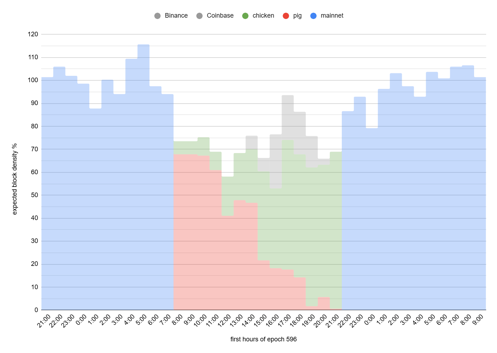
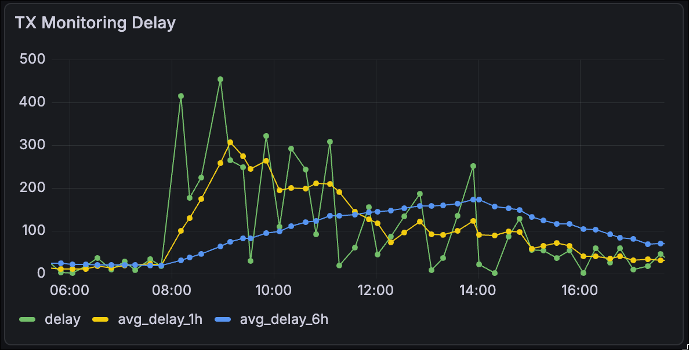
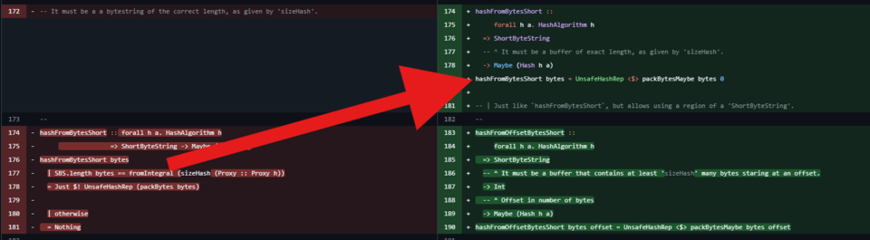
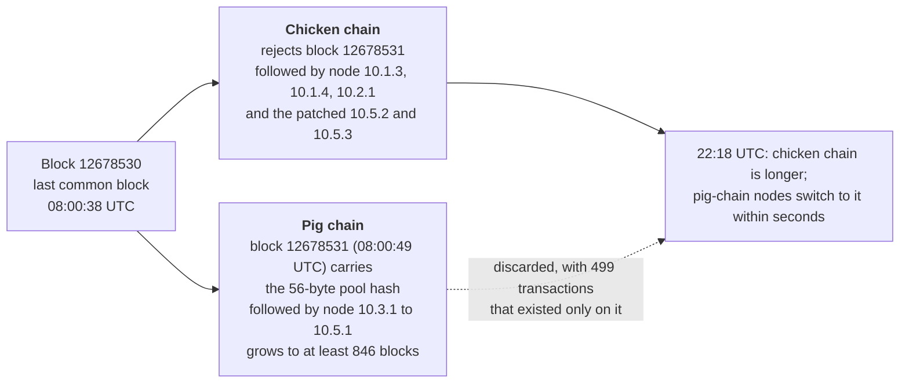
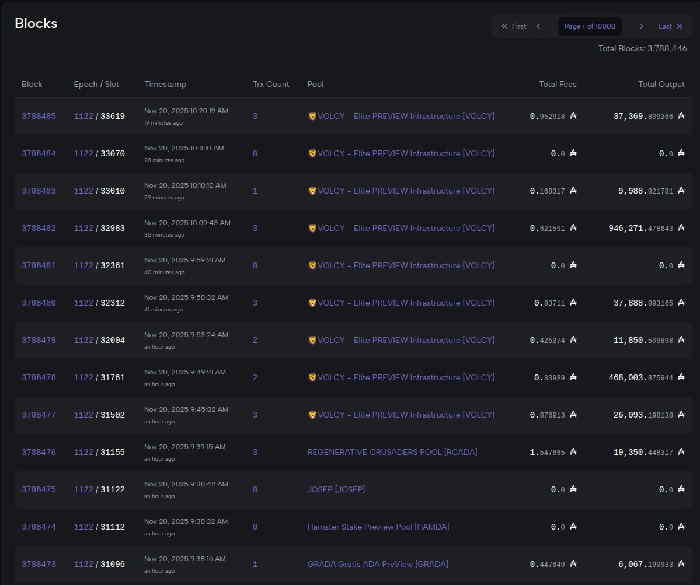
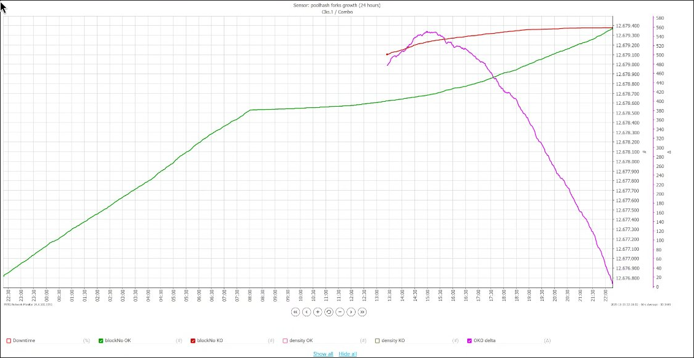
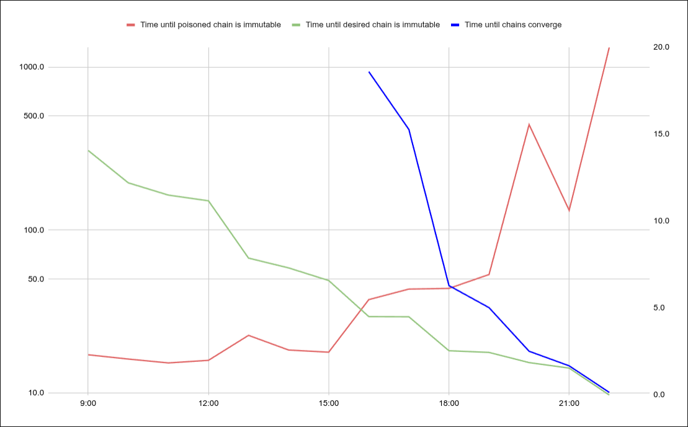
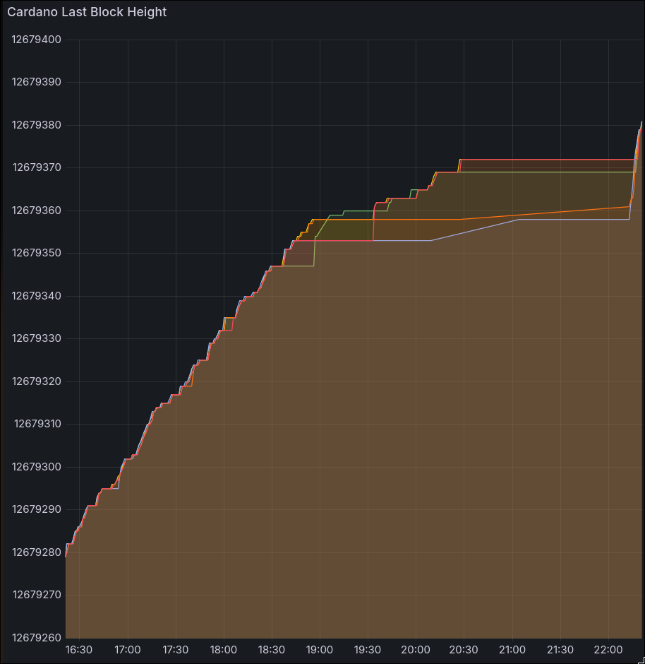

# CID-202501: Pig vs Chicken Chainsplit

> On 21 November 2025 at about 08:00 UTC, a stake-delegation transaction carrying a 56-byte stake pool identifier, where exactly 28 bytes are required, split Cardano mainnet into two chains for about 14 hours [3]. Node versions 10.3.1 to 10.5.1, run by about two thirds of active stake, accepted it because a bug in the node's `cardano-base` library silently truncated oversized hashes; older nodes and most downstream tooling (the Daedalus wallet, cardano-db-sync, explorers) rejected it, so the root cause lies in Cardano L1 software [1][3]. Responders called the accepting fork the "pig" chain and the rejecting, specification-conformant fork the "chicken" chain [3][6]. Blocks kept being produced, but transactions took up to several minutes to confirm, exchanges suspended ADA deposits and withdrawals, and 499 transactions ended up only on the discarded chain [3][4][15]. A fix prepared after the same bug hit the Preview testnet the day before was rolled out, and at 22:18 UTC the chicken chain overtook the pig chain and every node converged on it automatically [3]. No funds were stolen and there was no on-chain double spend; off-chain losses have not been assessed publicly [2][3]. The submitter called it a careless, AI-assisted experiment and Cardano founder Charles Hoskinson a premeditated attack; intent remains disputed, and Intersect engaged authorities including the FBI [1][17][18].

## Timeline (UTC)

≈ marks times derived from the ID of the X post linked from the cited source; ~ marks times converted from the after-action report's EST clock times.

| Time | Event |
|---|---|
| 2022-04-27 | cardano-base PR #274 is merged; `hashFromBytesShort` now only checks that *at least* the expected number of bytes is present [3][9]. |
| 2024-11-20 | cardano-base PR #506 is merged; one of its commits switches the CBOR decoder for hashes from `hashFromBytes` (exact-length check) to `hashFromBytesShort` [3][10]. |
| 2025-03 to 2025-07 | cardano-node 10.3.1, 10.4.1 and 10.5.1 ship the affected cardano-crypto-class 2.2.x. Most stake pools upgrade; the Daedalus full-node wallet stays on the unaffected 10.2.1 [3]. |
| 2025-11-20 08:40 | Preview testnet: a transaction delegating to a doubled (56-byte) pool hash is included at slot 96972032; newer nodes accept it, older nodes reject it, and Preview partitions [3][24]. |
| 2025-11-20 09:29 | Community members report slow block production on Preview; a fork is mentioned publicly at 09:40 [3][23]. |
| 2025-11-20 10:42 | Escalated to Input Output (IO) developers ("hash bytes wrong size" errors); IO's Preview db-sync is confirmed affected at 10:46 [3]. |
| 2025-11-20 14:20 | Root cause identified [3]. |
| 2025-11-20 15:43 | Risk assessment: the issue could partition mainnet, where most stake pools run 10.3.1 or later [3]. |
| 2025-11-20 16:49 | Decision to hotfix node versions 10.3.1 and later [3]. |
| 2025-11-20 18:17 | Fix commits authored for cardano-crypto-class 2.2.0.x and 2.2.3.x [3][11][12]; patched packages reach the Cardano Haskell Packages repository at 20:12 [3]. |
| 2025-11-20 22:29 | cardano-node 10.5.2 is tagged [3]; its GitHub release is published at 02:57 on 21 November [7]. |
| 2025-11-21 01:17 | Preview operators are told to stop their nodes, truncate their databases to before the fork and upgrade to 10.5.2, following the CIP-135 disaster-recovery procedure [3]. |
| 2025-11-21 08:00 | Last common block: 12678530 at 08:00:38 [3][14]. Pig-chain block 12678531 (08:00:49, hash `e87b9532…74e0b4`) contains the malformed transaction `87641e16f9993118cbc37574b66a203d3745a75af383eb65743f0f064003b459` [3], which delegates to a doubled hash of RATS, Charles Hoskinson's personal stake pool [4]. |
| 2025-11-21 08:05 | Mainnet symptoms reported on Discord; nodes on 10.1.4 are confirmed stuck at block 12678530 [3]. |
| 2025-11-21 08:40 | War room convened (Cardano Foundation, Intersect, Input Output, Technical Steering Committee, Security Council); it aligns on the chain that rejects the transaction [3]. |
| 2025-11-21 09:27 | Coinbase disables Cardano sends and receives [15]. |
| 2025-11-21 10:20 | Response plan executed: upgrade relays to 10.5.2, contact major stakeholders, manage exchanges [3]. |
| 2025-11-21 10:39 | Intersect posts incident details and operator instructions on X [3]; its incident report follows the same day [1]. |
| 2025-11-21 15:56 | cardano-node 10.5.3 is released to fix build issues for operators compiling from source [3][8]. |
| 2025-11-21 ~16:00 | Projections show the chicken chain catching up before the malformed transaction becomes immutable on the pig chain [4]. |
| 2025-11-21 17:58 | Exchanges unable to upgrade are advised to halt their nodes until the preferred chain holds more than 50% of stake [3]. |
| 2025-11-21 ≈18:30 | X user "Homer J" apologises for submitting the transaction [17][18]. |
| 2025-11-21 ≈19:11 | Hoskinson posts that "the FBI is already involved" [18]. |
| 2025-11-21 20:00 | More than 50% of stake is on the preferred chain; 74% of reporting pools have upgraded [3]. |
| 2025-11-21 ≈20:10 | Hoskinson describes a "premeditated attack from a disgruntled SPO" [17]. |
| 2025-11-21 22:18 | The chicken chain becomes longer; pig-chain nodes switch to it within seconds and the partition ends [3]. |
| 2025-11-21 23:00 | IO engineers start resubmitting pig-only transactions; none succeeds [3]. |
| 2025-11-22 02:10 | Coinbase marks the incident resolved [15]. |
| 2025-11-22 | π Lanningham (Sundae Labs) publishes "Poison Piggy - After Action Report" [4]. |
| 2025-11-22 ≈23:15 | IOG developer Roman Kireev ("effectfully") resigns, citing the involvement of law enforcement [18][19]. |
| 2025-11-23 | Intersect publishes "Cardano mainnet incident: facts at a glance" [2]. |
| 2025-11-26 | First meeting of the Chain Partition Incident Analysis Working Group, under Intersect's Technical Steering Committee and reporting to the Security Council [16]. |
| 2025-12-03 | IOG Chief Scientist Aggelos Kiayias publishes an analysis against Ouroboros' security guarantees [5]. |
| 2025-12-08 | cardano-base PR #582 merges the permanent fix into `master` [13]. |
| 2026-01-22 | The working group publishes its Preliminary Fact Finding Report v1.1 [3]. |

## Impact

For about 14 hours two chains were extended in parallel [3]. About two thirds of active stake initially followed the pig chain, a temporary violation of Ouroboros' honest-majority assumption in Kiayias's analysis [3][5]. The pig chain grew to at least 846 blocks beyond the fork point, against a previous maximum observed mainnet fork of 2 blocks (April 2021), but stayed within the security parameter *k* = 2,160 blocks, beyond which nodes need manual recovery [3].

Neither chain stopped producing blocks [1], but the chicken chain at first produced only about 4% of expected blocks and both chains together about 70% [3]; combined density never exceeded 75%, against a usual 90–97% [16]. Chicken-chain nodes, constantly offered the invalid blocks, disconnected from the peers offering them, and block propagation became 10 to 100 times slower than normal [3].



*Figure 1: Hourly block density as a percentage of expected in epoch 596 (20 November 21:00 to 22 November 09:00 UTC): normal mainnet (blue), pig chain (red), chicken chain (green) and, in grey, the capacity of two large stake pool groups that had shut down their nodes (labelled Binance and Coinbase). Source: Intersect Chain Partition Incident Analysis Working Group, ["Preliminary Fact Finding Report" v1.1](https://957504999-files.gitbook.io/~/files/v0/b/gitbook-x-prod.appspot.com/o/spaces%2FAUiAjcKAzL0AtLA4yTyp%2Fuploads%2FzBPhb8oelV8I2UxU7eXl%2FPreliminary%20Fact%20Finding%20Report%20v1.1%20-%2022nd%20January%202026.pdf?alt=media&token=a906d5a6-0c61-4890-9cdb-9350418466c8), section 3.4 [3].*

Settlement slowed. The Cardano Foundation's canary transactions waited up to about 450 seconds for inclusion (about 300 seconds averaged over an hour); Lanningham puts delays at up to 400 seconds for transactions submitted "via robust infrastructure", with gaps of up to 964 seconds between chicken-chain blocks [4]. Explorers froze or showed conflicting data, and DeFi applications saw inconsistent state [6][18].



*Figure 2: Inclusion delay (seconds) of the Cardano Foundation's canary transactions on 21 November (UTC): individual (green), one-hour average (yellow) and six-hour average (blue). Source: Cardano Foundation monitoring, published in π Lanningham, ["Poison Piggy - After Action Report"](https://www.314pool.com/post/cardano-post-mortem-2) [4].*

Of 8,676 transactions on the pig chain, 499 never reached the chicken chain [3]; Lanningham's earlier count of 479 of 14,383 (about 3.3%) omits the block that carried the malformed transaction [3][4]. All 547 resubmission attempts by IO engineers failed. Of the 479 transactions retried, 23 failed only on an expired validity interval, 107 only on spent or missing inputs and 349 on both; 369 failed transactions depended on other failed transactions, and 261 of the 499 involved Plutus scripts [3].

No funds were stolen; the chicken chain kept a consistent ledger, with no on-chain double spend and no adjustment needed [2][3]. Daedalus users were unaffected because Daedalus ran node 10.2.1 [1][3]. Exchanges were advised to suspend ADA transactions [3]: Coinbase paused Cardano sends and receives for about 16 h 43 min [15], and Upbit, Kraken and others for shorter periods [18]. Services were running normally within 24 hours [3]. ADA fell more than 6% (CoinDesk) or as much as 16% (The Block) [17][18], which Intersect attributed to broader market conditions and headline-driven fear [2].

The remaining exposure was off-chain. A signed transaction is valid on any fork where its inputs are unspent and its validity interval is open, and transactions propagated to both sides, so most appeared on both chains [4]. A service acting on a transaction seen only on the losing fork could lose value: Lanningham's example is an exchange on the wrong fork that credits a deposit, lets the user sell and withdraw, and then sees the deposit vanish [4]. Exchanges on the affected versions followed the pig chain until they upgraded or halted, and the working group found 655 inputs spent on both chains, without establishing whether any conflicting spend was deliberate [3]. Whether any service lost money is unknown; Lanningham judged it unlikely, given the fast exchange response and the few pig-only transactions [4]. The working group warns dApps and partner chains that infer finality from an assumed maximum fork length [3].

Rated SEV-1 (consensus safety: honest nodes followed diverging chains for about 14 hours; availability: CIP-135 Scenario 3.1, a block that node versions 10.3.1 to 10.5.1 could process and older versions could not, resolved through a coordinated node-version change, while combined chain density stayed at or below about 75% of expected for about 14 hours and major exchanges suspended ADA deposits and withdrawals) [3][15][16]; potential SEV-1 (consensus safety and availability: had the pig chain reached *k* = 2,160 blocks first, its nodes could only have rejoined through manual database truncation under CIP-135, and the off-chain replay exposure is unquantified) [1][4]. Recoverability: escalated (convergence depended on stake pool operators and exchanges outside the core teams, coordinated through a cross-organisation war room, and the 499 pig-only transactions could not be replayed) [3].

## Root cause

Stake pool identifiers and payment, stake, DRep and Constitutional Committee credentials are Blake2b-224 hashes of exactly 28 bytes [3]. In 2022, cardano-base PR #274 rewrote `hashFromBytesShort` in `cardano-crypto-class` to call `packBytesMaybe`, which only checks that the buffer holds *at least* the required number of bytes, reads that many and ignores the rest, while the documentation still said "It must be a buffer of exact length" [3][9]:

```haskell
-- cardano-crypto-class, after PR #274 (2022)
hashFromBytesShort bytes = UnsafeHashRep <$> packBytesMaybe bytes 0

packBytesMaybe bs offset = do
  let bufferSize = SBS.length bs
      size = fromInteger (natVal' (proxy# @n))
  guard (offset >= 0)
  guard (size <= bufferSize - offset)   -- "at least size bytes", not "exactly"
  Just $ packBytes bs offset
```



*Figure 3: The PR #274 change to `hashFromBytesShort` (commit 37d0938), with the working group's arrow: the exact-length guard (left) is replaced by a call to `packBytesMaybe` (right). Source: Intersect Chain Partition Incident Analysis Working Group, ["Preliminary Fact Finding Report" v1.1](https://957504999-files.gitbook.io/~/files/v0/b/gitbook-x-prod.appspot.com/o/spaces%2FAUiAjcKAzL0AtLA4yTyp%2Fuploads%2FzBPhb8oelV8I2UxU7eXl%2FPreliminary%20Fact%20Finding%20Report%20v1.1%20-%2022nd%20January%202026.pdf?alt=media&token=a906d5a6-0c61-4890-9cdb-9350418466c8), section 1 [3]; diff from [cardano-base PR #274](https://github.com/IntersectMBO/cardano-base/pull/274) [9].*

The defect stayed latent until a performance change routed CBOR decoding through it: a commit in PR #506 (merged 2024-11-20) replaced the pinned-memory `ByteString` path, which used `hashFromBytes` with an exact-length check, with an unpinned `ShortByteString` path using `hashFromBytesShort` [3][10]:

```diff
 instance (HashAlgorithm h, Typeable a) => FromCBOR (Hash h a) where
   fromCBOR = do
-    bs <- decodeBytes
-    case hashFromBytes bs of
+    sbs <- fromCBOR
+    case hashFromBytesShort sbs of
       Just x  -> return x
       Nothing -> fail $ "hash bytes wrong size, expected " ++ show expected
```

The "wrong size" failure stayed in the code but became unreachable for oversized input, which now decoded to a truncated hash [10]. Intersect calls it a bug that "dates back to 2022" in functionality "not used until a year ago" [1].

cardano-node 10.3.1, 10.4.1 and 10.5.1 contain the affected library; 10.1.3, 10.1.4 and 10.2.1 do not [3]. Newer nodes decoded the 56-byte pool hash (the 28-byte hash concatenated with itself) as a valid delegation to the real pool, leaving the ledger state unchanged but recording the extra bytes on chain; older nodes rejected the block with a decoder failure [3]. Because the affected versions held most of the stake, the accepting chain kept growing instead of stalling as it had on Preview [3].

Lanningham calls this a unidirectional "soft" fork: every block valid to old nodes was also valid to new ones, so once the stricter chain was longer, pig-chain nodes switched to it without intervention; a divergence in both directions would have needed manual action [4]. Kiayias adds that under BFT-style consensus, where voted blocks are final, recovery would have required explicit checkpointing or blacklisting in the protocol and in downstream tools such as bridges and light clients [5].



*Figure 4: The two chains after block 12678530. Diagram by the catalogue, based on the working group's report [3].*

Testing did not catch the bug: the working group found no unit, property or end-to-end test for this case and no fuzz or chaos testing aimed at this class of encoding discrepancy [3]. `cardano-cli` enforced the correct length when building transactions but would submit externally built ones that did not, which masked the bug [1][3]. The original design also did not explicitly consider a fork in which the *minority* chain is the preferred one [3].

## Detection

On Preview the community found the anomaly: slow block production was reported about 50 minutes after the malformed transaction, and "hash bytes wrong size" errors in IO's db-sync led to escalation about two hours after it (see Timeline) [3].



*Figure 5: Cardanoscan's Preview block list in the 09:40 UTC X post that the working group cites as the first public mention of the fork: after block 3788476 only one pool (VOLCY) produces blocks, minutes apart (times shown in UTC+1). Source: [SmaugPool on X](https://x.com/SmaugPool/status/1991441406960001083), 20 November 2025 [23].*

db-sync crashed on the transaction, and because most explorers depend on it the community was "flying blind" until relays on an older node version were connected to Cardanoscan's infrastructure [4]. Sam Leathers' diagnostic tool, built on Amaru libraries, located the divergence and extracted the raw transaction, and Andrew Westberg and Lanningham identified the doubled pool hash [4].

On mainnet, responders already knew the failure pattern: a Discord report followed the malformed block within about five minutes, and Intersect says teams were alerted within minutes [2][3].

## Response and resolution

The fix existed before the mainnet split but was not yet widely deployed [3]. Intersect described 10.5.2 as fast-tracked [1]; its release notes say "all checkmarks weren't available, but we deemed it worth publishing so SPOs stuck on preview could start upgrading" [7].

The war room chose the chain that rejected the transaction and conformed to the CDDL specification, although it started as the minority chain [3]. Lanningham gives two reasons: the strict fix was already public, so reversing course would have muddled communications, and following the permissive chain would have left wallets, explorers, exchanges and other off-chain tooling disrupted for longer [4]. Intersect adds that the older nodes used by Daedalus, db-sync, light wallets and explorers had rejected the transaction [1]. Responders stressed that operators kept sole discretion over their own systems and that no central kill switch or rollback was used [2][3].

Recovery was an upgrade campaign. Responders upgraded the bootstrap relays, contacted major stake pool operators and exchanges directly, and modelled both chains' growth and the time to convergence in real time [3][4]. Two large stake pool groups shut down their pig-chain nodes until they had patched, which helped the chicken chain overtake sooner [3]. The race was between the malformed transaction becoming immutable on the pig chain (2,160 blocks deep) and the chicken chain catching up; from about 16:00 UTC the projections showed the chicken chain winning [4].



*Figure 6: Block height of the chicken chain (green) and pig chain (red) on 21 November (UTC), with the gap between them (purple, right axis), as tracked by responders. The gap peaks at about 550 blocks and closes shortly after 22:00. Source: π Lanningham, ["Poison Piggy - After Action Report"](https://www.314pool.com/post/cardano-post-mortem-2) [4].*



*Figure 7: Hourly projections (UTC) of the hours until the pig chain (red) and chicken chain (green) would each be 2,160 blocks past the fork (logarithmic left axis) and until the chains would converge (blue, right axis). Source: π Lanningham, ["Poison Piggy - After Action Report"](https://www.314pool.com/post/cardano-post-mortem-2) [4].*



*Figure 8: Last block height reported by monitored IOG nodes on the pig chain from 16:30 UTC: they level off as pig-chain propagation worsens, then jump together to the longer chicken chain shortly after 22:00. Source: π Lanningham, ["Poison Piggy - After Action Report"](https://www.314pool.com/post/cardano-post-mortem-2) [4].*

A CIP-135 disaster-recovery plan, under which nodes still on the pig chain would have truncated their local state, was on standby but not needed [1][2]. Intersect identified the submitting wallet and engaged authorities including the FBI [1].

## Remediation and follow-up

- **Code fix.** The hotfix in cardano-crypto-class 2.2.0.1 and 2.2.3.2 restored the exact-length guard in `hashFromBytesShort` (`SBS.length bytes == sizeHash`, otherwise `Nothing`) [11][12]. cardano-base PR #582 (merged 2025-12-08) applied a permanent fix on `master`: it adds `packShortByteString`, which fails unless the buffer size matches exactly, deprecates `packBytesMaybe` and, "most importantly", improves negative serialisation tests for hashes and signatures [13].
- **Mandatory upgrade.** All node users on 10.3.1 through 10.5.1 were told to upgrade to 10.5.2 or 10.5.3 [7][8].
- **Stated priorities.** Intersect committed to better test coverage for edge cases and legacy code, faster and coordinated node upgrade cycles, and stronger monitoring and communication, and announced a code-quality review by the core developers and governance discussions on security research and on encouraging testing on testnets rather than mainnet [2].
- **Incident analysis.** The working group published its Preliminary Fact Finding Report on 22 January 2026 and recommends that any further evaluation take the form of an independently led inquiry [3]. Its site lists no later report as of 2026-10-13 [16].
- **Security Council retrospective.** It identifies deficiencies in the Council's remit and authority, the absence of a dedicated security incident manager, situational awareness and decision discipline, vendor incident leadership, resilience and time-zone coverage, vulnerability disclosure and triage, and node and operational diversity. It recommends clarifying post-incident governance and forensic processes, strengthening incident-response frameworks for "Level 1" events, improving technical expertise coverage and redundancy, formalising vulnerability intake and triage, and addressing node and operational diversity risks [3].
- **Community recommendations.** Lanningham calls for spec-driven code generation and fuzzing; node-to-client protocols that expose chain health to dApps, wallets and exchanges, with official circuit-breaker and finality patterns; less reliance on a single indexer (cardano-db-sync) for explorers; better education for stake pool operators on Ouroboros fork choice; and a built-in publish/subscribe channel for emergency alerts [4].
- **Compensation.** No source reports a compensation programme; no on-chain funds were lost [2][3].

## Incident handling assessment

Assessment of the responsible parties' handling (Input Output and Intersect, as maintainers of cardano-node and cardano-base and conveners of the incident response through Intersect's Security Council and Technical Steering Committee) against SOC 2 Trust Services Criteria, based on public sources only (see CLASSIFICATION.md, section 10).

| Criterion | Result | Observation |
|---|---|---|
| CC7.2 Monitoring and detection | Exceptions noted | Community members, not the maintainers' monitoring, reported the Preview anomaly about 50 minutes after the malformed transaction; it reached Input Output developers about two hours after it [3]. On mainnet, teams were alerted within minutes [2][3], but the Security Council's retrospective lists situational awareness among the deficiencies [3]. |
| CC7.3 Evaluation of events | Exceptions noted | The Preview root cause was identified within six hours, and by 15:43 UTC on 20 November responders had assessed that the bug could partition mainnet [3]. That assessment did not anticipate that downstream tooling could not follow the majority chain, because data on node diversity was limited, and the retrospective lists decision discipline and vulnerability triage among the deficiencies [3]. |
| CC7.4 Incident response | Exceptions noted | A cross-organisation war room convened 40 minutes after the split, chose the specification-conformant chain and ran an upgrade and exchange-outreach campaign that ended the partition about 14 hours later, with a CIP-135 plan on standby [2][3]. The retrospective lists the absence of a dedicated security incident manager, the Council's remit and authority, vendor incident leadership and time-zone coverage as deficiencies [3]. |
| CC7.5 Recovery | No exceptions noted | All nodes converged on a consistent ledger, the root cause was determined, and the hotfix was followed by a permanent fix with negative serialisation tests and a fact-finding report with recommendations [2][3][13]. Pig-only transactions could not be replayed and were left to their senders [2][3]. |
| CC2.3 External communication | Exceptions noted | Disclosure was timely and complete enough for `full-post-mortem`: operator instructions about 2 h 40 min after the split, an incident report the same day, a summary two days later and a fact-finding report two months later [1][2][3]. The exception concerns accuracy: primary sources disagree on key times, such as the 10.5.2 release (about 11:00 UTC per Intersect, 22:29 UTC per the working group, 02:57 UTC on GitHub), and the preliminary report contains date and version errors [1][3][7]. |
| CC8.1 Change management | Exceptions noted | Two changes introduced the root cause: PR #274 (2022) removed the exact-length check, and a performance commit in PR #506 (2024) routed CBOR decoding of hashes through it [3][9][10]. No unit, property, end-to-end or fuzz test covered this class of encoding discrepancy [3]. The emergency 10.5.2 release was published without all sign-off checks, a documented trade-off to unblock Preview operators [7]. |

## Lessons for builders

1. **Decode fixed-size fields with "exactly N", never "at least N".** The defect was a guard of the form `size <= bufferSize` inside a function documented as requiring an exact length [9]. Every fixed-length type in a consensus-critical decoder (hashes, keys, signatures) needs negative tests for too-short and too-long input, the gap PR #582 closed [13]. Silent truncation also means that decoding no longer round-trips the input bytes, which a byte-level round-trip test catches [3].
2. **Treat decoder refactors as consensus changes, and test below the transaction builder.** The trigger was a memory optimisation that swapped one decoding helper for another with weaker validation [10], and tests built on `cardano-cli` could not construct the malformed transaction [1][3]. Feed the same corpus, including fuzzed and malformed CBOR, to the old and new decoders and treat any accept/reject divergence as a release blocker; the working group found no such test [3], and press analysis drew the same conclusion about differential testing across client versions [20].
3. **Do not infer finality from typical fork depths.** A fork of at least 846 blocks happened on mainnet, against a historical maximum of 2 [3]. A partition lowers density on both forks, so a given depth takes longer to reach; long-standing operational advice is to wait about three times the nominal *k* window (around 36 hours) for strong finality [4]. Exchanges, bridges and partner chains should also pause off-chain value release automatically when chain density drops sharply or independent nodes report different tips, the circuit-breaker pattern Lanningham calls for [4].
4. **Handle rollbacks explicitly.** None of the pig-only transactions could be replayed: expired validity intervals and spent or missing inputs, often from chains of dependent transactions, made them all fail [3]. Batchers, wallets and bots must follow rollbacks from chain-sync and rebuild transactions whose inputs came from rolled-back outputs rather than resubmit them blindly.
5. **Diversify your view of the chain.** db-sync crashed on the transaction and most explorers depend on it, while Sundae Labs stayed on the correct chain because of its policy of not upgrading until forced [4]. A sentinel node on a different version or implementation exposes this kind of divergence early.
6. **Never reproduce a consensus bug on mainnet.** By the submitter's own account, he relied on AI-generated instructions to block all traffic to and from his server, without testing them on a testnet first [18]. Use a private devnet or a node with no configured peers, verify the isolation first, and report findings through the bug-bounty programmes of Intersect and the Cardano Foundation [2].
7. **Treat a testnet manifestation as a public disclosure.** The Preview transaction was public about 23 hours before the mainnet one, and the patched node was published only about five hours before it [3][7]. Maintainers of consensus software need emergency channels to large stake pool operators and exchanges in place before that gap opens, such as the built-in alert channel Lanningham proposes [4].

## Disputed or open points

- **Intent.** Homer J said he acted alone, did not short or sell ADA and "didn't have evil intentions"; he described a "let's see if I can reproduce the bad transaction" personal challenge in which he relied on AI instructions to block his server's traffic [17][18]. Hoskinson called it "a premeditated attack from a disgruntled SPO who spent months in the Fake Fred discord actively looking at ways to harm the brand and reputation of IOG" and said "it was absolutely personal" [17][18]. Intersect said forensic analysis linked the wallet to an Incentivized Testnet-era participant and treated bypassing the bug-bounty and responsible-disclosure channels as a potentially malicious act [1][2]. The sources report no outcome of a law-enforcement investigation.
- **Law enforcement and the developer community.** Kireev said he had not realised there was a risk of "getting raided by the authorities" over mistakes made during security work, and that most vulnerabilities in the computational layer had been found by him or originated from his ideas [18][19]. Hoskinson rejected that framing and defended filing a complaint as a duty [19]; commentators raised similar concerns about treating developer mistakes as legal matters [21].
- **Who submitted the Preview transaction.** Lanningham wrote that it was likely accidental but that it was unknown who sent it or why [4]; Intersect states only that a single user crafted the mainnet transaction after the Preview event [2].
- **Off-chain losses.** Whether any exchange, bridge or dApp lost value through cross-fork conflicting spends has not been published. The preliminary report leaves off-chain losses out of scope, and its UTxO collision analysis by Input Output and the University of Edinburgh is not public [3].
- **Timing discrepancies.**
  - **Preview transaction.** The working group gives 08:50 UTC, but its slot 96972032 corresponds to 08:40:32 UTC, and the last block before the fork on the surviving Preview chain (3788476) is timestamped 08:39:15 UTC [3][24]. This report uses 08:40. Lanningham's clock times for the Preview events cannot be reconciled with either [4].
  - **Mainnet transaction.** The working group's narrative gives 08:05 UTC, the time of the first Discord report, while its block data give 08:00:49 [3].
  - **Release of 10.5.2.** 22:29 UTC on 20 November (working group) [3], 02:57 UTC on 21 November (GitHub) [7], "approximately 11:00 UTC" (Intersect) [1].
  - **Release of 10.5.3.** 15:56 [3], about 15:30 [1] and 16:08 [8].
  - **Patch speed.** The Cardano Foundation and The Block say an emergency patch was deployed within three hours of detection [6][18], against roughly 13 hours from the first Preview report to the 10.5.2 tag [3].
  - **End of the partition.** 22:16 [4], 22:17 [2] and 22:18 [3].
  - **Introduction of the bug.** Lanningham dates the triggering change to 24 November 2024 [4]; the PR #506 merge date and the working group give 20 November 2024 [3][10].
- **Data quality of the preliminary report.** Its section "The Incident" dates the Preview and mainnet transactions to 2022, the fix version is written as "crypto-class-2.3.2.2" instead of 2.2.3.2 [12], and node 10.3.1 has two different release dates [3]. The report states that it may contain errors, and several underlying datasets are not public, including transaction logs, node-upgrade records and per-chain density logs [3].
- **Misreported block count.** Bitcoinist reports "around 13,900" blocks on the chicken chain [22]; in Lanningham's report, 13,904 is the number of *transactions* on the chicken chain [4].
- **"Did Cardano go down?"** Intersect and the Cardano Foundation stress that the chain never went offline and that blocks were produced throughout [2][6]; the Cardano Foundation also calls it "the first major consensus-level disruption in Cardano's eight-year history" [6]. Lanningham calls it a serious degradation of service and leaves the label to readers [4]. The rating above follows the measured impact, not the label.

## Sources

1. [P] Intersect, "Incident report: network partition analysis and resolution strategy", 2025-11-21. https://intersectmbo.org/news/incident-report-network-partition-analysis-and-resolution-strategy
2. [P] Intersect, "Cardano mainnet incident: facts at a glance", 2025-11-23. https://intersectmbo.org/news/cardano-mainnet-incident-facts-at-a-glance
3. [P] Intersect Chain Partition Incident Analysis Working Group, "Preliminary Fact Finding Report: Chain Partition. November 21st 2025 (v1.1)", 2026-01-22. https://957504999-files.gitbook.io/~/files/v0/b/gitbook-x-prod.appspot.com/o/spaces%2FAUiAjcKAzL0AtLA4yTyp%2Fuploads%2FzBPhb8oelV8I2UxU7eXl%2FPreliminary%20Fact%20Finding%20Report%20v1.1%20-%2022nd%20January%202026.pdf?alt=media&token=a906d5a6-0c61-4890-9cdb-9350418466c8
4. [P] π Lanningham (Sundae Labs, incident responder), "Poison Piggy - After Action Report", 2025-11-22. https://www.314pool.com/post/cardano-post-mortem-2
5. [P] Input Output (Aggelos Kiayias), "Ouroboros: self-healing in the wild", 2025-12-03. https://www.iog.io/news/ouroboros-self-healing-in-the-wild
6. [P] Cardano Foundation, "November 2025 Incident: Cardano Shows Its Resilience", 2025-12-04. https://cardanofoundation.org/blog/november-2025-cardano-shows-resilience
7. [P] IntersectMBO/cardano-node, "Release 10.5.2", 2025-11-21. https://github.com/IntersectMBO/cardano-node/releases/tag/10.5.2
8. [P] IntersectMBO/cardano-node, "Release 10.5.3", 2025-11-21. https://github.com/IntersectMBO/cardano-node/releases/tag/10.5.3
9. [P] IntersectMBO/cardano-base, "Packed bytes with offset" (PR #274), 2022-04-27. https://github.com/IntersectMBO/cardano-base/pull/274
10. [P] IntersectMBO/cardano-base, "Add support for `mempack`" (PR #506, incl. commit 1588e3a "Avoid using pinned memory for Hash deserialization"), 2024-11-20. https://github.com/IntersectMBO/cardano-base/pull/506
11. [P] IntersectMBO/cardano-base, "Optimize hash construction" (commit 33b7454, cardano-crypto-class 2.2.0.1), 2025-11-20. https://github.com/IntersectMBO/cardano-base/commit/33b74547d409f9c81365c234e7dc102d1fd15eb8
12. [P] IntersectMBO/cardano-base, "Optimize hash construction" (commit 7803478, cardano-crypto-class 2.2.3.2), 2025-11-20. https://github.com/IntersectMBO/cardano-base/commit/7803478bfc0030e5015972844635e437710fcc89
13. [P] IntersectMBO/cardano-base, "Fix `FromCBOR` instance for `Hash`" (PR #582), 2025-12-08. https://github.com/IntersectMBO/cardano-base/pull/582
14. [P] Cardanoscan, "Block 12678530" (last common block before the partition), 2025-11-21. https://cardanoscan.io/block/12678530
15. [P] Coinbase Status, "Cardano Network - Disabled Transactions", 2025-11-21. https://status.coinbase.com/incidents/hz3x4j4m9mxk
16. [P] Intersect, "Chain Partition Incident Analysis Working Group" (meeting notes), 2025-11-26. https://intersect.gitbook.io/forensics-working-group
17. [S] CoinDesk, "Cardano Temporarily Splits Into Two Chains as Attacker Claims to Use Possible AI-Generated Script to Exploit a Known Bug", 2025-11-23. https://www.coindesk.com/markets/2025/11/23/cardano-temporarily-splits-into-two-chains-after-attacker-uses-ai-generated-script-to-exploit-a-known-bug
18. [S] The Block, "Hoskinson involves FBI after developer's 'careless' experiment splits Cardano blockchain", 2025-11-23. https://www.theblock.co/post/380056/hoskinson-involves-fbi-after-developers-careless-experiment-splits-cardano-blockchain
19. [S] Protos, "Cardano crisis: senior dev quits after Hoskinson calls in the feds", 2025-11-24. https://protos.com/cardano-crisis-senior-dev-quits-after-hoskinson-calls-in-the-feds/
20. [S] CryptoSlate, "FBI called as Cardano split in two by a single transaction: Lessons for ETH and SOL client diversity", 2025-11-25. https://cryptoslate.com/cardano-split-in-two-by-a-single-transaction-lessons-for-eth-and-sol-client-diversity/
21. [S] Bitfinex, "What Actually Happened with the Cardano Exploit?", 2025-12-01. https://blog.bitfinex.com/education/what-actually-happened-with-the-cardano-exploit/
22. [S] Bitcoinist, "Cardano: Hoskinson Breaks Down The Poison Piggy Attack", 2025-11-25. https://bitcoinist.com/cardano-hoskinson-poison-piggy-attack/
23. [S] SmaugPool (stake pool operator) on X, "Something looks wrong on Cardano preview testnet", 2025-11-20 09:40 UTC (with screenshots). https://x.com/SmaugPool/status/1991441406960001083
24. [P] Koios API, Preview testnet `blocks` endpoint, slots 96971900 to 96972400 (on-chain data), retrieved 2026-10-13. https://preview.koios.rest/api/v1/blocks?select=block_height,abs_slot,block_time&abs_slot=gte.96971900&abs_slot=lte.96972400
