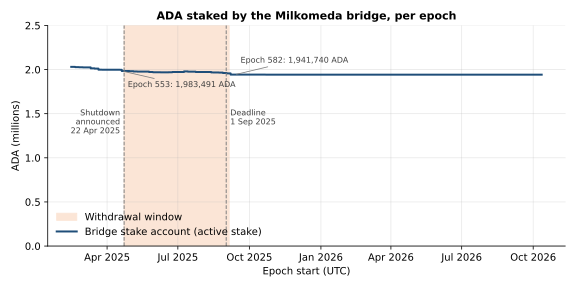
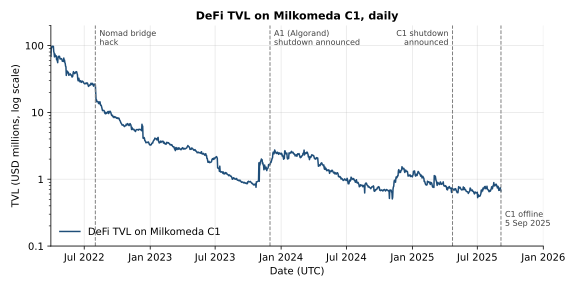
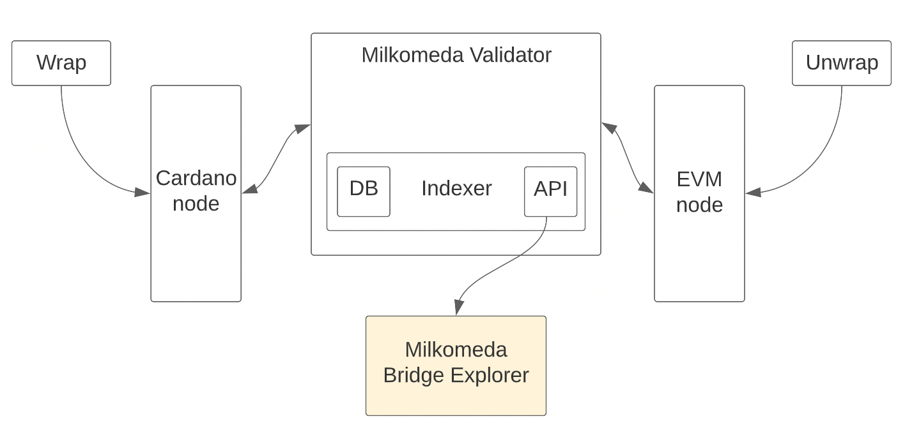

# CID-202502: Milkomeda C1 Sidechain Sunset and Frozen Residual Funds

> Milkomeda C1 was an EVM sidechain for Cardano built by dcSpark. Its bridge locked ADA and Cardano tokens on Cardano and issued wrapped equivalents on C1, such as "MilkADA" for ADA [6][8][20]. On 22 April 2025 the project announced on X that it would shut down, that users had to withdraw before 1 September 2025 and that "any funds left after that deadline will be frozen" [1]. The sidechain went offline on 5 September 2025 [4][5]. Nothing was hacked, but about 1.86 million ADA (about USD 1.5 million at the shutdown price) plus 89,274 ADA of staking rewards remain at the bridge's Cardano addresses. These funds are controlled by an operator multisig and have not moved since 4 September 2025 [11][12][15][17]. How much of this belongs to users is not public, and no claim or release process has been announced. The Cardano L1 was not at fault; the lasting harm comes from a bridge design that gives users no way to withdraw once the operator stops.

## Timeline (UTC)

| Time | Event |
|---|---|
| 2022-04-01 | The bridge mints Cardano-side "USDC (Nomad)", "USDT (Nomad)", "WBTC (Nomad)" and "WETH (Nomad)", each once at the 64-bit maximum supply (9,223,372,036,854,775,807 base units), holding the supply and releasing units as users bridge [15]. |
| 2022-04 | Milkomeda C1 mainnet launches [6]. DefiLlama records about USD 92.3 million TVL on C1 on 1 April 2022 [16]. |
| 2022-08-01 | The Nomad bridge, Milkomeda's Ethereum bridging partner, is hacked for about USD 190 million [21]. |
| 2023-09-12 | The bridge's staked multisig address (`addr1x8pyd...`) receives its first funds, delegated to pool MKM ("Milkomeda"), registered on 2023-08-09 [11][13]. |
| 2023-12-01 | Milkomeda announces that its Algorand rollup A1 will close in late May 2024 because fees do not cover validator costs; it says C1 has the potential to be self-sustaining [22]. |
| 2025-04-22 21:30 | @Milkomeda_com: "Milkomeda will shut down in four months. Please withdraw your funds before September 1 (00:00 EST). Any funds left after that deadline will be frozen." A reply adds "We'll share more details soon" [1]. |
| 2025-04-24 17:37 | A Milkomeda thread explains the shutdown, saying Cardano "was not the problem" (see Root cause) [2]. |
| 2025-06-05 01:34 | "Monthly reminder of Milkomeda shutting down" [3]. |
| 2025-09-01 04:00 or 05:00 | Withdrawal deadline, given as 00:00 EST (see Disputed or open points) [1]. |
| 2025-09-04 18:42:25 | Last spend from the bridge's deposit address `addr1w8pyd...`: a 112.1 ADA payout to a user address with Milkomeda metadata, apparently an unwrap [12][15]. |
| 2025-09-04 22:22:19 | Last transaction spending from the bridge's staked address `addr1x8pyd...` [11]. |
| 2025-09-05 20:14 | @Milkomeda_com: "Thank you all. We have officially shutdown with a few extra days." [4] The account bio changes to "deprecated protocol ... Shutdown since Sept 5th." [5] DefiLlama's C1 TVL is zero from 6 September [16]. |
| 2025-09-08 to 2025-11-07 | At least five wrap deposits (about 122.4 ADA) are sent to the bridge deposit address with Milkomeda metadata; the latest is 80.1 ADA on 2025-11-07 [14][15]. |
| 2025-09-30 | Messari's Q2 2025 report lists Milkomeda C1 as a Cardano partner chain "which announced it was shutting down" [18]. |
| 2026-10-13 | Bridge balances unchanged since 2025-09-04 (see Impact) [11][12][15]. |

## Impact

C1, its public RPC and the bridge stopped on 5 September 2025 [4][5], taking every dApp deployed on C1 with them. Those still holding value at shutdown included Blueshift, OccamX, MilkySwap, MuesliSwap's C1 deployment, Lemuria Finance, Milkomeda-C1 Djed, AdaSwap and TangleSwap [16].

Little value left the bridge during the withdrawal window: its stake account (rewards included) fell only from 1,983,491 ADA in the epoch 553 snapshot (19-24 April 2025) to 1,941,740 ADA from epoch 582 onward, about 2% [15] (Figure 1). DefiLlama put C1 DeFi TVL at about USD 741,600 on 22 April and USD 667,200 on 5 September 2025 [16].

*Figure 1: ADA in the Milkomeda bridge's stake account per epoch snapshot, rewards included, plotted at each epoch's start; the shaded area is the withdrawal window. Data: Koios API, retrieved 2026-10-13 [15]; chart by the catalogue.*

As of 2026-10-13 the two bridge addresses hold 1,857,757 ADA and dozens of native tokens, and the stake account a further 89,274 ADA of never-withdrawn rewards; nothing has been spent since 4 September 2025 [11][12][15]. At USD 0.81 per ADA on 1-5 September 2025 [17], that is about USD 1.50 million, or USD 1.58 million with rewards. Its ownership is undisclosed (see Disputed or open points).

Cardano tokens issued by the bridge lost their redemption path, which ran only through C1. Our calculation from on-chain supply data puts about 351,608 "USDC (Nomad)", 39,375 "USDT (Nomad)", 91.04 "WETH (Nomad)" and 1.33 "WBTC (Nomad)" in circulation outside the bridge addresses [15]. Their backing was probably already impaired by the 2022 Nomad hack [2][21], so no USD value is assigned.

Users also kept sending wrap deposits after the shutdown [14][15] (see Timeline). The number of affected users has not been published.

Rated SEV-3 (dimension: availability): the service and every dApp on it became permanently unavailable, and the residual balance is frozen, not lost, since the keyholders can still release it and its ownership is undisclosed. Potential SEV-1 (dimension: financial): if never released, the 1,857,757 ADA exceeds USD 1 million at the shutdown price (USD 1.50 million) and at the 22 April 2025 price of USD 0.62 (USD 1.16 million) [15][17]. Recoverability: escalated, because release depends entirely on the operator's 3-of-5 keyholders, who have announced no plan or timetable [11][15].

## Root cause

The shutdown was the operator's decision. The announcement's only stated reason is that "as @Cardano moves into a new era, we have to recognize what no longer fits its future" [1]. Two days later Milkomeda traced the loss of its growth path to the August 2022 Nomad hack: "roughly $25–30 million in assets sat on Cardano", but "most assets were never recovered, and there was no path back after that"; it also cited investors and partners who would not engage with a Cardano project [2]. Its Algorand A1 rollup had closed at the end of May 2024 because fees did not cover validator costs [19][22]. C1 TVL had fallen from about USD 92 million in April 2022 to about USD 0.74 million on the day of the announcement [16] (Figure 2); no source links the decision to this decline.

*Figure 2: Daily DeFi TVL on Milkomeda C1 from March 2022 to the shutdown, on a log scale; DefiLlama shows zero from 6 September 2025. Data: DefiLlama API, retrieved 2026-10-13 [16]; chart by the catalogue.*

The funds are frozen because of how the bridge held them. Both bridge addresses share the payment credential `c246c16d83b6d06d0a1b5742b440fc448484a159e1cfce48efc98736` [11][12], a native script that requires 3 of 5 listed key signatures and has no time-based clause [15]. Funds move only when three keyholders sign, and nothing expires; unlike a Plutus validator with an exit path, it gives users no way out on their own.

To wrap, users sent assets to the bridge address with metadata labels 87 (`mainnet.cardano-evm.c1`) and 88 (the EVM recipient), and the validators would "vote on the sidechain to release the wrapped funds". To unwrap, which was possible only through the bridge UI on C1 [8], "a mainchain transaction is voted on by the validators. Once voting is complete, the multi-signature wallet releases the funds" [9][15].

*Figure 3: Milkomeda C1 bridge architecture: users wrapped on Cardano and unwrapped on C1, with the Milkomeda validators, connected to a Cardano node and an EVM node, processing both directions. Source: Milkomeda Foundation, "Milkomeda C1 Bridge Explorer is live!", June 2022 [9].*

We infer from this design that MilkADA and other wrapped balances were recorded only on C1 [8][9]. With C1 stopped, users have no Cardano-side record to claim against, so only an operator-signed distribution can return their funds.

Bridged ADA was "auto-delegated" [6]: rewards accrue to the operator-controlled stake account, delegated to pool MKM (100% margin, zero pledge, two delegators, no blocks since October 2024) [13][15]. The Cardano protocol behaved correctly throughout.

## Detection

Detection does not apply in the usual sense: the operator announced the shutdown in advance on X, posted a "monthly reminder", and community accounts reposted the announcement [1][3]. We found no blog post, documentation notice or email about it. The documentation still calls C1 "the premier EVM-based sidechain in the Cardano ecosystem" [6] and, like the website, still lists the bridge, RPC endpoints and a wrapping guide [7][8]. A third-party guide warns that depositing to "its retired bridge contracts would lose them permanently" [19].

## Response and resolution

The operator gave about four months' notice and posted a monthly reminder [1][3]. It processed unwraps until 4 September 2025, three days after the deadline [11][12], then announced it had "officially shutdown with a few extra days" [4]. The "more details soon" promised in the announcement [1] did not follow: we found no withdrawal instructions, final balance snapshot or policy for frozen funds [1]-[5], and no claim, refund or distribution process. No bridge funds have moved since 4 September 2025 [11][12][15].

## Remediation and follow-up

None published. The project calls itself deprecated [5], yet its documentation and website carry no sunset notice [7][8]. No source says whether dcSpark will release the frozen ADA, the staking rewards or the post-shutdown deposits, or whether those deposits were credited on C1.

## Incident handling assessment

Assessment of the responsible party's handling (dcSpark as operator of Milkomeda C1 and its bridge; here, the wind-down) against SOC 2 Trust Services Criteria, based on public sources only (see CLASSIFICATION.md, section 10).

| Criterion | Result | Observation |
|---|---|---|
| CC7.2 Monitoring and detection | Not evidenced | No source shows how the operator tracked the residual bridge balance during the window [15] or the deposits that arrived after the shutdown [14][15]. |
| CC7.3 Evaluation of events | Not evidenced | No published assessment of the residual balance, its ownership or the stranded bridge-issued tokens [1]-[5]. |
| CC7.4 Incident response | Exceptions noted | Notice, a monthly reminder and three extra days of unwraps [1][3][11][12], but the documentation and website still show the bridge and wrapping instructions [7][8], and deposits continued after the shutdown [14]. |
| CC7.5 Recovery | Exceptions noted | The residual ADA and staking rewards have not moved since 2025-09-04, with no claim, refund or release process [11][12][15]. No post-mortem or remediation was published. |
| CC2.3 External communication | Exceptions noted | Communication was limited to posts on X [1][3][4]; the promised "more details", a final balance snapshot and a policy for frozen funds were not published [1]. |
| CC8.1 Change management | Not applicable | The incident stems from the shutdown decision and the bridge's original multisig design, not from a change that introduced a fault [1][15]. |

## Lessons for builders

- **Give users an exit that does not need the operator.** Assets in an m-of-n multisig depend entirely on the operator's continued cooperation [15]. Lock bridged assets in a Plutus validator that allows forced withdrawal, for example by publishing final sidechain balances as a Merkle root on Cardano and letting holders claim with an inclusion proof after a timeout.
- **A sunset plan must cover what is left after the deadline.** Before the deadline, publish the remaining addresses and amounts, a snapshot block, a claim window and the policy for residual balances through durable channels (docs, blog, on-chain metadata), not only X [1][3][4].
- **Plan for deposits that keep arriving.** Anyone can pay to a native-script address [14][15]. Plan refunds, and remove or flag the deposit address in SDKs, wallet integrations, token registries and docs that hard-code it [7][8][10][19].
- **Give bridged tokens an end-of-life story.** Every unit the bridge released into circulation lost its redemption path when the bridge stopped [15]. Issuers should document what happens to redemption on shutdown, and DEXes and wallets should flag tokens whose bridge is deprecated.
- **Say who owns staking rewards on bridged ADA.** Rewards here went to an operator-controlled stake account delegated to an operator-branded pool with a 100% margin [11][13]. Disclose who receives them and how they are returned at shutdown.
- **Treat a sidechain as a counterparty.** dApps on C1 inherited its platform risk; the A1 wind-down [19][22] and collapsing TVL [16] were earlier signals. Assess the operator's funding, the independence of its keyholders and its documented exit procedures.

## Disputed or open points

- **Who owns and controls the residual ADA.** The bridge holds about 1.86 million ADA [11][12], while DefiLlama counted about USD 534,100 of WADA (the ERC-20 form of MilkADA [8]) in Blueshift, OccamX, MilkySwap and MuesliSwap on 4 September 2025 [16]. How the rest splits between user wallets, other dApps, operator-held MilkADA and bridge fees is unknown: no MilkADA supply or breakdown has been published, and C1 state can no longer be queried [4][5]. The announcement says leftover funds "will be frozen" [1], not forfeited, and the five keyholders have not been named.
- **Completeness of the address set.** We identified the bridge addresses from the archived bridge configuration API ("current_address") [10] and from on-chain transactions carrying Milkomeda's metadata label 87 [15]. The SDK documents a time interval for address changes [10], so other bridge addresses may exist and the frozen total may be higher.
- **Deadline timezone.** "00:00 EST" is 05:00 UTC; if US Eastern daylight time was meant, the deadline was 04:00 UTC [1]. In practice unwraps continued until 4 September 2025 [11][12].
- **DefiLlama figures.** C1 TVL drops to zero on 6 September 2025 [16], probably because data stopped when the chain went offline rather than because of withdrawals. Values for thinly traded tokens may be overstated.

## Sources

1. [P] Milkomeda (@Milkomeda_com), post on X: "It's been a wild ride... Milkomeda will shut down in four months. Please withdraw your funds before September 1 (00:00 EST). Any funds left after that deadline will be frozen." (1/2, with reply 2/2 "We'll share more details soon"), 2025-04-22. https://x.com/Milkomeda_com/status/1914794030707122405 (read via mirror: https://nitter.tiekoetter.com/milkomeda_com)
2. [P] Milkomeda (@Milkomeda_com), thread on X: "We wanted to clear up two misunderstandings once and for all...", 2025-04-24. https://x.com/Milkomeda_com/status/1915460158248955955 (part 3/3: https://x.com/Milkomeda_com/status/1915460161906295180)
3. [P] Milkomeda (@Milkomeda_com), post on X: "Monthly reminder of Milkomeda shutting down", 2025-06-05. https://x.com/Milkomeda_com/status/1930437970743509033
4. [P] Milkomeda (@Milkomeda_com), post on X: "Thank you all. We have officially shutdown with a few extra days.", 2025-09-05. https://x.com/Milkomeda_com/status/1964059609666134104
5. [P] Milkomeda (@Milkomeda_com), X profile bio: "Milkomeda is a deprecated protocol originally aiming to bring EVM to non-EVM blockchains. Shutdown since Sept 5th.", retrieved 2026-10-13. https://x.com/milkomeda_com
6. [P] Milkomeda documentation, "The Milkomeda C1 (Cardano EVM Sidechain)", n.d. https://docs.milkomeda.com/cardano/how-it-works/c1-sidechain/
7. [P] Milkomeda documentation, "Milkomeda C1 Overview" (endpoints, Chain ID 2001, bridge links, token addresses), n.d. https://docs.milkomeda.com/cardano/for-developers/overview/
8. [P] Milkomeda, "Getting Started" / "Moving Assets Back to Cardano (Unwrapping)" (website guide), retrieved 2026-10-13. https://www.milkomeda.com/
9. [P] Milkomeda Foundation, "Milkomeda C1 Bridge Explorer is live!", 2022-06-15. https://medium.com/@milkomedafoundation/milkomeda-c1-bridge-explorer-is-live-cfb8b5e8fd5d (archived: https://web.archive.org/web/20251222002828/https://medium.com/@milkomedafoundation/milkomeda-c1-bridge-explorer-is-live-cfb8b5e8fd5d)
10. [P] Milkomeda / Flint bridge configuration API, mainnet "stargate" payload (archived), 2024-05-18. https://web.archive.org/web/20240518191822/https://allowlist-mainnet.flint-wallet.com/v1/stargate ; SDK documentation: https://dcspark.github.io/milkomeda-documentation/cardano/for-developers/wallet-integration/
11. [P] Cardanoscan, address `addr1x8pydstdswmdqmg2rdt59dzql3zgfp9pt8sulnjgalycwdssxdwtkts49uw77gv6ck8st7qtfkq52ph08ywgn8p9h8csn2vzgr` (bridge multisig, staked; stake key `stake17ygrxh9m9c2j7800yxdvtrc9lq95mq29qmhnj8yfnsjmnugd6kevn`), retrieved 2026-10-13. https://cardanoscan.io/address/addr1x8pydstdswmdqmg2rdt59dzql3zgfp9pt8sulnjgalycwdssxdwtkts49uw77gv6ck8st7qtfkq52ph08ywgn8p9h8csn2vzgr
12. [P] Cardanoscan, address `addr1w8pydstdswmdqmg2rdt59dzql3zgfp9pt8sulnjgalycwdsj9js7w` (bridge deposit address), retrieved 2026-10-13. https://cardanoscan.io/address/addr1w8pydstdswmdqmg2rdt59dzql3zgfp9pt8sulnjgalycwdsj9js7w
13. [P] Cardanoscan, stake pool "MKM - Milkomeda" (`pool1gq07hfmull6etsr23l36cvwgfkym6jqn4q2dz5vz4y446yat70t`), retrieved 2026-10-13. https://cardanoscan.io/pool/pool1gq07hfmull6etsr23l36cvwgfkym6jqn4q2dz5vz4y446yat70t
14. [P] Cardanoscan, transaction `02ac104bd0998da0577fa69235f1c9c56e205241b0797baa701b37a35e417445` (80.1 ADA sent to the bridge deposit address), 2025-11-07. https://cardanoscan.io/transaction/02ac104bd0998da0577fa69235f1c9c56e205241b0797baa701b37a35e417445
15. [P] Koios API (on-chain data), queries run 2026-10-13: `script_info` for script hash `c246c16d83b6d06d0a1b5742b440fc448484a159e1cfce48efc98736`; `address_info`, `address_txs`, `address_assets`, `tx_info` for both bridge addresses; `account_info` and `account_history` (active stake per epoch) for the bridge stake key `stake17ygrxh9m9c2j7800yxdvtrc9lq95mq29qmhnj8yfnsjmnugd6kevn`; `epoch_info` (epoch start times, epoch 437 onward); `pool_info` and `pool_blocks` for pool MKM; `asset_info` for the Nomad-bridged tokens. https://api.koios.rest/api/v1/
16. [S] DefiLlama, Milkomeda C1 historical chain TVL and protocol breakdowns (API), retrieved 2026-10-13. https://api.llama.fi/v2/historicalChainTvl/Milkomeda%20C1 ; e.g. https://api.llama.fi/protocol/blueshift
17. [S] DefiLlama coins API, historical ADA price (coingecko:cardano) for 2025-04-22, 2025-09-01 and 2025-09-05, retrieved 2026-10-13. https://coins.llama.fi/prices/historical/1757030400/coingecko:cardano
18. [S] Messari (Sam Ruskin, Youssef Haidar), "State of Cardano Q2 2025", 2025-09-30. https://messari.io/report/state-of-cardano-q2-2025
19. [S] Datawallet, "How to Add Cardano to MetaMask" (section "What Happened to Milkomeda?"), updated 2026-07-17. https://www.datawallet.com/crypto/add-cardano-to-metamask ; Milkomeda documentation home ("Mainnet available until the end of May 2024" for A1): https://docs.milkomeda.com/
20. [P] dcSpark, "dcSpark Announces Development Of New Sidechain Protocol: Milkomeda", 2021 (exact date not captured). https://medium.com/dcspark/dcspark-announces-development-of-new-sidechain-protocol-milkomeda-cc28ed764a89
21. [S] Immunefi, "Hack Analysis: Nomad Bridge, August 2022". https://immunefi.com/blog/bug-fix-reviews/hack-analysis-nomad-bridge-august-2022/
22. [S] Cointime (via Bitget News), "Milkomeda A1 (Algorand) validator will be shut down in late May next year", 2023-12-01. https://www.bitget.com/news/detail/12560603846280
