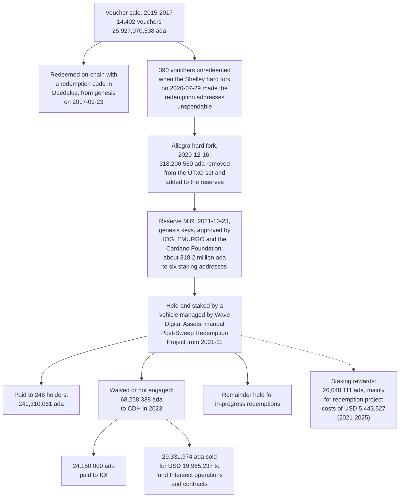
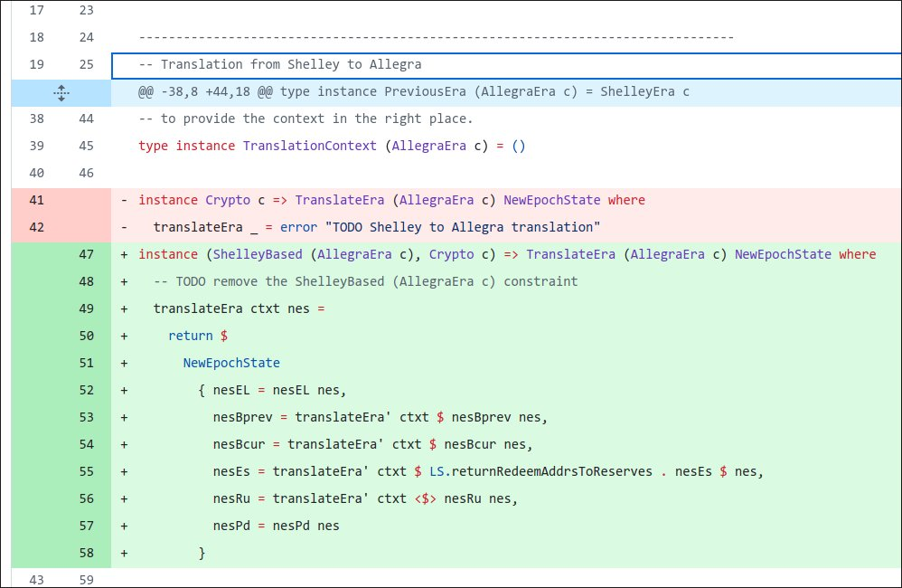
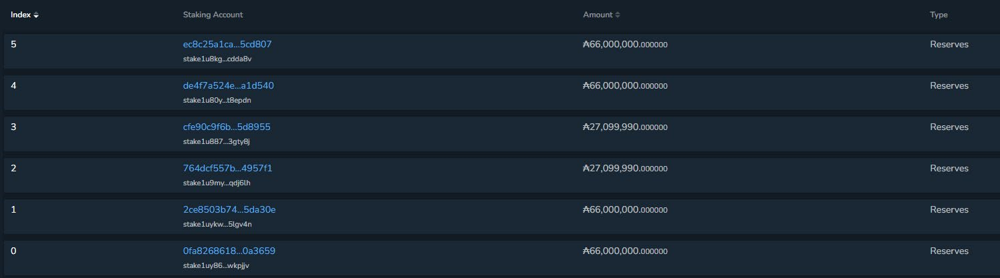

# CID-202503: 318M ADA Unredeemed-Voucher Funds, Disclosure Gap and Independent Review

*This report was generated with AI (Claude Opus 5.5) from the public sources listed under Sources. To correct or remove content, see [Corrections and removals](../README.md#corrections-and-removals).*

> In December 2020 the Allegra hard fork swept about 318.2 million ADA belonging to 390 unredeemed pre-launch vouchers into Cardano's protocol reserves, and in October 2021 a transfer signed with the genesis keys (the governance keys held by Cardano's three founding entities before on-chain governance) sent it to custodial staking addresses that funded a manual, off-chain redemption process [1][3][4]. The movements were visible on-chain, but their amounts, custody and use were not publicly accounted for until 2025 [1][9][11]. In May 2025 the NFT artist Masato Alexander alleged that Charles Hoskinson and Input Output Global (IOG) had used the genesis keys to take control of the ADA [6][7]. A review that IOG commissioned from the law firm McDermott Will & Schulte and the accounting firm BDO found the allegations had no basis, reconciled the funds and reported that 99.7% of the ADA sold had been redeemed [1][2]. No loss of user funds has been established, and the Cardano protocol behaved as specified. The episode set off a public dispute between Hoskinson and the Cardano Foundation [22]; one prominent critic retracted in October 2025 [16][17], while the original accuser has shared posts calling the review unreliable [24].

## Timeline (UTC)

| Time | Event |
|---|---|
| 2015-09 to 2017-01 | Sawyers Holdings Limited issues ADA vouchers, distributed mainly in Japan by Attain Corporation: 14,402 vouchers for 25,927,070,538 ada [1]. |
| 2017-09-23 | Cardano genesis; voucher holders can redeem on-chain in the Daedalus wallet [1]. |
| 2019 | At a meeting in Miami, Hoskinson, co-founder Jeremy Wood and the Cardano Foundation agree, after a "heated debate", to move remaining redemptions to a manual process and "sweep" the unredeemed ADA [1]. |
| 2020-07-29 | Shelley hard fork; the redemption addresses become unspendable [1]. |
| 2020-10-23 | `cardano-ledger` PR #1933, which "removes the Byron redeemer addresses during the transition to Allegra and adds the corresponding lovelace to the reserves", is merged [3]. |
| 2020-12-12 19:04 | A proposal to move to protocol version 3.0 (Allegra), signed by all seven genesis keys, is submitted on-chain [1][4]. |
| 2020-12-16 21:44 | Allegra hard fork (first block of epoch 236): 318,200,560 ada from 390 unredeemed vouchers moves from the UTxO set to the reserves [1][4]. |
| 2021-02-16 | IOHK's support page says IOG is "working to give ada voucher holders another opportunity to redeem" [5]. |
| 2021-06-15 | A note added to the Shelley ledger specification (PR #2332) records the removal of the redemption addresses at Allegra [1]. |
| 2021-10-23 14:33 | A genesis-key-signed reserve MIR (Move Instantaneous Rewards) transaction, approved by IOG, EMURGO and the Cardano Foundation, sends about 318.2 million ada to six staking addresses with the metadata "Moved from reserves to ada pre-sale redemption escrow" [1][4]. |
| 2021-11 | A vehicle managed by Wave Digital Assets holds and stakes the ADA under a subscription agreement dated 2021-11-10; manual redemptions begin [1]. |
| 2023-05-28 and 2023-08-31 | 68,258,338 ada attributed to holders who waived or did not engage goes to Cardano Development Holdings (CDH), a Cayman foundation administered by Intersect, Cardano's member-based governance organisation [1][2]. |
| 2023-12-08 | CDH, Intersect and the IOG affiliate Input Output Infrastructure (IOI) sign a services agreement funded partly from the CDH ADA; IOI later receives 24,150,000 ada under it [1]. |
| 2025-05-06 12:59 | Alexander posts that "IOG took 350m ADA (+25m f/staking) using genesis keys" [6]. |
| 2025-05-06 18:57 | Hoskinson replies: "IOG never gave itself 350 million unclaimed ada. This is a lie," and says the forfeited remainder went to Intersect [8]. |
| 2025-05-07 15:40 | Alexander alleges that Hoskinson "unilaterally used his genesis keys to REWRITE the Cardano ledger and take control of ₳318m ($619m)", citing the Allegra transaction and `returnRedeemAddrsToReserves` [7]. |
| 2025-05-13 21:50 | IOG Chief Legal Officer Joel Telpner says that, because of fraud concerns, "we did not publicly discuss at the time the processes we deployed to track down those individuals" [9]. |
| 2025-05 | IOG engages McDermott Will & Schulte and BDO [1]. |
| 2025-05-19 11:34 | The Cardano Foundation says it had "no operational involvement" in the redemption process and was "not provided with detailed accounting information or the flow of funds" [11]. |
| 2025-07-20 01:04 | Hoskinson says he has the first copy of the report and expects a mid-August release [12][21]. |
| 2025-09-03 | IOG publishes the report, dated 2 September [2]. At 17:12 Hoskinson posts "Waiting for the apologies to come rolling in…" [13]. |
| 2025-09-04 | In an X Spaces interview, Hoskinson demands an apology from the Foundation and calls for a no-confidence vote or a Swiss class action against its board [22][23]. |
| 2025-09-04 08:01 | The Cardano Foundation welcomes the report, saying it confirms the redemption process "was conducted correctly and diligently" [14]. |
| 2025-10-06 03:54 | X account @FredCardano retracts "all of my previous accusations" and apologises [16]. |
| 2025-10-06 04:08 | Hoskinson accepts, saying "this terrible and hurtful chapter in our ecosystems history has been closed" [17][24]. |

## Impact

The holders of 390 vouchers (318,200,560 ada) still unredeemed when on-chain redemption ended were directly affected. From July 2020 to November 2021 they could not redeem by any route; afterwards they had to pass identity checks that some needed several attempts to complete [1]. By 15 August 2025, 246 had been paid 241,310,061 ada, and 120 vouchers held by 107 holders (76,669,030 ada, 0.3% of the ADA sold) remained unredeemed [1].

The review found no misappropriation. BDO reconciled the 318,200,560 ada against redemptions, staking rewards, CDH transfers and balances to within 1,176 ada, "likely attributable to staking and transaction fees", found no discrepancies between sale and on-chain data for the 14,282 redeemed vouchers, and found no evidence that any holder with a valid voucher was turned away [1]. Staking earned 26,648,111 ada, mainly spent on USD 5,443,527 of redemption costs from 2021 to 2025; of the CDH ADA, 24,150,000 ada went to IOI and 29,331,974 ada was sold for USD 19,965,237 to fund Intersect operations and contracts [1]. The 318 million ADA was worth about USD 619 million in 2021, the figure Alexander cited, and about USD 234 million in May 2025 [7][20].

Hoskinson and the Cardano Foundation fell out publicly: he criticised it for staying silent before the report and called for it to be held accountable, while the Foundation said it had not been given detailed accounting [11][22][23]. Consensus, block production and transaction processing were unaffected; the protocol behaved as specified [1][3].

Rated SEV-4 (dimensions: availability; trust and integrity): redemption was unavailable for about 16 months to a localised group of 390 voucher holders, and the public misinformation (allegations found to have no basis, and early figures that differed from the reconciled ones) caused no demonstrated user harm [1][19]. Potential SEV-1 (dimensions: financial; trust and integrity): the controls at the time let genesis keys, all seven of which IOG could at times use under delegation, move about 318.2 million ada out of the reserves with no on-chain community approval and no public accounting; misuse or compromise of those keys, or of the custodial staking addresses, could have diverted ADA worth about USD 619 million at 2021 prices [1][4][20]. This scenario describes the control design, not a finding that misuse occurred. Recoverability: escalated, because restoring trust required outside law and accounting firms, and redeeming the 107 remaining holders still depends on outside investigators and on the holders responding [1].

## Root cause

Figure 1 traces the swept ADA to its uses; the numbered paragraphs explain the factors that combined to cause the controversy.

*Figure 1: Path of the voucher ADA that was still unredeemed at the Shelley hard fork, as described in the investigative report [1] and on-chain records [4]. Redemption and transfer figures are as of 15 August 2025; see Disputed or open points for inconsistencies in the totals. Diagram by the catalogue.*

**1. On-chain redemption ended with Shelley.** Voucher buyers held no private keys; the ADA Virtual Vending Machine (AVVM) turned their purchase receipt into a redemption code for Daedalus [1]. Shelley's "bootstrap" address type was "not intended to include Byron era redeem addresses", so those addresses became unspendable [1]. IOG cites the cost and complexity of rebuilding on-chain redemption for the few remaining holders, and the risk of fraudulent claims using compliance data compromised after the distributor Attain dissolved in 2017 [1].

**2. The Allegra sweep.** `cardano-ledger` PR #1933 added `returnRedeemAddrsToReserves` to the Shelley-to-Allegra era translation. Its author wrote that redeemer addresses "are not spendable in Shelley, and given the permanent history can be returned by MIR certs", and that the function is property-tested to preserve lovelace [3]. Alexander's thread cites the same transaction and code [7], so the dispute is not about what the code did but about whether moving the ADA was legitimate and adequately disclosed.

*Figure 2: The change PR #1933 made to the Shelley-to-Allegra era translation: the translated epoch state is passed through `returnRedeemAddrsToReserves` (line 55). Screenshot posted by Masato Alexander in his thread of 7 May 2025 [7]; pull request [3].*

**3. Genesis-key authority.** Governance actions in the Byron and Shelley eras needed five of seven genesis keys: three held by IOG, two by the Cardano Foundation and two by EMURGO. "During certain times, the Foundation and EMURGO delegated their authority to Input Output to use all seven delegate keys"; the Foundation's delegation ended in July 2022 [1]. Shelley-era reserve MIR certificates let these keys move ADA from the reserves straight to stake addresses with no wider on-chain approval; this is how about 318.2 million ada reached six staking addresses on 23 October 2021 [1][4]. Because of the delegation, the signatures did not show which entities had approved the transfer; approval by all three is documented in the 2025 report [1].

*Figure 3: The six reserve MIR certificates in transaction `03b02cff…63c5` of 23 October 2021, four of 66,000,000 ada and two of 27,099,990 ada, each paying a different staking account. Explorer screenshot reproduced on page 67 of the investigative report. Source: McDermott Will & Schulte and BDO, investigative report [1]; transaction record [4].*

**4. Limited disclosure at the time.** The pull request [3], the transaction metadata [4] and support pages directing holders first to the Cardano Foundation, then to an IOG email address and later to RemixPoint [5] were public. Amounts, custodial addresses, staking, costs and the later transfer to CDH were not: Sawyers did not want to "broadcast" the redemption project, which received only "certain discrete posts" on IOG's website [1]. IOG's chief legal officer cited fraud concerns [9], and the Cardano Foundation received only occasional progress updates [11]. When Alexander traced the movements in 2025, there was no public reconciliation to check them against.

**5. Unclaimed-funds rules set after the sale.** Staking did not exist when the vouchers were sold, and the voucher terms gave holders no right to future staking rewards [1]. Years after the sale, Sawyers, the voucher issuer, decided on legal advice to stake the ADA, fund redemption costs from the rewards and send forfeited ADA to CDH [1].

## Detection

There was no internal detection event. A community member read public on-chain data and code: Alexander's first post, on 6 May 2025, was framed around Intersect's spending [6], and his thread the next day linked the Allegra protocol-update transaction and the ledger commit [7]. By then the sweep was 4.4 years old and the MIR transfer 3.5 years old [1][4].

## Response and resolution

Hoskinson denied the allegation about six hours after the first post [8] and warned Alexander: "If you continue to imply that IO stole funds, I will sue you" [7][20]. From May to August 2025, McDermott Will & Schulte and BDO collected records from IOG's Google Vault (exported by an IOG IT manager) and documents from Intersect and Wave, held 18 interviews and traced the funds on-chain [1]. The Cardano Foundation asked for a review of "all inflows and outflows from the MIR request through to current balances", including returns earned in the meantime [11].

IOG published the 128-page report and a summary on a dedicated website [2]. It concluded that the allegations "do not have any basis" and that IOG and Sawyers "acted diligently and created structured safeguards" [1]; the Cardano Foundation welcomed it [14]. Hoskinson then demanded apologies from critics and the Foundation [13][22][23]. @FredCardano, which ran a DRep (delegated representative) and a Discord server used to organise criticism of Hoskinson, retracted its accusations [16][24].

## Remediation and follow-up

- **Transparency site and report:** The report, in English and Japanese, publishes transaction hashes, addresses, reconciliation tables and contract-payment flows for the swept ADA and the CDH transfer [1][2].
- **Continued redemption and refund commitment:** When the report was published, eight redemption cases covering about 7.3 million ada were active. Hoskinson told the investigators that any confirmed unredeemed voucher holder who comes forward before 1 October 2028 can receive a JPY refund, or a refund plus the option to repurchase ADA at the original price [1].
- **Structural change before the controversy:** The Conway ledger era, activated with the Chang upgrade on 1 September 2024 [1], removed genesis delegations and MIR certificates; treasury movements now need governance actions such as `TreasuryWithdrawal` [18].
- **Communication changes:** Hoskinson said he would probably hand his X account to a media team and change the format of his AMAs after the report [10].

## Incident handling assessment

Assessment of the responsible party's handling (Input Output Global, whose conduct was alleged and which commissioned the review) against SOC 2 Trust Services Criteria, based on public sources only (see CLASSIFICATION.md, section 10).

| Criterion | Result | Observation |
|---|---|---|
| CC7.2 Monitoring and detection | Not applicable | No operational anomaly occurred: the transfers worked as intended, and the controversy began with a third party's reading of public on-chain data and code [6][7]. The lack of public accounting is assessed under CC2.3. |
| CC7.3 Evaluation of events | No exceptions noted | Hoskinson responded about six hours after the first post [8]; within a week IOG's chief legal officer explained why the processes had not been disclosed [9], and in May 2025 IOG engaged McDermott Will & Schulte and BDO to investigate and reconcile the funds [1]. |
| CC7.4 Incident response | No exceptions noted | The review collected IOG records, Intersect and Wave documents, 18 interviews and on-chain tracing [1]. Hoskinson gave a progress update in July 2025 [12], and IOG published the full report in September 2025 [2]. |
| CC7.5 Recovery | No exceptions noted | The review reconciled the swept ada to within 1,176 ada and found no misappropriation [1]. The genesis-key and MIR powers involved had already been removed in the Conway era [18], and redemptions continue under a manual process [1]. |
| CC2.3 External communication | Exceptions noted | The sweep, MIR transfer and redemption process were not publicly accounted for at the time; IOG's chief legal officer cited fraud concerns, and the Cardano Foundation had not received detailed accounting [1][9][11]. Figures Hoskinson gave in May 2025 differed from the later report [1][8][19], which IOG published in full [2]. |
| CC8.1 Change management | No exceptions noted | The sweep was introduced by a reviewed ledger change that was property-tested to preserve lovelace [3] and activated by a protocol update signed by all seven genesis keys [1][4]. The MIR transfer was approved by IOG, EMURGO and the Cardano Foundation [1]. |

## Lessons for builders

- **Disclose privileged balance movements when they happen.** The sweep code was reviewed and tested [3] and the MIR transaction carried an escrow label [4], but amounts, custodial addresses, staking and use of rewards were reconciled publicly only by a forensic review in 2025 [1]. Hard-fork translations, migrations, admin functions and third-party custody that move balances should come with published addresses, totals, destinations and a reproducible reconciliation.
- **Keep legacy funds claimable on-chain.** Holders lost self-service redemption because the new address model excluded redeem addresses [1]. When retiring an address type or contract, provide an on-chain claim route (for example, claims checked against a published Merkle root of entitlements) before falling back to manual KYC.
- **Set unclaimed-funds rules in the terms.** Claim deadlines, the fate of forfeited funds, who gets yield earned in the meantime and who approves release were decided years after the sale here [1]; deciding them later invites disputes even when the decisions are defensible.
- **Separate key custody in practice, not only on paper.** Five-of-seven multisig gives little assurance if one party can be delegated all seven keys [1]. Publish signer identities, and forbid cross-delegation or log it publicly.
- **Disclose related-party funding decisions when they are made.** Forfeited ADA funded a contract with an IOG affiliate, with recusals beyond what Intersect's policy required [1]; publishing such decisions and their conflict handling at the time reduces later suspicion.

## Disputed or open points

- **Allegation versus findings:** Alexander alleged that Hoskinson "unilaterally" used genesis keys to "take control" of ₳318 million [7]; the review found that all three founding entities approved the MIR transfer and traced the ADA to redemptions, costs and CDH [1]. CCN reported that Alexander shared posts calling the review "unreliable" [24]; no point-by-point public rebuttal by him was found.
- **Independence of the review:** IOG commissioned the review, "prepared solely for Input Output"; the investigators could not compel testimony or documents, IOG staff ran the email collection, and the work "does not meet the standard for attestation under the AICPA" [1]. Its published transaction hashes allow partial independent checking. The Defiant called it a Cardano Foundation audit [20]; the Foundation and the report attribute it to IOG [1][11].
- **Dating:** The allegations and some press place the sweep in 2021 [7][22]; on-chain data shows it on 2020-12-16, with the MIR transfer on 2021-10-23 [1][4].
- **Inconsistent public figures:** Alexander cited "350m ADA (+25m f/staking)" [6]. Hoskinson said the "vast majority" was claimed [8], and Crypto Valley Journal reported him as saying 99.8% was redeemed and about 18 to 24 million ADA went to Intersect [19]. The report gives 318,200,560 ada swept, 26,648,111 ada of staking rewards, 68,258,338 ada sent to CDH and 99.7% of ADA (99.2% of vouchers) redeemed [1].
- **Internal inconsistencies in the report:** It calls the ledger change "pull request No. 1993" but cites PR #1933 [1][3], and gives the amount moved as 318,200,560, 318,200,580 (with 600 ada of test transactions and a 20 ada round-up) and 318,200,980 ada [1]. The six MIR certificates in transaction `03b02cff…63c5` sum to 318,199,980 ada; adding the 600 ada of test transfers gives 318,200,580 ada [1][4].
- **End of on-chain redemption:** An IOHK support article says Daedalus redemption support ended in March 2019 [5]; the report treats on-chain redemption as available until July 2020 [1]. Both may be true (wallet feature removed, addresses still spendable), but no source reconciles them.
- **Cardano Foundation's role:** The report says the Foundation initially agreed to lead the post-sweep redemption but "ultimately failed to lead these efforts" [1], and IOHK's support page in December 2020 sent redemption enquiries to the Foundation [5]. The Foundation says it had "no operational involvement" beyond directing requests to IOG [11].
- **Secondary-source error:** CCN attributed the 318 million ADA transaction to "protocol-level staking rewards distribution" [24]; the report and metadata describe a transfer to a "pre-sale redemption escrow" [1][4].
- **Remaining holders:** 76,669,030 ada of entitlements remained unredeemed at 2025-08-15, while the CDH ADA had been partly spent [1]. By subtraction from the report's figures, only about 8.6 million ada of the swept amount was neither paid out nor sent to CDH, so if most remaining holders came forward, their claims would rely largely on Hoskinson's refund commitment to 2028-10-01 [1]. No binding public instrument for that commitment was found.
- **Cointelegraph coverage:** Hoskinson says Cointelegraph published the allegations without contacting IOG and did not retract them [15][24]; the article could not be located and is not assessed.
- **Later allegations:** In June 2026 Alexander alleged, from separate tracing, that Hoskinson sold about 1.5 billion ADA in 2021; The Defiant reported no public response from Hoskinson [25]. The 2025 review does not cover this, and it is not assessed here.

## Sources

1. [P] McDermott Will & Schulte LLP and BDO USA, P.C., "The Voucher Program, Redemptions, and Use of Unredeemed Ada: Investigative Report and Forensic Audit Conducted for Input Output Global, Inc.", 2025-09-02. https://www.adaredemptiontransparency.com/investigative-report.pdf
2. [P] Input Output Global, "Committed to transparency" (ADA redemption transparency website and summary of the report), 2025-09-03. https://www.adaredemptiontransparency.com/
3. [P] Jared Corduan (IntersectMBO/cardano-ledger), "remove bootstrap redeemer address in allegra" (pull request #1933, merged 2020-10-23), 2020-10-22. https://github.com/IntersectMBO/cardano-ledger/pull/1933
4. [P] Cardano mainnet on-chain records: Allegra protocol-update proposal transaction `1fbd16c1…68e8`, 2020-12-12, https://cardanoscan.io/transaction/1fbd16c1d1b1933f2f97a313db8c749bdcf65a39d996515b0f5e5535baad68e8?tab=protocolupdates ; reserve MIR transaction `03b02cff…63c5` with "presale-escrow" metadata, 2021-10-23, https://adastat.net/transactions/03b02cff29a5f2dfc827e00345eaab8b29a3d740e9878aa6e5dd2b52da0763c5 (timestamps, metadata and certificate amounts read via the Koios API, https://api.koios.rest/api/v1/tx_info)
5. [P] IOHK Support, "Ada Redemption" (archived versions, page updated 2020-12-10, 2021-02-16 and 2023-04-24), 2021-01-27 / 2021-03-04 / 2025-05-22. http://web.archive.org/web/20210127111424/https://iohk.zendesk.com/hc/en-us/articles/900003850926-Ada-Redemption-support-has-ended ; http://web.archive.org/web/20210304134617/https://iohk.zendesk.com/hc/en-us/articles/900003850926-Ada-Redemption ; http://web.archive.org/web/20250522170647/https://iohk.zendesk.com/hc/en-us/articles/900003850926-Ada-Redemption
6. [P] Masato Alexander (@masatoalexander), post on X: "IOG took 350m ADA (+25m f/staking) using genesis keys…", 2025-05-06. https://x.com/masatoalexander/status/1919738746691305898
7. [P] Masato Alexander (@masatoalexander), thread on X: "In 2021, Charles Hoskinson unilaterally used his genesis keys to REWRITE the Cardano ledger…", 2025-05-07. https://x.com/masatoalexander/status/1920141651344838993 (follow-ups: https://x.com/masatoalexander/status/1920141658781298858 , https://x.com/masatoalexander/status/1920141665190211716)
8. [P] Charles Hoskinson (@IOHK_Charles), post on X: "IOG never gave itself 350 million unclaimed ada…", 2025-05-06. https://x.com/IOHK_Charles/status/1919828800671777204
9. [P] Joel Telpner (@JTelpner), Chief Legal Officer, Input Output Global, post on X: "Perhaps the legal advice given was too conservative…", 2025-05-13. https://x.com/JTelpner/status/1922409107924947186
10. [P] Charles Hoskinson (@IOHK_Charles), post on X: "The one advantage in a crisis…", 2025-05-18. https://x.com/IOHK_Charles/status/1924176258222502001
11. [P] Cardano Foundation (@Cardano_CF), post on X: "Over the past few weeks, there have been many questions about the ada voucher redemption process…", 2025-05-19. https://x.com/Cardano_CF/status/1924428540486840653
12. [P] Charles Hoskinson (@IOHK_Charles), post on X: "I just received the first copy of the audit report…", 2025-07-20. https://x.com/IOHK_Charles/status/1946738026488443002
13. [P] Charles Hoskinson (@IOHK_Charles), post on X: "Waiting for the apologies to come rolling in…", 2025-09-03. https://x.com/IOHK_Charles/status/1963288888711000286
14. [P] Cardano Foundation (@Cardano_CF), post on X: "We welcome the publication of the investigative report on the ada Voucher Program…", 2025-09-04. https://x.com/Cardano_CF/status/1963512763801550852
15. [P] Charles Hoskinson (@IOHK_Charles), post on X about Cointelegraph's refusal to retract, 2025-09-28. https://x.com/IOHK_Charles/status/1972184878000046182
16. [P] @FredCardano, post on X: "I want to extend my deepest and sincerest apologies…", 2025-10-06. https://x.com/FredCardano/status/1975047078616195112
17. [P] Charles Hoskinson (@IOHK_Charles), post on X accepting the apology, 2025-10-06. https://x.com/IOHK_Charles/status/1975050405261250626
18. [P] IntersectMBO, "Formal Ledger Specification: Ledger.Conway.Specification.Certs" (section "Removal of Pointer Addresses, Genesis Delegations and MIR Certificates"), n.d. https://intersectmbo.github.io/formal-ledger-specifications/site/Ledger.Conway.Specification.Certs.html
19. [S] Crypto Valley Journal, "Allegation against Cardano founder: misappropriation of USD 620 million in ADA?", 2025-05-19. https://cryptovalleyjournal.com/hot-topics/news/allegation-against-cardano-founder-misappropriation-of-usd-620-million-in-ada/
20. [S] The Defiant (Leo Jakobson), "Cardano Founder 'Deeply Hurt' by Theft Claims, Announces Audit", 2025-05-20. https://thedefiant.io/news/blockchains/cardano-hoskinson-allegations-audit (archived: https://web.archive.org/web/2025/https://thedefiant.io/news/blockchains/cardano-hoskinson-allegations-audit)
21. [S] Crypto Briefing (Vivian Nguyen), "Cardano founder Charles Hoskinson says audit report is on track for mid-August release", 2025-07-19. https://cryptobriefing.com/cardano-audit-report-release/
22. [S] DL News (Osato Avan-Nomayo), "Charles Hoskinson fumes at Cardano Foundation over alleged $600m malfeasance", 2025-09-04. https://www.dlnews.com/articles/people-culture/charles-hoskinson-fumes-at-cardano-foundation/ (syndicated: https://finance.yahoo.com/news/charles-hoskinson-fumes-cardano-foundation-142727737.html)
23. [S] ForkLog, "Hoskinson Demands Apology Over $600 Million Theft Allegations", 2025-09-06. https://forklog.com/en/hoskinson-demands-apology-over-600-million-theft-allegations/
24. [S] CCN (James Morales), "Charles Hoskinson Accepts Public Apology From Former Critic Over ADA Voucher Allegations", 2025-10-06. https://www.ccn.com/news/crypto/charles-hoskinson-accepts-apology-fredcardano-ada-voucher-allegations/ (archived: https://web.archive.org/web/20251202131655/https://www.ccn.com/news/crypto/charles-hoskinson-accepts-apology-fredcardano-ada-voucher-allegations/)
25. [S] The Defiant, "On-Chain Tracking Revives Allegations That Hoskinson Sold 1.5B ADA in the 2021 Rally", 2026-06-10. https://thedefiant.io/news/people/on-chain-tracking-revives-allegations-that-hoskinson-sold-1-5b-ada-in-the-2021-rally
