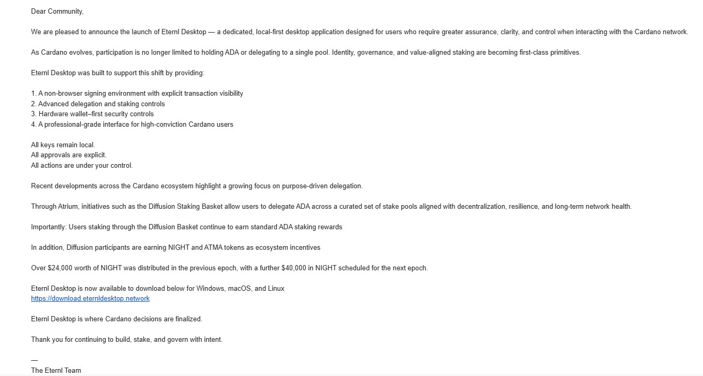
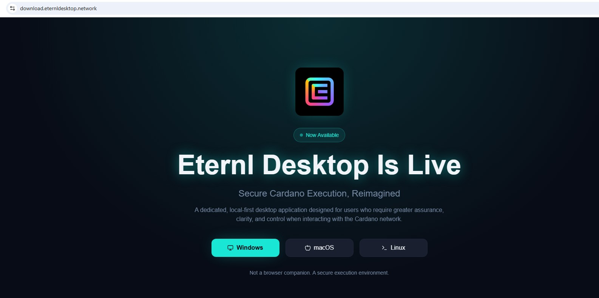
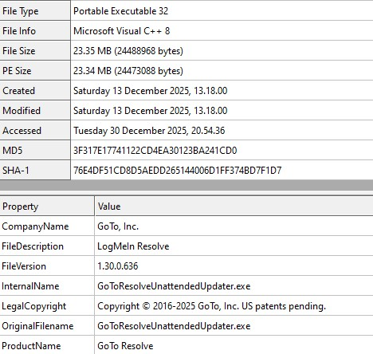
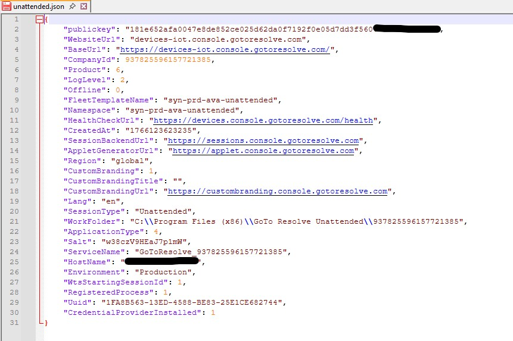

# CID-202504: Fake Eternl Desktop Phishing Campaign

> In late December 2025, Cardano users received a polished phishing email announcing an "Eternl Desktop" application for the Cardano wallet Eternl, with the promise of NIGHT and ATMA token rewards from Atrium's "Diffusion Staking Basket" [1][7][8]. The email linked to a lookalike domain, `download.eternldesktop.network`, registered on 21 December 2025 [3]. The Windows installer it served contained no wallet: it silently installed GoTo Resolve (formerly LogMeIn Resolve), a legitimate remote-administration product, set up for unattended access, so that whoever controlled the attacker's GoTo Resolve account could take over the victim's computer [1][7][9]. An independent researcher exposed the campaign on 30 December 2025, and security and crypto media repeated the warning on 2–4 January 2026 [1][7][8][9][10][11][12][13]. No victims or stolen funds have been reported. Eternl's software and channels were not compromised, only its brand was used, and the Cardano L1 was not involved. No statement by Eternl and no takedown of the domain have been found. In March 2026 the same researcher documented a near-identical campaign impersonating the Yoroi wallet [2].

## Timeline (UTC)

| Time | Event |
|---|---|
| 2025-12-12 17:04 | Atrium Lab announces that, after the launch of the Midnight network's NIGHT token on 9 December, its Diffusion Staking Basket will distribute NIGHT and ATMA to ADA stakers from 15 December [6]. The phishing email later uses these rewards as bait [1]. |
| 2025-12-21 06:02 | The domain `eternldesktop.network` is registered through the registrar NiceNIC International Group, with Cloudflare name servers [3]. |
| Late December 2025 | The phishing email "Eternl Desktop Is Live — Secure Execution for Atrium & Diffusion Participants" circulates in the Cardano community [1][8]. Its send date and the source of recipient addresses have not been published. |
| 2025-12-30 20:42 | Anurag Gawande publishes "RMM Abuse in a Crypto Wallet Distribution Campaign" on malwr-analysis.com, with an analysis of the installer and indicators of compromise (IOCs). The blog displays the date as 31 December [1]. |
| 2026-01-02 06:11 | GBHackers reports the campaign [7], followed by Cyber Press (10:55) [8] and Cyber Security News (12:22) [9]. |
| 2026-01-03 | Crypto media cover the campaign: Cryptopolitan (13:55) [10], Yellow (14:45) [11] and crypto.news (17:30) [12]. |
| 2026-01-04 | KuCoin News republishes a ChainCatcher report on the campaign [13]. |
| 2026-01-07 19:37 | The Internet Archive records an HTTP 308 (redirect) response from `http://download.eternldesktop.network/`: the host was still answering, although the capture does not show whether the installer was still served [5]. |
| 2026-03-01 19:28 | The same researcher documents a "Yoroi Desktop" phishing campaign that also installs GoTo Resolve in unattended mode from an MSI file, and links it to the Eternl campaign. The blog displays the date as 2 March [2]. |

## Impact

No source reports confirmed theft, a victim count or a loss figure [1][7][8][9][10][11][12][13][14], and how many people received the email is unknown. Yellow writes that the warning signs "went unnoticed by some users" but gives no evidence [11]. The lure targeted ADA holders who stake and take part in governance, specifically Diffusion stakers expecting NIGHT and ATMA rewards [1][8].

What the campaign put at risk was the victim's whole Windows machine. Unattended remote access gives the operator persistent control, from which they can watch the user, run commands, harvest credentials and drain wallets held on that machine [1][7].

Eternl itself was not compromised. The installer was "not a known component of any official Eternl wallet release" [1], and Eternl's official link list names a browser extension, the web app at eternl.io, iOS and Android apps, Discord, Telegram, X and a wiki, but no desktop application [4]. No Cardano protocol component was involved.

Rated SEV-4 (trust and integrity: impersonation and malware distribution without demonstrated user harm); potential SEV-2 (financial, a judgement: unattended remote control of machines belonging to ADA stakers who hold software wallets could credibly have caused aggregate losses of USD 100,000–999,999; no value-at-risk figure exists). Recoverability: routine, because no Eternl system needed recovery and no victim losses were documented [1][4].

## Root cause

This was social engineering against wallet users, not a flaw in Eternl or Cardano. The lure, the infrastructure and the payload were each convincing on their own.

The email was professionally written, without spelling or grammar errors [1] (Figure 1). It named real ecosystem programmes (Atrium, the Diffusion Staking Basket, NIGHT and ATMA rewards) that had gone live days earlier [1][6]. It pitched "local-first, non-browser signing" as a safer alternative to browser-extension wallets and closed with "Eternl Desktop is where Cardano decisions are finalized" to create urgency [1].

*Figure 1: The phishing email, signed "The Eternl Team", with its reference to Atrium, the Diffusion Staking Basket and NIGHT and ATMA rewards, and the link to `download.eternldesktop.network`. Source: Anurag Gawande, ["RMM Abuse in a Crypto Wallet Distribution Campaign"](https://malwr-analysis.com/2025/12/31/rmm-abuse-in-a-crypto-wallet-distribution-campaign/), malwr-analysis.com [1].*

The download sat on `download.eternldesktop.network`, a domain that contains the brand name but is not an Eternl domain, registered days before the campaign [1][3] (Figure 2). The MSI came with no published checksum, no visible code-signing information and no release notes, so users had no way to verify it [1].

*Figure 2: The fake download page at `download.eternldesktop.network`, offering "Eternl Desktop" for Windows, macOS and Linux. Source: Anurag Gawande, ["RMM Abuse in a Crypto Wallet Distribution Campaign"](https://malwr-analysis.com/2025/12/31/rmm-abuse-in-a-crypto-wallet-distribution-campaign/), malwr-analysis.com [1].*

The researcher's analysis of the installer found [1]:

- `Eternl.msi`, 23.3 MB, MD5 `8fa4844e40669c1cb417d7cf923bf3e0`. The MSI metadata gives the title "LogMeIn Resolve Unattended" and the comment "LogMeIn Resolve Unattended v1.30.0.636".
- An embedded executable, `unattended-updater.exe`, MD5 `3f317e17741122cd4ea30123ba241cd0`, whose original file name is `GoToResolveUnattendedUpdater.exe` (Figure 3).
- When run, it installs into `C:\Program Files (x86)\GoTo Resolve Unattended\` and writes JSON configuration files. One of them, `unattended.json`, "enables unattended access", so a remote operator can connect without the user being present (Figure 4). Cyber Security News also lists `logger.json`, `mandatory.json` and `pc.json` [9].
- It contacts GoTo Resolve infrastructure, including `zerotrust.services.gotoresolve.com`, `devices-iot.console.gotoresolve.com`, `sessions.console.gotoresolve.com` and `dumpster.console.gotoresolve.com/api/sendEventsV2` (the last request failed and was retried in the researcher's test).
- Security products flag it as a potentially unwanted application (PUA) or "Riskware", not as outright malware.

*Figure 3: File properties of the executable embedded in the MSI: company GoTo, Inc., product GoTo Resolve, file version 1.30.0.636, original file name `GoToResolveUnattendedUpdater.exe`. Source: Anurag Gawande, ["RMM Abuse in a Crypto Wallet Distribution Campaign"](https://malwr-analysis.com/2025/12/31/rmm-abuse-in-a-crypto-wallet-distribution-campaign/), malwr-analysis.com [1].*

*Figure 4: The `unattended.json` configuration written by the installer, with `"SessionType": "Unattended"`, a `CompanyId` and GoTo Resolve console endpoints (the researcher redacted parts of the key and host name). Source: Anurag Gawande, ["RMM Abuse in a Crypto Wallet Distribution Campaign"](https://malwr-analysis.com/2025/12/31/rmm-abuse-in-a-crypto-wallet-distribution-campaign/), malwr-analysis.com [1].*

Because the payload is legitimate commercial remote monitoring and management (RMM) software, antivirus products may not block it [7]. As the researcher puts it, "LogMeIn Resolve itself is a legitimate product, its silent delivery inside a wallet installer is not legitimate behavior" [1]. In the Yoroi campaign he reads the `CompanyId` in the same configuration file as the identifier of the attacker-controlled GoTo Resolve tenant into which victim machines are enrolled [2]; the Eternl write-up shows the field (Figure 4) but does not discuss it [1].

## Detection

Anurag Gawande, an independent malware analyst, examined the email and the download site, extracted the MSI with CFF Explorer and LessMSI, and ran the payload in dynamic analysis [1]. He published IOCs on 2025-12-30, about nine and a half days after the domain was registered [1][3]. How he obtained the email, and whether Eternl, Atrium or any platform detected the campaign independently, is not stated [1].

## Response and resolution

The researcher published his analysis with a "HIGHLY SUSPICIOUS – DO NOT INSTALL" verdict, IOCs (domain, file names, hashes, product identifiers) and a threat assessment [1]. Security outlets [7][8][9], crypto outlets [10][11][12][13] and an email-security vendor blog [14] repeated the warning and told users to download wallet software only from official channels.

No statement by Eternl was found (see *Disputed or open points*), and no takedown by the registrar, Cloudflare or GoTo is documented. The host still answered on 2026-01-07 [5]. On 2026-10-13 the registry still listed the domain as registered, with no hold status [3]; a single check by the catalogue on the same day found that the host did not answer HTTP or HTTPS requests. With no takedown, fix or recovery documented or in prospect, the status is `unresolved`.

## Remediation and follow-up

No Eternl component was at fault, so there was no code fix, and no compensation was announced.

The pattern recurred. In March 2026 the same researcher documented a campaign against Yoroi users with a lookalike `download.v1desktop-yoroiwallet[.]com` domain, MSI installers hosted on the file-sharing service gofile.io that install GoTo Resolve in unattended mode, and a second variant using ConnectWise ScreenConnect [2].

## Incident handling assessment

Assessment of the responsible party's handling against SOC 2 Trust Services Criteria, based on public sources only (see CLASSIFICATION.md, section 10). The responsible party is Eternl as the impersonated brand. Its software, domains and accounts were not compromised, so the table records what is publicly visible, not a failure by Eternl.

| Criterion | Result | Observation |
|---|---|---|
| CC7.2 Monitoring and detection | Not evidenced | An independent researcher detected and published the campaign [1]. No source says whether Eternl monitored for or detected the lookalike domain or email. |
| CC7.3 Evaluation of events | Not evidenced | No Eternl assessment of the campaign was found [1][7][8][9]. |
| CC7.4 Incident response | Not evidenced | No Eternl warning or takedown request is documented, and the host still answered on 2026-01-07 [5]. Eternl's X account could not be checked. |
| CC7.5 Recovery | Not applicable | No Eternl system was compromised and no victims were documented, so there was nothing to restore [1][4]. |
| CC2.3 External communication | Not evidenced | No Eternl statement was found [1][7][8][9] (`disclosure: third-party-report`), but X and Discord could not be checked. Eternl's official link list, which names no desktop application, let users check that the download was not genuine [4]. |
| CC8.1 Change management | Not applicable | The incident was not caused by a change to any Eternl system [1]. |

## Lessons for builders

- **Publish one canonical list of distribution channels.** Eternl's link list makes it possible to show that no desktop app exists [4]. Pin such a list on the primary domain and in every channel, and state which platforms you do *not* ship for; a "desktop" lure only works if users cannot check quickly.
- **Sign every binary and publish hashes on your own domain.** The fake MSI had no published checksum, no visible signing information and no release notes [1]. If every genuine release is signed by a known publisher and its SHA-256 is published on the official site, an unsigned or wrongly signed installer stands out.
- **State publicly that you never send download links by email.** The attack relied on users trusting an emailed link [1][8].
- **Monitor for lookalike domains.** The distribution domain was registered about nine and a half days before public detection and was still registered on 2026-10-13 [1][3]. Brand-containing domains (`<brand>desktop.*`, `download.<brand>*`) appear in certificate-transparency logs and newly-registered-domain feeds; abuse reports prepared in advance for registrars, DNS providers and file hosts shorten the exposure window.
- **Report abused RMM tenants to the vendor.** Victim machines are enrolled into a vendor-side tenant identified in the configuration (`CompanyId`) [2]. Responders can send these identifiers to the vendor and ask for the tenant to be disabled.
- **Treat ecosystem launches as phishing season.** The lure used the NIGHT launch and the start of Diffusion rewards within days [1][6]. Protocol teams can tell users in advance which apps are needed to claim rewards, and wallet teams can repeat the warning in-app.
- **Keep treasury keys off general-purpose desktops.** Teams holding operational keys should alert on newly installed RMM agents (GoTo Resolve, ScreenConnect and similar) and keep signing keys on hardware devices, so that remote control of a desktop is not enough to move funds [1][2].

## Disputed or open points

- **Whether an official "Eternl Desktop" exists.** Some secondary outlets describe the email as a "nearly identical replica of the official Eternl Desktop announcement" or refer to a "newly announced Eternl Desktop application" [9][10][12]. The primary analysis found no announcement on official Eternl channels and that the installer was not part of any official release [1], and Eternl's official link list includes no desktop application [4].
- **No statement by Eternl.** No warning, blog post or X post by Eternl about this campaign was found. Eternl's X account (@eternlwallet) blocks automated access and could not be checked, so a statement on X or Discord cannot be ruled out.
- **File name.** The analysis names the installer `Eternl.msi`, but its IOC list gives `etrnl.msi` [1]. It is unclear whether two file names were used.
- **Hosting of the installer.** The Yoroi write-up says that "across both campaigns" the MSI files were hosted on gofile.io rather than on the phishing domains [2]. The Eternl write-up does not mention gofile.io [1], so whether "both campaigns" includes the Eternl campaign is not established.
- **Characterisation of the payload.** crypto.news calls the payload a "remote access trojan" [12]. Strictly, it is a legitimate commercial RMM agent configured and distributed for malicious use, which the researcher's detection summary classes as PUA or Riskware [1].
- **Attribution.** No source attributes the campaign to a known actor. The researcher connects it by technique to the later Yoroi campaign [2] but does not claim the same operator. The `CompanyId` shown for the Eternl installer (Figure 4) differs from the one he lists for the Yoroi campaign [1][2].

## Sources

1. [P] Anurag Gawande, malwr-analysis.com, "RMM Abuse in a Crypto Wallet Distribution Campaign", 2025-12-30. https://malwr-analysis.com/2025/12/31/rmm-abuse-in-a-crypto-wallet-distribution-campaign/
2. [P] Anurag Gawande, malwr-analysis.com, "Yoroi Wallet Phishing Abuses GoTo Resolve and ScreenConnect for Device Takeover", 2026-03-01. https://malwr-analysis.com/2026/03/02/yoroi-wallet-phishing-abuses-goto-resolve-and-screenconnect-for-device-takeover/
3. [P] Identity Digital (registry), RDAP domain record for eternldesktop.network (registration 2025-12-21T06:02:40Z; registrar NiceNIC International Group), retrieved 2026-10-13. https://rdap.identitydigital.services/rdap/domain/eternldesktop.network
4. [P] Eternl, "Official links to Eternl apps and social media" (Linktree), retrieved 2026-10-13. https://linktr.ee/eternlwallet
5. [P] Internet Archive, Wayback Machine CDX record for download.eternldesktop.network (capture 20260107193725, HTTP 308), 2026-01-07. https://web.archive.org/cdx/search/cdx?url=eternldesktop.network&matchType=domain&limit=20&output=json
6. [P] Atrium Lab (@atrium_lab), X article "Be the FIRST to earn NIGHT from staking ADA!", 2025-12-12. https://x.com/atrium_lab/status/1999525890770755723
7. [S] GBHackers (Mayura Kathir), "Cardano Users Warned of Possible Phishing Attempt Posing as 'Eternl Desktop' Update", 2026-01-02. https://gbhackers.com/eternl-desktop-update/
8. [S] Cyber Press (Priya), "Suspected Phishing Campaign Targets Cardano Users Through Fake 'Eternl Desktop' Announcement", 2026-01-02. https://cyberpress.org/fake-eternl-desktop-phishing-scam/
9. [S] Cyber Security News (Tushar Subhra Dutta), "Potential Wallet Phishing Campaign Targets Cardano Users via 'Eternl Desktop' Announcement", 2026-01-02. https://cybersecuritynews.com/potential-wallet-phishing-campaign-targets-cardano-users/
10. [S] Cryptopolitan (Owotunse Adebayo), "Cardano users targeted in new wallet phishing campaign", 2026-01-03. https://www.cryptopolitan.com/cardano-users-targeted-wallet-phishing/
11. [S] Yellow (Kostiantyn Tsentsura), "Cardano Users Targeted In Fake Eternl Desktop Wallet Phishing Campaign", 2026-01-03. https://yellow.com/news/cardano-users-targeted-in-fake-eternl-desktop-wallet-phishing-campaign
12. [S] crypto.news (Vignesh Karunanidhi), "Cardano wallets under threat? suspicious phishing campaign surfaces", 2026-01-03. https://crypto.news/cardano-wallets-under-threat-phishing-campaign/
13. [S] KuCoin News (citing ChainCatcher), "Cardano Users Warned of Phishing Attack Targeting Eternl Desktop Wallet", 2026-01-04. https://www.kucoin.com/news/flash/cardano-users-warned-of-phishing-attack-targeting-eternl-desktop-wallet
14. [S] Paubox (Farah Amod), "Cardano users warned about fake 'Eternl Desktop' wallet download", 2026-01-15. https://www.paubox.com/blog/cardano-users-warned-about-fake-eternl-desktop-wallet-download
