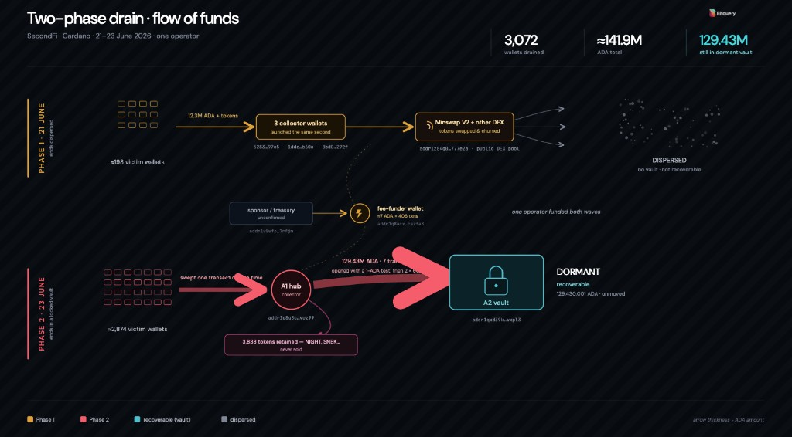
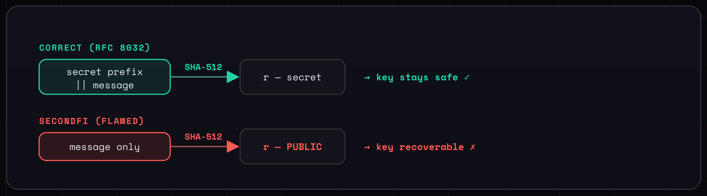

# CID-202601: SecondFi Wallet Signing Nonce Flaw

> Between 21 and 23 June 2026, attackers stole about 16.1 million ADA (about US$2.4 million at the time) from 374 wallets of SecondFi, the self-custody Cardano wallet app that EMURGO had rebranded from Yoroi in April 2026 [9][14][27]. Every Cardano transaction is authorised by a digital signature, and each signature contains a one-time number (the "nonce") that must be derived from the wallet's secret key; anyone who knows the nonce can calculate the private key from the signature. An app update shipped on 8 June 2026 derived the nonce from the transaction data alone, which is public on the blockchain, so a single transaction signed with the update let anyone work out that address's private key and empty it [9][22][23]. During the attack SecondFi itself moved about 129 million ADA out of exposed wallets and said it would hold the funds with a third-party custodian for the affected users [4]. The Cardano protocol was not at fault, and hardware-wallet users were not affected [10][21]. SecondFi never reopened, and on 22 July 2026 it announced the wind-down of both SecondFi and Yoroi [8][9]. A recovery portal opened on 7 October 2026, but by 13 October 2026 no figures on completed returns had been published, and the recovery terms warn that users may get back less than they lost [12][13].

## Timeline (UTC)

| Time | Event |
|---|---|
| 2026-04-22 | EMURGO announces that Yoroi is becoming SecondFi, a "neofinance" app, and that the app will update automatically [14]. |
| 2026-06-08 | SecondFi Android 10.0.3 is released. Independent analyses find that its software signer leaves the secret nonce prefix out of signing [22][23]. Tibane Labs says a new signing SDK replaced the previous signer that day and that the first affected signature appears on-chain the same day [24][26]. |
| 2026-06-12 | An address signs a transaction of about 1M ADA with the affected app, exposing its key; it is emptied by the 03:35 sweep on 23 June [22]. |
| 2026-06-21 20:29 | Three collection wallets start draining wallets in the same second [21]. SecondFi later attributes them to "Attacker A" [5]. |
| 2026-06-21 20:31 | One victim loses 38,421.556 ADA in a single transaction [21]. |
| 2026-06-22 | According to an independent write-up citing EMURGO, the issue is first discovered and app version 10.0.6 is published [22]. |
| 2026-06-23 03:35 | 5,409,581 ADA, the largest single sweep of the second wave, moves from the 12 June example address to the address Bitquery calls the "hub" [15][21][22]. |
| 2026-06-23 06:26 | SecondFi's first public notice reports a "security issue impacting a small number of Cardano wallets" and pauses all front-end interactions (maintenance mode) [1]. |
| 2026-06-23 11:21 | SecondFi says the issue was "confined to our native Cardano web wallet generation software" and estimates the impact at about 16M ADA [2]. |
| 2026-06-23 11:29 | The first of two 60,000,000 ADA transfers moves funds from the hub to a single address; by about 12:20, 129,430,001 ADA has collected there [16][21]. |
| 2026-06-24 | Yu Xian ("Cos"), founder of SlowMist, estimates that user losses "could theoretically exceed $20 million", involving more than 129 million ADA [21][27]. |
| 2026-06-24 05:40 | SecondFi says the issue is "at the address level" and tells users not to restore their recovery phrase into a new Cardano wallet [3]. |
| 2026-06-24 09:47 | SecondFi reports four draining events: three by external attackers (about 16m ADA from 374 addresses) and its own "emergency rescue measures" securing about 129m ADA for a third-party custodian. It reports a patch for unaffected wallets [4]. |
| 2026-06-25 10:34 | SecondFi publishes the addresses of two attackers: Attacker A drained 171 wallets in two automated batches, Attacker B 203 wallets, with 4,020,468 ADA still in B's collection address [5]. |
| 2026-06-25 11:22 | Last outgoing transaction from the address that held the 129.43M ADA, leaving about 1 ADA [17]. |
| 2026-06-25 12:27 | Charles Guillemet (Ledger) reports rebuilding private keys from mainnet signatures: "One signature, every time" [19]. |
| 2026-06-27 04:05 | EMURGO CEO Phillip Pon says a recovery path has been found, with about two weeks to build and test it before assets are returned [7][26]. |
| 2026-06-27 | Tibane Labs publishes a forensic report blaming an unaudited signing SDK [24][26]. Mark Karpelès says the flawed function sat in EMURGO's internal JavaScript framework "Dullahan" [25]. |
| 2026-07-06 10:13 | EMURGO, in "The Path Forward": SecondFi "will not resume normal operations—even after the audits are complete" [8][29]. |
| 2026-07-22 04:41 | SecondFi reports about 16.1M ADA (~US$2.6M) stolen from 374 wallets, publishes the Groom Lake findings and announces the wind-down of SecondFi and the Yoroi wallet [9]. The app stays in isolation mode [32]. |
| 2026-10-07 05:16 | The asset recovery tool goes live at secondfi.io [11][13]. |

## Impact

External attackers stole about 16.1 million ADA from 374 wallets [9][10]: about US$2.4 million at the US$0.15 ADA price reported on 24 June [27]. SecondFi's own figure is about US$2.6 million [9]. Native tokens and NFTs were also taken, with no published total; the first attacker swapped stolen tokens into ADA through the Minswap exchange [21]. On 25 June, 4,020,468 ADA of the stolen funds was still in Attacker B's flagged collection address [5]; no later report on that balance has been published.

SecondFi separately moved about 129 million ADA out of exposed wallets and said it would hold it at a third-party custodian for the affected addresses [4]. Bitquery counted 2,874 wallets in the matching second wave and valued the 129,430,001 ADA it traced at about US$19.4 million [21]; SecondFi has not published its own count. Because SecondFi says these funds are held for return, they are not counted as lost.

*Figure 1: Bitquery's on-chain reconstruction of the drain in two phases: about 12.3M ADA from about 198 wallets dispersed through three collector wallets and Minswap on 21 June, and 129.43M ADA swept from about 2,874 wallets through a hub into a single vault on 23 June. Bitquery attributes both phases to one attacker; whether the second phase was SecondFi's own sweep is discussed under Disputed or open points. Source: Bitquery Research, ["How an attacker drained a Cardano wallet's users of more than 129 million ADA"](https://bitquery.io/investigations/cardano-secondfi-129m-drain) [21].*

The service has been suspended since 23 June 2026 [1] and never reopened [8]; during the wind-down the app showed balances but did not allow users to send, swap or transfer [32].

The private key of every address that signed with the affected build can be computed from public data, permanently [9][22][23]. EMURGO described SecondFi as "Cardano's largest wallet provider" [6], and Yoroi had served over a million users [29]. Not every Yoroi wallet was affected [10], but SecondFi has not published how many addresses were exposed without being drained.

The Cardano chain saw no consensus or liveness impact: it processed the attackers' transactions as designed [21], and SecondFi states that the network was not compromised [30][32].

Rated SEV-1 (financial: about 16.1M ADA, US$2.4M gross, stolen, above the US$1M threshold; trust: the private keys of a large user population became derivable from public data). Potential SEV-1 (financial: a further ~129M ADA, about US$19.4M at US$0.15, sat at exposed addresses until SecondFi swept it [4][21]; together with the stolen ADA, about 145M ADA or US$22M was within attackers' reach, consistent with SlowMist's estimate of more than US$20M [27]). Recoverability: not-recoverable (the stolen ADA has not been recovered from the attackers, and exposed keys cannot be made safe again, so affected addresses must be abandoned [3][23]; the product itself was shut down [9]).

## Root cause

Cardano signs transactions with Ed25519 using extended keys whose 64-byte secret is `kL || kR`: `kL` is the signing scalar and `kR` is a secret "prefix" whose only role is to make the nonce unpredictable [22][23]. RFC 8032 derives the nonce deterministically from that secret and the message, `r = SHA-512(prefix || M)` [18]; for Cardano this is `r = SHA-512(kR || M)`, with `M` the transaction body hash. The signature is `(R, s)` with `R = r·B` and `s = (r + k·kL) mod L`, where `k = SHA-512(R || A || M)` and `A` is the public key [22][23].

The affected SecondFi signer computed `r = SHA-512(M)` and left `kR` out [22][23][26]. In the decompiled Android 10.0.3 bundle the full 64-byte key reached the signing function but was first used at the challenge step, too late to affect the nonce [22]. Tibane Labs says the underlying cryptographic library was sound and that the key was lost in the adapter that passes it to the library, which supplies `kL` but leaves the nonce prefix unset [24][26]. The shipped app no longer used the Cardano Serialization Library, which derives the nonce correctly [22][24].

Because `M` is public on-chain, anyone can compute `r`, and the signature equation then gives `kL = (s − r)·k⁻¹ mod L` from a single signature [22][23] (Figure 2). Guillemet called this "worse than nonce reuse": reuse needs two signatures, while here "a single signature is enough to reconstruct the private key" [19]. Verifiers only check `[s]B = R + [k]A` (RFC 8032 §5.1.7) and cannot see how `R` was produced, so the flawed signatures were valid on-chain [18][22]. SecondFi's own description is that "a value that should have been derived from secret information could, under certain conditions, be computed from public transaction data" [9][10].

*Figure 2: A correct RFC 8032 signer hashes the secret prefix together with the message, so the nonce `r` stays secret. The SecondFi signer hashed the message only, which made `r` public and the private key recoverable. Source: Tibane Labs, ["Anatomy of a Predictable-Nonce Key Disclosure"](https://www.tibane.net/reports/20260626b_tibane_secondfi_mechanism.pdf), Figure 2 [33].*

What leaked was the address-level signing key, not the recovery phrase, so restoring the phrase in another wallet offered no protection and affected addresses had to be abandoned [3][20][23]. Only signatures made with the new signer from 8 June 2026 onward are exposed [24][26]. Hardware wallets compute the nonce inside the device and were not affected [10][19]. How the flawed code reached production is disputed (see *Disputed or open points*).

## Detection

SecondFi has not said who detected the incident or how. The flawed signer was live from 8 June [22][24] and went unnoticed for about 13 days until draining began at 20:29 UTC on 21 June [21]. An independent write-up citing EMURGO dates discovery to 22 June [22]; SecondFi's first public notice followed at 06:26 UTC on 23 June, about 34 hours after the first drain [1]. SlowMist's founder was among the first to flag attacker addresses publicly [21].

## Response and resolution

On 23 June SecondFi paused the platform [1], took a full balance snapshot and worked with IOG, the Cardano Foundation, Intersect and SundaeSwap to monitor exchange touchpoints [2]; by 24 June it had patched unaffected wallets [4]. IOG said its incident response team had been in contact with SecondFi since 22 June and that SecondFi had asked for an independent security audit [28].

During the attack SecondFi triggered what it called "emergency rescue measures" to secure about 129m ADA, routed to an "independent, qualified third-party custodian" and held for the affected addresses, with an external accounting firm engaged to verify the holdings [4]. Neither the custodian nor the accounting firm has been named. On-chain, 129,430,001 ADA collected at one address on 23 June [16][21] and was moved on by 25 June [17]. Guillemet called the sweep "a cryptographic failure patched with a social promise" and described a self-custody wallet provider moving live customer funds with the users' own leaked keys as "a new shape" [19][20].

On 25 June SecondFi published the attackers' addresses and said it was working with law enforcement [5]. Groom Lake, hired by EMURGO, reviewed code, code history and chain data. It concluded that the main operation was "sophisticated, external, and well-funded", with some indicators being assessed for overlap with the DPRK-linked Lazarus Group, and identified a separate second attacker that hit a different set of wallets. No attribution has been confirmed [9][10][30].

Returning funds took far longer than first announced. On 27 June EMURGO aimed to start returns in about two weeks and told users not to move funds outside official guidance [7][26]. On 6 July it said an external audit of the recovery system was needed first, that "the safe return of assets must remain the overriding priority", and that SecondFi would become "a dedicated asset recovery team, tasked solely with returning assets to affected users" [8][29]. On 22 July SecondFi announced the wind-down, promising an export tool for early August and a ZK-proof recovery portal for August 2026 [9]. A wallet migration tool assessed by Bitdefender was released for unaffected wallets [10][11], and the recovery tool launched on 7 October 2026 [11][13].

## Remediation and follow-up

- **Code fix.** The flaw has been patched, and new wallets created with the corrected software are not known to be affected [9][10]. SecondFi has not published the fixed version; BlockSec puts the fix in 10.0.6.2 [23].
- **Product discontinued.** All users are told to migrate to a new wallet from another provider, preferably a hardware wallet [9][11]. The migration tool unstakes ADA, so users must delegate again to a stake pool and a DRep from the new wallet [11].
- **Recovery process.** Affected users enter their recovery phrase at secondfi.io. The browser uses it locally to generate a zero-knowledge proof (a proof that the user knows the phrase, without revealing it), bound to a new destination address; requests are processed in batches within five working days [12][13].
- **Terms of recovery.** Amounts are estimates based on the incident snapshot, and "the assets recovered may be less than the assets originally lost" [12]. Each lost NFT is compensated with a fixed 30 ADA. Staking rewards allocated before the incident are included; unallocated rewards are not. Recovery of NIGHT tokens claimed into affected wallets "cannot be guaranteed" [10][12].
- **Compensation commitment.** SecondFi states that its commitment "remains unequivocal: to support the return of assets of all affected wallet holders from the 4 distinct wallet draining events" [10]. CoinDesk reported that EMURGO has funded an asset recovery wallet [30]; on 22 July Cointelegraph noted that SecondFi had not said whether it would compensate users from its own funds [31].
- **Post-mortem.** EMURGO promised a full account of "who, what, and why" once the independent reviews are finished [29]; none had been published by 2026-10-13.

## Incident handling assessment

Assessment of the responsible party's handling (SecondFi and its operator EMURGO) against SOC 2 Trust Services Criteria, based on public sources only (see CLASSIFICATION.md, section 10).

| Criterion | Result | Observation |
|---|---|---|
| CC7.2 Monitoring and detection | Exceptions noted | The flawed signer was live from 8 June and went unnoticed for about 13 days before draining began [22][24]. SecondFi has not said who detected the incident; discovery is dated to 22 June, the day after the first drains [21][22]. |
| CC7.3 Evaluation of events | Exceptions noted | The first notice described "a small number of Cardano wallets" [1], and the first root-cause statement placed the flaw in wallet generation software [2]. SecondFi later revised this to per-transaction signing, as independent analyses had found [9][22][23]. |
| CC7.4 Incident response | Exceptions noted | SecondFi paused the platform, patched unaffected wallets by 24 June and moved about 129M ADA out of exposed wallets [1][4], but its first public notice came about 34 hours after the first drain, and the sweep of user funds drew custody and consent criticism [1][19][21]. |
| CC7.5 Recovery | Exceptions noted | The flaw was patched [9][10], but the service never resumed and was wound down [8][9]. The recovery tool launched more than three months after the incident, and no figures on completed returns have been published [12][13]; SecondFi has not said whether it will compensate users from its own funds [31]. |
| CC2.3 External communication | Exceptions noted | SecondFi issued frequent updates [1][2][3][4][5][9], but its root-cause description changed and version numbers were not published [2][9]. The promised account of "who, what, and why" has not appeared, and the custodian and accounting firm remain unnamed [4][29]. |
| CC8.1 Change management | Exceptions noted | The flaw entered production with the 8 June release, which by several accounts replaced the previous signing code with new, unaudited code [24][26]. The origin of that code is disputed [24][25][26]. |

## Lessons for builders

1. **The Ed25519 nonce must depend on a secret.** RFC 8032 makes the nonce deterministic, so signing does not depend on a random number generator (the failure behind the PlayStation 3 key leak), and secret, by hashing the private prefix (`kR` in Cardano extended keys) into it [18][26]. Both properties are required: a nonce computed from public data alone gives away the key with every signature [19][22].
2. **Test the signer against a reference; "sign then verify" and the ledger cannot catch this bug.** Verification only checks `[s]B = R + [k]A` [18][22]. Tests that would have failed on this signer:
   - Known-answer tests against the RFC 8032 §7.1 vectors for standard Ed25519 [18].
   - For extended keys, byte-for-byte comparison with a reference implementation such as the previously used Cardano Serialization Library or Emurgo's `cryptoxide` [22]. Ed25519 is deterministic, so any difference for the same key and message is a bug.
   - A property test that two different keys signing the same `M` produce different `R`; with the flawed signer, `R` depends only on `M` [22].
   - A check of the wallet's own on-chain signatures for the pattern `SHA-512(M)·B = R` after each release, which could have flagged the flaw during the 13 days before the first drain [21][22].
3. **Review the plumbing, not just the primitive.** The reported fault was in the wrapper that passed the key to a sound library [24][26]. Signing APIs should require the full 64-byte extended secret and fail closed if `kR` is missing or empty.
4. **Treat changes to the signing path as security-critical releases.** By several accounts an established signer was replaced by new, unaudited code [24][26] and shipped to users through an automatic update [14]. BlockSec recommends well-audited standard Ed25519 libraries and an independent cryptographic audit before deployment [23]; Immunefi's CEO called key-handling code the "part nobody audits like a contract" [28]. Staged roll-out limits how many keys a faulty signer can expose.
5. **Plan for key-exposure incidents before they happen.** Once a derived key leaks, moving the seed to another app does not help, and as Guillemet put it, "sign to prove ownership" is dead, because the attacker can sign too [3][20][23]. Recovery then needs proof of knowledge of the seed, for example a ZK proof as SecondFi eventually built, plus on-chain accounting of what left each address [12][20]. Wallet providers should decide in advance, and tell users, whether and how they would ever move user funds in an emergency [19][20].

## Disputed or open points

- **"Wallet generation software" or signer.** SecondFi's first root-cause statement placed the issue in its "native Cardano web wallet generation software" [2]; press repeated this [27][28], and Bitquery attributed the breach to "weak randomness" in key generation [21]. SecondFi's 22 July statement places the flaw in "how the wallet software generated per-transaction signatures" [9], and independent analyses of the Android 10.0.3 build found the signer at fault and ruled out weak randomness [22][24]. On that reading the keys were generated correctly but leaked through signatures, which is why older Yoroi-created addresses were exposed if they signed with the new build [22][26]. SecondFi has not said which builds (Android, iOS, browser extension) contained the flawed signer; the public analyses examined Android only [22][24].
- **Affected versions.** One analysis names 10.0.3 (8 June) as flawed and 10.0.6 (22 June) as the post-discovery release [22]. BlockSec says 10.0.3 to 10.0.6 were affected and 10.0.6.2 fixed it [23]. SecondFi has not published version numbers.
- **Where the flawed code came from, and intent.** The Block summarised Tibane Labs as blaming an "experimental, unaudited SDK called trantor, published to npm by an independent developer" [26], and Tibane's 25 June advisory calls it "the third-party SDK @stashers.io/trantor" [33]. Tibane's forensic report instead describes it as EMURGO's in-house SDK "Dullahan", published to npm by its original author, a former EMURGO employee [24]. Karpelès says the insecure function had existed in "Dullahan" for at least 10 months [25], and Taylor Monahan said SecondFi had "rolled their own crypto" in closed-source, unaudited software [26]. Tibane Labs, whose team includes Karpelès, is building a competing wallet, so its analysis comes from an interested party [26][29]. SecondFi says the flaw was also visible in a copy of the code published without authorisation on GitHub and that it is cooperating with authorities [9]; it does not claim the attackers found the flaw through that copy [32]. EMURGO called the attack "pre-meditated" [6], while Guillemet said he could not tell whether the change was an honest mistake or planted [19]. Groom Lake's Lazarus indicators remain unconfirmed [9].
- **Loss figures.** Bitquery's on-chain total of ~141.9M ADA from 3,072 wallets and SlowMist's estimate of more than US$20M [21][27] both include the ~129M ADA that SecondFi says it moved itself [4], against SecondFi's 16.1M ADA from 374 wallets [9]. Bitquery's address list does not include Attacker B's collection address [5][21]. Token and NFT losses have not been quantified.
- **Who carried out the second wave, and where the funds went.** The size of Bitquery's second-wave sweep matches SecondFi's ~129M ADA rescue [4][21], and Guillemet describes that wave as the platform's own sweep [19]. Bitquery attributes both waves to one attacker through a shared fee-paying wallet [21], but SecondFi lists that address as Attacker A's "Central Fee/Change Address" [5], and the largest second-wave sweep has a single input and no fee-wallet input [15]. SecondFi has not published the addresses it used, and its attacker list does not include the hub or vault [5]. The second wave began at 03:35 UTC on 23 June [15], before the first public notice [1]. The vault was emptied by 25 June [17]; its destination has not been publicly confirmed as the custodian.
- **Users reporting no transactions after 8 June.** Replies to Guillemet's analysis asked how some wallets were drained whose owners said they had only opened the app without transacting [19], and Bitquery reports drained wallets untouched since 2020 [21]. No public explanation was found.

## Sources

1. [P] SecondFi (@secondfiapp), "An Important Security Update from the SecondFi Team", 2026-06-23. https://x.com/secondfiapp/status/2069306133337227382
2. [P] SecondFi (@secondfiapp), "SECURITY UPDATE: Root Cause & Blast Radius Confirmed" (thread), 2026-06-23. https://x.com/secondfiapp/status/2069380358291001425
3. [P] SecondFi (@secondfiapp), "To provide more clarity, we have identified the nature of the incident, it is at the address level", 2026-06-24. https://x.com/secondfiapp/status/2069656913202360606
4. [P] SecondFi (@secondfiapp), "We have identified the root cause and have since rolled out a patch for all unaffected wallets", 2026-06-24. https://x.com/secondfiapp/status/2069719171391512793
5. [P] SecondFi (@secondfiapp), "We aim to provide the latest update on our investigation into the exploit" (attacker addresses), 2026-06-25. https://x.com/secondfiapp/status/2070093205450998032
6. [P] EMURGO (@emurgo_io), "The SecondFi Security Incident - Updates on Investigation and Recovery", 2026-06-25. https://x.com/emurgo_io/status/2070040375331586338
7. [P] EMURGO (@emurgo_io), "SecondFi Security Incident: Executing Recovery", 2026-06-27. https://x.com/emurgo_io/status/2070720268683596020
8. [P] EMURGO (@emurgo_io), "SecondFi Security Incident Update — The Path Forward", 2026-07-06. https://x.com/emurgo_io/status/2074074175485165989
9. [P] SecondFi (@secondfiapp), "An update regarding the recent security incident involving SecondFi", 2026-07-22. https://x.com/secondfiapp/status/2079788851204329886
10. [P] SecondFi Knowledge Base, "Incident FAQ" (updated 2026-10-07), 2026-10-07. https://kb.secondfi.io/en/article/incident-faq-omrng2/
11. [P] SecondFi Knowledge Base, "SecondFi is Ceasing Operations" (updated 2026-10-07), 2026-10-07. https://kb.secondfi.io/en/article/secondfi-is-ceasing-operations-1xp4wb9/
12. [P] SecondFi Knowledge Base, "SecondFi Asset Recovery FAQ" (updated 2026-10-07), 2026-10-07. https://kb.secondfi.io/en/article/secondfi-asset-recovery-faq-1qqpqft/
13. [P] SecondFi (@secondfiapp), "The Asset Recovery Tool Is Now Live", 2026-10-07. https://x.com/secondfiapp/status/2107701581160517828
14. [P] EMURGO via cardano.org, "Yoroi Wallet Is Evolving Into SecondFi: What You Need to Know", 2026-04-22. https://cardano.org/news/2026-04-22-yoroi-wallet-is-evolving-into-secondfi/
15. [P] Cardanoscan, "Transaction c9556fbe06f87dfb400164ecf86dcfefbf4108af80bfaeb1be1a4e43fcacf5a0" (5,409,581 ADA sweep), 2026-06-23. https://cardanoscan.io/transaction/c9556fbe06f87dfb400164ecf86dcfefbf4108af80bfaeb1be1a4e43fcacf5a0
16. [P] Cardanoscan, "Transaction fab61e24979c729157738382a71512cab235d1203164c40fb06a7995fe098d93" (60,000,000 ADA to vault address), 2026-06-23. https://cardanoscan.io/transaction/fab61e24979c729157738382a71512cab235d1203164c40fb06a7995fe098d93
17. [P] Cardanoscan, "Address addr1qxd39k4…wxpl3" (balance and last outgoing transaction, retrieved 2026-10-13), 2026-06-25. https://cardanoscan.io/address/addr1qxd39k4peszxlf0x59e88hngpe5u9882y2lyhdzazsq4kfvmztd2rnqyd7j7dgtjw00xsrnfc2ww5g47fw6969qptvjshwxpl3
18. [P] IETF, "RFC 8032: Edwards-Curve Digital Signature Algorithm (EdDSA)", 2017-01. https://www.rfc-editor.org/rfc/rfc8032
19. [S] Charles Guillemet (@P3b7_), "SecondFi: more than $20M stolen, or taken hostage - When the nonce is predictable, the key is public", 2026-06-25. https://x.com/P3b7_/status/2070121675102863721
20. [S] Charles Guillemet (@P3b7_), "After the signing bug exposed users' keys, attackers drained wallets", 2026-06-26. https://x.com/P3b7_/status/2070555744894685428
21. [S] Bitquery Research, "How an attacker drained a Cardano wallet's users of more than 129 million ADA", 2026-06-24. https://bitquery.io/investigations/cardano-secondfi-129m-drain
22. [S] Anonymous (HackMD), "Predictable Ed25519 Nonces in SecondFi Android 10.0.3", undated (June 2026). https://hackmd.io/@QmCYMVNVQuqRJhiqMlXVdA/ry2LIyiMGx
23. [S] BlockSec, "~$4.1M Lost: Taiko, SecondFi Exploits | BlockSec Weekly", 2026-07-01. https://blocksec.com/blog/web3-security-taiko-secondfi-exploits
24. [S] Tibane Labs, "SecondFi Cardano" forensic report, 2026-06-27. https://www.tibane.net/research/secondfi-cardano
25. [S] Mark Karpelès (@MagicalTux), post on EMURGO's "Dullahan" signing function, 2026-06-27. https://x.com/MagicalTux/status/2070925978805920049
26. [S] The Block, "SecondFi maps recovery path after $2.4 million Cardano wallet exploit, aims to return funds within two weeks", 2026-06-27. https://www.theblock.co/news/defi/2026-06-27-secondfi-maps-recovery-path-after-2-4-million-cardano-wallet-exploit-aims-to-return-funds-within-two-weeks-406457
27. [S] CoinDesk, "SecondFi loses $2.4 million in Cardano wallet exploit", 2026-06-24. https://www.coindesk.com/business/2026/06/24/secondfi-loses-usd2-4-million-in-cardano-wallet-exploit-with-up-to-usd20-million-at-risk
28. [S] Cointelegraph, "SecondFi traces Cardano wallet exploit to address-level issue", 2026-06-24. https://cointelegraph.com/news/cardano-wallet-secondfi-flaw-16-million-ada-exploit
29. [S] The Crypto Times, "EMURGO Winds Down SecondFi for Good as Cardano Hack Recovery Drags On", 2026-07-06. https://www.cryptotimes.io/2026/07/06/emurgo-winds-down-secondfi-for-good-as-cardano-hack-recovery-drags-on/
30. [S] CoinDesk, "SecondFi to shut down after $2.4 million ADA wallet theft", 2026-07-22. https://www.coindesk.com/web3/2026/07/22/secondfi-to-shut-down-after-usd2-4-million-ada-wallet-theft
31. [S] Cointelegraph, "SecondFi to wind down after $2.6M ADA theft linked to wallet flaw", 2026-07-22. https://cointelegraph.com/news/secondfi-shutdown-ada-theft-wallet-flaw
32. [S] ForkLog, "SecondFi to Shut Down After $2.6 Million ADA Theft", 2026-07-22. https://forklog.com/en/secondfi-to-shut-down-after-2-6-million-ada-theft/
33. [S] Tibane Labs, "Anatomy of a Predictable-Nonce Key Disclosure" (technical security advisory, PDF linked from the forensic report), 2026-06-25. https://www.tibane.net/reports/20260626b_tibane_secondfi_mechanism.pdf
