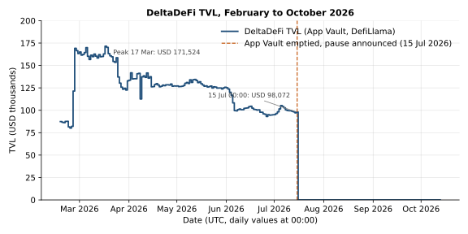
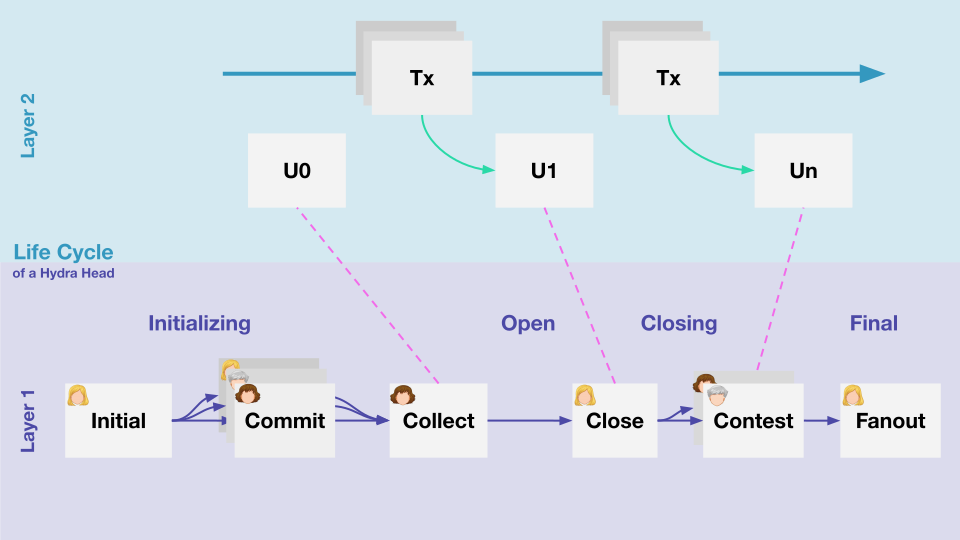
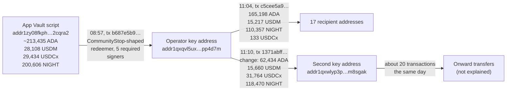

# CID-202602: DeltaDeFi Hydra DEX Operational Pause

> DeltaDeFi, built by SIDAN Lab, was an order-book decentralised exchange (DEX) that matched trades inside a Hydra head, Cardano's layer-2 state channel; the press called it the first Hydra-powered DEX on Cardano [2][3]. After DReps rejected a ₳1.5 million Treasury request [19][20], the team paused operations on 15 July 2026 "until further notice", citing "the lack of operation runway" [1]. Twenty-six minutes before the announcement, five administrative keys moved all deposits in DeltaDeFi's on-chain vault (about USD 98,000) to a single key address; two hours later most of the ADA went to 17 addresses [11][12][14]. The team promised refunds where Cardano's minimum-ADA rule allowed [1] but has published no refund ledger or confirmation that all users were repaid. No theft or loss has been reported; as of 13 October 2026 the app remains in maintenance mode [26]. Neither the Cardano L1 nor the Hydra protocol was at fault: users who are not participants in an operator's Hydra head depend on the operator, not on Hydra's guarantees, when it stops.

## Timeline (UTC)

| Time | Event |
|---|---|
| 2024-2025 | SIDAN Lab receives Project Catalyst funding for DeltaDeFi: Fund 11 concept (₳100,000), Fund 12 MVP (₳300,000) and Fund 12 open-source libraries (₳200,000), all marked "Complete". A Fund 13 Hydra DEX proposal (₳150,000) is "Not approved" [16]. |
| 2025-11 | DeltaDeFi launches a beta ("Berlin Beta") on Cardano mainnet, timed with Cardano Summit 2025 [2][5]. |
| 2025-12-29 20:48 | A Budget Info Action, "DeltaDeFi: Hydra Trading Infrastructure Budget (₳1,500,000)", asks DReps to signal support for ₳1.5 million over six months [18][19]. |
| 2026-01-29 (approx.) | The Info Action expires in epoch 610 without ratification [19]. By DeltaDeFi's count, 116 DReps voted No, 40 Yes and 18 Abstain (No about 82.6% of Yes/No voting power); its analysis of 3 February lists concerns including who runs the Hydra head and whether users can exit to L1 if the operator is offline [20]. |
| 2026-02-11 | DeltaDeFi presents its mainnet design at the Hydra working group; IOG reports that it "deliberately adopts a federated trust model among head operators" [24]. |
| By 2026-05-16 | DeltaDeFi's governance repository lists a Cardano Builder DAO application as "Passed (not funded)" and a third draft of a ₳5,000,000 Treasury loan proposal citing USD 607,000 cumulative volume, 169 active traders and USD 20,000 of in-house market-making capital [21][22]. |
| 2026-07-15 08:57:27 | One transaction spends all 12 UTxOs at the App Vault (213,435 ADA, 28,108 USDM, 29,434 USDCx and 200,606 NIGHT) to key address `addr1qxqvl5ux...pp4d7m`. It has five required signers and the redeemer shape of the `CommunityStop` withdrawal path [9][11]. |
| 2026-07-15 09:23:37 | DeltaDeFi posts on X: "Due to the lack of operation runway, DeltaDeFi operation will be paused effectively today, until further notice." It promises to "distribute the funds back to all users if there is sufficient min-UTxO" [1]. |
| 2026-07-15 11:04:49 | The operator address sends 165,198 ADA, 15,217 USDM, 110,357 NIGHT and 133 USDCx to 17 other addresses and returns change to itself [12]. |
| 2026-07-15 11:10:41 | The change (62,434 ADA, 15,660 USDM, 31,764 USDCx and 118,470 NIGHT) moves to a second key address, `addr1qxwlyp3p...m8sgak` [13]; about 20 further transactions move these funds onward by 16:33 [23]. |
| 2026-07-16 | DefiLlama TVL drops to zero, where it stays through 2026-10-13 [14]. Coin Edition, The Crypto Basic and Blockonomi report the pause [2][3][4]. |
| 2026-10-13 | The web app shows "Scheduled Maintenance … All services — including trading, deposits, and withdrawals — are temporarily unavailable"; API endpoints at `api.deltadefi.io` time out; the marketing site still reads "Live on Mainnet" [26]. No further public update by DeltaDeFi was found. |

## Impact

Trading, deposits and withdrawals stopped on 15 July 2026 and had not resumed by 13 October 2026 [1][26]. The exchange was small: in May 2026 it had one live trading pair (ADA/USDCx), 169 active traders and USD 607,000 in cumulative volume [21].

DefiLlama valued the App Vault at USD 98,072 at 00:00 UTC on 15 July, nine hours before it was emptied, against a peak of USD 171,524 on 17 March [14] (Figure 1). At DefiLlama's prices this was 213,435 ADA (USD 35,027, about USD 0.164 per ADA), 29,434 USDCx (USD 29,222), 28,108 USDM (USD 28,061) and 200,606 NIGHT (USD 5,762), the same quantities that left the vault on-chain [11][14].

*Figure 1: DeltaDeFi TVL as measured by DefiLlama, which counts all assets at the App Vault address, from its first data point on 17 February 2026. Values are daily snapshots at 00:00 UTC, so the emptying of the vault at 08:57 UTC on 15 July appears at the 16 July point. Data: DefiLlama API, retrieved 2026-10-13 [14][15]; chart by the catalogue.*

The team promised automatic refunds where min-UTxO allowed and manual claims via X or Discord otherwise [1]. Every Cardano output carrying tokens needs a minimum amount of ADA (typically 1.4 to 2 ADA), so very small balances may not be returnable automatically [2]; DeltaDeFi's own minimum withdrawal was 2 ADA [6]. The only on-chain distribution, about 100 minutes after the announcement, paid 17 addresses: 100,000 ADA and 60,000 ADA to two of them (97% of the ADA distributed), 42.5 ADA with 106,697 NIGHT and 14,563 USDM (about half of the vault's NIGHT and USDM) to a third, and between 8.8 and 2,102 ADA, many with small token amounts, to the other 14 [12]. Public data does not show which recipients were depositors and which, if any, were team or market-making accounts.

No source reports theft, an exploit or a confirmed loss. But DeltaDeFi's documentation had said users could withdraw "without DeltaDeFi's permission" and that "without users' signature, value can never transfer to other accounts" [7]; in practice an administrative multi-signature path emptied the vault, and repayment depended on the operator (see Root cause).

Rated SEV-3 (dimensions: trust and integrity; availability): the service operated materially differently from what users were told, to their detriment [7][11], and a dApp holding deposits has been unusable for far more than 24 hours, although DeltaDeFi's size makes "widely used" borderline [21][26]; operator-held funds count as frozen, not lost. Potential SEV-3 (dimension: financial): the USD 98,072 in the vault [14] could be moved by the stop-key holders without per-user authorisation [9], or stranded had the operator disappeared without publishing the off-chain balance records [8]. Recoverability: escalated (users' recovery depends on operator-run refunds with no ledger, completion statement or timetable, and no restart has been announced [1][12][26]).

## Root cause

The project ran out of money: the only stated reason is "the lack of operation runway" [1]. Catalyst grants for DeltaDeFi totalled ₳600,000 across Funds 11 and 12, but a Fund 13 request was not approved [16] and the Fund 15 proposal "Hydra Trading Vault for Liquidity Providers" (₳200,000) still shows "Pending vote" [17]. The ₳1.5 million Treasury Info Action expired [19] after DReps, as summarised by DeltaDeFi, objected to Treasury funding for a single commercial DEX, the absence of a liquidity plan and of a repayment mechanism, and an unclear Hydra trust model [20]. A Cardano Builder DAO application "Passed (not funded)" [22], and the ₳5 million loan drafted in May 2026 [21] was never submitted: no Treasury Withdrawal action by DeltaDeFi appears among on-chain governance actions as of 2026-10-13 [23]. The press placed the pause among several Cardano projects scaling back in mid-2026 because of funding and market conditions [3][4].

Funding explains why the service stopped. The custody design explains why stopping left users dependent on the operator:

1. **Users were not Hydra head participants.** DeltaDeFi hosted the Hydra nodes itself [5]. Hydra's safety rests on "at least one honest participant" [5], and only participants can close or contest a head and fan its final state out to L1 [25] (Figure 2). As one DRep rationale quoted by DeltaDeFi put it, Hydra "gives L1-equivalent security only to those who are running a node as a participant in that Hydra head" [20]. Ordinary users had no Hydra-level exit of their own.

   

   *Figure 2: Life cycle of a basic Hydra head. Participants open the head on layer 1 (initial, commit, collect), agree on snapshots (U0 … Un) off-chain, and any participant can close it; after a contestation period, the fanout transaction makes the final agreed state available on layer 1. Source: Hydra Head protocol documentation, "Protocol overview" ([original](https://hydra.family/head-protocol/docs/protocol-overview#hydra-head-lifecycle)) [25].*

2. **Value sat on L1; balances lived in an off-chain Merkle tree.** All user funds sat at the single App Vault script address [15][24], while account balances were compressed into a Merkle-tree root. The documentation warned that "losing the actual records poses a significant threat in terms of permanent lock of user funds" and promised to publish the full Merkle-tree operation record [8]. Deposits and withdrawals settled only when the operator closed and reopened the head, in a "Hydra cycle" of 30 minutes to 12 hours [6], so between cycles the latest balances existed only in the operator's head and off-chain records [6][8].
3. **Three withdrawal paths from the vault.** The vault delegates spending to a withdrawal script whose hash sits in an oracle datum. In the public code that hash is fixed, while the stop key can rotate the operation and stop keys and the community stop keys can replace their own list [10]. The `app_withdrawal` script accepts [9]:
   - `ProcessAppWithdrawal` signed by the operation key, for normal operator-processed withdrawals;
   - the same redeemer authorised by the user through an `EmergencyWithdrawalRequest` with a valid Merkle proof reducing the user's balance. This is the documented emergency withdrawal "enforced with a time lag" [7]; the code sets the lag as the request timestamp plus 86,400, and because Plutus time counts milliseconds, that is about 86 seconds, not 24 hours;
   - `CommunityStop`, added on 24 November 2025, which checks only that all `community_stop_keys` signed. It lets any value leave the vault to any destination, with no per-user accounting.
4. **The vault was emptied through a path consistent with `CommunityStop`.** The 08:57 transaction spent the vault script (hash `1e74d837…`, the App Vault's payment credential) with a zero-ADA withdrawal from reward script `e8c540a9…` and redeemer `constructor 1, no fields`, the shape of `CommunityStop` in the public type `ProcessAppWithdrawalRedeemer` [9][11]. Its five required signers include the payment key of the destination address [11]. The deployed scripts are parameterised and could not be matched to a public commit, so the identification rests on the redeemer shape.

## Detection

There was no external detection: the team announced the pause itself [1]. The first public sign was on-chain, when the App Vault was emptied 26 minutes before the X post [1][11]; DefiLlama registered it at its next daily data point, on 16 July [14].

## Response and resolution

DeltaDeFi's only communication was the X post of 15 July, which also said the team "will explore different options going forward" [1]. No post-mortem, refund ledger or wind-down plan was found, and no restart, sale or handover has been announced; the documentation and website still describe the DEX as live [5][26].

On-chain, the team consolidated the vault assets at an operator key address [11], made one 17-output distribution [12], and moved the remainder to a second key address and onward the same day [13][23] (Figure 3). No transaction has touched the vault, the operator address or the second address since 15 July; the second address held about 628 ADA on 13 October [23].

*Figure 3: Movement of the App Vault assets on 15 July 2026 (UTC), from the transactions listed in the Timeline. The pause was announced on X at 09:23, between the first and second transactions [1][11][12][13][23]. Diagram by the catalogue.*

## Remediation and follow-up

None published. Open items: a refund ledger (recipient, amount and transaction for each eligible account), confirmation that every depositor was repaid, publication of the final Merkle-tree state so users can check their balances, and an updated website and documentation. Neither the Fund 15 proposal [17] nor the drafted loan [21] has a recorded outcome tied to the pause.

## Incident handling assessment

Assessment of the responsible party's handling (DeltaDeFi / SIDAN Lab; for this discontinuation, the handling of the wind-down) against SOC 2 Trust Services Criteria, based on public sources only (see CLASSIFICATION.md, section 10).

| Criterion | Result | Observation |
|---|---|---|
| CC7.2 Monitoring and detection | No exceptions noted | The team identified its funding shortfall itself and tracked its funding attempts in its governance repository [20][22]; it announced the pause before any third party reported it [1]. |
| CC7.3 Evaluation of events | No exceptions noted | The announcement identified all depositors as affected, named the min-UTxO constraint on returning small balances and set out a manual claim route [1]. |
| CC7.4 Incident response | Exceptions noted | The pause took effect on the day it was announced, with no notice period [1], and the vault had been emptied to an operator key address through an administrative path beforehand, contrary to the documentation [7][9][11]. |
| CC7.5 Recovery | Not evidenced | One distribution followed [12], but without a refund ledger or completion statement it cannot be determined whether every depositor was repaid; the remainder moved onward without explanation [13][23]. |
| CC2.3 External communication | Exceptions noted | Disclosure consisted of a single X post, with no post-mortem or refund ledger [1]. Three months later the website still read "Live on Mainnet" [26]. |
| CC8.1 Change management | Not applicable | The pause was caused by a lack of operating runway, not by a change [1]. The `CommunityStop` path added in November 2025 [9] shaped how funds were moved but did not cause the pause. |

## Lessons for builders

- **Hydra protects participants, not customers.** If your users are not head participants, Hydra's "one honest participant" guarantee does not reach them [5][25]; their safety rests on your L1 contracts and operations. Say so in user documentation, and do not call a single-operator head non-custodial without that qualification.
- **Make the escape hatch usable without you.** DeltaDeFi's emergency withdrawal [9] needs a Merkle proof against the latest root, and so the off-chain records the team itself called critical [8]. Publish tree snapshots with each Hydra cycle and ship a standalone exit tool that builds the emergency transaction from them, tested on mainnet.
- **Bound administrative withdrawal paths.** A stop path that lets a key set send any value anywhere [9] turns user protection into trust in the key holders. Let it only freeze the vault or pay into a pre-committed redemption script that pays out against the published Merkle root, add a time lock, and publish the key holders, their independence and the threshold.
- **Make deployments verifiable.** DeltaDeFi's deployed scripts could not be matched to its public code [9][11]. Publish the deployed script hashes, parameters and oracle datum, including the stop-key list, for each release.
- **Settle often if L1 is the source of truth.** Settling only when the head closes and reopens (30 minutes to 12 hours) [6] leaves the latest balances off-chain at a sudden stop; incremental decommits or regular state anchoring narrow that gap.
- **Plan and fund the wind-down early.** DeltaDeFi's runway depended on Catalyst and Treasury decisions that went against it [16][19][20], and min-UTxO makes small token balances costly to return [2][6]. Keep an ADA reserve for a full refund run, decide in advance how dust is handled, and on shutdown publish a refund ledger and mark the docs, front-end and aggregators as closed [26].

## Disputed or open points

- **Were all users repaid?** No refund ledger, completion statement or count of manual claims was published [1][12]. Whether the two large ADA recipients and the large token recipient are user, team or market-making accounts is unknown [12], and the destination and purpose of the 62,434 ADA remainder were not explained [13][23].
- **Who holds the community stop keys?** The public code names them only as the `community_stop_keys` in the oracle datum, a list the holders can replace themselves [9][10]. Apart from the destination address's key [11], whether any of the five signers is independent of DeltaDeFi is not public.
- **Documented exit.** DeltaDeFi has not commented on the gap between its documented guarantees [7] and the path used. Whether any user tried the emergency withdrawal [9], and whether the Merkle records it needs were ever published [8], is unknown.
- **"No active monitoring or security maintenance".** Coin Edition reports that the contracts, off-chain infrastructure and interface remain in a "read-only or limited capacity" with no active monitoring or security maintenance [2]; this is not in the X post [1], and no primary source was found. With the App Vault empty since 15 July [11], the practical risk appears limited; funds still inside the Hydra head or at other DeltaDeFi scripts, if any, were not assessed.

## Sources

1. [P] DeltaDeFi (@DeltaDeFi), post on X: "Operational update for the DeltaDeFi community. Due to the lack of operation runway…", 2026-07-15. https://x.com/DeltaDeFi/status/2077323188963561716
2. [S] Coin Edition (Steve Muchoki), "DeltaDeFi Announces Operational Pause Due to Insufficient Funding", 2026-07-16. https://coinedition.com/deltadefi-announces-operational-pause-due-to-insufficient-funding/
3. [S] The Crypto Basic (Lele Jima), "Cardano First Hydra-Powered DEX Pauses Operations Amid Sustainability Challenges", 2026-07-16. https://thecryptobasic.com/2026/07/16/cardano-first-hydra-powered-dex-pauses-operations-amid-sustainability-challenges/
4. [S] Blockonomi (Maxwell Mutuma), "Cardano Loses First Hydra DEX Amid Funding Strain", 2026-07-16. https://blockonomi.com/cardano-loses-first-hydra-dex-amid-funding-strain
5. [P] DeltaDeFi, documentation "FAQ: General" (status, decentralisation roadmap, Hydra node hosting), retrieved 2026-10-13. https://docs.deltadefi.io/faq/general
6. [P] DeltaDeFi, documentation "FAQ: Product" (minimum deposit/withdrawal, Hydra cycle), retrieved 2026-10-13. https://docs.deltadefi.io/faq/product
7. [P] DeltaDeFi, documentation "Intent and Process" (emergency actions, fund-safety statements), retrieved 2026-10-13. https://docs.deltadefi.io/about/learn/architecture/intent-and-process
8. [P] DeltaDeFi, documentation "Hydra" (Merkle-tree compression, data integrity), retrieved 2026-10-13. https://docs.deltadefi.io/about/learn/architecture/hydra
9. [P] DeltaDeFi, deltadefi-scripts `validators/app_vault/app_withdrawal.ak` (commit a5e7cb0; `CommunityStop` added in commit eae8512d, 2025-11-24), 2025-12-13. https://github.com/deltadefi-protocol/deltadefi-scripts/blob/a5e7cb083f9d9f4d4a0eec1ed55d267db1d2d04a/validators/app_vault/app_withdrawal.ak
10. [P] DeltaDeFi, deltadefi-scripts `validators/app_vault/spend.ak` (vault delegates to the withdrawal script hash in the oracle datum; see also `validators/app_oracle/spend.ak` for key rotation), 2025-12-13. https://github.com/deltadefi-protocol/deltadefi-scripts/blob/a5e7cb083f9d9f4d4a0eec1ed55d267db1d2d04a/validators/app_vault/spend.ak
11. [P] Cardano mainnet, transaction b687e5b9…ca814e (App Vault emptied to operator address; five required signers), 2026-07-15. https://cexplorer.io/tx/b687e5b91cd18a26242a7e14aa8f4efa536e94980b5f6a8f6b78fb05f5ca814e
12. [P] Cardano mainnet, transaction c5cee5a9…f8c0d5 (17-output distribution), 2026-07-15. https://cexplorer.io/tx/c5cee5a98e763e45916116c5c4bab29b81f9d3dcd9b5b7543d725b6572f8c0d5
13. [P] Cardano mainnet, transaction 1371abff…b5d73085 (remainder moved to second key address), 2026-07-15. https://cexplorer.io/tx/1371abff7b80623aabbdadec1fe20522ccb99dbdf59aa7a9b43a3810b5d73085
14. [S] DefiLlama, "DeltaDeFi" protocol TVL time series with per-token amounts and USD values (Cardano), retrieved 2026-10-13. https://api.llama.fi/protocol/deltadefi
15. [S] DefiLlama-Adapters, "Add DeltaDeFi adapter (#18048)" (defines App Vault address as TVL source), 2026-02-16. https://github.com/DefiLlama/DefiLlama-Adapters/commit/3c7f073e1b2a4d6b29d05e3c5b44476a503b2b6c
16. [P] Project Catalyst, "SIDAN Lab (sidanlab)" proposer page (proposal statuses and amounts), retrieved 2026-10-13. https://projectcatalyst.io/proposers/sidanlab
17. [P] Project Catalyst, "DeltaDeFi - Hydra Trading Vault for Liquidity Providers" (Fund 15, ₳200,000, "Pending vote"), retrieved 2026-10-13. https://projectcatalyst.io/funds/15/cardano-use-cases-prototype-and-launch/deltadefi-hydra-trading-vault-for-liquidity-providers
18. [P] Intersect, "Recent Cardano Governance Actions", 2026-01-09. https://www.intersectmbo.org/news/recent-cardano-governance-actions
19. [P] Cardano mainnet, governance action gov_action15ce4qnwug759939wqv782pvh6qg68khspg8kh02gmex99mcsytwqqqr7jkr, "DeltaDeFi: Hydra Trading Infrastructure Budget (₳1,500,000)" (Info Action; proposed epoch 603, expired epoch 610), 2025-12-29. https://cexplorer.io/gov/action/gov_action15ce4qnwug759939wqv782pvh6qg68khspg8kh02gmex99mcsytwqqqr7jkr
20. [P] DeltaDeFi, "DeltaDeFi Budget Info Action: Community Feedback Analysis" (governance repository), 2026-02-03. https://github.com/deltadefi-protocol/gov/blob/ca139e14a1e0f01bffb8e98f7040aa4f2ada636d/hydra-trading-infrastructure-budget/2nd-draft/cgov-analysis-on-1st-draft.md
21. [P] DeltaDeFi, "DeltaDeFi: Cardano Flagship Exchange: ₳5,000,000 Treasury Loan with Perpetual Upside" (3rd draft, governance repository), 2026-05-16. https://github.com/deltadefi-protocol/gov/blob/ca139e14a1e0f01bffb8e98f7040aa4f2ada636d/hydra-trading-infrastructure-budget/3rd-draft/treasury-withdrawal.md
22. [P] DeltaDeFi, "DeltaDeFi Governance" README (proposal statuses, including Cardano Builder DAO "Passed (not funded)"), 2026-05-16. https://github.com/deltadefi-protocol/gov/blob/ca139e14a1e0f01bffb8e98f7040aa4f2ada636d/README.md
23. [P] Koios (Cardano indexer API), queries of `proposal_list`, `address_txs`, `address_info` and `tx_info` for the addresses and transactions named in this report, retrieved 2026-10-13. https://api.koios.rest/api/v1/proposal_list
24. [P] Input Output (Olga Hryniuk), "Hydra – adoption phase", 2026-02-20. https://www.iog.io/news/hydra-adoption-phase
25. [P] Hydra Head protocol documentation, "Protocol overview" (head lifecycle: close, contest, fanout by participants), retrieved 2026-10-13. https://hydra.family/head-protocol/docs/protocol-overview
26. [P] DeltaDeFi, web app (maintenance banner; API endpoints unreachable) and website ("Live on Mainnet"), observed 2026-10-13. https://app.deltadefi.io/
