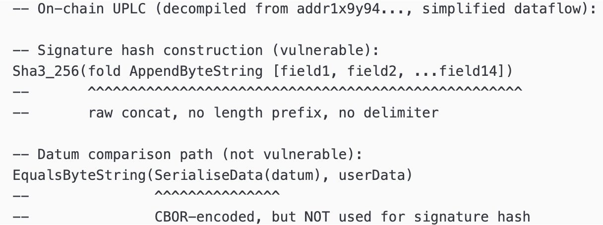
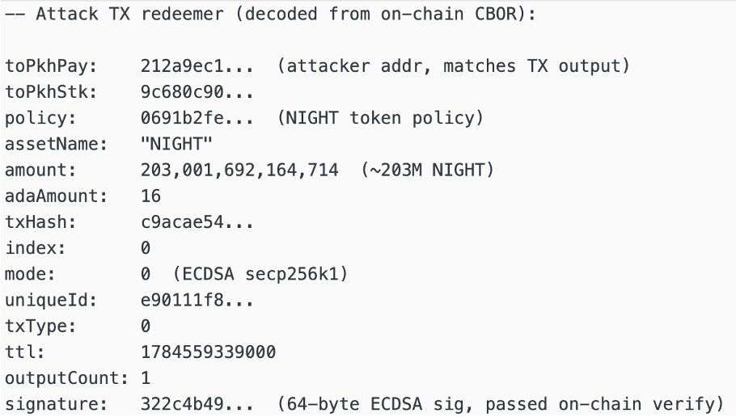
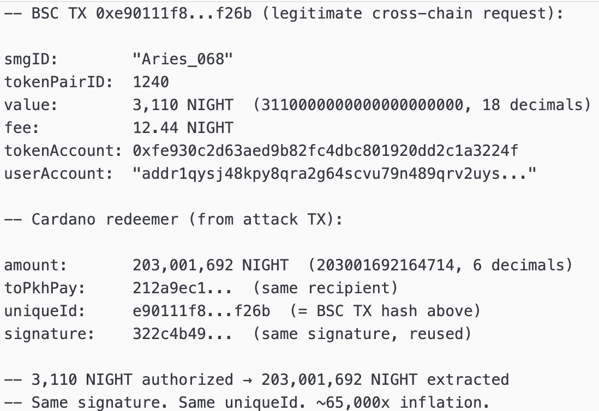
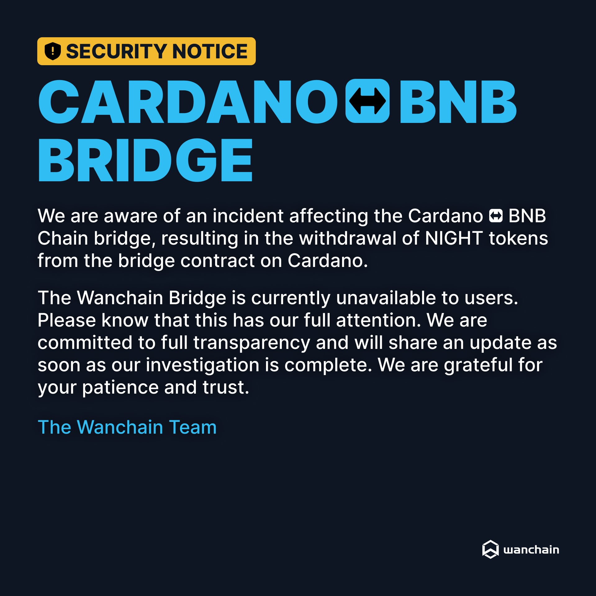

# CID-202603: Wanchain Cardano Bridge Exploit (NIGHT)

*This report was generated with AI (Claude Opus 5.5) from the public sources listed under Sources. To correct or remove content, see [Corrections and removals](../README.md#corrections-and-removals).*

> On 20 July 2026, between 14:46 and 14:55 UTC, an attacker withdrew about 515.2 million NIGHT, the Midnight network's token issued as a Cardano native asset, from the Cardano-side treasury of Wanchain's Cardano–BNB Chain bridge in four transactions [11][14]. The tokens were worth about USD 10 million at the time and made up roughly 98% of the reserve backing Wanchain-wrapped NIGHT on BNB Chain [14]. No keys were stolen and no signatures forged. Wanchain's Cardano smart contract checked approvals from Wanchain's signing network against a message built by joining several fields with nothing marking where one ended and the next began, so the attacker could present a valid approval for a small withdrawal as approval for a much larger one [1][6]. The flaw was in Wanchain's contract, not in Cardano: the ledger ran the contract as written, the Midnight network was unaffected and no new NIGHT was created [1][9][14]. Wanchain suspended the bridge, published a short post-mortem and offered the attacker a 10% bounty to return the rest by 6 August 2026 [1][2][3]. As of 13 October 2026 no return or compensation plan has been made public [14][19], and the bridge's NIGHT reserve has not been refilled [11].

## Timeline (UTC)

X post times are derived from the post IDs; on-chain times are Cardano block times [11].

| Time | Event |
|---|---|
| Before 2024-12-19 | Wanchain says its Cardano bridge was audited before launch by Anastasia Labs and is "undergoing another audit" by TxPipe [5]. The Project Catalyst Fund 12 proposal funding that second audit (250,000 ADA) is marked complete [12]. |
| 2026-07-20 14:18–14:33 | Three releases of about 5,076 NIGHT each go from the bridge treasury to the address that later receives the drained NIGHT, consistent with Wanchain's statement that the attacker first made small legitimate transfers [1][11]. |
| 2026-07-20 14:46:50 | Transaction `0a4861be…2ea1` withdraws 203,001,692.164714 NIGHT to the attacker's address [6][11]. |
| 2026-07-20 14:49:03 | A release of 1,978.056 NIGHT from the treasury reaches the same address [11]. |
| 2026-07-20 14:51:25 | Transaction `ba4edf84…2305` withdraws 129,633,878.020714 NIGHT [11]. |
| 2026-07-20 14:53:18 | Transaction `e4ff7b12…f1d7` withdraws 120,430,264.324714 NIGHT [11]. |
| 2026-07-20 14:55:05 | Transaction `fe9e9de0…af3d` withdraws 62,140,710.916714 NIGHT. Total drained: 515,206,545.43 NIGHT [11]. |
| 2026-07-20 (from 14:46) | The attacker starts selling. Community tracing reports about 300 million NIGHT sold on Cardano DEXes and NIGHT used as collateral on Liqwid [14]. NIGHT falls from above USD 0.026 to about USD 0.0152–0.0158 [14][19]. |
| 2026-07-20 16:29–21:21 | The treasury processes 19 more transactions, including a 14,113 NIGHT release to a different address at 16:29 [11]. When Wanchain halted the bridge was not published [1]. |
| 2026-07-20 20:43 | Midnight Foundation "Community Update": the incident "appears to relate to cross-chain bridge operations and not the @MidnightNtwrk itself" [8][13]. |
| 2026-07-21 00:57 | Midnight Foundation: the incident is "isolated to the Wanchain Cardano–BNB bridge"; Midnight's protocol, validators and consensus "remain secure" [9]. |
| 2026-07-21 05:47 | BlockSec Phalcon publishes a root-cause analysis: "non-injective signed-message encoding in the TreasuryCheck validator" [6]. |
| 2026-07-21 05:51 | Wanchain posts a "Security notice"; the bridge "is currently unavailable to users" [2][13]. |
| 2026-07-21 06:21 | BlockSec traces the exploit's `uniqueId` to a legitimate BNB Chain transaction that authorised about 3,110 NIGHT [7]. |
| 2026-07-21 12:38 | Midnight Foundation says KuCoin, Kraken, Binance, Bybit, OKX, Gate and MEXC have frozen linked accounts and addresses, blacklisted attacker wallets and, "where appropriate", suspended NIGHT deposits and withdrawals [10]. |
| 2026-07-22 | NIGHT rebounds about 19% to around USD 0.022. Per CoinDesk, Charles Hoskinson blames legacy bridge architecture built by a third party and argues for zero-knowledge designs [15]. |
| 2026-07-28 | Wanchain publishes "Cardano ↔ BNB Chain Bridge Incident Post-Mortem" [1]. |
| 2026-07-30 17:00 | Wanchain offers a white-hat deal: return 90%, keep 10%, deadline 6 August 2026 12:00 UTC [3]. |
| 2026-08-04 09:21 | Wanchain repeats that the offer "remains open" [4]. |
| 2026-08-06 12:00 | The deadline passes. No public statement confirms any return [19]. |
| 2026-08-14 | First treasury withdrawal since 20 July. It and all 49 later treasury withdrawals run a different check script from the one used in the drains [11]. |
| 2026-10-09 to 10-10 | 34 treasury withdrawals, all XER outflows [11]. |
| 2026-10-13 | The treasury holds 11,837,345.21 NIGHT. Wanchain's published Cardano return address has never received NIGHT [11]. |

## Impact

The four withdrawals total 515,206,545.43 NIGHT [11], matching the "approximately 515.206 million" reported by analysts [14]. The reserve held about 527 million NIGHT before the attack and about 12 million afterwards, so roughly 97.8% was removed [14]. The drained amount was about 2.15% of NIGHT's 24 billion total supply and 3.1% of the circulating supply [14].

At about USD 0.0195 per NIGHT the drain was worth about USD 10 million [13][14]. Valuations at pre-attack prices give about USD 13 million [16][18], and valuations after the sell-off about USD 9 million [14]; the attacker's realised proceeds were lower because of slippage on thin DEX liquidity [14]. NIGHT fell more than 40% to an all-time low of USD 0.01582 on 20 July 2026 before partly recovering [14][15][19].

The drained NIGHT backed Wanchain-wrapped NIGHT on BNB Chain, which cannot be fully redeemed unless the reserve is refilled or another recovery mechanism is used [14]. Wanchain made the bridge unavailable [1][2], and some exchanges suspended NIGHT deposits and withdrawals [10]. Wanchain says its EVM and other non-EVM bridge contracts use a different codebase and are not vulnerable to this attack [1]; the Midnight network was not affected [9], and NIGHT's total supply did not change [14].

Rated SEV-1 (dimension: financial loss of about USD 10 million gross, above the USD 1 million threshold); potential SEV-1 (dimension: financial; the same treasury also held other bridged assets such as Mynth, XER and WMT that were not taken [14]). Recoverability: not-recoverable (none of the drained NIGHT has reached Wanchain's return address and the reserve had not been refilled by 2026-10-13 [11]; no compensation for wrapped-NIGHT holders has been published [14]).

## Root cause

Wanchain's bridge is secured by an MPC (multi-party computation) signing network, which Wanchain describes as 25 nodes of which 17 must agree to execute a cross-chain transaction [14]. To release funds on Cardano, the MPC network signs a hash of the withdrawal data, and a Plutus V2 validator called TreasuryCheck rebuilds that hash from the transaction's redeemer (the data supplied with the spending transaction) and verifies the signature [1][6]. BlockSec decompiled the on-chain bytecode and found that the validator built the hash input "by raw-concatenating 14 variable-length redeemer fields (via `AppendByteString` fold) without delimiters or length prefixes", so that "different field-value tuples can produce the same byte string — and therefore the same hash and a valid signature reuse" [6]. Wanchain's post-mortem names the two fields exploited: the amount of the asset being moved (here NIGHT) and an amount of ADA, both "converted to bytes then hashed", with "no fixed boundary marking where the first number ended and the second began" [1].

*Figure 1: BlockSec's simplified dataflow of the decompiled TreasuryCheck validator. The signature hash is SHA3-256 over a raw concatenation of the redeemer fields; the CBOR-encoding `SerialiseData` builtin appears only on the datum comparison path. Source: BlockSec Phalcon, [post on X, 21 July 2026](https://x.com/Phalcon_xyz/status/2079443108027421183) [6].*

*Figure 2: The redeemer of the first drain transaction as decoded by BlockSec: an `amount` of 203,001,692,164,714 base units (about 203M NIGHT) directly followed by `adaAmount`, and a signature that passed on-chain verification. Source: BlockSec Phalcon, [post on X, 21 July 2026](https://x.com/Phalcon_xyz/status/2079443108027421183) [6].*

The attacker made a small, legitimate NIGHT transfer from BNB Chain to Cardano, which the MPC network signed and submitted through a dedicated Ogmios server (an interface to a Cardano node) run by Maestro. About 8.69 seconds later the attacker's own transaction appeared on chain with the same signature but with the byte boundary between the two numbers shifted. The contract checked that the signature was valid and had not been used before, and released the funds [1]. BlockSec traced the `uniqueId` in the first drain to a legitimate BNB Chain request for about 3,110 NIGHT [7].

*Figure 3: BlockSec's comparison of the legitimate BNB Chain request (value 3,110 NIGHT, fee 12.44 NIGHT, paid to the attacker's Cardano address) with the Cardano redeemer that reused its `uniqueId` and signature to extract 203,001,692 NIGHT. Source: BlockSec Phalcon, [post on X, 21 July 2026](https://x.com/Phalcon_xyz/status/2079451633847783655) [7].*

The ledger data show how the boundary moved [11]. Each drained amount, in NIGHT base units (6 decimals), equals a small amount multiplied by 65,536 (2^16), plus 4,714 (`0x126a`):

| Drain transaction | NIGHT withdrawn | = small amount × 65,536 + 4,714 |
|---|---|---|
| `0a4861be…` | 203,001,692.164714 | 3,097.560000 NIGHT |
| `ba4edf84…` | 129,633,878.020714 | 1,978.056000 NIGHT |
| `e4ff7b12…` | 120,430,264.324714 | 1,837.620000 NIGHT |
| `fe9e9de0…` | 62,140,710.916714 | 948.192000 NIGHT |

In hexadecimal, 1,978.056 NIGHT is `75e6bd40` and the drained 129,633,878.020714 NIGHT is `75e6bd40126a`. This fits Wanchain's description [1]: the boundary moved two bytes to the right, so the bytes `0x12 0x6a` that began the next field became the end of the NIGHT amount. The concatenated bytes, and therefore the hash and signature, stay the same while the amount grows by a factor of 2^16, matching the "~65,000x inflation" BlockSec reported [7]. This reading is the catalogue's inference from the on-chain amounts.

A safe primitive was already in the contract: the bytecode contains the `SerialiseData` builtin but uses it only when matching output datums, and hashing `SerialiseData(...)` of the structured message "would have provided unambiguous CBOR-encoded field boundaries" [6].

Wanchain says the exploited contract "had been formally audited by two independent external firms, and neither identified this issue", without naming them [1] (see Disputed or open points).

## Detection

Wanchain has not said how or when it detected the drain; the post-mortem says only that "shortly after, the bridge became unavailable and an investigation was launched" [1]. Treasury transactions continued until 21:21 UTC [11], suggesting the bridge was not paused immediately, and no automated circuit breaker stopped the sequence after the first 203 million NIGHT withdrawal [14]. Press reports credit BlockSec's Phalcon monitoring with first flagging the exploit publicly [13][17]. Wanchain acknowledged the incident about 15 hours after the drain, four minutes after BlockSec's analysis [2][6].

## Response and resolution

Wanchain made the bridge unavailable and opened an investigation [1][2]. Coordinated by the Midnight Foundation, which issued three statements within about 16 hours separating the bridge from the Midnight network [8][9][10], KuCoin, Kraken, Binance, Bybit, OKX, Gate and MEXC froze accounts and addresses linked to the incident, blacklisted attacker wallets and, where appropriate, suspended NIGHT deposits and withdrawals [10]. The amounts frozen were not disclosed [14].

Wanchain's first statement was a "Security notice" published only as an image (Figure 4), promising "full transparency" and an update once the investigation was complete [2][13]. In replies, users complained that Wanchain said little in the following days [2].

*Figure 4: Wanchain's security notice, posted on X at 05:51 UTC on 21 July 2026 with the one-line text "Security notice regarding the Cardano ↔ BNB Chain Bridge." Source: Wanchain (@wanchain_org), [post on X](https://x.com/wanchain_org/status/2079444149066244340) [2].*

The post-mortem of 28 July explains the mechanism, rules out key compromise and states which code paths were affected [1]. It gives no transaction hashes, amounts, detailed timeline, attacker addresses or compensation plan. It says some funds had been converted to other assets and some had moved to centralised exchanges, which had been notified. It also says Wanchain could not establish when the legitimate signed transaction left Maestro's Ogmios server or entered the mempool, and that "despite repeated requests from Wanchain and multiple other impacted parties, Maestro has not, to date, shared logs" [1]. We found no public response from Maestro.

On 30 July Wanchain asked the attacker to return 90% of the NIGHT to a Cardano or Ethereum address by 6 August 2026 12:00 UTC and keep 10%, in which case it would treat the case as a white-hat recovery and "not pursue civil claims"; analytics firms and exchanges were monitoring the addresses [3][17]. Wanchain repeated the offer on 4 August [4], and the press reported it would otherwise pursue legal remedies and widen efforts to identify the attacker [18]. No return has been publicly confirmed [19]; the Cardano return address has never received NIGHT or any transaction with inputs from the attacker's stake key [11].

## Remediation and follow-up

- On 28 July Wanchain said it was implementing a fix, aimed to ship it "within the week" without a hard deadline, and would put it through internal and external review before deployment [1]. We found no announcement of the deployment, a re-audit or the reopening of the NIGHT route.
- On-chain, all 50 treasury withdrawals since 14 August 2026 run a different check script (hash `8c027908…`, 6,501 bytes) from the one used in the drains (hash `485aa103…`, 15,989 bytes); no treasury transaction has used the old script since 20 July [11]. This indicates that the TreasuryCheck logic was replaced, but its code and any review are not public.
- As of 13 October 2026 the treasury's NIGHT balance (11.84 million) has not been refilled [11], and no compensation framework for holders of wrapped NIGHT on BNB Chain, or for others affected, has been published [14].

## Incident handling assessment

Assessment of the responsible party's handling (Wanchain, which built and operates the bridge contracts and MPC signing network) against SOC 2 Trust Services Criteria, based on public sources only (see CLASSIFICATION.md, section 10).

| Criterion | Result | Observation |
|---|---|---|
| CC7.2 Monitoring and detection | Exceptions noted | No source says how or when Wanchain detected the drain, and press reports credit BlockSec Phalcon with first flagging it publicly [1][13][17]. Four withdrawals took about 98% of the reserve in about eight minutes with no reported automatic circuit breaker [11][14]. |
| CC7.3 Evaluation of events | Not evidenced | No source describes Wanchain's internal triage or when it assessed the scope. Its post-mortem a week later identified the mechanism and the affected code paths consistently with BlockSec's analysis [1][6]. |
| CC7.4 Incident response | Exceptions noted | Wanchain made the bridge unavailable and opened an investigation, but did not publish when it halted the bridge, and the treasury kept processing transactions for hours after the drain [1][11]. The exchange freezes were coordinated by the Midnight Foundation [10]. |
| CC7.5 Recovery | Exceptions noted | The root cause was determined and a fix announced [1], and a replacement check script has been in use on-chain since 14 August [11], but Wanchain has not confirmed the deployment, a re-audit or the reopening of the route. The NIGHT reserve has not been refilled and no compensation framework has been published [11][14]. |
| CC2.3 External communication | Exceptions noted | Wanchain's first statement was an image-only notice about 15 hours after the drain, and users complained of little information in the following days [2][6]. The post-mortem omits transaction data, a detailed timeline and a recovery plan [1][18]. |
| CC8.1 Change management | Exceptions noted | The flaw was introduced with the deployed TreasuryCheck contract. Wanchain says two independent audits reviewed it without finding the issue; which code version they covered is not public [1][5]. |

## Lessons for builders

- **Never sign or verify a raw concatenation of variable-length fields.** If the encoding does not uniquely determine its inputs, one signature authorises several messages. In Plutus, hash `serialiseData` of a typed `Data` value (for example `sha3_256 (serialiseData msg)`); in Aiken, use `builtin.serialise_data` / `cbor.serialise` on a record type. CBOR encodes each field's length and type, so boundaries cannot move. The builtin was already in Wanchain's Plutus V2 script [6][14]. A hand-rolled encoding must be injective: fixed-width integers (for example `integerToByteString`, Plutus V3 / CIP-121) and length-prefixed byte strings would have made the two-byte shift seen in the drain amounts impossible.
- **Make the off-chain signer produce exactly the same bytes.** CBOR allows several encodings of one value, so the MPC or oracle signer must rebuild the same `Data` and encode it as `serialiseData` does; shared test vectors (message, bytes, hash) run against both validator and signer catch drift.
- **Treat any broadcast authorisation as public.** The attacker's transaction appeared 8.69 seconds after the legitimate signed transaction was submitted [1]. Once a signed transaction reaches a node, others may see its redeemer and signature before confirmation; a visible signature must give no power beyond what the signer intended.
- **Bind replay protection to the whole message.** The contract checked that the signature had not been used before [1], but the same signature could be read as different withdrawals. Consume the identifier on chain (for example by spending a unique UTxO) and keep the identifier and every economic field inside one unambiguous preimage.
- **Cap treasury outflows and reconcile reserves.** Each withdrawal was tens of thousands of times larger than the user's transfer [7], and four of them took about 98% of the reserve in about eight minutes [11][14]. Per-transaction caps, per-period limits relative to reserve size, and an automatic pause when locked collateral diverges from wrapped supply would each have limited the loss [14].
- **Test injectivity directly.** Property tests that move k bytes across each boundary between adjacent variable-length fields and assert that verification fails would catch this bug; "valid message passes" tests do not, and two audits did not either [1].

## Disputed or open points

- **Date:** Block times put the drain on 20 July 2026 [11]; several outlets give 21 July, the UTC date of BlockSec's alert and Wanchain's statement [13][16].
- **Size of the original authorisation:** BlockSec cites about 3,110 NIGHT for the BNB Chain request behind the 203M withdrawal [7], while working back from the on-chain amount gives 3,097.56 NIGHT (see Root cause). The 12.44 NIGHT fee shown in Figure 3 is exactly the difference, so the gap is probably the bridge fee, but neither BlockSec nor Wanchain says so [7].
- **Replay check and the 14:49 release:** A 1,978.056 NIGHT release to the attacker's address landed at 14:49:03, before the 14:51:25 drain whose amount derives from 1,978.056 NIGHT [11]. Wanchain says the contract checked that the signature "hadn't been used before" [1], but how the drain passed that check after a matching release had landed is unexplained; it may involve a different transfer of the same amount.
- **How the attacker got the signature:** Wanchain names Maestro's dedicated Ogmios server as an unaccounted-for part of the transaction path and says Maestro has not shared logs [1]. No Maestro statement was found. No source alleges wrongdoing by Maestro, and the post-mortem places the root cause in the contract [1].
- **Timing of the post-mortem:** The post-mortem is dated 28 July 2026 [1], yet FinanceFeeds reported on 31 July that Wanchain had "not yet published its full postmortem" [18].
- **Fund flows:** About 217.7 million NIGHT swapped for 24.02 million ADA, 87.88 million NIGHT for about 1.44 million USDCx, about 200 million NIGHT moved to a second wallet and 68.27 million NIGHT deposited on Liqwid to borrow about 4.36 million ADA come from preliminary community tracing [14] and are not confirmed by Wanchain. CoinDesk's figure of 290 million NIGHT "stolen and dumped" [15] matches the amount reported sold [14], not the amount drained.
- **Audit coverage:** Whether the two firms Wanchain cites [1] are those named in 2024 [5], and which code version they reviewed, is not public. The Catalyst proposal said the audited contracts would be open-sourced [12], but we did not locate a public repository.
- **Concentration of NIGHT in the bridge:** No source explains who had bridged the roughly 527 million NIGHT in the reserve [14], or how much belonged to individual users rather than market makers or institutions.

## Sources

1. [P] Wanchain, "Cardano ↔ BNB Chain Bridge Incident Post-Mortem" (page title: "Cardano–BNB Chain Bridge Incident: What Happened & What's Next"), 2026-07-28. https://medium.com/@wanchain_org/cardano-bnb-chain-bridge-incident-post-mortem-353e465276e7 (no Wayback Machine copy existed at retrieval)
2. [P] Wanchain (@wanchain_org), post on X: "Security notice regarding the Cardano ↔ BNB Chain Bridge.", 2026-07-21. https://x.com/wanchain_org/status/2079444149066244340
3. [P] Wanchain (@wanchain_org), thread on X: "To the party who executed the exploit of the Wanchain Bridge on Cardano on July 20, 2026…", 2026-07-30. https://x.com/wanchain_org/status/2082873876682248250
4. [P] Wanchain (@wanchain_org), post on X (thread 3/5): "The offer outlined in the prior message remains open…", 2026-08-04. https://x.com/wanchain_org/status/2084570393621258612
5. [P] Wanchain (@wanchain_org), post on X: "Wanchain's #Cardano Bridge was audited prior to launch by @AnastasiaLabs…", 2024-12-19. https://x.com/wanchain_org/status/1869759693507141641
6. [P] BlockSec Phalcon (@Phalcon_xyz), post on X: "Wanchain @wanchain_org Cardano bridge was reportedly being attacked…" (root-cause analysis, links attack transaction), 2026-07-21. https://x.com/Phalcon_xyz/status/2079443108027421183
7. [P] BlockSec Phalcon (@Phalcon_xyz), post on X: "We traced the redeemer's `uniqueId` field back to a legitimate BSC TX…", 2026-07-21. https://x.com/Phalcon_xyz/status/2079451633847783655
8. [P] Midnight Foundation (@midnightfdn), post on X: "Community Update: We are aware of reports concerning an incident involving the Wanchain Cardano to BNB bridge…", 2026-07-20. https://x.com/midnightfdn/status/2079306216564539796 (text as embedded in [13])
9. [P] Midnight Foundation (@midnightfdn), post on X: "We wanted to provide a brief clarification regarding the recent incident involving NIGHT…", 2026-07-21. https://x.com/midnightfdn/status/2079370237334413522
10. [P] Midnight Foundation (@midnightfdn), post on X: "Update on Wanchain Cardano<>BNB bridge incident…", 2026-07-21. https://x.com/midnightfdn/status/2079546529673609701
11. [P] Cardano mainnet ledger data: treasury script `addr1xyw0kswupwx38ljnvq8pwpvae0x69krywdr7cffg3d84ydp9nvv84g58ykxqh90xx6j8ywgjst0dkt430w9lxgdmzncsw5rzpd`, TreasuryCheck script used in the drains `addr1x9y94ggrg0mrhnp2g0ckyhwggyynfz8ydpd6vp7vrpa6f9f9nvv84g58ykxqh90xx6j8ywgjst0dkt430w9lxgdmzncsrlh4ng` (script hash `485aa10343f63bcc2a43f1625dc841093488e4685ba607cc187ba495`), check script used from 2026-08-14 `addr1xxxqy7ggyc8tc22ppnj0llnc3kj3pexhl4nlfvua83makh39nvv84g58ykxqh90xx6j8ywgjst0dkt430w9lxgdmzncsurygyp` (script hash `8c027908260ebc29410ce4fffe788da510e4d7fd67f4b39d3c77db5e`), recipient `addr1qysj48kpy8qra2g64scvu79n489qrv2uys5ggsrun29v5f5udqxfpr7x0pqfl6khjwv6vm0k8s3spn6h0zfrwszfqgcqeld8kj`, Wanchain return address `addr1q8jqrqz0t2vzy5yvl88wtyjgurvhwauw0sqpe698mq04p0ham3clyk6mg6gctwsfuc8hsgqdt0s9laxl585uwu3xvx2s2pglww`, NIGHT policy `0691b2fecca1ac4f53cb6dfb00b7013e561d1f34403b957cbb5af1fa`, drain transactions `0a4861be5dd1cd0a5ccd7d38855ef8fe233563274c22c27adb4f5980535d2ea1`, `ba4edf844c8dc1289a63660a33a720d24d7dd83825222354b09aee5847132305`, `e4ff7b122df4bc78dc151089a581eedf7997974eaeb74df011a09a889de6f1d7`, `fe9e9de054459578dbfaa5507f447ea4453a7525f801b526d9ffebe6753aaf3d`; queried via Koios API, 2026-10-13. https://api.koios.rest/api/v1/tx_info ; attack transaction: https://cardanoscan.io/transaction/0a4861be5dd1cd0a5ccd7d38855ef8fe233563274c22c27adb4f5980535d2ea1
12. [P] Project Catalyst, "Wanchain's Cardano Bridge Audit" (Fund 12, proposal #1200245), n.d. https://projectcatalyst.io/funds/12/cardano-use-cases-product/wanchains-cardano-bridge-audit
13. [S] The Crypto Times (Gopal Solanky), "Wanchain Cardano Bridge Exploited, Hackers Stole $10M in NIGHT Tokens", 2026-07-21. https://www.cryptotimes.io/2026/07/21/wanchain-cardano-bridge-exploited-hackers-stole-10m-in-night-tokens/
14. [S] The Crypto Times (Divya Mistry), "The $10M Wanchain Bridge Exploit: How a Signature Flaw Drained 515M NIGHT Tokens", 2026-07-22 (updated 2026-10-01). https://www.cryptotimes.io/insights/wanchain-night-bridge-exploit-signature-flaw/
15. [S] CoinDesk (Oliver Knight), "Midnight token rebounds 19% after Wanchain bridge hack, Hoskinson calls for ZK revamp", 2026-07-22. https://www.coindesk.com/business/2026/07/22/midnight-token-rebounds-after-wanchain-bridge-hack-hoskinson-calls-for-industry-overhaul
16. [S] CoinCentral, "Wanchain Cardano Bridge Exploit Drains 515 Million NIGHT Tokens in $13M Hack", 2026-07-22. https://coincentral.com/wanchain-cardano-bridge-exploit-drains-515-million-night-tokens-in-13m-hack/
17. [S] The Crypto Times (Sharmistha Suman), "Wanchain Sets August 6 Deadline for Cardano Bridge Hacker", 2026-07-31. https://www.cryptotimes.io/2026/07/31/wanchain-sets-august-6-deadline-for-cardano-bridge-hacker/
18. [S] FinanceFeeds (Karthik Subramanian), "Wanchain Gives Hacker Until 12:00 UTC on August 6 to Return Stolen Funds", 2026-07-31. https://financefeeds.com/wanchain-gives-hacker-until-1200-utc-on-august-6-to-return-stolen-funds/
19. [S] MIND CRON (Harry), "NIGHT Prints a Six-Month High 97% Below Its Peak", 2026-10-01. https://mindcron.com/night-token-six-month-high-after-wanchain-hack/
