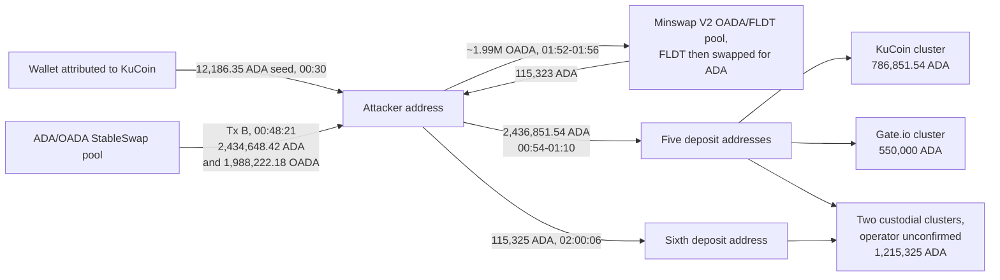
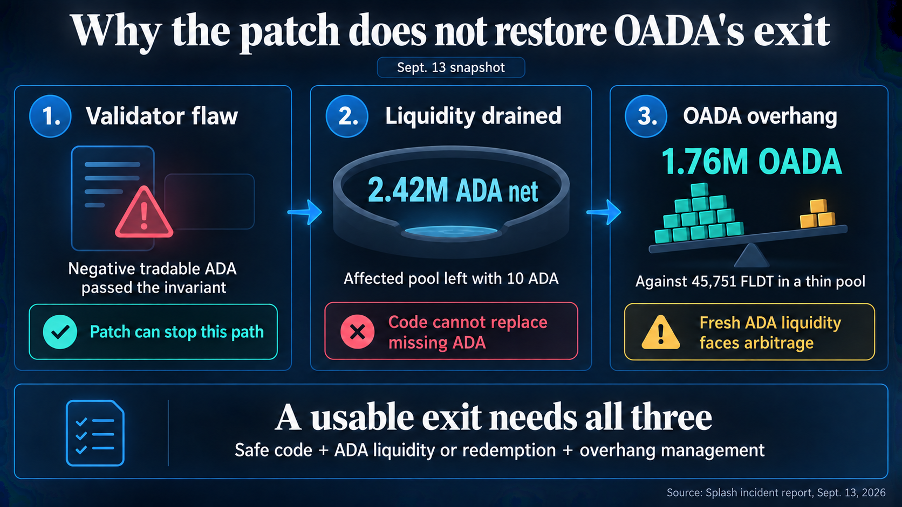

# CID-202604: Splash StableSwap Pool Exploit (ADA/OADA)

*This report was generated with AI (Claude Opus 5.5) from the public sources listed under Sources. To correct or remove content, see [Corrections and removals](../README.md#corrections-and-removals).*

> On 13 September 2026 an attacker drained the ADA/OADA StableSwap pool on the Cardano DEX Splash in two transactions 45 seconds apart, taking 2,424,778 ADA (net of their own deposit) and 1,988,222 OADA, about $915k with OADA valued at its 1:1 ADA peg [1][16]. Splash's pool smart contract (validator) never checked that the pool's "tradable" reserves stayed positive, so an economically impossible trade passed validation; the Cardano base layer was not at fault [1]. Because the pool was the only documented way to convert Optim Finance's ADA-pegged token OADA back to ADA, Optim paused its protocol and OADA holders lost their exit [5][9]. Splash published a detailed root-cause analysis and funds trace the same day and marked the code unsafe [1][2]. As of 13 October 2026 no funds have been returned, no fixed validator has been published and OADA exit liquidity has not been restored; Optim opened a claims portal on 9 October with distributions planned before the end of 2026 [2][17].

## Timeline (UTC)

| Time | Event |
|---|---|
| 2024-06-28 15:27 | Reference script for the `stableFnPoolT2t` validator created on mainnet. The deployed code is splash-core commit `0d28fe4`, compiled with Aiken v1.0.24-alpha [1]. |
| 2024-08-05 | Anastasia Labs issues its StableSwap security audit report (engagement 7 June to 19 July 2024). The audit covers the swap branch that was later exploited [1][10]. |
| 2026-09-06 to 09-11 | Six routine pool transactions (deposits, redeems, one swap) go through the normal batcher. `protocol_fees_x` stays 0 [1]. |
| 2026-09-13 00:30:05 | Attacker's fresh address is funded with 12,186.35 ADA from a wallet that Splash attributes to a KuCoin withdrawal wallet [1]. |
| 2026-09-13 00:47:10 | Attacker buys 100 OADA for 100 ADA through the Optim OADA contract [1]. |
| 2026-09-13 00:47:36 | **Tx A** (`bfb002acec5d1d7e6264da8ff57c21124fa954fdec3ca8c7baf6221727f5bae2`, block 13933439): the attacker deposits 9,870 ADA and books 9,869.999999 ADA of it as accrued "protocol fees" in the pool datum [1]. |
| 2026-09-13 00:48:21 | **Tx B** (`47dae2dac155a14fd967e61d3dd2893eb5e6da1ccb5c4db0da255d7d8e7682d0`, block 13933444): 2,434,648.42 ADA and 1,988,222.18 OADA leave the pool, which is left holding 10 ADA [1][11]. |
| 2026-09-13 00:54-01:10 | 2,436,851.54 ADA is sent to five exchange or custodial deposit addresses [1]. |
| 2026-09-13 01:52-01:56 | About 1.99M OADA is sold into a Minswap V2 OADA/FLDT pool, and the FLDT is swapped for 115,323 ADA [1]. |
| 2026-09-13 02:00:06 | The 115,325 ADA in sale proceeds goes to a sixth deposit address. All six deposit addresses are swept into their custodial clusters within 82 minutes of Tx B [1]. |
| 2026-09-13 06:57 | Optim Finance publicly reports the exploit, pauses its protocol and tells users not to provide OADA liquidity [5][14]. |
| 2026-09-13 16:55 | Splash completes its incident report and funds trace [1]. |
| 2026-09-13 19:12 | Splash opens PR #57, adding the report and a "do not use" notice for its stable-pool code to `splash-core`; the notice is on `main` [2][3]. |
| 2026-09-13 19:19 | Splash announces on X that the pool was drained "through a security breach in the contract", says "no other pool types are affected" and invites the attacker to resolve the matter as a bug bounty [4]. |
| 2026-09-13 20:03 | Optim calls Splash's report "most comprehensive to date" [6]. |
| 2026-09-15 00:06 | Optim says it is "indexing the chain and getting a full accounting of impacted addresses and assets" [7]. |
| 2026-09-17 19:11 | Optim: "Update on next 24-48 hours. We're setting up a claims portal" [8]. |
| 2026-10-09 16:12 | Optim announces that its claims portal is live for OADA, sOADA and O holders, with 10 weeks to submit claims and distributions "before year end" [17]. |

## Impact

Tx B took 2,434,648.42 ADA and 1,988,222.18 OADA out of the pool. Net of the attacker's own 9,870 ADA deposit, the pool lost 2,424,778.42 ADA and 1,988,222.18 OADA. Because the LP token supply did not change, the loss falls on the pool's liquidity providers [1]. At CoinGecko's 13 September price of about $0.2073 per ADA [16], that is about $503k in ADA plus $412k in OADA at its 1:1 peg, about $915k in total. Sold into a thin market, the OADA brought the attacker only about 115k ADA (about $24k) [1]. The pool was left with 10 ADA, about 1.44M OADA and a negative tradable ADA reserve, so it cannot operate normally; two other pools on the same validator held about 72 ADA in total [1].

For OADA holders the drain removed the exit. Optim's documentation says OADA has no direct redemption: the OADA/ADA StableSwap on Splash is the only exit, and Optim's Splash DEX AMO (an automated market operation that buys or sells OADA in that pool) holds the peg [9]. After the drain every other OADA venue held only single- or double-digit ADA balances, and about 1.76M OADA sat in a thin Minswap OADA/FLDT pool far below peg, a stock that Splash said would absorb any new ADA/OADA liquidity through arbitrage [1] (Figure 2). Optim paused its protocol and said OADA-to-ADA swaps were not possible [5]. Its documentation says sOADA, the staked tranche, "absorbs any potential losses should the system encounter unforeseen issues" [9].

Splash said no other pool types were affected [4]. The Cardano ledger and consensus were unaffected and processed the transactions as valid [1].

Rated SEV-2 (financial: about $915k gross, below the $1M SEV-1 threshold; the OADA exit outage of more than 24 hours reaches only SEV-3 on availability); potential SEV-1 (financial: before the attack the pool held about 2.42M ADA and 3.43M OADA [1], about $1.21M at the same price and peg, and the validator imposed no lower bound on either reserve). Recoverability: not-recoverable (the drained funds have not been returned; Optim's claims distributions are pending and their funding has not been published [17]).

## Root cause

The pool ran Splash's two-asset StableSwap validator `pool_t2t_exact.ak`, deployed as `stableFnPoolT2t` with script hash `5d3df99f…` [1][12]. Splash rebuilt the deployed bytecode from source, matched it byte for byte to splash-core commit `0d28fe4`, and found the swap branch used in the exploit unchanged from the audited commit `d9768bb4` [1].

The validator computes `x_tradable = x_total − protocol_fees_x` and `y_tradable = y_total − protocol_fees_y` and then checks the StableSwap invariant `F(D, x, y) = D³ + 3196·x·y·D − 3200·x·y·(x + y)` on these values. According to Splash's analysis, three checks were missing [1]:

1. **No domain check.** Nothing required `x_tradable > 0` and `y_tradable > 0` before or after a transition, or `protocol_fees < total`. Plutus integers are signed and unbounded, so a negative intermediate reserve is a legal value even though the ledger never holds negative balances.
2. **Fee accrual bounded only from below.** The check `quote_protocol_fees_delta * f_rev >= -quote_total_delta * protocol_fee_num` reduces to `delta ≥ 0` because this pool had `protocol_fee_num = 0`. A transaction could therefore declare almost any deposit as "protocol fees".
3. **No swap-direction check.** The swap direction is inferred from the sign of `y_tradable_delta`. Nothing required that one asset enters and the other leaves, so a transition in which both tradable reserves fall was not rejected.

The invariant's sign tests (`F_before ≥ 0`, `F_after ≤ 0`, `F_after_shifted ≥ 0`) assume `x, y > 0`. With a negative `x` the products change sign, and the tests can be satisfied by a transition in which the pool loses both assets [1].

The attacker used these gaps in two steps [1]. Tx A deposited 9,870 ADA and raised `protocol_fees_x` from 0 to 9,869,999,999 lovelace, so the tradable ADA reserve grew by exactly 1 lovelace. Tx B then used the AMM swap branch to withdraw real ADA down to 10 ADA, below the inflated fee counter, which drove tradable ADA to −9,859.999999. The fee check (0 ≥ 0), the non-quote fee check and all three polynomial checks still passed, so 1,988,222 OADA left the pool at the same time. Splash's numeric replay shows that either a domain check or a two-sided fee bound would have stopped the attack on its own: the domain check rejects Tx B, and the two-sided fee bound rejects Tx A [1].

Anastasia Labs' audit (v1.0, 5 August 2024) covered `pool_t2t_exact.ak` and reported eight findings, six marked resolved and two acknowledged. According to Splash, none of them concerned fee accrual in the swap branch, the sign of tradable reserves or swap direction [1][10].

## Detection

The first public report came from Optim Finance at 06:57 UTC, about six hours after Tx B [5][14]. Splash completed its report at 16:55 UTC and announced it at 19:19 UTC, crediting community member TheCryptoNinja with an independent same-day on-chain trace that matched its own and added a lead [1][4]. Neither team has said how or when it first noticed the drain.

## Response and resolution

Optim Finance paused its protocol, removed the remaining liquidity and warned users not to provide OADA or O liquidity, noting that "a large amount of OADA is in the hands of the hacker" [5]. It then compiled an accounting of impacted addresses and assets [7], and on 9 October opened a claims portal for OADA, sOADA and O holders, with a 10-week claim window and distributions planned before year end [8][17].

Splash's same-day report covers the root cause, a byte-for-byte reproduction of the deployed script, an audit comparison, the attacker's addresses and a funds trace [1]. Splash also added a "CRITICAL VULNERABILITY — DO NOT USE THIS CONTRACT" notice to the stable-pool directory of `splash-core` [2][3]. The trace follows 2,552,176.54 ADA, including the OADA-sale proceeds, to six deposit addresses in four custodial clusters (Figure 1). Two clusters are attributed to KuCoin (786,851.54 ADA) and Gate.io (550,000 ADA) on the basis of two public datasets and chain links; the operator of the other two (1,215,325 ADA) is unconfirmed [1]. The attacker's seed funds also came from a wallet attributed to KuCoin, and one KuCoin deposit address had received 1.26M ADA on 9 September, which Splash said suggests the same exchange account without having established it [1].

*Figure 1: Flow of the drained funds on 13 September 2026 (UTC). All six deposit addresses were swept into their custodial clusters within 82 minutes of Tx B. Data: Splash, "Splash StableSwap (ADA/OADA) exploit: incident report and funds trace" [1]; diagram by the catalogue.*

Splash said it would contact KuCoin and Gate.io with the transaction IDs and would treat a direct return of funds as a white-hat resolution, with a reward and no further escalation [1][4]. No public statement from either exchange about the funds has been found.

## Remediation and follow-up

- Cardano validators cannot be changed once deployed, so a fix requires a new validator and a migration of liquidity. Splash's repository states that "a fixed version will be published separately" and that until then "every stable-pool validator in this repository" should be treated as unsafe, including the newer `validators_v2` code on `main`, which shares the vulnerable reserve computation [2][3]. No fixed stable-pool validator had been published by 2026-10-13 [2].
- An open pull request, "Fix incorrect swap" (#58, opened 2026-09-30, latest commit "Guard pool transitions and add regression tests" on 2026-10-13), adds reserve-positivity and swap-direction checks to Splash's Plutarch CFMM, balance and royalty pool validators. It does not modify the Aiken stable-pool code and does not state whether it relates to this incident [13].
- No return of funds, restoration of OADA exit liquidity or protocol-level OADA redemption had been announced by 2026-10-13. CryptoSlate notes that a usable relaunch would need replenished ADA liquidity or a redemption mechanism, plus a way to deal with the discounted OADA stock in the Minswap pool [15]. Optim's claims portal is the only compensation route announced [17].

*Figure 2: Why a validator fix alone does not restore OADA's exit, based on Splash's 13 September snapshot: 2.42M ADA drained, 10 ADA left in the pool, and 1.76M OADA against 45,751 FLDT in a thin Minswap pool. The "patch" refers to the checks Splash described; no fixed validator had been published by 2026-10-13. Source: Liam 'Akiba' Wright, CryptoSlate, ["Cardano's Splash fix patches the exploit, but leaves 2.4M ADA missing and holders trapped"](https://cryptoslate.com/cardanos-splash-fix-patches-the-exploit-but-leaves-2-4m-ada-missing-and-holders-trapped/), 17 September 2026 ([original image](https://cryptoslate.com/wp-content/uploads/2026/09/exec-5e649beb-ace6-46e5-8aac-3b6b17753ae2-1.png)) [15].*

## Incident handling assessment

Assessment of the responsible party's handling (Splash, operator of the exploited pool validator) against SOC 2 Trust Services Criteria, based on public sources only (see CLASSIFICATION.md, section 10).

| Criterion | Result | Observation |
|---|---|---|
| CC7.2 Monitoring and detection | Not evidenced | Splash has not published how or when it detected the drain [1]. The first public report came from Optim Finance about six hours after Tx B [5]. |
| CC7.3 Evaluation of events | No exceptions noted | Within about 16 hours Splash had reproduced the deployed script byte for byte, identified the missing checks, stated that other pool types were unaffected and flagged that its newer `validators_v2` stable-pool code shares the flaw [1][2][4]. |
| CC7.4 Incident response | No exceptions noted | The drain finished within 45 seconds [1]. Splash then marked every stable-pool validator in its repository as unsafe, traced the funds to exchange deposit addresses and said it would contact KuCoin and Gate.io [1][2][4]. |
| CC7.5 Recovery | Exceptions noted | The root cause was determined on the day of the exploit [1], but as of 2026-10-13 Splash had published no fixed stable-pool validator, recovered no funds and announced no compensation, and OADA exit liquidity had not been restored [2][13]. The only compensation route is Optim's claims portal [17]. |
| CC2.3 External communication | No exceptions noted | Splash published a full incident report with root cause, audit comparison and funds trace, and announced it on X on the day of the exploit [1][4]. Optim Finance called it "most comprehensive to date" [6]. |
| CC8.1 Change management | Exceptions noted | The validator was deployed after an Anastasia Labs audit whose scope included the exploited swap branch, which was unchanged at deployment, yet it lacked domain, two-sided fee and swap-direction checks [1][10]. The newer `validators_v2` code carries the same reserve computation [2]. Deployment traceability was good: Splash matched the on-chain script to its source commit byte for byte [1]. |

## Lessons for builders

- **Check the domain of every derived quantity.** If a validator computes `reserve − fees`, `collateral − debt` or similar, assert that the result is strictly positive before and after the transition, and that `fees ≤ total`. Plutus `Integer` is signed and unbounded, and invariant formulas derived for positive reals can be satisfied by negative values.
- **Bound accounting counters on both sides.** Fee, interest and reward accrual should equal the amount computed from the trade (exactly, or within a tight range). A lower bound alone allows arbitrary inflation, and here it reduced to `delta ≥ 0` because the fee numerator was zero. Test degenerate parameter settings (zero fees, maximum fees) explicitly.
- **Enforce swap direction and value conservation independently of the invariant.** A swap must have exactly one reserve increase and one decrease. A transition in which every reserve falls while the LP supply is unchanged should be rejected by a simple check, not left to a polynomial.
- **Fuzz datum transitions adversarially.** Generate arbitrary redeemers and datum deltas (including fee-counter changes and negative intermediate reserves) and assert "pool value never decreases without LP burn". Aiken property tests or an external fuzzer can find the two-step pattern used here (inflate a counter, then withdraw below it).
- **Keep audit, source and deployment traceable.** The exploited path was within audited scope and unchanged since the audit, and Splash could tie the on-chain script to an exact commit, compiler version and parameter within hours because it kept a deployment manifest and could rebuild byte for byte [1]. Publishing such manifests for every deployed validator lets others check what an audit actually covered.
- **Avoid single points of exit in composed protocols.** OADA's only exit was one third-party pool, which also carried its peg mechanism [9]. Issuers of pegged assets should plan a fallback redemption route and monitor the pools they depend on, for example by alerting on fee counters that jump from 0 to nearly the full deposit.

## Disputed or open points

- **Was it "patched"?** CryptoSlate's headline says Splash's fix "patches the exploit" [15]. Splash's own sources describe the checks that would have prevented the attack and state that a fixed version "will be published separately"; no fixed stable-pool validator had been published by 2026-10-13 [1][2].
- **Who bears the loss.** Neither Splash nor Optim has said who held the pool's LP position (for example, Optim's AMO or third-party LPs), how many addresses were affected, how Optim's claims distributions will be funded and valued, or whether sOADA holders will absorb losses as Optim's documentation provides [9][17].
- **Exchange cooperation.** Splash said it would contact KuCoin and Gate.io [1]. No outcome, freeze or account identification has been made public, and the operators of the two unconfirmed custodial clusters (1,215,325 ADA) have not been identified [1].
- **Other OADA venues.** Optim said the attacker "cleaned out all venues of liquidity that paired OADA" [5]. Splash's trace documents the attacker selling OADA into one Minswap OADA/FLDT pool and records other venues as near-empty by 16:20 UTC, but does not attribute the draining of each other venue to the attacker [1].

## Sources

1. [P] Splash, "Splash StableSwap (ADA/OADA) exploit: incident report and funds trace", 2026-09-13. https://github.com/splashprotocol/splash-core/blob/main/validators_v2/validators/stable_pool/SPLASH_STABLESWAP_INCIDENT_2026-09-13.pdf
2. [P] Splash (GitHub), "validators_v2/validators/stable_pool — CRITICAL VULNERABILITY — DO NOT USE THIS CONTRACT", 2026-09-13. https://github.com/splashprotocol/splash-core/tree/main/validators_v2/validators/stable_pool
3. [P] Splash (GitHub), "stable_pool: critical vulnerability notice and incident report (13 Sep 2026)", PR #57, 2026-09-13. https://github.com/splashprotocol/splash-core/pull/57
4. [P] Splash (@splashprotocol) on X, "The ADA/OADA StableSwap pool was drained on 13 Sep through a security breach in the contract" (with thread), 2026-09-13. https://x.com/splashprotocol/status/2099216297913377253
5. [P] Optim Finance (@OptimFi) on X, "There was an EXPLOIT of a Spalsh pool that supported OADA", 2026-09-13. https://x.com/OptimFi/status/2099029810626593147
6. [P] Optim Finance (@OptimFi) on X, "*OADA Exploit* Splash incident report is most comprehensive to date", 2026-09-13. https://x.com/OptimFi/status/2099227454489743778
7. [P] Optim Finance (@OptimFi) on X, reply: "indexing the chain and getting a full accounting of impacted addresses and assets", 2026-09-15. https://x.com/OptimFi/status/2099650992409284758
8. [P] Optim Finance (@OptimFi) on X, reply: "Update on next 24-48 hours. We're setting up a claims portal", 2026-09-17. https://x.com/OptimFi/status/2100663971011535283
9. [P] Optim Finance documentation, "OADA and sOADA", accessed 2026-10-13. https://optim-finance.gitbook.io/optim-finance/oada/oada-and-soada
10. [P] Splash documentation, "Audits" (Stableswap: Security Audit Report by Anastasia Labs), accessed 2026-10-13. https://docs.splash.trade/concepts/audits
11. [P] Cexplorer, Tx B (pool drain) 47dae2dac155a14fd967e61d3dd2893eb5e6da1ccb5c4db0da255d7d8e7682d0, 2026-09-13. https://cexplorer.io/tx/47dae2dac155a14fd967e61d3dd2893eb5e6da1ccb5c4db0da255d7d8e7682d0
12. [P] Cexplorer, script 5d3df99fcfbbf282bd76a3d76a2e30bdd22e61c56f1462447938933b (stableFnPoolT2t), accessed 2026-10-13. https://cexplorer.io/script/5d3df99fcfbbf282bd76a3d76a2e30bdd22e61c56f1462447938933b
13. [P] Splash (GitHub), "Fix incorrect swap", PR #58 (open), 2026-09-30. https://github.com/splashprotocol/splash-core/pull/58
14. [S] The Crypto Times, "Optim Finance Pauses OADA After Splash Pool Exploit Drains Cardano Liquidity", 2026-09-13. https://www.cryptotimes.io/2026/09/13/optim-finance-pauses-oada-after-splash-pool-exploit-drains-cardano-liquidity/
15. [S] CryptoSlate (Liam 'Akiba' Wright), "Cardano's Splash fix patches the exploit, but leaves 2.4M ADA missing and holders trapped", 2026-09-17. https://cryptoslate.com/cardanos-splash-fix-patches-the-exploit-but-leaves-2-4m-ada-missing-and-holders-trapped/
16. [S] CoinGecko, "Cardano (ADA) historical data, 13-09-2026", accessed 2026-10-13. https://api.coingecko.com/api/v3/coins/cardano/history?date=13-09-2026
17. [P] Optim Finance (@OptimFi) on X, "Optim Claims Portal is now live!", 2026-10-09. https://x.com/OptimFi/status/2108591433892663436
