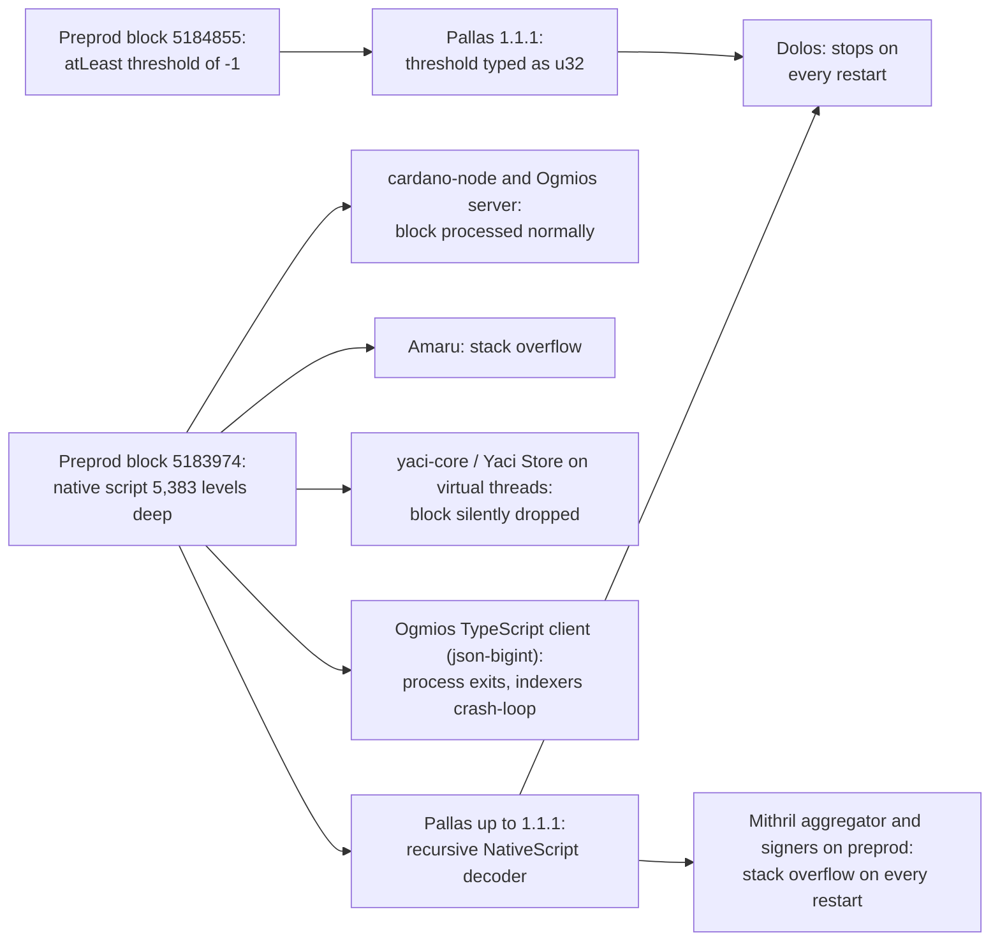

# CID-202605: Deeply Nested Native Script Crashes Tooling on Preprod

*This report was generated with AI (Claude Opus 5.5) from the public sources listed under Sources. To correct or remove content, see [Corrections and removals](../README.md#corrections-and-removals).*

> On 16 September 2026, an open-source project testing the limits of Cardano native scripts (the built-in multisig and time-lock scripts) submitted two unusual but valid transactions to the preprod testnet: one nests a single key 5,383 levels deep, the most a maximum-size transaction can hold, and the other uses a multisig threshold of -1, which the ledger treats as always satisfied [4][5]. The reference Haskell node accepted both [5], but several widely used tools that read the chain crashed on them. The Rust library Pallas ran out of stack memory or rejected the negative number, so Dolos indexers and the preprod aggregator and signers of Mithril (a multi-signature protocol whose signers are run by stake pool operators, SPOs) crashed on every restart. Indexers built on the Ogmios TypeScript client and the Amaru node also crashed, and Yaci Store silently dropped the block [1][2][3][12][13][15]. Pallas, Dolos and Mithril shipped fixes within about 22 hours; Mithril also deployed its hotfix to mainnet and told mainnet signers to upgrade [8][9][11]. No funds were lost, mainnet was not disrupted and the Cardano L1 was not at fault. Whether the concurrent cardano-node 11.1.2 release, which Intersect later called a critical upgrade prompted by "an issue discovered on the Preprod testnet in September", is related has not been established [21]. On 13 October 2026 the Ogmios TypeScript client and Oura were still unfixed [12][17].

## Timeline (UTC)

| Time | Event |
|---|---|
| 2026-09-16 | Arachne, an open-source conformance harness for native scripts (GitHub: Crypto2099), submits boundary-test transactions to preprod [5]. |
| 2026-09-16 13:49 | Preprod block 5183974 (slot 133883340, epoch 313) includes transaction `f90dce57…` [6][7]. It spends from a script that wraps one key in 5,383 `all` layers: a 16,181-byte script in a transaction that fills the 16,384-byte size limit. One level deeper is refused only for size (`MaxTxSizeUTxO`) [1][5]. |
| 2026-09-16 15:13 | An operator reports that preprod indexers built on the Ogmios TypeScript client crash-loop at this block; the Ogmios server is unaffected [12]. |
| 2026-09-16 15:37 | TxPipe opens Pallas PR #802: the block "stopped Dolos instances on both AMD64 and ARM64" [1]. |
| 2026-09-16 19:03 | Preprod block 5184855 (slot 133902219) includes transaction `b1db2a41…`, which spends an `atLeast(-1, [sig, sig])` script with no key witness [5][6][7]. Pallas 1.1.1 cannot decode the negative threshold, so Dolos stops again [3][4]. |
| 2026-09-16 19:20 | A cardano-ledger commit, "Remove unnecessary memory overhead in Timelocks", changes how nested native-script children are held in memory; it later ships in cardano-node 11.1.2 [18][19]. |
| 2026-09-16 20:45-21:34 | Pallas merges the stack-safe native-script codec (#802) and the signed-threshold fix (#803/#804) and releases 1.2.0 [1][4][9]. |
| 2026-09-16 22:40 | With its `lts/v1` line already on Pallas 1.2.0, Dolos opens a PR adding both blocks as regression fixtures (unmerged on 13 October) and notes that its serving side would still overflow on block 5183974 [3][11]. |
| 2026-09-17 03:29 | cardano-node 11.1.2 is published; its only ledger change is listed as "Optimizes memory usage in time lock scripts" [18]. |
| 2026-09-17 05:11 | Pallas 1.3.0 adds stack-safe native-script JSON and Plutus-data decoding; 1.4.0 follows at 21:49, covering further metadata, Plutus-data and Dijkstra native-script operations [9][10]. |
| 2026-09-17 08:12 | A Yaci Store issue reports that block 5183974 is silently missing from the database [13]. |
| 2026-09-17 09:23 | Mithril opens a "critical" issue: since 16 September its `release-preprod` aggregator and signers abort with a stack overflow on every restart [2]. |
| 2026-09-17 10:25 | Dolos v1.6.1 ships with Pallas 1.3.0 and stack-safe script JSON [11]. |
| 2026-09-17 11:50 | Mithril publishes 2630.1-hotfix (signer 1.1.9, Pallas 1.3.0), deploys it to its mainnet, preprod and preview aggregators, and tells signers on all three networks to upgrade [8]. |
| 2026-09-18 | Yaci 0.4.6 ships iterative native-script decoding [14]; cardano-rosetta-java moves to node 11.1.2, Mithril 2630.1-hotfix and yaci-core 0.4.6 [16]. |
| 2026-09-19 | Amaru v10.11.20260918 is published with a fix for "deeply nested scripts and transaction data" [15]. Intersect asks SPOs to prioritise node 11.1.2, which "addresses an issue identified during testing", and to upgrade Mithril signers at the same time [20]. |
| 2026-09-23 | Yaci Store 2.0.3 ships with Yaci 0.4.6 [14]. |
| 2026-09-24 | The ledger team decides negative thresholds must stay decodable, because funds may already be locked by such scripts [23]. |
| 2026-09-29 13:38 | cardano-node 11.1.3 reverts an IPv4 decoding change that 11.1.2 "inadvertently changed" [22]. |
| 2026-10-09 | Intersect calls 11.1.2 "a critical upgrade issued in response to an issue discovered on the Preprod testnet in September" and sets it as the minimum version; about 30% of epoch-660 mainnet blocks still come from older versions [21][25]. |

## Impact

The two transactions reached tools in several languages through different code paths (Figure 1).

*Figure 1: How the two preprod transactions reached the affected tools, based on the maintainers' issues and pull requests and the submitter's record [1][2][3][4][5][12][13][15]; diagram by the catalogue.*

- **Mithril (preprod):** from 16 September the aggregator and signers aborted whenever they polled the chain and again on every restart [2]. The hotfix came about 22 hours after the block; signers on 2630.0 stayed stopped until their operators upgraded [8].
- **Dolos (preprod):** instances stopped on every restart and resync, with "stack overflow, SIGABRT" on block 5183974 and a type error on block 5184855 [1][3][4]. Sync was fixed the same evening; the script JSON endpoint and u5c mapper could still overflow until v1.6.1 [3][11].
- **Ogmios TypeScript client:** the Node.js process exited on the block, so "any indexer built on the TS client that resumes from before that block will loop forever on it" [12].
- **Yaci Store and cardano-rosetta-java:** with virtual threads, the shipped Docker defaults, Yaci Store 2.0.3-rc1 silently dropped block 5183974 and its 23 transactions while sync continued normally [13]. The cardano-rosetta-java maintainers described the same yaci-core 0.4.4 behaviour as "leaving a hole in the chain data while `/network/status` still reports synced" [16]. Yaci Store 2.0.3 fixed it on 23 September [14].
- **Amaru:** the alternative node implementation crashed with a stack overflow until v10.11.20260918 [15].
- **Not affected:** the Haskell node accepted both transactions [5] and the Ogmios server "handles it fine" [12]. No source reports disruption to preprod block production. Both transactions moved only a few test ada [6].

Rated SEV-4 on availability under the emergency-upgrade rule: no source reports a similar transaction on mainnet (see *Disputed or open points*), but the testnet incident led to an unscheduled hotfix of the mainnet Mithril aggregator and an instruction to mainnet signers to upgrade, which Intersect asked SPOs to apply "as soon as practical" alongside node 11.1.2, with no user-visible impact on mainnet [8][20]. The preprod outage alone would be SEV-5. Potential SEV-3 on availability: had the transaction landed on mainnet first, at a fee of about 0.88 ada under the protocol's fee parameters [5], Mithril certification would have stopped for about a day until the hotfix, Yaci Store and cardano-rosetta-java deployments would have silently missed data for about a week, and indexers built on the Ogmios TypeScript client or Oura would have been down for more than 27 days [8][12][13][14][17]. No source suggests network-wide degradation or exchange suspensions, which SEV-2 would require. Recoverability: extra-resources; emergency library releases and coordinated operator upgrades fixed most tools within a week, while two were still unpatched after 27 days [9][11][12][14][17].

## Root cause

**Native scripts have no depth limit except transaction size.** A native script is a tree: `all`, `any` and `atLeast` nodes contain child scripts, and signature and time-bound nodes are the leaves. One `all` wrapper costs three bytes of CBOR (`82 01 81`). Arachne found that "no recursion limit is written down in the CDDL, in the ledger's evaluator, or in its decoder, and none exists in practice either" [5]. Every tool that reads the chain must therefore handle a native script several thousand levels deep.

**Bug 1: recursive decoding exhausted the thread stack.** Pallas decoded `NativeScript` with a derived CBOR decoder that called itself once per nesting level. On block 5183974 this exhausted the 2 MiB stack of a tokio worker thread inside `MultiEraBlock::decode` [1][2]. Because the overflow happens while the whole block is decoded, one transaction makes the block unreadable, the process aborts (SIGABRT) instead of returning an error, and every restart repeats the crash [2][3][4][17]. The same class of bug appeared elsewhere:

- JavaScript: the recursive-descent `json-bigint` parser in the Ogmios TypeScript client, which met about 10,770 levels of JSON nesting inside an async socket listener; the unhandled rejection bypassed the client's error handler and ended the process [12].
- Java: in yaci-core, a recursive `ScriptAll.toString()` [13] and, according to the cardano-rosetta-java maintainers, cbor-java's `ArrayDecoder` [16]. On platform threads, Jackson's 1,000-level depth limit tripped first and the error was caught; on virtual threads the stack ran out first, the `StackOverflowError` went uncaught, and the block was dropped [13].
- Rust in Amaru: both the native-script type and a CBOR walk in the network multiplexer, which was "*actually* causing the stack overflow" [15].

The Pallas fix replaces recursion with heap-backed work lists for decoding, encoding, cloning, equality and destruction, because "successful decoding alone would leave later operations capable of overflowing". It deliberately adds no depth limit [1]. JSON, debug formatting and downstream visitors were out of scope; Dolos's serving side was one such visitor, and later Pallas releases fixed those paths [1][3][9][11].

**Bug 2: the threshold had the wrong integer type.** Pallas typed the `atLeast` threshold as an unsigned 32-bit integer, whereas the ledger CDDL has typed it as signed since Shelley (`int32`, widened to `int64` in Allegra) [4]. A negative threshold is "trivially satisfied by any witness count", so cardano-node accepts it [4]. Pallas 1.1.1 failed on block 5184855 with `unexpected type i8 … expected u32` [3]. The fix changes the field to `i64` [4], a breaking API change [9]. The ledger team later confirmed that this can never be tightened: "if we were to make them impossible to decode, those inputs would be locked forever" [23].

**A wider latent class.** TxPipe found that Pallas's `PlutusData` decoder had the same flaw and is cheaper to trigger: it overflowed at about 3,250 levels, at one CBOR byte per level, and an inline datum on a plain output needs no script to run. "Nobody has done it yet" [10].

## Detection

No maintainer detected the exposure in advance; operators found it when their deployments crashed. The first public report was an Ogmios issue 1 hour 24 minutes after the block, from an operator whose indexer "started crash looping this morning" [7][12]. TxPipe opened its Pallas fix 24 minutes later, having diagnosed stopped Dolos instances [1]. Yaci Store found its silent block drop the next morning while testing a release candidate [13], and Mithril opened its issue about 19.5 hours after the block [2].

## Response and resolution

- **TxPipe (Pallas, Dolos):** shipped Pallas 1.2.0 with both fixes about eight hours after the first block and 1.3.0 and 1.4.0 within the next day for the remaining recursive paths; Dolos followed with v1.6.1 [1][4][9][10][11].
- **Mithril team:** checked that block 5183974 decodes on a default 2 MiB stack, shipped the hotfix to aggregators on all three public networks, and announced it on Discord and in a dev blog post [2][8].
- **Bloxbean (Yaci, Yaci Store):** a contributor posted a workaround (`store.continue-on-parse-error=true`) within hours [13]; Yaci 0.4.6 and Yaci Store 2.0.3 shipped the fix [14].
- **cardano-rosetta-java:** bumped node, Mithril client and yaci-core, noting that the yaci-core fix had "not been exercised against block 5183974" [16].
- **PRAGMA (Amaru):** made its recursive types stack-safe (PR #1380, superseding #1378) and released v10.11.20260918, which also stops deeply nested network messages from crashing the node [15].
- **Intersect and the ledger team:** Intersect asked operators to prioritise node 11.1.2 together with the Mithril hotfix and later made 11.1.2 the minimum version [20][21]; the ledger team kept negative thresholds decodable [23].
- **Still open on 13 October 2026:** the Ogmios maintainer labelled the TypeScript client crash a bug ("help welcomed") and scheduled it for milestone v7.0.1, but released no fix [12]. Oura's upgrade to Pallas 1.2 was unmerged, and its `lts/v1` line pins pre-1.0 Pallas crates with no patched release [17].

## Remediation and follow-up

- **Pallas:** native-script, Plutus-data and metadata handling no longer uses call-stack recursion and has no artificial depth limit [1][9][10]. The real preprod block is a regression fixture exercised on an explicit 2 MiB stack, and 20,000-level trees are tested on a 128 KiB stack [1]. The threshold is `i64` everywhere, including the local-tx-submission types [4].
- **Dolos:** script JSON is rendered straight to text instead of a `serde_json::Value`, which "cannot be serialized or dropped at chain depth on a 2 MiB worker stack" [11]. The PR adding both blocks as sync-path fixtures was unmerged on 13 October [3].
- **Mithril:** updated Pallas in the chain reader, the DMQ crate and the end-to-end tests [2].
- **Yaci:** nested arrays and native-script JSON are processed iteratively, with compact JSON above an estimated 64 KiB; values that fail to parse are isolated with their original CBOR and hashes, so the rest of the block is still returned [14].
- **cardano-ledger:** `cardano-ledger-allegra` 1.10.1.0, shipped in node 11.1.2, stops nested native-script children from keeping their own serialised bytes; the main-branch port (PR #6122) is described as having "no user visible changes" [18][19].
- **Disclosure:** root cause and fixes are documented in public issues, pull requests and a Mithril dev blog post [1][2][8], but no consolidated post-mortem with a timeline and impact figures was found, and Intersect's incident-report page lists no entry for September 2026 [24].

## Incident handling assessment

Assessment of the handling by the maintainers of the affected tools (TxPipe for Pallas, Dolos and Oura; the Mithril team; Bloxbean for Yaci and Yaci Store; PRAGMA for Amaru; the Ogmios maintainers for the TypeScript client) against SOC 2 Trust Services Criteria, based on public sources only (see CLASSIFICATION.md, section 10).

| Criterion | Result | Observation |
|---|---|---|
| CC7.2 Monitoring and detection | Exceptions noted | No maintainer detected the exposure in advance; operators and users found the crashes between 1 hour 24 minutes and about 19.5 hours after the block, and Yaci Store's silent drop only the next morning (see *Detection*) [1][2][12][13]. |
| CC7.3 Evaluation of events | No exceptions noted | TxPipe identified the root cause within hours, noted that a larger stack "only raises the threshold", and found the same flaw in the Plutus-data decoder [1][10]. Mithril labelled its issue critical [2]. |
| CC7.4 Incident response | Exceptions noted | Pallas, Dolos and Mithril shipped fixes 8 to 22 hours after the first block, and a Yaci Store workaround was posted within hours [8][9][11][13]. The Ogmios TypeScript client crash was triaged but unfixed on 13 October 2026 [12]. |
| CC7.5 Recovery | Exceptions noted | Pallas, Dolos, Mithril, Yaci, Yaci Store and Amaru replaced call-stack recursion, and Pallas keeps the real block as a regression fixture [1][9][11][14][15]. On 13 October 2026 Oura had no fixed release and Dolos's fixture PR was unmerged [3][17]. |
| CC2.3 External communication | Exceptions noted | Root cause and fixes were documented publicly and Mithril told signers to upgrade [1][2][8], but no consolidated post-mortem with a timeline and impact figures was found [24]. |
| CC8.1 Change management | Not applicable | The defects were long-standing recursive decoder designs and an integer type that never matched the CDDL, not a recent change [1][4][5]. |

## Lessons for builders

- **Your decoder must accept every block the reference node accepts, within bounded resources.** On-chain data is permanent, so a block that crashes your parser crashes every restart and resync [2][4]. Size the worst case from protocol limits: one maximum-size transaction holds more than 5,000 levels of native script [5] or roughly 16,000 levels of Plutus data [10].
- **Never recurse over tree-shaped chain data on the call stack**, whether decoding, encoding, hashing, cloning, comparing, dropping, printing or serialising. In Rust, even the automatic `Drop` of a recursive enum recurses; Pallas had to implement it by hand, a breaking change [1][10].
- **Test deep inputs on the smallest stack your production threads use**, such as async workers, virtual threads and request handlers. Yaci Store passed on platform threads and lost the block on virtual threads [13].
- **Do not fix this by raising the stack size or adding a depth limit.** A larger `RUST_MIN_STACK` "only raises the threshold" [1], a 1,000-level JSON limit hid the bug on one thread type [13], and a limit stricter than the ledger's would reject valid blocks [1][5].
- **Mirror the CDDL types exactly.** The threshold is a signed 64-bit integer and non-positive values mean "always satisfied" [4][5]; once such scripts are on chain, no decoder can become stricter [23]. Tools that display native scripts should flag such thresholds as spendable by anyone.
- **Fail loudly and isolate bad values; never drop data silently.** A block that disappears while the service reports "synced" is worse than a crash [13][16]. Keep the original bytes of a value that fails to parse and return the rest of the block, as Yaci now does [14], and catch parse errors where untrusted data enters, such as socket listeners [12].
- **Ship fixes for every supported release line.** Oura's `lts/v1` depended on Pallas crates with no patched release [17].

## Disputed or open points

- **Is cardano-node 11.1.2 a fix for this incident?** Not established. Intersect said 11.1.2 "addresses an issue identified during testing" and also "optimises memory usage in time lock scripts" [20], and later called it "a critical upgrade issued in response to an issue discovered on the Preprod testnet in September" [21]. Its release notes list only that memory change and a protocol-version bump in the block header; the diff from 11.1.1 is one commit, "ledger: allegra bump", which changes `cardano-ledger-allegra` (1.10.0.0 to 1.10.1.0) and `cardano-slotting` (0.2.1.0 to 0.2.2.0, which only adds a type) [18]. The allegra change was committed about 5.5 hours after block 5183974 and stops nested native-script children from retaining their own bytes; the ledger team's port calls this removing "unused bytes" with "no user visible changes" [19]. cardano-rosetta-java lists 11.1.2 among its upgrades for this block but describes it only as a memory optimisation [16]. No security advisory or Intersect incident report was found [24]. If the undisclosed issue is linked, the potential severity could be higher than rated. About 30% of epoch-660 blocks still came from older node versions [21], although block share does not equal the share of nodes [25].
- **Mainnet exposure:** the Yaci Store reporter found "no comparably nested script" on mainnet or preview [13], and no source reports a negative threshold on mainnet. Mithril says its fix prevents such crashes "on all networks" [8]; the Ogmios reporter warned that "nothing stops someone from doing the same on mainnet" [12].
- **Intent:** Arachne describes the transactions as deliberate limit tests, and its security policy treats any chain exercise that touches mainnet as a reportable issue [5]. TxPipe wrote that the incidents "looked accidental" [10]. No source suggests an intent to disrupt tooling, and none shows that the submitter warned or later contacted tool maintainers.
- **Depth and size figures:** sources give 5,383 nested `all` wrappers [1][2][5] or 5,384 levels, counting the innermost key [3]. Yaci Store's first report estimated "about 1000 levels", its JSON depth limit [13]. The transaction size is 16,383 bytes per the submitter [5], 16,382 per the Ogmios reporter [12] and 16.4 kB per the explorer [6].
- **Outage windows and scale:** Mithril says only "since 2026-09-16" [2]; no project published exact start or end times or the number of affected instances.

## Sources

1. [P] TxPipe (txpipe/pallas), "fix(primitives): prevent stack overflow on deeply nested native scripts" (PR #802, merged 2026-09-16 20:45 UTC), 2026-09-16. https://github.com/txpipe/pallas/pull/802
2. [P] Mithril team (IntersectMBO/mithril), "Stack overflow in aggregator and signer on `release-preprod` when decoding a block" (issue #3549, labelled critical), 2026-09-17. https://github.com/IntersectMBO/mithril/issues/3549
3. [P] TxPipe (txpipe/dolos), "test(cardano): index the preprod blocks that broke native script decoding" (PR #1359, open and unmerged as of 2026-10-13), 2026-09-16. https://github.com/txpipe/dolos/pull/1359
4. [P] txpipe/pallas (contributor npoxon), "fix(primitives)!: ScriptNOfK's threshold is the ledger's signed int64, not u32" (PR #803; same change merged to main as #804), 2026-09-16. https://github.com/txpipe/pallas/pull/803 ; https://github.com/txpipe/pallas/pull/804
5. [P] Arachne (GitHub: Crypto2099), "chain-evidence/record.md", "spec/06-chain-exercises.md", README and SECURITY.md (submitter's record of the preprod transactions), 2026-09-18. https://github.com/Crypto2099/arachne/blob/main/chain-evidence/record.md ; https://github.com/Crypto2099/arachne/blob/main/spec/06-chain-exercises.md ; https://github.com/Crypto2099/arachne/blob/main/README.md ; https://github.com/Crypto2099/arachne/blob/main/SECURITY.md
6. [P] Cexplorer (preprod), transaction pages for `f90dce57…` and `b1db2a41…` and block page for 5,183,974 (on-chain data, retrieved 2026-10-13), 2026-09-16. https://preprod.cexplorer.io/tx/f90dce5765108da976abdbb9fc618f9a6ffd9fa4d93b2f288eed1808545424c9 ; https://preprod.cexplorer.io/tx/b1db2a411cb651a413840d3c8b112895a5bda2519a8ba6a372b8dd1ffc7746c2 ; https://preprod.cexplorer.io/block/bac1660208e7a8f63fc7caf97cfefcd3066a517d3ca4d971e1b316d1e43708e5
7. [P] Koios (preprod API), block data for heights 5183974 and 5184855 (hashes, slots, epoch, Unix block times 1789566540 and 1789585419; retrieved 2026-10-13), 2026-09-16. https://preprod.koios.rest/api/v1/blocks?block_height=in.(5183974,5184855)&select=hash,epoch_no,abs_slot,epoch_slot,block_height,block_time,tx_count,pool,proto_major,proto_minor
8. [P] Mithril team, "Distribution 2630.1 hotfix is now available" (dev blog) and release page "Mithril v2630.1-hotfix" (published 11:50 UTC), 2026-09-17. https://mithril.network/doc/dev-blog/2026/09/17/distribution-2630.1-hotfix ; https://github.com/IntersectMBO/mithril/releases/tag/2630.1-hotfix
9. [P] TxPipe (txpipe/pallas), release notes v1.2.0 (2026-09-16 21:34 UTC), v1.3.0 (2026-09-17 05:11 UTC) and v1.4.0 (2026-09-17 21:49 UTC), 2026-09-17. https://github.com/txpipe/pallas/releases/tag/v1.2.0 ; https://github.com/txpipe/pallas/releases/tag/v1.3.0 ; https://github.com/txpipe/pallas/releases/tag/v1.4.0
10. [P] TxPipe (txpipe/pallas), "fix(primitives): decode PlutusData without call-stack recursion" (PR #807), 2026-09-17. https://github.com/txpipe/pallas/pull/807
11. [P] TxPipe (txpipe/dolos), "chore(lts): bump pallas to 1.3.0 and render script JSON as text" (PR #1362, merged 10:01 UTC) and release v1.6.1 (10:25 UTC), 2026-09-17. https://github.com/txpipe/dolos/pull/1362 ; https://github.com/txpipe/dolos/releases/tag/v1.6.1
12. [P] CardanoSolutions/ogmios, "TS client crashes the whole process on deeply nested blocks (json-bigint stack overflow)" (issue #480, opened by an affected indexer operator; labelled and assigned to milestone v7.0.1 by the maintainer on 2026-09-17; open as of 2026-10-13), 2026-09-16. https://github.com/CardanoSolutions/ogmios/issues/480
13. [P] bloxbean/yaci-store, "Block silently dropped during sync when a transaction carries a deeply nested native script (2.0.3-rc1)" (issue #1150, with a contributor's workaround), 2026-09-17. https://github.com/bloxbean/yaci-store/issues/1150
14. [P] Bloxbean (bloxbean/yaci, bloxbean/yaci-store), PR #185 "Fix block parsing with deeply nested native scripts", PR #188 "Preserve blocks when nested datum or metadata parsing fails", Yaci release v0.4.6 (2026-09-18 03:58 UTC) and Yaci Store release v2.0.3 (2026-09-23), 2026-09-18. https://github.com/bloxbean/yaci/pull/185 ; https://github.com/bloxbean/yaci/pull/188 ; https://github.com/bloxbean/yaci/releases/tag/v0.4.6 ; https://github.com/bloxbean/yaci-store/releases/tag/v2.0.3
15. [P] PRAGMA (pragma-org/amaru), "Fix Stack Overflows" (PR #1378, closed in favour of PR #1380 "Stack safe recursive types and tests", merged 2026-09-18) and release v10.11.20260918 (published 2026-09-19 06:26 UTC), 2026-09-19. https://github.com/pragma-org/amaru/pull/1378 ; https://github.com/pragma-org/amaru/pull/1380 ; https://github.com/pragma-org/amaru/releases/tag/v10.11.20260918
16. [P] cardano-foundation/cardano-rosetta-java, "chore: bump cardano-node to 11.1.2, mithril to 2630.1-hotfix, yaci-core to 0.4.6" (PR #792, merged 2026-09-18), 2026-09-17. https://github.com/cardano-foundation/cardano-rosetta-java/pull/792
17. [P] TxPipe (txpipe/oura), "chore(deps): bump pallas to 1.2" (PR #953, open as of 2026-10-13), 2026-09-16. https://github.com/txpipe/oura/pull/953
18. [P] IntersectMBO/cardano-node, "Release 11.1.2" (published 03:29 UTC) and comparison 11.1.1...11.1.2, with the 11.1.1 release notes for the package table, 2026-09-17. https://github.com/IntersectMBO/cardano-node/releases/tag/11.1.2 ; https://github.com/IntersectMBO/cardano-node/compare/11.1.1...11.1.2 ; https://github.com/IntersectMBO/cardano-node/releases/tag/11.1.1
19. [P] IntersectMBO/cardano-ledger, commit `6dc6a4e9` "Remove unnecessary memory overhead in Timelocks" (2026-09-16 19:20 UTC) and PR #6122 "Remove unnecessary memory overhead in NativeScripts" (2026-09-30), 2026-09-16. https://github.com/IntersectMBO/cardano-ledger/commit/6dc6a4e9bf95f2f19391476fdc08cb2de9596b45 ; https://github.com/IntersectMBO/cardano-ledger/pull/6122
20. [P] Intersect, "Intersect weekly update #129 Sep 19, 2026", 2026-09-19. https://www.intersectmbo.org/news/intersect-weekly-update-129-sep-19-2026
21. [P] Intersect, "Intersect weekly update #132 Oct 9, 2026", 2026-10-09. https://intersectmbo.org/news/intersect-weekly-update-132-oct-9-2026
22. [P] IntersectMBO/cardano-node, "Release 11.1.3", 2026-09-29. https://github.com/IntersectMBO/cardano-node/releases/tag/11.1.3
23. [P] IntersectMBO/cardano-ledger, "Switch RequireMOf decoder to reject negative numbers" (issue #6086, closed 2026-09-24), 2026-09-17. https://github.com/IntersectMBO/cardano-ledger/issues/6086
24. [P] Intersect, Cardano Development Updates, posts tagged "incident" (retrieved 2026-10-13; latest entry dated 2024-09-12), 2026-10-13. https://updates.cardano.intersectmbo.org/tags/incident
25. [S] Crypto Benelux, "Cardano-update blijft achter: 30% blokproductie draait nog op oude software", 2026-10-11. https://cryptobenelux.com/altcoin-nieuws/cardano-update-blijft-achter-30-blokproductie-draait-nog-op-oude-software
